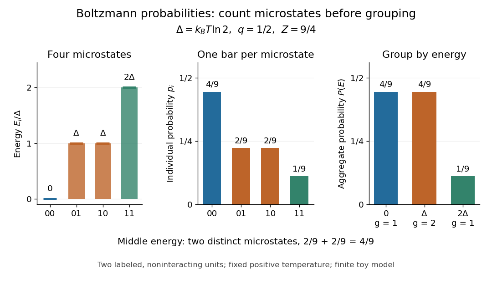

# Boltzmann distribution in a four-state system

↑ **Parent:** [Boltzmann distribution](boltzmann-distribution.md)

Consider two distinguishable, noninteracting [two-level systems](two-level-system.md), each with [energies](energy-split.md) $0$ and $\Delta>0$. Their four [microstates](microstate.md) $(0,0),(0,1),(1,0),(1,1)$ have total [energies](energy-split.md) $0,\Delta,\Delta,2\Delta$. Thus the three [energy](energy-split.md) [macrostates](macrostate.md) have [state degeneracies](state-degeneracy.md) $1,2,1$. This is a stipulated finite model, not a measured material.

Set $q=e^{-\beta\Delta}$. The four individual [Boltzmann factors](boltzmann-factor.md) are $1,q,q,q^2$, so the [partition function](canonical-partition-function.md) and aggregate [probabilities](probability.md) are

$$
Z=1+2q+q^2=(1+q)^2,\qquad
\bigl(P(0),P(\Delta),P(2\Delta)\bigr)=\frac{(1,2q,q^2)}{(1+q)^2}.
$$

Each of the two middle [microstates](microstate.md) has [probability](probability.md) $q/Z$, while their shared [energy](energy-split.md) [macrostate](macrostate.md) has [probability](probability.md) $2q/Z$.

At the [temperature](temperature-split.md) satisfying $\Delta=k_BT\ln2$, the [Boltzmann factor](boltzmann-factor.md) is $q=1/2$ and the [partition function](canonical-partition-function.md) is $Z=9/4$. Therefore

$$
\bigl(p_{00},p_{01},p_{10},p_{11}\bigr)=\left(\frac49,\frac29,\frac29,\frac19\right),\qquad
\bigl(P(0),P(\Delta),P(2\Delta)\bigr)=\left(\frac49,\frac49,\frac19\right).
$$

The middle [energy](energy-split.md) is as likely as the [ground state](ground-state.md) [energy](energy-split.md) because its [state degeneracy](state-degeneracy.md) is twice as large. Yet each individual middle [microstate](microstate.md) is only half as likely as the [ground state](ground-state.md) [microstate](microstate.md). The diagram places the four [energies](energy-split.md) beside their individual [probabilities](probability.md), then shows the sums within each [macrostate](macrostate.md).

**[Figure 19](#image-four-microstates-and-three-energy-macrostates-at-a-gap-of-k-bt-ln2). Four microstates and three energy macrostates at a gap of $k_BT\ln2$**.

The [expected value](expected-value-split.md) of [energy](energy-split.md) follows directly by weighting the three possible [energies](energy-split.md):

$$
\langle E\rangle=0\,P(0)+\Delta P(\Delta)+2\Delta P(2\Delta)
=\frac{2\Delta q+2\Delta q^2}{(1+q)^2}
=\frac{2\Delta q}{1+q}.
$$

At $q=1/2$ this is $2\Delta/3$. An individual [energy](energy-split.md) measurement still returns $0$, $\Delta$ or $2\Delta$; the [expected value](expected-value-split.md) describes the [ensemble average](expected-value-split.md), rather than a fourth possible measured [energy](energy-split.md).

## ↑ Ancestors (6)

1. [Boltzmann distribution](boltzmann-distribution.md)
2. [Thermodynamics](thermodynamics-split.md)
3. [Statistical physics](statistical-physics-split.md)
4. [Branches of physics](branches-of-physics.md)
5. [Physics](physics-split.md)
6. [Codex Wiki](split.md)
