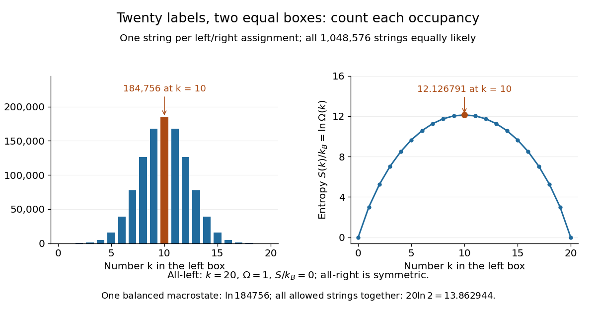

# Boltzmann entropy of a two-box occupancy

↑ **Parent:** [Boltzmann's entropy formula](boltzmann-s-entropy-formula.md)

Take $N=20$ distinguishable, labeled particles and two boxes of equal [volume](volume.md). Retain only whether each particle is in the left or right box: use a [bit](bit.md) $0$ for left and $1$ for right. Each length-20 string is one coarse [microstate](microstate.md) of this toy model. Assume the labels make [independent](independent-random-variables.md) side choices with equal [probability](probability.md), so the $2^{20}=1\,048\,576$ strings are equiprobable. Equal [volumes](volume.md) motivate these weights for noninteracting particles with no preference for either box; equal [volumes](volume.md) alone would not establish them for an arbitrary interacting [gas](gas.md).

Now retain only the number $k$ in the left box as the [macrostate](macrostate.md). Choosing which $k$ labels are left gives a [binomial coefficient](binomial-coefficient.md), so

$$
\Omega(k)=\binom{20}{k}=\frac{20!}{k!(20-k)!},\qquad
S(k)=k_B\ln\binom{20}{k},\qquad
P(k)=\frac{\binom{20}{k}}{2^{20}}.
$$

The [factorials](factorial.md) count assignments to labels; the [probability](probability.md) of a [macrostate](macrostate.md) sums the [probabilities](probability.md) of its constituent [microstates](microstate.md). This is the [binomial distribution](binomial-distribution.md) with parameters $20$ and $1/2$. The same [binomial coefficient](binomial-coefficient.md) appears in the counting of distinguishable [two-level systems](two-level-system.md), although here the [macrostate](macrostate.md) records occupancy rather than [energy](energy.md). [Mehran Kardar, MIT 8.333 (2013), lecture 12, §IV.C, equations IV.17–18: binomial microstate counts](https://ocw.mit.edu/courses/8-333-statistical-mechanics-i-statistical-mechanics-of-particles-fall-2013/0cb99318c2ed889316cdcff839759e8d_MIT8_333F13_Lec12.pdf)

The largest [binomial coefficient](binomial-coefficient.md) occurs at $k=10$, the balanced [macrostate](macrostate.md). All-left means $k=20$ and supplies just one string. Thus

$$
\begin{aligned}
\Omega(10)&=184\,756,& S(10)/k_B&=\ln184\,756\approx12.126791,\\
\Omega(20)&=1,& S(20)/k_B&=0,\\
P(10)&\approx0.176197,& P(20)&=2^{-20}\approx9.53674\times10^{-7}.
\end{aligned}
$$

There are $184\,756$ balanced strings for every all-left string, even though each individual string has the same [probability](probability.md). Exact balance has about $17.6\%$ of the total [probability](probability.md); equilibrium reasoning concerns the many [macrostates](macrostate.md) near balance too, rather than certainty of exactly ten particles on each side. The diagram compares the counts with their [natural logarithms](natural-logarithm.md).

**[Figure 26](#image-counts-and-boltzmann-entropies-of-the-occupancy-macrostates-of-twenty-labeled-particles). Counts and Boltzmann entropies of the occupancy macrostates of twenty labeled particles**.

Four fair, [independent](independent-random-variables.md) coins give a smaller worked example with the same [binomial distribution](binomial-distribution.md). If $k$ is the number of heads, the five [macrostates](macrostate.md) $k=0,1,2,3,4$ contain respectively $1,4,6,4,1$ [microstates](microstate.md). Their [probabilities](probability.md) are respectively $1/16,4/16,6/16,4/16,1/16$. In particular, two heads is one [macrostate](macrostate.md) containing six ordered coin sequences, with [Boltzmann entropy](boltzmann-s-entropy-formula.md) $k_B\ln6$ in this counting analogy. A prescribed ordered sequence has one realization. The next diagram enumerates the same sixteen strings as left/right assignments.

## ↑ Ancestors (7)

1. [Boltzmann's entropy formula](boltzmann-s-entropy-formula.md)
2. [Entropy](entropy.md)
3. [Thermodynamics](thermodynamics-split.md)
4. [Statistical physics](statistical-physics-split.md)
5. [Branches of physics](branches-of-physics.md)
6. [Physics](physics-split.md)
7. [Codex Wiki](split.md)

## ← Incoming links (2)

- [Boltzmann entropy when a restriction is removed](boltzmann-entropy-when-a-restriction-is-removed.md)
- [Scope of Boltzmann's entropy formula](scope-of-boltzmann-s-entropy-formula.md)
