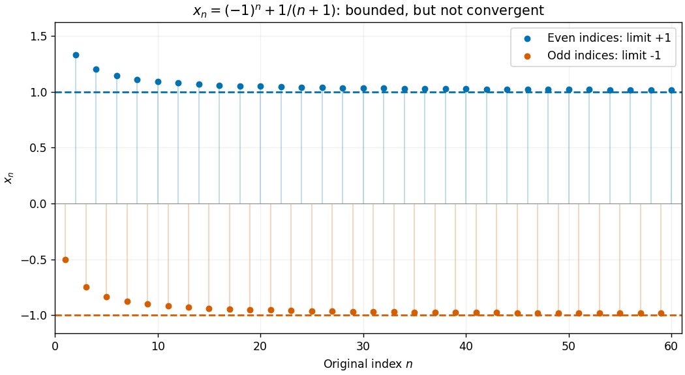

# Bolzano-Weierstrass theorem

↑ **Parent:** [Sequence and series](sequence-and-series-split.md)  
ⓦ [Wiki](https://en.wikipedia.org/wiki/Bolzano-Weierstrass_theorem)

Every [bounded sequence](bounded-sequence.md) of [real numbers](real-number.md) contains a [subsequence](subsequence.md) with a finite [limit of a sequence](limit-of-a-sequence.md). If $|x_n|\leq M$ for every [positive integer](positive-integer.md) $n$, there are [integers](integer-split.md) $n_1<n_2<\cdots$ and a [real number](real-number.md) $\ell$ such that

$$
\lim_{j\to\infty}x_{n_j}=\ell.
$$

The increasing indices matter: a [subsequence](subsequence.md) retains the original order and selects terms arbitrarily far along the original [sequence](sequence.md). The theorem guarantees the existence of at least one such selection; it does not claim that the entire [sequence](sequence.md) converges or that the [subsequential limit](subsequential-limit.md) is unique.[Basic Analysis, Volume I by Jiří Lebl, §2.3.3, Theorem 2.3.8: every bounded real sequence has a convergent subsequence](basic-analysis-introduction-to-real-analysis-volume-i-by-jiri-lebl/2-3-limit-superior-limit-inferior-and-bolzano-weierstrass.md)

For example, the [bounded sequence](bounded-sequence.md) $x_n=(-1)^n+1/(n+1)$ has two distinct [subsequential limits](subsequential-limit.md):

$$
x_{2j}=1+\frac1{2j+1}\longrightarrow1,\qquad
x_{2j-1}=-1+\frac1{2j}\longrightarrow-1.
$$

The even terms form a [convergent sequence](convergent-sequence.md), and so do the odd terms. The full [sequence](sequence.md) cannot have a [limit of a sequence](limit-of-a-sequence.md) because its two [subsequences](subsequence.md) have different limits. Its [limit superior](limit-superior.md) is $1$ and its [limit inferior](limit-inferior.md) is $-1$.

**[Figure 9](#image-a-bounded-sequence-can-have-two-different-subsequential-limits). A bounded sequence can have two different subsequential limits**. Terms of $x_n=(-1)^n+1/(n+1)$ are colored by even or odd index. The dashed lines mark $1$ and $-1$. Each color approaches its own limit, while the entire [sequence](sequence.md) keeps moving between the two groups. The values are exact model calculations, not observations.

This is useful when a construction produces many candidate points but does not immediately produce a [convergent sequence](convergent-sequence.md). For a [continuous function](continuous-function.md) on a nonempty closed bounded [feasible region](feasible-region.md) in a finite-dimensional [Euclidean space](euclidean-norm.md), take a [sequence](sequence.md) whose objective values approach the [infimum](infimum.md). A [convergent subsequence](convergent-subsequence.md) supplies a candidate point; a [closed subset](closed-set.md) retains that point, and [continuity](continuous-function.md) passes the objective values to the [limit of a sequence](limit-of-a-sequence.md). This is the mechanism behind attainment in the [extreme value theorem](extreme-value-theorem.md). The [diagonal subsequence argument](diagonal-subsequence-argument.md) extends the real-sequence theorem to finite-dimensional [Euclidean space](euclidean-norm.md).

The theorem is named for [Bernard Bolzano](bernard-bolzano.md) and [Karl Weierstrass](karl-weierstrass.md).[Basic Analysis, Volume I by Jiří Lebl, opening footnote to §2.3: the theorem's two namesakes](basic-analysis-introduction-to-real-analysis-volume-i-by-jiri-lebl/2-3-limit-superior-limit-inferior-and-bolzano-weierstrass.md)

**Table of contents**

- [Nested intervals extract a convergent subsequence](nested-intervals-extract-a-convergent-subsequence.md)
- [Bounded rational sequences can converge outside the rationals](bounded-rational-sequences-can-converge-outside-the-rationals.md)
- [Infinite-dimensional bounded sequences can lack convergent subsequences](infinite-dimensional-bounded-sequences-can-lack-convergent-subsequences.md)
- [Extended real subsequence theorem](extended-real-subsequence-theorem.md)
- [Diagonal subsequence argument](diagonal-subsequence-argument.md)
- [Unique subsequential limit of a bounded sequence](unique-subsequential-limit-of-a-bounded-sequence.md)

## ↑ Ancestors (6)

1. [Sequence and series](sequence-and-series-split.md)
2. [Real analysis](real-analysis-split.md)
3. [Analysis](analysis-split.md)
4. [Area of mathematics](area-of-mathematics.md)
5. [Mathematics](mathematics-split.md)
6. [Codex Wiki](split.md)

## ← Incoming links (35)

- [Cauchy sequence](cauchy-sequence.md)
- [Diagonal compactness for bounded Lipschitz functions](diagonal-compactness-for-bounded-lipschitz-functions.md)
- [Extended real subsequence theorem](extended-real-subsequence-theorem.md)
- [Extreme value theorem](extreme-value-theorem.md)
- [Heine-Borel theorem](heine-borel-theorem.md)
- [Solution](past-exam-of-the-mathematics-course-of-the-university-of-cambridge/2002/ia/paper-1/10c/solution.md)
- [Solution](past-exam-of-the-mathematics-course-of-the-university-of-cambridge/2002/ia/paper-1/4c/solution.md)
- [Solution](past-exam-of-the-mathematics-course-of-the-university-of-cambridge/2003/ib/paper-1/1f/i/solution.md)
- [Solution](past-exam-of-the-mathematics-course-of-the-university-of-cambridge/2006/ia/paper-1/11f/solution.md)
- [Solution](past-exam-of-the-mathematics-course-of-the-university-of-cambridge/2007/ia/paper-1/11e/solution.md)
- [Solution](past-exam-of-the-mathematics-course-of-the-university-of-cambridge/2007/ia/paper-1/12d/solution.md)
- [Solution](past-exam-of-the-mathematics-course-of-the-university-of-cambridge/2007/iii/paper-8/1/solution.md)
- [Solution](past-exam-of-the-mathematics-course-of-the-university-of-cambridge/2008/ib/paper-4/13f/solution.md)
- [Solution](past-exam-of-the-mathematics-course-of-the-university-of-cambridge/2008/ib/paper-4/4e/solution.md)
- [Solution](past-exam-of-the-mathematics-course-of-the-university-of-cambridge/2009/ib/paper-4/13e/solution.md)
- [Solution](past-exam-of-the-mathematics-course-of-the-university-of-cambridge/2011/ia/paper-1/3f/a/solution.md)
- [Solution](past-exam-of-the-mathematics-course-of-the-university-of-cambridge/2011/ii/paper-3/12f/ii/solution.md)
- [Solution](past-exam-of-the-mathematics-course-of-the-university-of-cambridge/2014/ib/paper-1/11f/solution.md)
- [Solution](past-exam-of-the-mathematics-course-of-the-university-of-cambridge/2014/ib/paper-2/12f/i/solution.md)
- [Solution](past-exam-of-the-mathematics-course-of-the-university-of-cambridge/2015/ia/paper-1/10d/a/solution.md)
- [Solution](past-exam-of-the-mathematics-course-of-the-university-of-cambridge/2016/ia/paper-1/9e/solution.md)
- [Solution](past-exam-of-the-mathematics-course-of-the-university-of-cambridge/2016/iii/paper-211/3/c/solution.md)
- [Solution](past-exam-of-the-mathematics-course-of-the-university-of-cambridge/2017/iii/paper-339/1/f/solution.md)
- [Solution](past-exam-of-the-mathematics-course-of-the-university-of-cambridge/2018/ib/paper-4/3f/solution.md)
- [Solution](past-exam-of-the-mathematics-course-of-the-university-of-cambridge/2018/ii/paper-4/22f/a/solution.md)
- [Solution](past-exam-of-the-mathematics-course-of-the-university-of-cambridge/2019/ia/paper-1/3e/i/solution.md)
- [Solution](past-exam-of-the-mathematics-course-of-the-university-of-cambridge/2019/ia/paper-1/3e/iii/solution.md)
- [Solution](past-exam-of-the-mathematics-course-of-the-university-of-cambridge/2020/ia/paper-1/10f/a/solution.md)
- [Solution](past-exam-of-the-mathematics-course-of-the-university-of-cambridge/2020/ia/paper-1/10f/b/solution.md)
- [Solution](past-exam-of-the-mathematics-course-of-the-university-of-cambridge/2020/ia/paper-1/10f/c/solution.md)
- [Solution](past-exam-of-the-mathematics-course-of-the-university-of-cambridge/2021/ia/paper-1/4f/solution.md)
- [Solution](past-exam-of-the-mathematics-course-of-the-university-of-cambridge/2021/ii/paper-1/22h/b/solution.md)
- [Solution](past-exam-of-the-mathematics-course-of-the-university-of-cambridge/2022/ia/paper-1/10d/solution.md)
- [Subsequence selection as regular matrix summability](subsequence-selection-as-regular-matrix-summability.md)
- [Subsequential limit](subsequential-limit.md)
