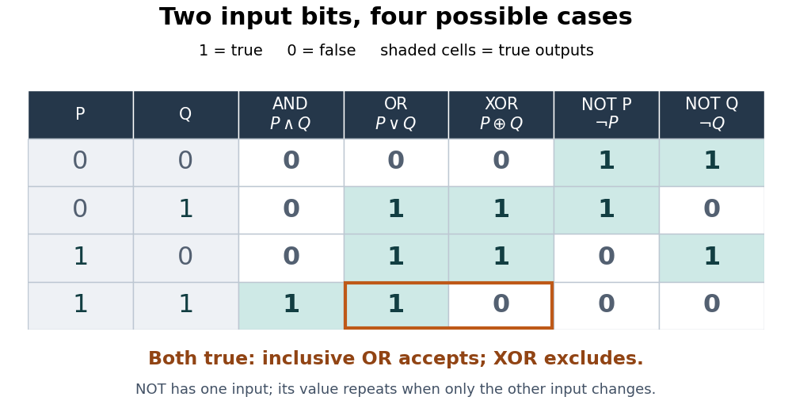

# Boolean operation

↑ **Parent:** [Theoretical computer science](theoretical-computer-science-split.md)

A [Boolean operation](boolean-operation.md) is a [Boolean function](boolean-function.md) taking [truth values](truth-value.md) encoded as [bits](bit.md): $0$ means false and $1$ means true. These operations supply the concrete two-valued interpretation of a [Boolean algebra](boolean-algebra.md). A [Boolean valuation](boolean-valuation.md) fixes the inputs; a [truth table](truth-table.md) lists every possible input. With two input [bits](bit.md) there are four rows.

The basic [logical connectives](logical-connective.md) are [logical conjunction](logical-conjunction.md) (AND, $P\wedge Q$, both true), [logical disjunction](logical-disjunction.md) (OR, $P\vee Q$, at least one true), [exclusive or](exclusive-or.md) (XOR, $P\oplus Q$, exactly one true), and [logical negation](negation.md) (NOT, $\neg P$, the opposite value). OR is inclusive: it accepts the case where both inputs are true.[Discrete Mathematics: An Open Introduction (3rd edition) by Oscar Levin; Discrete Mathematics: An Open Introduction, 3rd edition by Oscar Levin, §3.1, Truth Tables: conjunction, disjunction and negation tables](discrete-mathematics-an-open-introduction-3rd-edition-by-oscar-levin/3-1-propositional-logic.md)

**[Figure 1](#image-four-input-pairs-distinguish-logical-conjunction-inclusive-logical-disjunction-exclusive-or-and-logical-negation). Four input pairs distinguish logical conjunction, inclusive logical disjunction, exclusive or, and logical negation**.

For an original program-condition example, let $P$ mean “the backup is recent” and $Q$ mean “the backup is verified”. A rule requiring a recent, verified backup uses [logical conjunction](logical-conjunction.md); one accepting either qualification uses [logical disjunction](logical-disjunction.md). A rule flagging a mismatch between the two qualifications uses [exclusive or](exclusive-or.md). A recent, verified backup gives $(P,Q)=(1,1)$: AND and OR accept it, while XOR does not flag it. The last row of the [truth table](truth-table.md) makes this difference explicit.

The same small [Boolean operations](boolean-operation.md) build larger tests and [Boolean circuits](boolean-circuit.md). In a [programming language](programming-language-split.md), the value of a condition and the procedure for evaluating it both matter. For Boolean operands, [Python](python-programming-language.md)'s `and`, `or`, and `not` implement these [logical connectives](logical-connective.md). Evaluation proceeds from the left; `and` skips its right operand if the left is false, and `or` skips it if the left is true. More generally, `and` and `or` return an operand, whereas `not` returns a Boolean.[Python 3.14 documentation; Python Language Reference, version 3.14, §6.11 Boolean operations: evaluation order and returned operands](python-3-14-documentation/expressions-python-3-14-language-reference.md)

For example, the [Python](python-programming-language.md) condition `denominator != 0 and numerator / denominator > 2` avoids [division](division-mathematics.md) by zero because the [logical conjunction](logical-conjunction.md)'s second test is evaluated only when the first succeeds. Reversing the tests preserves the abstract [truth table](truth-table.md) for defined operands but can raise a division-by-zero error handled through [exception handling](exception-handling.md). A rewrite involving a [side effect](side-effect-computer-science.md) must also preserve the needed evaluation behavior.

**Table of contents**

- [Boolean operations on events](boolean-operations-on-events.md)
- [Exclusive or](exclusive-or.md)
  - [Exclusive or toggles and parity](exclusive-or-toggles-and-parity.md)
- [Negation](negation.md)
- [De Morgan's laws](de-morgan-s-laws.md)
  - [De Morgan dual of a Boolean function](de-morgan-dual-of-a-boolean-function.md)

## ↑ Ancestors (3)

1. [Theoretical computer science](theoretical-computer-science-split.md)
2. [Computer science](computer-science-split.md)
3. [Codex Wiki](split.md)

## ← Incoming links (6)

- [Boolean circuit](boolean-circuit.md)
- [Boolean formula](boolean-formula.md)
- [Boolean operation](boolean-operation.md)
- [Boolean operations on events](boolean-operations-on-events.md)
- [Solution](past-exam-of-the-mathematics-course-of-the-university-of-cambridge/2017/iii/paper-121/1/ii/solution.md)
- [Solution](past-exam-of-the-mathematics-course-of-the-university-of-cambridge/2017/iii/paper-121/1/iv/solution.md)
