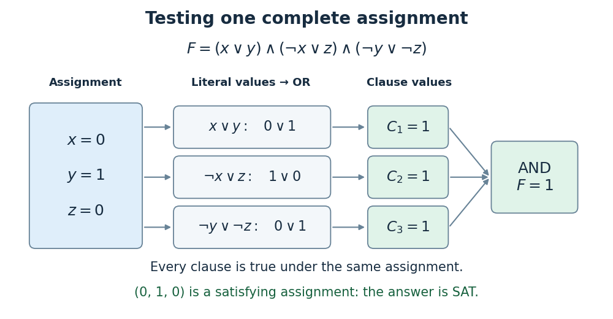
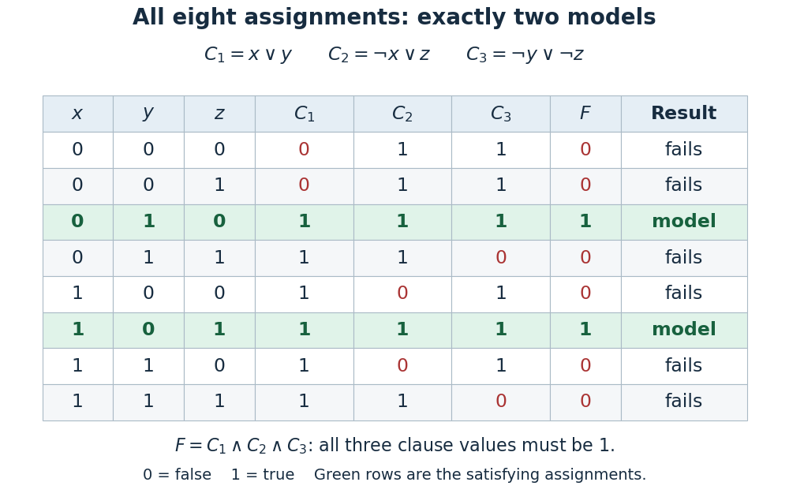

# Boolean satisfiability problem

↑ **Parent:** [NP-completeness](np-completeness.md)  
ⓦ [Wiki](https://en.wikipedia.org/wiki/Boolean_satisfiability_problem)

The [Boolean satisfiability problem](boolean-satisfiability-problem.md) asks whether a [Boolean formula](boolean-formula.md) has an assignment making it true. A complete assignment is a [Boolean valuation](boolean-valuation.md): it gives every [Boolean variable](boolean-variable.md) a [truth value](truth-value.md), consistently at all occurrences. A [satisfying assignment](satisfying-assignment.md), also called a [model of a Boolean formula](satisfying-assignment.md), makes the entire [Boolean formula](boolean-formula.md) true. A solver's answer `SAT` asserts that at least one [satisfying assignment](satisfying-assignment.md) exists; `UNSAT` asserts that the input is an [unsatisfiable Boolean formula](unsatisfiable-boolean-formula.md). These are statements about existence, rather than the [truth value](truth-value.md) under one particular [Boolean valuation](boolean-valuation.md).

For [conjunctive normal form](conjunctive-normal-form.md), or [CNF](conjunctive-normal-form.md), write

$$
F=C_1\land\cdots\land C_m,
\qquad C_i=\ell_{i1}\lor\cdots\lor\ell_{ik_i}.
$$

Each [Boolean literal](boolean-literal.md) $\ell$ is a [Boolean variable](boolean-variable.md) or its [logical negation](negation.md). Each [Boolean clause](clause-of-a-boolean-formula.md) uses inclusive [logical disjunction](logical-disjunction.md): one true [Boolean literal](boolean-literal.md) suffices. The outer [logical conjunction](logical-conjunction.md) requires every [Boolean clause](clause-of-a-boolean-formula.md) to succeed under the same [Boolean valuation](boolean-valuation.md). Choosing a different [Boolean valuation](boolean-valuation.md) for each [Boolean clause](clause-of-a-boolean-formula.md) would answer a different question.

Consider the original three-[Boolean variable](boolean-variable.md) example

$$
F=(x\lor y)\land(\neg x\lor z)\land(\neg y\lor\neg z),
\qquad C_1=x\lor y,\quad C_2=\neg x\lor z,\quad C_3=\neg y\lor\neg z.
$$

At the [Boolean valuation](boolean-valuation.md) $(x,y,z)=(0,1,0)$, the [Boolean literals](boolean-literal.md) in $C_1$ have values $(0,1)$, those in $C_2$ have values $(1,0)$, and those in $C_3$ have values $(0,1)$. Every [Boolean clause](clause-of-a-boolean-formula.md) therefore has [truth value](truth-value.md) one, so $F$ has [truth value](truth-value.md) one: this is a [satisfying assignment](satisfying-assignment.md).

**[Figure 7](#image-an-original-satisfying-assignment-evaluated-through-boolean-literals-three-boolean-clauses-and-their-logical-conjunction). An original satisfying assignment evaluated through Boolean literals, three Boolean clauses, and their logical conjunction**.

The complete [truth table](truth-table.md) has $2^3=8$ [Boolean valuations](boolean-valuation.md). Exactly two are [satisfying assignments](satisfying-assignment.md): $(0,1,0)$ and $(1,0,1)$. In particular, $(1,1,1)$ satisfies the first two [Boolean clauses](clause-of-a-boolean-formula.md) but falsifies the third, so satisfying most [Boolean clauses](clause-of-a-boolean-formula.md) does not suffice for [SAT](boolean-satisfiability-problem.md). That different objective belongs to [maximum satisfiability](maximum-satisfiability.md).

**[Figure 8](#image-all-eight-boolean-valuations-of-the-original-cnf-example-with-its-two-satisfying-assignments-highlighted). All eight Boolean valuations of the original CNF example, with its two satisfying assignments highlighted**.

A short proof of completeness avoids listing all eight rows. If $x=0$, the [Boolean clause](clause-of-a-boolean-formula.md) $C_1$ forces $y=1$, after which $C_3$ forces $z=0$; $C_2$ is already true. If $x=1$, $C_2$ forces $z=1$, after which $C_3$ forces $y=0$; $C_1$ is already true. These two cases exhaust the [truth values](truth-value.md) of $x$ and produce precisely the two [satisfying assignments](satisfying-assignment.md) above.

[Verifying a satisfying assignment](verifying-a-satisfying-assignment.md) and finding a [satisfying assignment](satisfying-assignment.md) are different tasks. Given a candidate, evaluate the [Boolean formula](boolean-formula.md) once; finding a candidate requires choosing compatible [truth values](truth-value.md) across all its [Boolean clauses](clause-of-a-boolean-formula.md). The [Cook-Levin theorem](cook-levin-theorem.md) says that general [SAT](boolean-satisfiability-problem.md) is [NP-complete](np-completeness.md), even though a proposed [satisfying assignment](satisfying-assignment.md) is efficiently checkable. Its proof encodes a bounded [nondeterministic computation](nondeterministic-turing-machine.md) as a [Boolean formula](boolean-formula.md) whose [satisfying assignments](satisfying-assignment.md) describe accepting computations. [Stephen A. Cook](stephen-a-cook.md)'s 1971 paper established this connection between [computational complexity theory](computational-complexity-theory.md) and [propositional logic](propositional-logic.md).[The Complexity of Theorem-Proving Procedures by Stephen A. Cook, 1971, §1, Theorem 1 and proof, pp. 2–3 of the revision-3 transcription: CNF encodes accepting computations](the-complexity-of-theorem-proving-procedures-by-stephen-a-cook.md)

A concrete use is checking finite configuration rules. Let $x$ mean that an optional feature is enabled, $y$ that a fallback is selected, and $z$ that the feature's required component is installed. Require a feature or fallback, require the component whenever the feature is enabled, and forbid using the fallback with that component. [Logical implication](logical-implication.md) rewrites the second rule $x\to z$ as $\neg x\lor z$; [De Morgan's laws](de-morgan-s-laws.md) rewrite the third rule $\neg(y\land z)$ as $\neg y\lor\neg z$. Their [logical conjunction](logical-conjunction.md) is exactly $F$, so its two [satisfying assignments](satisfying-assignment.md) give the two allowed configurations. The usefulness of [SAT](boolean-satisfiability-problem.md) lies in expressing local rules uniformly while demanding one globally consistent [Boolean valuation](boolean-valuation.md). The conclusion concerns exactly these encoded rules.

**Table of contents**

- [Satisfying assignment](satisfying-assignment.md)
  - [Verifying a satisfying assignment](verifying-a-satisfying-assignment.md)
- [Unsatisfiable Boolean formula](unsatisfiable-boolean-formula.md)
- [Partial Boolean assignment](partial-boolean-assignment.md)
- [2-satisfiability](2-satisfiability.md)
- [Integer programming formulation of satisfiability](integer-programming-formulation-of-satisfiability.md)
- [Maximum satisfiability](maximum-satisfiability.md)
  - [Literal-frequency greedy approximation for MAX-SAT](literal-frequency-greedy-approximation-for-max-sat.md)
- [2UN-SAT](2un-sat.md)
- [Maximum 2-satisfiability](maximum-2-satisfiability.md)
  - [Golden ratio approximation for MAX-2SAT](golden-ratio-approximation-for-max-2sat.md)
  - [Seven-clause gadget for MAX-2SAT](seven-clause-gadget-for-max-2sat.md)
- [Boolean formula](boolean-formula.md)
  - [Disjunctive normal form](disjunctive-normal-form.md)
  - [Conjunctive normal form](conjunctive-normal-form.md)
    - [Tseytin transformation](tseytin-transformation.md)
  - [Clause of a Boolean formula](clause-of-a-boolean-formula.md)
  - [Boolean literal](boolean-literal.md)
  - [Boolean variable](boolean-variable.md)
- [3-SAT](3-sat.md)
- [Horn clause](horn-clause.md)
  - [Horn-SAT](horn-sat.md)
    - [Horn-SAT forward-chaining algorithm](horn-sat-forward-chaining-algorithm.md)

## ↑ Ancestors (8)

1. [NP-completeness](np-completeness.md)
2. [NP-hardness](np-hardness.md)
3. [Polynomial-time many-one reduction](polynomial-time-many-one-reduction.md)
4. [Polynomial-time reduction](polynomial-time-reduction.md)
5. [Computational complexity theory](computational-complexity-theory.md)
6. [Theoretical computer science](theoretical-computer-science-split.md)
7. [Computer science](computer-science-split.md)
8. [Codex Wiki](split.md)

## ← Incoming links (10)

- [2-satisfiability](2-satisfiability.md)
- [3-SAT](3-sat.md)
- [Boolean formula](boolean-formula.md)
- [Boolean satisfiability problem](boolean-satisfiability-problem.md)
- [Maximum satisfiability](maximum-satisfiability.md)
- [Partial Boolean assignment](partial-boolean-assignment.md)
- [Solution](past-exam-of-the-mathematics-course-of-the-university-of-cambridge/2010/iii/paper-35/4/solution.md)
- [Solution](past-exam-of-the-mathematics-course-of-the-university-of-cambridge/2013/iii/paper-59/1/a/solution.md)
- [Solution](past-exam-of-the-mathematics-course-of-the-university-of-cambridge/2024/iii/paper-124/1/i/solution.md)
- [Satisfying assignment](satisfying-assignment.md)
