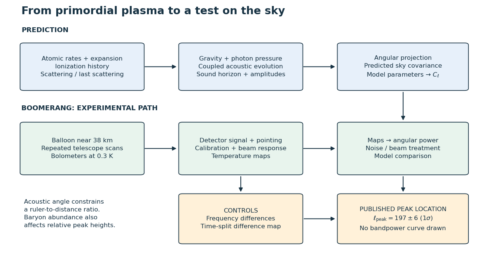

# BOOMERANG acoustic-peak measurement

↑ **Parent:** [Physical cosmology](physical-cosmology.md)

BOOMERANG's 1998 Antarctic balloon flight scanned a low-dust region with a microwave telescope near $38\,\mathrm{km}$ and [bolometers](bolometer.md) at $0.3\,\mathrm K$. Ground beam measurements and microwave [angular dipole](angular-dipole.md) calibration connected signals to sky [temperature](temperature-split.md). Frequency-map and time-split differences tested contamination. The 2000 paper fitted the [Cosmic microwave background power spectrum](cosmic-microwave-background-power-spectrum.md), finding $\ell_{\rm peak}=197\pm6$ at one standard deviation. Its near-flat-geometry inference used a chosen model family and parameter priors; secondary peaks were not yet established.[de Bernardis et al. (2000), PDF pp.3–9: apparatus, controls, peak fit](a-flat-universe-from-high-resolution-maps-of-the-cosmic-microwave-background-radiation-by-p-de-bernardis-and-others.md)

**[Figure 2](#image-primordial-plasma-predictions-meet-a-calibrated-sky-measurement). Primordial-plasma predictions meet a calibrated sky measurement**. Original functional diagram. The numerical result is the published peak location; no experimental bandpowers are simulated.

## ↑ Ancestors (5)

1. [Physical cosmology](physical-cosmology.md)
2. [Cosmology](cosmology-split.md)
3. [Branches of physics](branches-of-physics.md)
4. [Physics](physics-split.md)
5. [Codex Wiki](split.md)

## ← Incoming links (2)

- [Angular sound-horizon degeneracy](angular-sound-horizon-degeneracy.md)
- [Peebles primordial-plasma predictions](peebles-primordial-plasma-predictions.md)
