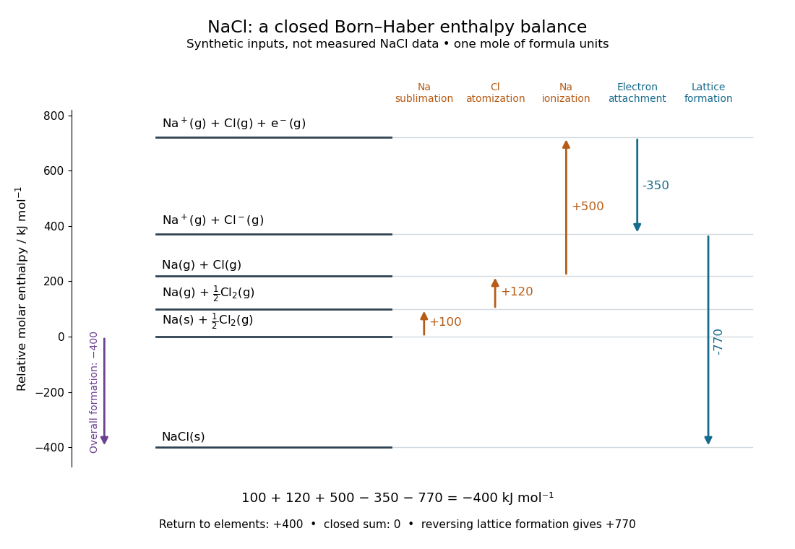

# Born-Haber cycle

↑ **Parent:** [Lattice energy](lattice-energy.md)

A [Born-Haber cycle](born-haber-cycle.md) uses [Hess's law](hess-s-law.md) to infer a [lattice energy](lattice-energy.md) from measurable [enthalpy](enthalpy.md) differences and isolated-species data. The motivating difficulty is that separating a [mole](mole-unit.md) of an [ionic crystal](ionic-crystal.md) into mutually separated gaseous [ions](ion.md) is not a convenient direct [calorimetry](calorimetry.md) experiment. Instead, compare two accounting routes between the same elemental reference states and the same [solid](solid.md). Because [enthalpy](enthalpy.md) is a [state function](state-function.md), the signed differences close exactly when all inputs describe compatible states. These routes do not assert a [reaction mechanism](reaction-mechanism.md) or a temporal sequence of [reaction intermediates](reaction-intermediate.md).[“The Born-Haber Cycle”, Figure 7.13 and Table 7.4](chemistry-2e-by-paul-flowers-and-others/7-5-strengths-of-ionic-and-covalent-bonds.md)

For one [mole](mole-unit.md) of [sodium chloride](sodium-chloride.md) [formula units](formula-unit.md), the overall formation reaction is

$$
\mathrm{Na}(s)+\tfrac12\mathrm{Cl}_2(g)\longrightarrow\mathrm{NaCl}(s),\qquad F=\Delta H_{\rm f}^{\circ}.
$$

The [stoichiometry](stoichiometry.md) requires half a [mole](mole-unit.md) of diatomic [chlorine](chlorine.md) [molecules](molecule.md), supplying one [mole](mole-unit.md) of [chlorine](chlorine.md) [chemical atoms](atom-physics.md). A half coefficient counts an [amount of substance](amount-of-substance.md); it does not describe half of an individual [molecule](molecule.md). Write each auxiliary [chemical reaction](chemical-reaction.md) with its own sign:

$$
\begin{aligned}
\mathrm{Na}(s)&\longrightarrow\mathrm{Na}(g) && S>0,\\
\tfrac12\mathrm{Cl}_2(g)&\longrightarrow\mathrm{Cl}(g) && B>0,\\
\mathrm{Na}(g)&\longrightarrow\mathrm{Na}^+(g)+e^-(g) && I>0,\\
\mathrm{Cl}(g)+e^-(g)&\longrightarrow\mathrm{Cl}^-(g) && A=\Delta H_{\rm attach}^{\circ}<0,\\
\mathrm{Na}^+(g)+\mathrm{Cl}^-(g)&\longrightarrow\mathrm{NaCl}(s) && L_{\rm form}<0.
\end{aligned}
$$

Here $S$ is the [sublimation](sublimation.md) [enthalpy](enthalpy.md), $B$ the [enthalpy of atomization](enthalpy-of-atomization.md) of [chlorine](chlorine.md) per [mole](mole-unit.md) of [chemical atoms](atom-physics.md), and $I$ the molar ionization [enthalpy](enthalpy.md) represented by the [ionization energy](ionization-energy.md) input in elementary treatments. If the [bond-dissociation energy](bond-dissociation-energy.md) table gives the compatible molar [enthalpy](enthalpy.md) for $\mathrm{Cl}_2(g)\to2\mathrm{Cl}(g)$, use half that number for $B$. Both [ions](ion.md) in the last step are gaseous, and no aqueous [hydration of ions](hydration-of-ions.md) belongs in that step.

Adding these equations cancels the gaseous [chemical atoms](atom-physics.md), the gaseous [ions](ion.md) and the free [Electron](electron.md), leaving precisely the overall formation reaction. Thus

$$
F=S+B+I+A+L_{\rm form},\qquad
L_{\rm diss}=-L_{\rm form}=S+B+I+A-F.
$$

The closed traversal returns from the [solid](solid.md) to the elemental reference states, adding $-F$; therefore $S+B+I+A+L_{\rm form}-F=0$. Notice that the signed attachment term $A$ is negative. Substituting a positive spectroscopic [electron affinity](electron-affinity.md) for $A$ would reverse the attachment contribution.

**[Figure 18](#image-sodium-chloride-born-haber-enthalpy-cycle). A closed Born-Haber cycle for sodium chloride using explicitly synthetic molar enthalpies: levels represent complete material inventories, and horizontal position is bookkeeping rather than a reaction coordinate**.

The diagram deliberately uses invented, internally consistent inputs in $\mathrm{kJ\,mol^{-1}}$: $S=100$, $B=120$, $I=500$, $A=-350$ and $F=-400$. Preparation of separated gaseous [ions](ion.md) raises the [enthalpy](enthalpy.md) by $370$, so $L_{\rm form}=-770$ and $L_{\rm diss}=+770$. The closure check is $100+120+500-350-770+400=0$. These numbers are not measured [sodium chloride](sodium-chloride.md) data and do not replace the source's $769\,\mathrm{kJ\,mol^{-1}}$ example in [lattice energy](lattice-energy.md). Every level retains one [sodium](sodium.md) nucleus, one [chlorine](chlorine.md) nucleus and zero total [electric charge](electric-charge.md); the ionization level explicitly retains the free [Electron](electron.md).

**Table of contents**

- [Lattice enthalpy from solution calorimetry](lattice-enthalpy-from-solution-calorimetry.md)
  - [Potassium chloride](potassium-chloride.md)

## ↑ Ancestors (5)

1. [Lattice energy](lattice-energy.md)
2. [Ionic bonding](ionic-bonding.md)
3. [Chemical bond](chemical-bond.md)
4. [Chemistry](chemistry-split.md)
5. [Codex Wiki](split.md)

## ← Incoming links (3)

- [Born-Haber cycle](born-haber-cycle.md)
- [Electron attachment enthalpy](electron-attachment-enthalpy.md)
- [Lattice energy](lattice-energy.md)
