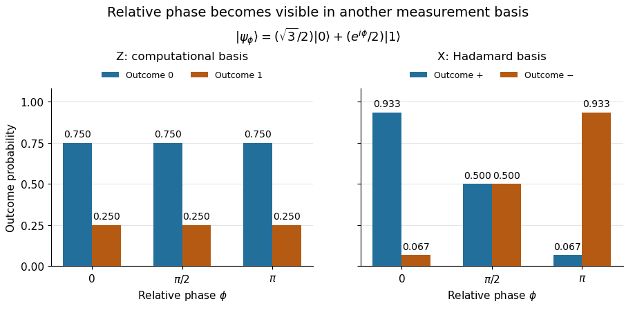

# Born rule

↑ **Parent:** [Probability amplitude](probability-amplitude.md)  
ⓦ [Wiki](https://en.wikipedia.org/wiki/Born_rule)

The Born rule connects a [quantum state](quantum-state.md) to measurement [probabilities](probability.md). Let $\{|j\rangle\}$ be a complete [orthonormal basis](orthonormal-basis.md), finite or countably infinite, for a [Hilbert space](hilbert-space-split.md), and let

$$
|\psi\rangle=\sum_j a_j|j\rangle,
\qquad
a_j=\langle j|\psi\rangle,
\qquad
\langle\psi|\psi\rangle=1.
$$

An ideal measurement distinguishing these basis vectors returns label $j$ with [probability](probability.md)

$$
p_j=|a_j|^2=|\langle j|\psi\rangle|^2.
$$

This assignment is a physical measurement rule. Its compatibility with total [probability](probability.md) one follows from [orthonormality](orthonormal-set.md) and normalization:

$$
\sum_jp_j=\sum_j|a_j|^2
=\sum_{j,k}a_j^*a_k\langle j|k\rangle
=\langle\psi|\psi\rangle=1.
$$

The [probabilities](probability.md) are the squared [moduli](modulus.md), not the amplitudes themselves or the squares $a_j^2$. [Watrous, IBM Quantum Learning, Quantum information, Measuring quantum states](https://quantum.cloud.ibm.com/learning/en/courses/basics-of-quantum-information/single-systems/quantum-information).

If the basis is an [eigenbasis](eigenbasis.md) of an [observable](observable.md), the reported numerical value is its [eigenvalue](eigenvalue.md). Several vectors can share one [eigenvalue](eigenvalue.md); the [probability](probability.md) of that value is then the sum over the corresponding basis labels. More generally, a [projective measurement](projective-measurement.md) with [orthogonal projections](orthogonal-projection.md) $P_r$ assigns

$$
p_r=\langle\psi|P_r|\psi\rangle=\|P_r|\psi\rangle\|^2,
\qquad
p_r=\operatorname{Tr}(\rho P_r)
$$

for a [pure state](pure-state.md) and a general [density matrix](density-matrix-split.md) $\rho$, respectively. This also covers [mixed states](mixed-state.md) and degenerate [eigenspaces](eigenspace.md). The [Born rule](born-rule.md) determines outcome statistics; the ideal conditional state change is specified separately by the [Lüders rule](luders-rule.md). See [projective measurement](projective-measurement.md) for that formulation and its assumptions. [Watrous, IBM Quantum Learning, Mathematical formulations of measurements, Projective measurements](https://quantum.cloud.ibm.com/learning/en/courses/general-formulation-of-quantum-information/general-measurements/formulations-of-measurements).

For a worked example, take the normalized [qubit](qubit.md) [quantum state](quantum-state.md)

$$
|\psi_\phi\rangle=\frac{\sqrt3}{2}|0\rangle+\frac{e^{i\phi}}2|1\rangle.
$$

The squared [moduli](modulus.md) add to $3/4+1/4=1$. A [computational-basis measurement](quantum-measurement-in-the-computational-basis.md), equivalently a measurement of the $Z$ [Pauli matrix](pauli-matrices.md), has

$$
p_0=\left|\frac{\sqrt3}{2}\right|^2=\frac34,
\qquad
p_1=\left|\frac{e^{i\phi}}2\right|^2=\frac14.
$$

These [probabilities](probability.md) do not depend on the relative [quantum phase](quantum-phase.md) $\phi$. Now choose the [Hadamard basis](hadamard-basis.md)

$$
|\pm\rangle=\frac{|0\rangle\pm|1\rangle}{\sqrt2},
$$

whose vectors are [eigenstates](eigenstate.md) of the $X$ [Pauli matrix](pauli-matrices.md), also used by the [Pauli X gate](pauli-x-gate.md). The new [probability amplitudes](probability-amplitude.md) and [probabilities](probability.md) are

$$
b_\pm=\langle\pm|\psi_\phi\rangle
=\frac{\sqrt3\pm e^{i\phi}}{2\sqrt2},
\qquad
p_\pm=|b_\pm|^2
=\frac12\pm\frac{\sqrt3}{4}\cos\phi.
$$

Both [probabilities](probability.md) are nonnegative and their sum is one. The relative [quantum phase](quantum-phase.md) becomes visible because the two [probability amplitudes](probability-amplitude.md) add before their squared [modulus](modulus.md) is taken:
- At $\phi=0$, $p_+=(2+\sqrt3)/4\simeq0.9330127$ and $p_-\simeq0.0669873$.
- At $\phi=\pi/2$, $p_+=p_-=1/2$.
- At $\phi=\pi$, $p_+\simeq0.0669873$ and $p_-\simeq0.9330127$.

**[Figure 5](#image-the-same-qubit-preparation-has-phase-independent-z-probabilities-and-phase-sensitive-x-probabilities). The same qubit preparation has phase-independent Z probabilities and phase-sensitive X probabilities**.

A [Hadamard gate](hadamard-gate.md) followed by a [computational-basis measurement](quantum-measurement-in-the-computational-basis.md) realizes these $X$ statistics, since $H|\pm\rangle=|0\rangle,|1\rangle$, respectively. Compare the two bases using fresh, identically prepared copies: a preceding measurement may change the state. The [quantum superposition](quantum-superposition.md) section shows why replacing the preparation by the [mixed state](mixed-state.md) $\operatorname{diag}(3/4,1/4)$ keeps the $Z$ statistics but gives $p_+=p_-=1/2$ for every $\phi$.

The usefulness of the [Born rule](born-rule.md) is this conversion from [linear algebra](linear-algebra-split.md) to experimental predictions: calculate overlaps in the basis actually measured, then take squared [moduli](modulus.md). Its appealing geometry is that changing basis redistributes probability while preserving total squared [norm](norm.md). The same rule relates an [energy eigenstate](energy-eigenstate.md) expansion to an [energy measurement](energy-measurement.md) and a position [wavefunction](wave-function-split.md) to a [probability density](probability-density.md).

Born's 1926 paper on [quantum scattering](quantum-scattering-split.md) interpreted the outgoing-wave coefficients in terms of the [probabilities](probability.md) of collision outcomes; a corrective footnote specified proportionality to the square of the amplitude. This is a historical scattering formulation, rather than the general [density matrix](density-matrix-split.md) formula above. [Born, Zur Quantenmechanik der Stoßvorgänge, Zeitschrift für Physik 37, 863–867, 1926](zur-quantenmechanik-der-stossvorgange-by-max-born.md); [English translation of Born's paper, p. 3 and footnote 1](https://www.neo-classical-physics.info/uploads/3/0/6/5/3065888/born_-_qm_for_collisions_i.pdf).

**Table of contents**

- [Born statistical scattering interpretation](born-statistical-scattering-interpretation.md)
  - [Angular scattering probability from complex amplitudes](angular-scattering-probability-from-complex-amplitudes.md)
  - [Two-channel scattering with flux normalization](two-channel-scattering-with-flux-normalization.md)
- [Two-level quantum return probability](two-level-quantum-return-probability.md)
- [Two-level observable transition probability](two-level-observable-transition-probability.md)
- [Wigner's theorem](wigner-s-theorem.md)
  - [Projective unitary representation](projective-unitary-representation.md)
- [Energy measurement](energy-measurement.md)

## ↑ Ancestors (6)

1. [Probability amplitude](probability-amplitude.md)
2. [Wave function](wave-function-split.md)
3. [Quantum mechanics](quantum-mechanics-split.md)
4. [Branches of physics](branches-of-physics.md)
5. [Physics](physics-split.md)
6. [Codex Wiki](split.md)

## ← Incoming links (177)

- [Aharonov-Bergmann-Lebowitz rule](aharonov-bergmann-lebowitz-rule.md)
- [Atomic orbital](atomic-orbital.md)
- [Bell correlations versus a classical mixture](bell-correlations-versus-a-classical-mixture.md)
- [Berry-phase interference with a reference path](berry-phase-interference-with-a-reference-path.md)
- [Born rule](born-rule.md)
- [Born statistical scattering interpretation](born-statistical-scattering-interpretation.md)
- [Coherent preparation and incoherent mixing](coherent-preparation-and-incoherent-mixing.md)
- [de Broglie-Bohm theory](de-broglie-bohm-theory.md)
- [Density matrix](density-matrix-split.md)
- [Depth-first quantum circuit path summation](depth-first-quantum-circuit-path-summation.md)
- [Driven two-level Rabi model](driven-two-level-rabi-model.md)
- [Energy eigenspace](energy-eigenspace.md)
- [Energy populations and evolving relative phases](energy-populations-and-evolving-relative-phases.md)
- [Error syndrome](error-syndrome.md)
- [Erwin Schrödinger](erwin-schrodinger.md)
- [Estimating a quantum expectation value](estimating-a-quantum-expectation-value.md)
- [Excited state](excited-state.md)
- [Expectation value](expectation-value.md)
- [Finite-pulse Ramsey phase response](finite-pulse-ramsey-phase-response.md)
- [Finite-pulse Ramsey transition probability](finite-pulse-ramsey-transition-probability.md)
- [Ground-state overlap after sudden expansion of a square well](ground-state-overlap-after-sudden-expansion-of-a-square-well.md)
- [Hadamard gate](hadamard-gate.md)
- [Harmonic-oscillator forbidden-region probability](harmonic-oscillator-forbidden-region-probability.md)
- [Heisenberg uncertainty relation](heisenberg-uncertainty-relation.md)
- [Helstrom measurement for the zero and plus states](helstrom-measurement-for-the-zero-and-plus-states.md)
- [Impulsive quantum kick](impulsive-quantum-kick.md)
- [Many-worlds interpretation](many-worlds-interpretation.md)
- [Matter wave](matter-wave.md)
- [Measurement characterization of quantum fidelity](measurement-characterization-of-quantum-fidelity.md)
- [Mixed state](mixed-state.md)
- [Molecular orbital](molecular-orbital.md)
- [Node of a wavefunction](node-of-a-wavefunction.md)
- [Observable matrices in an energy basis](observable-matrices-in-an-energy-basis.md)
- [One-sided sudden expansion of an infinite square well](one-sided-sudden-expansion-of-an-infinite-square-well.md)
- [Ontological model of a quantum system](ontological-model-of-a-quantum-system.md)
- [Solution](past-exam-of-the-advanced-quantum-physics-course-of-the-university-of-cambridge/2014/paper-1/2/a/solution.md)
- [Solution](past-exam-of-the-advanced-quantum-physics-course-of-the-university-of-cambridge/2018/section-b/b2/solution.md)
- [Solution](past-exam-of-the-advanced-quantum-physics-course-of-the-university-of-cambridge/2021/section-b/4/c/solution.md)
- [Solution](past-exam-of-the-chemistry-a-course-of-the-university-of-cambridge/2024/paper-1/a1/a/v/solution.md)
- [Solution](past-exam-of-the-chemistry-a-course-of-the-university-of-cambridge/2024/paper-1/a1/b/iv/solution.md)
- [Solution](past-exam-of-the-chemistry-a-course-of-the-university-of-cambridge/2025/paper-1/a1/b/i/solution.md)
- [Solution](past-exam-of-the-chemistry-course-of-the-year-3-of-the-natural-sciences-course-of-the-university-of-cambridge/2022/paper-2b/section-a/25/a/solution.md)
- [Solution](past-exam-of-the-chemistry-course-of-the-year-3-of-the-natural-sciences-course-of-the-university-of-cambridge/2022/paper-2b/section-a/25/b/solution.md)
- [Solution](past-exam-of-the-mathematics-course-of-the-university-of-cambridge/2001/ib/paper-3/20f/b/solution.md)
- [Solution](past-exam-of-the-mathematics-course-of-the-university-of-cambridge/2002/ib/paper-3/20d/a/solution.md)
- [Solution](past-exam-of-the-mathematics-course-of-the-university-of-cambridge/2002/iii/paper-33/4/solution.md)
- [Solution](past-exam-of-the-mathematics-course-of-the-university-of-cambridge/2003/iii/paper-47/1/solution.md)
- [Solution](past-exam-of-the-mathematics-course-of-the-university-of-cambridge/2004/ib/paper-2/8d/solution.md)
- [Solution](past-exam-of-the-mathematics-course-of-the-university-of-cambridge/2004/iii/paper-53/1/1/solution.md)
- [Solution](past-exam-of-the-mathematics-course-of-the-university-of-cambridge/2004/iii/paper-53/2/3/solution.md)
- [Solution](past-exam-of-the-mathematics-course-of-the-university-of-cambridge/2004/iii/paper-53/4/3/solution.md)
- [Solution](past-exam-of-the-mathematics-course-of-the-university-of-cambridge/2004/iii/paper-53/4/4/solution.md)
- [Solution](past-exam-of-the-mathematics-course-of-the-university-of-cambridge/2004/iii/paper-54/4/solution.md)
- [Solution](past-exam-of-the-mathematics-course-of-the-university-of-cambridge/2005/ib/paper-1/15g/solution.md)
- [Solution](past-exam-of-the-mathematics-course-of-the-university-of-cambridge/2005/iii/paper-58/1/i/solution.md)
- [Solution](past-exam-of-the-mathematics-course-of-the-university-of-cambridge/2005/iii/paper-58/1/iv/solution.md)
- [Solution](past-exam-of-the-mathematics-course-of-the-university-of-cambridge/2005/iii/paper-59/3/solution.md)
- [Solution](past-exam-of-the-mathematics-course-of-the-university-of-cambridge/2006/iii/paper-33/1/solution.md)
- [Solution](past-exam-of-the-mathematics-course-of-the-university-of-cambridge/2006/iii/paper-58/1/a/solution.md)
- [Solution](past-exam-of-the-mathematics-course-of-the-university-of-cambridge/2006/iii/paper-59/3/solution.md)
- [Solution](past-exam-of-the-mathematics-course-of-the-university-of-cambridge/2007/ib/paper-3/16b/solution.md)
- [Solution](past-exam-of-the-mathematics-course-of-the-university-of-cambridge/2007/iii/paper-34/5/c/solution.md)
- [Solution](past-exam-of-the-mathematics-course-of-the-university-of-cambridge/2007/iii/paper-58/1/d/solution.md)
- [Solution](past-exam-of-the-mathematics-course-of-the-university-of-cambridge/2007/iii/paper-59/1/solution.md)
- [Solution](past-exam-of-the-mathematics-course-of-the-university-of-cambridge/2007/iii/paper-59/3/solution.md)
- [Solution](past-exam-of-the-mathematics-course-of-the-university-of-cambridge/2008/iii/paper-57/4/b/solution.md)
- [Solution](past-exam-of-the-mathematics-course-of-the-university-of-cambridge/2008/iii/paper-58/1/ii/solution.md)
- [Solution](past-exam-of-the-mathematics-course-of-the-university-of-cambridge/2009/ib/paper-3/7b/solution.md)
- [Solution](past-exam-of-the-mathematics-course-of-the-university-of-cambridge/2009/iii/paper-53/1/c/solution.md)
- [Solution](past-exam-of-the-mathematics-course-of-the-university-of-cambridge/2009/iii/paper-53/3/solution.md)
- [Solution](past-exam-of-the-mathematics-course-of-the-university-of-cambridge/2010/ii/paper-2/33c/solution.md)
- [Solution](past-exam-of-the-mathematics-course-of-the-university-of-cambridge/2010/iii/paper-51/2/b/solution.md)
- [Solution](past-exam-of-the-mathematics-course-of-the-university-of-cambridge/2011/ii/paper-1/33d/solution.md)
- [Solution](past-exam-of-the-mathematics-course-of-the-university-of-cambridge/2012/iii/paper-65/2/i/solution.md)
- [Solution](past-exam-of-the-mathematics-course-of-the-university-of-cambridge/2012/iii/paper-66/3/c/solution.md)
- [Solution](past-exam-of-the-mathematics-course-of-the-university-of-cambridge/2013/iii/paper-57/1/a/ii/solution.md)
- [Solution](past-exam-of-the-mathematics-course-of-the-university-of-cambridge/2013/iii/paper-57/3/c/ii/solution.md)
- [Solution](past-exam-of-the-mathematics-course-of-the-university-of-cambridge/2014/ib/paper-1/15a/iii/solution.md)
- [Solution](past-exam-of-the-mathematics-course-of-the-university-of-cambridge/2014/iii/paper-61/3/ii/solution.md)
- [Solution](past-exam-of-the-mathematics-course-of-the-university-of-cambridge/2014/iii/paper-62/2/solution.md)
- [Solution](past-exam-of-the-mathematics-course-of-the-university-of-cambridge/2014/iii/paper-62/3/solution.md)
- [Solution](past-exam-of-the-mathematics-course-of-the-university-of-cambridge/2014/iii/paper-62/4/solution.md)
- [Solution](past-exam-of-the-mathematics-course-of-the-university-of-cambridge/2014/iii/paper-63/2/b/solution.md)
- [Solution](past-exam-of-the-mathematics-course-of-the-university-of-cambridge/2016/ib/paper-1/15b/a/i/solution.md)
- [Solution](past-exam-of-the-mathematics-course-of-the-university-of-cambridge/2016/iii/paper-324/3/ii/solution.md)
- [Solution](past-exam-of-the-mathematics-course-of-the-university-of-cambridge/2017/ib/paper-2/17b/b/ii/solution.md)
- [Solution](past-exam-of-the-mathematics-course-of-the-university-of-cambridge/2017/ib/paper-3/8b/b/solution.md)
- [Solution](past-exam-of-the-mathematics-course-of-the-university-of-cambridge/2017/ii/paper-2/32c/solution.md)
- [Solution](past-exam-of-the-mathematics-course-of-the-university-of-cambridge/2017/iii/paper-324/1/b/ii/solution.md)
- [Solution](past-exam-of-the-mathematics-course-of-the-university-of-cambridge/2017/iii/paper-324/2/a/solution.md)
- [Solution](past-exam-of-the-mathematics-course-of-the-university-of-cambridge/2017/iii/paper-324/4/a/ii/solution.md)
- [Solution](past-exam-of-the-mathematics-course-of-the-university-of-cambridge/2018/ib/paper-4/6b/solution.md)
- [Solution](past-exam-of-the-mathematics-course-of-the-university-of-cambridge/2018/ii/paper-3/15d/b/ii/solution.md)
- [Solution](past-exam-of-the-mathematics-course-of-the-university-of-cambridge/2018/ii/paper-4/33d/solution.md)
- [Solution](past-exam-of-the-mathematics-course-of-the-university-of-cambridge/2019/ib/paper-3/16b/solution.md)
- [Solution](past-exam-of-the-mathematics-course-of-the-university-of-cambridge/2020/ib/paper-1/15a/solution.md)
- [Solution](past-exam-of-the-mathematics-course-of-the-university-of-cambridge/2020/ii/paper-1/10c/iv/solution.md)
- [Solution](past-exam-of-the-mathematics-course-of-the-university-of-cambridge/2020/ii/paper-1/10c/v/solution.md)
- [Solution](past-exam-of-the-mathematics-course-of-the-university-of-cambridge/2020/ii/paper-2/15c/d/ii/solution.md)
- [Solution](past-exam-of-the-mathematics-course-of-the-university-of-cambridge/2021/ib/paper-1/14c/ii/solution.md)
- [Solution](past-exam-of-the-mathematics-course-of-the-university-of-cambridge/2021/ib/paper-3/6c/i/solution.md)
- [Solution](past-exam-of-the-mathematics-course-of-the-university-of-cambridge/2021/ib/paper-4/4c/solution.md)
- [Solution](past-exam-of-the-mathematics-course-of-the-university-of-cambridge/2021/ii/paper-1/34b/a/solution.md)
- [Solution](past-exam-of-the-mathematics-course-of-the-university-of-cambridge/2022/ib/paper-2/15b/b/ii/solution.md)
- [Solution](past-exam-of-the-mathematics-course-of-the-university-of-cambridge/2022/ib/paper-2/15b/b/iii/solution.md)
- [Solution](past-exam-of-the-mathematics-course-of-the-university-of-cambridge/2022/ii/paper-2/35a/c/solution.md)
- [Solution](past-exam-of-the-mathematics-course-of-the-university-of-cambridge/2022/iii/paper-324/1/b/i/solution.md)
- [Solution](past-exam-of-the-mathematics-course-of-the-university-of-cambridge/2022/iii/paper-325/1/solution.md)
- [Solution](past-exam-of-the-mathematics-course-of-the-university-of-cambridge/2024/iii/paper-325/1/solution.md)
- [Solution](past-exam-of-the-mathematics-course-of-the-university-of-cambridge/2025/iii/paper-325/1/b/solution.md)
- [Solution](past-exam-of-the-mphil-in-micro-and-nanotechnology-enterprise-course-of-the-university-of-cambridge/2022/paper-2/section-b/21/i/solution.md)
- [Solution](past-exam-of-the-physics-a-course-of-the-university-of-cambridge/2010/paper-2/section-b/b8/solution.md)
- [Solution](past-exam-of-the-physics-a-course-of-the-university-of-cambridge/2013/paper-1/section-c/c10/solution.md)
- [Solution](past-exam-of-the-physics-a-course-of-the-university-of-cambridge/2015/paper-1/section-a/1/solution.md)
- [Solution](past-exam-of-the-physics-a-course-of-the-university-of-cambridge/2015/paper-1/section-b/b7/solution.md)
- [Solution](past-exam-of-the-physics-a-course-of-the-university-of-cambridge/2015/paper-1/section-c/c11/a/solution.md)
- [Solution](past-exam-of-the-physics-a-course-of-the-university-of-cambridge/2015/paper-1/section-c/c11/c/solution.md)
- [Solution](past-exam-of-the-physics-a-course-of-the-university-of-cambridge/2017/paper-1/section-c/c10/solution.md)
- [Solution](past-exam-of-the-physics-a-course-of-the-university-of-cambridge/2017/paper-1/section-c/c11/c/solution.md)
- [Solution](past-exam-of-the-physics-a-course-of-the-university-of-cambridge/2018/paper-1/section-b/b8/b/solution.md)
- [Solution](past-exam-of-the-physics-a-course-of-the-university-of-cambridge/2018/paper-1/section-c/c10/solution.md)
- [Solution](past-exam-of-the-physics-a-course-of-the-university-of-cambridge/2019/paper-1/section-b/b6/c/solution.md)
- [Solution](past-exam-of-the-physics-a-course-of-the-university-of-cambridge/2019/paper-1/section-c/c10/solution.md)
- [Solution](past-exam-of-the-physics-a-course-of-the-university-of-cambridge/2019/paper-1/section-c/c11/c/solution.md)
- [Solution](past-exam-of-the-physics-a-course-of-the-university-of-cambridge/2021/paper-1/section-a/1/solution.md)
- [Solution](past-exam-of-the-physics-a-course-of-the-university-of-cambridge/2021/paper-1/section-d/d9/solution.md)
- [Solution](past-exam-of-the-physics-a-course-of-the-university-of-cambridge/2022/paper-1/section-a/3/solution.md)
- [Solution](past-exam-of-the-physics-a-course-of-the-university-of-cambridge/2022/paper-1/section-d/d9/solution.md)
- [Solution](past-exam-of-the-physics-course-of-the-year-1-of-the-natural-sciences-course-of-the-university-of-cambridge/2011/paper-1/section-d/d13/solution.md)
- [Solution](past-exam-of-the-physics-course-of-the-year-1-of-the-natural-sciences-course-of-the-university-of-cambridge/2017/section-d/12/solution.md)
- [Solution](past-exam-of-the-physics-course-of-the-year-1-of-the-natural-sciences-course-of-the-university-of-cambridge/2018/section-d/13/solution.md)
- [Solution](past-exam-of-the-physics-course-of-the-year-1-of-the-natural-sciences-course-of-the-university-of-cambridge/2022/section-b/9/a/solution.md)
- [Solution](past-exam-of-the-physics-course-of-the-year-1-of-the-natural-sciences-course-of-the-university-of-cambridge/2024/paper-1/section-b/9/a/solution.md)
- [Solution](past-exam-of-the-quantum-information-course-of-the-university-of-cambridge/2012/paper-1/2/solution.md)
- [Solution](past-exam-of-the-quantum-information-course-of-the-university-of-cambridge/2013/paper-1/2/solution.md)
- [Solution](past-exam-of-the-quantum-information-course-of-the-university-of-cambridge/2014/paper-1/3/a/solution.md)
- [Solution](past-exam-of-the-quantum-information-course-of-the-university-of-cambridge/2015/paper-1/2/b/solution.md)
- [Solution](past-exam-of-the-quantum-information-course-of-the-university-of-cambridge/2015/paper-1/3/b/solution.md)
- [Solution](past-exam-of-the-theoretical-physics-ii-course-of-the-university-of-cambridge/2019/4/a/solution.md)
- [Position measurement](position-measurement.md)
- [Position uncertainty](position-uncertainty.md)
- [Post-quench oscillations in a two-level system](post-quench-oscillations-in-a-two-level-system.md)
- [Postulates of quantum mechanics](postulates-of-quantum-mechanics.md)
- [Preparation uncertainty](preparation-uncertainty.md)
- [Probability amplitude](probability-amplitude.md)
- [Projective measurement](projective-measurement.md)
- [Purity of a density operator](purity-of-a-density-operator.md)
- [Quantum equilibrium equivariance](quantum-equilibrium-equivariance.md)
- [Quantum information](quantum-information.md)
- [Quantum interference](quantum-interference.md)
- [Measurement in quantum mechanics](quantum-measurement-split.md)
- [Quantum mechanics](quantum-mechanics-split.md)
- [Quantum phase estimation with a maximally mixed target](quantum-phase-estimation-with-a-maximally-mixed-target.md)
- [Quantum quench](quantum-quench.md)
- [Quantum state](quantum-state.md)
- [Quantum state continuity at a finite Hamiltonian step](quantum-state-continuity-at-a-finite-hamiltonian-step.md)
- [Quantum superposition](quantum-superposition.md)
- [Quantum theory](quantum-theory-split.md)
- [Qubit](qubit.md)
- [Qubit state](qubit-state.md)
- [Ramp-state expansion in a symmetric infinite well](ramp-state-expansion-in-a-symmetric-infinite-well.md)
- [Ramsey interferometry](ramsey-interferometry.md)
- [Schrödinger equation](schrodinger-equation.md)
- [Selective quantum measurement](selective-quantum-measurement.md)
- [Sequential Bayesian photon counting](sequential-bayesian-photon-counting.md)
- [Spin expectation value](spin-expectation-value.md)
- [Spin measurement](spin-measurement.md)
- [Squared quantum fidelity](squared-quantum-fidelity.md)
- [Sudden approximation](sudden-approximation.md)
- [Two-level observable transition probability](two-level-observable-transition-probability.md)
- [Two-level quantum return probability](two-level-quantum-return-probability.md)
- [Two-level sudden quench](two-level-sudden-quench.md)
- [Variational characterization of trace distance](variational-characterization-of-trace-distance.md)
- [Wave function](wave-function-split.md)
- [Wavefunction normalization](wavefunction-normalization.md)
- [Work in a two-level sudden quench](work-in-a-two-level-sudden-quench.md)
- [Zeeman populations from an unpolarized angular-momentum multiplet](zeeman-populations-from-an-unpolarized-angular-momentum-multiplet.md)
