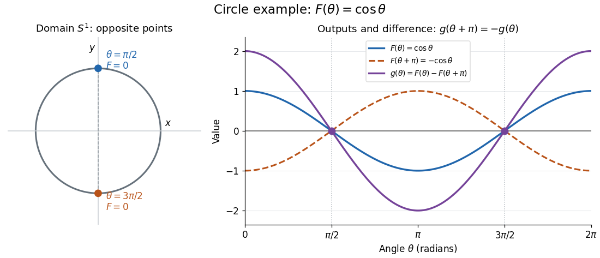
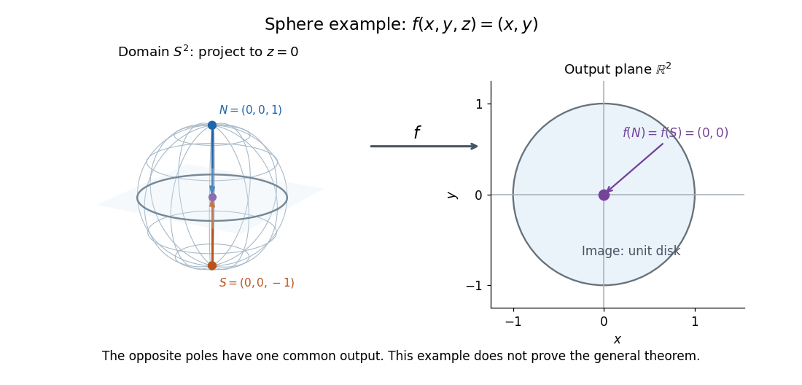

# Borsuk-Ulam theorem

↑ **Parent:** [Algebraic topology](algebraic-topology-split.md)  
ⓦ [Wiki](https://en.wikipedia.org/wiki/Borsuk-Ulam_theorem)

The [Borsuk-Ulam theorem](borsuk-ulam-theorem.md) says that recording $n$ [continuous](continuous-function.md) real-valued measurements on an $n$-dimensional [unit sphere](unit-sphere.md) must give identical records somewhere on opposite sides. The measurements can vary wildly; [continuity](continuous-function.md) alone forces a coincidence at an [antipodal pair](antipodal-pair.md).

Precisely, for every [integer](integer-split.md) $n\geq1$ and every [continuous map](continuous-map.md) $f:S^n\to\mathbb R^n$, there is an $x\in S^n$ such that

$$
f(x)=f(-x),\qquad S^n=\left\{x\in\mathbb R^{n+1}:\sum_{j=1}^{n+1}x_j^2=1\right\}.
$$

Here $x$ and $-x$ form an [antipodal pair](antipodal-pair.md) on the [unit sphere](unit-sphere.md); the [antipodal map](antipodal-map.md) reverses every position coordinate. The target is the [Euclidean space](euclidean-norm.md) $\mathbb R^n$. Both points have the same entire output, so every one of the $n$ measurements agrees at this common pair. See [Hatcher, Algebraic Topology, Corollary 2B.7, p. 176](https://pi.math.cornell.edu/~hatcher/AT/ATch2.pdf#page=80).

**Circle example.** Parametrize the [unit circle](complex-unit-circle.md) by $x(\theta)=(\cos\theta,\sin\theta)$, with [angles](angle.md) taken modulo $2\pi$, and record the first coordinate using the [cosine function](cosine.md):

$$
F:S^1\to\mathbb R,\qquad F(x(\theta))=\cos\theta,\qquad F(x(\pi/2))=F(x(3\pi/2))=0.
$$

The top and bottom points of the [unit circle](complex-unit-circle.md) form the required [antipodal pair](antipodal-pair.md). Their first coordinates agree, while their second coordinates are $1$ and $-1$.

**[Figure 1](#image-an-antipodal-pair-on-the-unit-circle-with-equal-cosine-values). An antipodal pair on the unit circle with equal cosine values**. For this [cosine function](cosine.md) example, the top and bottom points have output zero. The graph also shows the sign reversal of the antipodal difference after half a turn.

**Sphere example.** On the [unit sphere](unit-sphere.md) in three-dimensional [Euclidean space](euclidean-norm.md), take the [orthogonal projection](orthogonal-projection.md) onto the equatorial plane and identify that plane with $\mathbb R^2$:

$$
f:S^2\to\mathbb R^2,\qquad f(x,y,z)=(x,y),\qquad f(0,0,1)=f(0,0,-1)=(0,0).
$$

These poles are the only coincident [antipodal pair](antipodal-pair.md) for this [orthogonal projection](orthogonal-projection.md): equality of $(x,y)$ and $(-x,-y)$ forces $x=y=0$, and the [unit sphere](unit-sphere.md) equation then gives $z=\pm1$. The [Borsuk-Ulam theorem](borsuk-ulam-theorem.md) guarantees an [antipodal pair](antipodal-pair.md) for every [continuous map](continuous-map.md) into $\mathbb R^2$, even when no convenient projection formula is available.

**[Figure 2](#image-both-antipodal-poles-project-to-the-origin-of-the-equatorial-plane). Both antipodal poles project to the origin of the equatorial plane**. The arrows show the [orthogonal projection](orthogonal-projection.md) example $f(x,y,z)=(x,y)$. This illustrates one [continuous map](continuous-map.md), rather than proving the [Borsuk-Ulam theorem](borsuk-ulam-theorem.md) for arbitrary maps.

Equal output need not mean equal position coordinates. Keeping all three coordinates gives a [continuous map](continuous-map.md) $i:S^2\to\mathbb R^3$ defined by $i(x,y,z)=(x,y,z)$, the restriction of the [identity map](identity-function.md) of $\mathbb R^3$. Its outputs at an [antipodal pair](antipodal-pair.md) are always distinct, since $u=-u$ would force $u=0$, which is outside the [unit sphere](unit-sphere.md). Thus replacing the target $\mathbb R^2$ by $\mathbb R^3$ destroys this guarantee.

**Why the circle case follows from the intermediate value theorem.** For an arbitrary [continuous map](continuous-map.md) $f:S^1\to\mathbb R$, write $F(\theta)=f(x(\theta))$ using the [unit circle](complex-unit-circle.md) parametrization above. The [continuous function](continuous-function.md)

$$
g(\theta)=F(\theta)-F(\theta+\pi)
$$

satisfies $g(\theta+\pi)=-g(\theta)$ because $F$ has [period](period-of-a-function.md) $2\pi$. If $g(0)=0$, the first [antipodal pair](antipodal-pair.md) already works. Otherwise $g(0)$ and $g(\pi)$ have opposite signs, and the [intermediate value theorem](intermediate-value-theorem.md) supplies a zero between them. At that zero, the two antipodal values of $f$ agree. In the [cosine function](cosine.md) example, $g(\theta)=2\cos\theta$. This short argument handles only $n=1$. See [Hatcher, Algebraic Topology, discussion of Theorem 1.10, p. 32](https://pi.math.cornell.edu/~hatcher/AT/ATch1.pdf#page=12).

**An ideal weather interpretation.** Model the surface of [Earth](earth.md) as a [sphere](sphere.md). At one fixed instant, suppose [temperature](temperature-split.md) $T$ and [pressure](pressure-split.md) $P$ are globally defined [continuous](continuous-function.md) scalar measurements on that [sphere](sphere.md). Apply the [Borsuk-Ulam theorem](borsuk-ulam-theorem.md) to $f(u)=(T(u),P(u))$ to obtain a common [antipodal pair](antipodal-pair.md) satisfying

$$
T(u)=T(-u),\qquad P(u)=P(-u).
$$

The two equalities hold at the same pair; applying the circle argument separately to two measurements would not ensure that. This is a conclusion about the ideal [continuous](continuous-function.md) model, with both measurements taken at the same instant, rather than an assertion that an exactly matching pair has been empirically measured. Matoušek gives this motivating interpretation and explicitly cautions that physical [temperature](temperature-split.md) need not be [continuous](continuous-function.md).[§2.1, p. 22](using-the-borsuk-ulam-theorem-by-jiri-matousek.md)

**Equivalent formulations.** A [continuous map](continuous-map.md) $h:S^n\to\mathbb R^n$ is odd when $h(-x)=-h(x)$, extending the symmetry of an [odd function](odd-function.md). The [Borsuk-Ulam theorem](borsuk-ulam-theorem.md) equivalently says every such map has a zero. For a general $f$, the difference $h(x)=f(x)-f(-x)$ has this symmetry; conversely, equal antipodal outputs of an odd map must be zero. Another equivalent formulation is that no [odd map between spheres](odd-map-between-spheres.md) $S^n\to S^{n-1}$ exists. Normalizing a nonvanishing odd map by its [Euclidean norm](euclidean-norm.md) would produce such an [odd map between spheres](odd-map-between-spheres.md). These formulations are useful starting points for [algebraic topology](algebraic-topology-split.md); the general proof is beyond the circle argument here.[Hatcher, Algebraic Topology, Corollary 2B.7, p. 176](https://pi.math.cornell.edu/~hatcher/AT/ATch2.pdf#page=80)

For further study, [Jiří Matoušek](jiri-matousek.md)'s [Using the Borsuk-Ulam Theorem](using-the-borsuk-ulam-theorem-by-jiri-matousek.md) (2003) develops the theorem and its applications to [combinatorics](combinatorics-split.md) and [Euclidean geometry](euclidean-geometry-split.md). An early publication is [Karol Borsuk](karol-borsuk.md)'s 1933 paper [Drei Sätze über die n-dimensionale euklidische Sphäre](drei-satze-uber-die-n-dimensionale-euklidische-sphare-by-karol-borsuk.md).

**Table of contents**

- [Lusternik–Schnirelmann theorem](lusternik-schnirelmann-theorem.md)
  - [Antipodal-free closed cover from simplex Voronoi cells](antipodal-free-closed-cover-from-simplex-voronoi-cells.md)
  - [Open-cover proof of the Lusternik-Schnirelmann-Borsuk theorem](open-cover-proof-of-the-lusternik-schnirelmann-borsuk-theorem.md)

## ↑ Ancestors (5)

1. [Algebraic topology](algebraic-topology-split.md)
2. [Geometry and topology](geometry-and-topology-split.md)
3. [Area of mathematics](area-of-mathematics.md)
4. [Mathematics](mathematics-split.md)
5. [Codex Wiki](split.md)

## ← Incoming links (11)

- [Borsuk-Ulam theorem](borsuk-ulam-theorem.md)
- [Lusternik–Schnirelmann theorem](lusternik-schnirelmann-theorem.md)
- [Odd-order obstruction for scalar elliptic operators in at least three dimensions](odd-order-obstruction-for-scalar-elliptic-operators-in-at-least-three-dimensions.md)
- [Open-cover proof of the Lusternik-Schnirelmann-Borsuk theorem](open-cover-proof-of-the-lusternik-schnirelmann-borsuk-theorem.md)
- [Solution](past-exam-of-the-mathematics-course-of-the-university-of-cambridge/2005/iii/paper-10/2/solution.md)
- [Solution](past-exam-of-the-mathematics-course-of-the-university-of-cambridge/2005/iii/paper-13/2/solution.md)
- [Solution](past-exam-of-the-mathematics-course-of-the-university-of-cambridge/2008/ii/paper-2/21f/solution.md)
- [Solution](past-exam-of-the-mathematics-course-of-the-university-of-cambridge/2015/iii/paper-13/1/i/solution.md)
- [Solution](past-exam-of-the-mathematics-course-of-the-university-of-cambridge/2018/iii/paper-327/3/solution.md)
- [Solution](past-exam-of-the-mathematics-course-of-the-university-of-cambridge/2024/iii/paper-109/4/a/solution.md)
- [Solution](past-exam-of-the-mathematics-course-of-the-university-of-cambridge/2024/iii/paper-109/4/b/solution.md)
