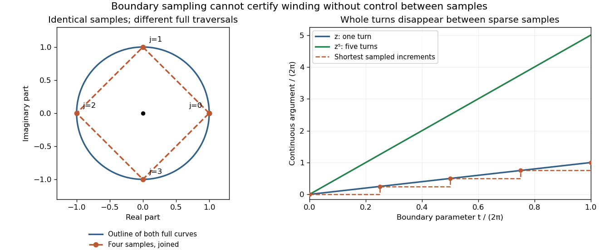

# Boundary sampling can miss winding

↑ **Parent:** [Argument principle](argument-principle.md)

A finite list of function values does not determine the [winding number](winding-number.md) of the intervening [image](image-of-a-function.md) [contour](complex-integration-contour.md). For example, sample $\gamma(t)=e^{it}$ only at $t_j=2\pi j/4$, $j=0,1,2,3$. The [polynomials](polynomial-split.md) $f(z)=z$ and $g(z)=z^5$ agree at all four sampled points, because $\gamma(t_j)^4=1$. Joining those values by straight segments draws the same square for both. Yet their true [winding numbers](winding-number.md) are one and five, and their enclosed [zero multiplicities](multiplicity-of-a-zero.md) differ by four.

**[Figure 13](#image-four-identical-boundary-samples-can-hide-four-additional-turns). Four identical boundary samples can hide four additional turns**. Left: $z$ and $z^5$ on the [unit circle](complex-unit-circle.md) give the same four samples and the same polygon if only those samples are joined. The full curves have the same circular outline but different traversal counts. Right: their continuous [arguments](argument-complex-analysis.md), measured in turns, reveal one versus five revolutions. The dashed stairs show the false one-turn interpretation obtained by taking the shortest [argument](argument-complex-analysis.md) increments between the four samples.

Refining samples can help resolve a given example, but an asserted root count needs a bound controlling what happens between them. One sufficient certificate is to enclose the [image](image-of-a-function.md) of each boundary subarc and its interpolating segment in a [convex set](convex-set-split.md) that excludes zero. Straight interpolation then gives a [homotopy](homotopy-split.md) avoiding zero, so the polygon and true [image](image-of-a-function.md) [contour](complex-integration-contour.md) have the same [winding number](winding-number.md). A plot that merely looks closed and avoids zero at its sampled points is not that certificate.

## ↑ Ancestors (6)

1. [Argument principle](argument-principle.md)
2. [Complex analysis](complex-analysis-split.md)
3. [Analysis](analysis-split.md)
4. [Area of mathematics](area-of-mathematics.md)
5. [Mathematics](mathematics-split.md)
6. [Codex Wiki](split.md)

## ← Incoming links (1)

- [Winding number](winding-number.md)
