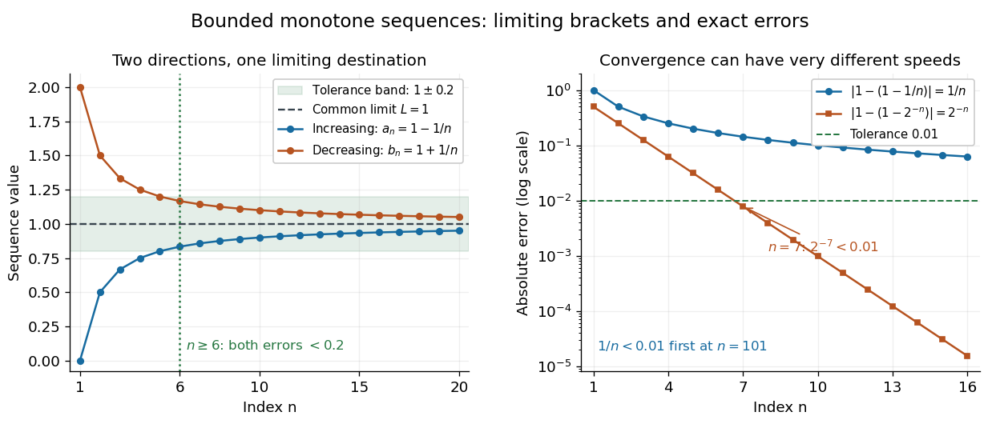

# Bounded monotone sequence theorem

↑ **Parent:** [Monotone sequence](monotone-sequence.md)

**A [monotone sequence](monotone-sequence.md) of [real numbers](real-number.md) has a finite [limit of a sequence](limit-of-a-sequence.md) exactly when it is a [bounded sequence](bounded-sequence.md).** In the increasing case, only an [upper bound](upper-bound-in-a-partially-ordered-set.md) needs to be supplied, because the first term already gives a [lower bound](lower-bound-in-a-partially-ordered-set.md); in the decreasing case, only a [lower bound](lower-bound-in-a-partially-ordered-set.md) needs to be supplied. The [limit of a sequence](limit-of-a-sequence.md) is the exact edge of the [set](set-split.md) of terms:

$$
a_n\leq a_{n+1}\leq M\quad\Longrightarrow\quad a_n\longrightarrow L=\sup\{a_n:n\geq1\},
$$

$$
m\leq b_{n+1}\leq b_n\quad\Longrightarrow\quad b_n\longrightarrow L=\inf\{b_n:n\geq1\}.
$$

The [upper bound](upper-bound-in-a-partially-ordered-set.md) $M$ or [lower bound](lower-bound-in-a-partially-ordered-set.md) $m$ need not itself be the [limit of a sequence](limit-of-a-sequence.md). A [supremum](supremum.md) or [infimum](infimum.md) identifies the sharp bound. [§2.1.1, Theorem 2.1.10 and the one-sided-boundedness observation following its proof](basic-analysis-introduction-to-real-analysis-volume-i-by-jiri-lebl.md)

For example, $a_n=1-1/n$ is increasing and bounded above by one, and $b_n=1+1/n$ is decreasing and bounded below by one. Both have [limit of a sequence](limit-of-a-sequence.md) one, although neither ever equals one. Their [absolute errors](absolute-error.md) are exactly $1/n$. They also bracket any [sequence](sequence.md) $x_n$ satisfying $a_n\leq x_n\leq b_n$: the [squeeze theorem](squeeze-theorem.md) gives $x_n\to1$, even if $(x_n)$ itself is not a [monotone sequence](monotone-sequence.md).

**[Figure 17](#image-increasing-and-decreasing-sequences-bracket-a-common-limit-of-a-sequence-with-explicitly-shrinking-absolute-errors). Increasing and decreasing sequences bracket a common limit of a sequence, with explicitly shrinking absolute errors**. Left: $1-1/n$ and $1+1/n$ enclose one; for every $n\geq6$ both lie strictly inside the tolerance band $1\pm0.2$. Right: the [absolute errors](absolute-error.md) $1/n$ and $2^{-n}$ shrink at different rates. The markers are individual terms, and connecting segments only guide the eye.

The theorem is useful when a [recurrence relation](recurrence-relation.md) gives successive improvements and a bound, before the answer has been identified. It proves existence of a [limit of a sequence](limit-of-a-sequence.md); further algebra, often using [continuity](continuous-function.md), identifies the answer. A finite plot illustrates the formulas but does not establish the infinite claim. [Error bounds for bounded monotone sequences](error-bounds-for-bounded-monotone-sequences.md) require additional quantitative information.

A real increasing [sequence](sequence.md) bounded above converges to its [supremum](supremum.md); a decreasing [sequence](sequence.md) bounded below converges to its [infimum](infimum.md). For the increasing case, the definition of [supremum](supremum.md) provides a term above $L-\varepsilon$, and every later term remains between that term and $L$. Negation reduces the decreasing case to the increasing case. This elementary result is distinct from the measure-theoretic [monotone convergence theorem](monotone-convergence-theorem.md) for integrals.

The existence of the real [supremum](supremum.md) in this short proof uses the [least-upper-bound property](least-upper-bound-property.md), equivalently [completeness of the real numbers](completeness-of-the-real-numbers.md). The [approximation property of a supremum](approximation-property-of-a-supremum.md) supplies $a_N>L-\varepsilon$, and monotonicity keeps every later term within the same tolerance:

$$
n\geq N\quad\Longrightarrow\quad 0\leq L-a_n\leq L-a_N<\varepsilon.
$$

The corresponding decreasing statement follows from the [approximation property of an infimum](approximation-property-of-an-infimum.md). The converse uses the fact that every [convergent sequence](convergent-sequence.md) is a [bounded sequence](bounded-sequence.md). [§2.1, Proposition 2.1.7 and §2.1.1, proof of Theorem 2.1.10](basic-analysis-introduction-to-real-analysis-volume-i-by-jiri-lebl.md)

**Table of contents**

- [Increasing and decreasing approximations to a common limit](increasing-and-decreasing-approximations-to-a-common-limit.md)
- [Attainment of the limit of a monotone sequence](attainment-of-the-limit-of-a-monotone-sequence.md)
- [Assumptions of the bounded monotone sequence theorem](assumptions-of-the-bounded-monotone-sequence-theorem.md)
- [Error bounds for bounded monotone sequences](error-bounds-for-bounded-monotone-sequences.md)
  - [Bounded monotone sequences have no universal convergence rate](bounded-monotone-sequences-have-no-universal-convergence-rate.md)

## ↑ Ancestors (8)

1. [Monotone sequence](monotone-sequence.md)
2. [Sequence](sequence.md)
3. [Sequence and series](sequence-and-series.md)
4. [Real analysis](real-analysis-split.md)
5. [Analysis](analysis-split.md)
6. [Area of mathematics](area-of-mathematics.md)
7. [Mathematics](mathematics-split.md)
8. [Codex Wiki](split.md)

## ← Incoming links (15)

- [Arithmetic-geometric mean iteration](arithmetic-geometric-mean-iteration.md)
- [Bounded monotone sequences have no universal convergence rate](bounded-monotone-sequences-have-no-universal-convergence-rate.md)
- [Increasing and decreasing approximations to a common limit](increasing-and-decreasing-approximations-to-a-common-limit.md)
- [Monotone sequence](monotone-sequence.md)
- [Solution](past-exam-of-the-mathematics-course-of-the-university-of-cambridge/2001/ia/paper-1/11d/ii/solution.md)
- [Solution](past-exam-of-the-mathematics-course-of-the-university-of-cambridge/2004/ia/paper-1/12f/i/solution.md)
- [Solution](past-exam-of-the-mathematics-course-of-the-university-of-cambridge/2004/ia/paper-1/3d/solution.md)
- [Solution](past-exam-of-the-mathematics-course-of-the-university-of-cambridge/2007/ia/paper-1/3f/solution.md)
- [Solution](past-exam-of-the-mathematics-course-of-the-university-of-cambridge/2007/ia/paper-1/9f/solution.md)
- [Solution](past-exam-of-the-mathematics-course-of-the-university-of-cambridge/2007/ia/paper-4/7e/solution.md)
- [Solution](past-exam-of-the-mathematics-course-of-the-university-of-cambridge/2008/ia/paper-4/8d/solution.md)
- [Solution](past-exam-of-the-mathematics-course-of-the-university-of-cambridge/2010/ia/paper-1/11d/solution.md)
- [Solution](past-exam-of-the-mathematics-course-of-the-university-of-cambridge/2012/ia/paper-1/11d/i/solution.md)
- [Solution](past-exam-of-the-mathematics-course-of-the-university-of-cambridge/2012/ia/paper-1/11d/iv/solution.md)
- [Solution](past-exam-of-the-mathematics-course-of-the-university-of-cambridge/2012/ia/paper-1/9e/b/solution.md)
