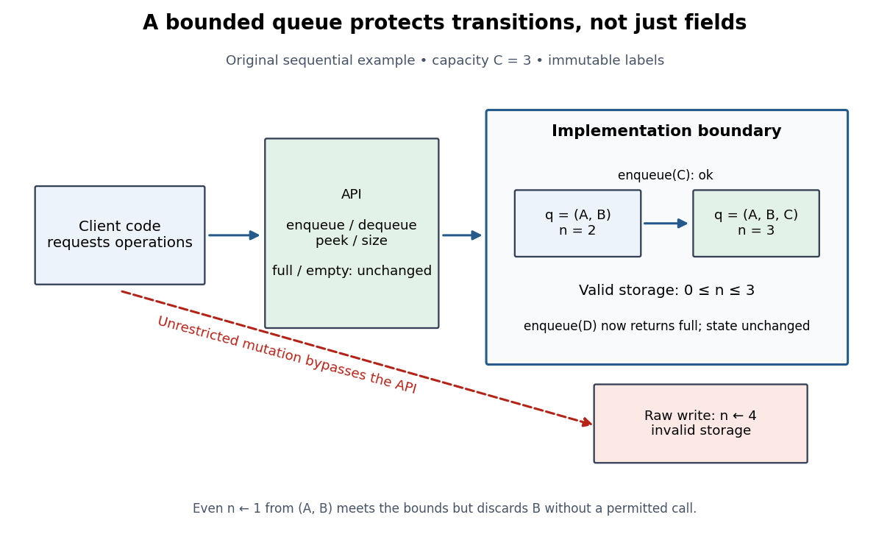

# Bounded queue with encapsulation

↑ **Parent:** [Encapsulation (computer programming)](encapsulation-computer-programming.md)

Consider an original [FIFO queue](fifo-queue.md) example storing immutable labels, with fixed positive [integer](integer-split.md) capacity $C$. Its abstract state is a finite [sequence](sequence.md) $q=(x_0,\ldots,x_{n-1})$, with $0\leq n\leq C$. The [API](application-programming-interface.md) has `enqueue(x)`, `dequeue()`, `peek()` and `size()`. Successful `enqueue` returns `ok`; a full queue returns `full` and is unchanged. Successful `dequeue` returns the first label and removes it; an empty queue returns `empty` and is unchanged. `peek` returns the first label or `empty` without modification, and `size` returns $n$. The status results are distinct from stored labels.

For a compact [array](array-data-structure.md) representation $(A,n)$, fix $|A|=C$ and require the [representation invariant](representation-invariant.md)

$$
I(A,n):\quad n\in\mathbb Z,\qquad 0\leq n\leq C.
$$

The [abstraction function](abstraction-function.md) is $\alpha(A,n)=(A_0,\ldots,A_{n-1})$. Only these first $n$ entries matter; unused slots have no abstract meaning. On successful `enqueue(x)`, write $A_n=x$ and then set $n\leftarrow n+1$. On successful `dequeue()`, save $A_0$, shift the remaining $n-1$ entries left, and decrement $n$. Testing the full or empty case before updating gives the specified unchanged failure state.

**[Figure 15](#image-permitted-queue-calls-preserve-valid-states-an-unrestricted-count-write-bypasses-the-api). Permitted queue calls preserve valid states; an unrestricted count write bypasses the API**.

With $C=3$ and $q=(A,B)$, `enqueue(C)` produces $(A,B,C)$; `enqueue(D)` returns `full` without change. A raw write $n\leftarrow4$ violates the [representation invariant](representation-invariant.md). More subtly, changing the count from two to one satisfies its bounds but discards $B$ without a permitted operation. Validity of the storage state and legality of the [API](application-programming-interface.md) transition are different obligations. A setter for every storage field would surrender the useful boundary even if its name looked like an ordinary operation.

## ↑ Ancestors (3)

1. [Encapsulation (computer programming)](encapsulation-computer-programming.md)
2. [Computer science](computer-science-split.md)
3. [Codex Wiki](split.md)

## ← Incoming links (4)

- [Abstraction function](abstraction-function.md)
- [Correct operations through an abstraction function](correct-operations-through-an-abstraction-function.md)
- [Representation exposure](representation-exposure.md)
- [Representation independence](representation-independence.md)
