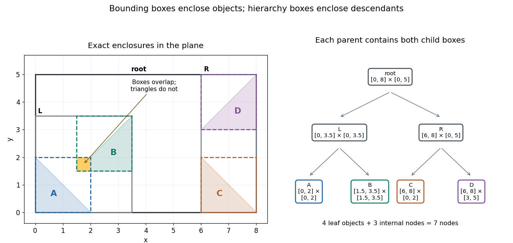
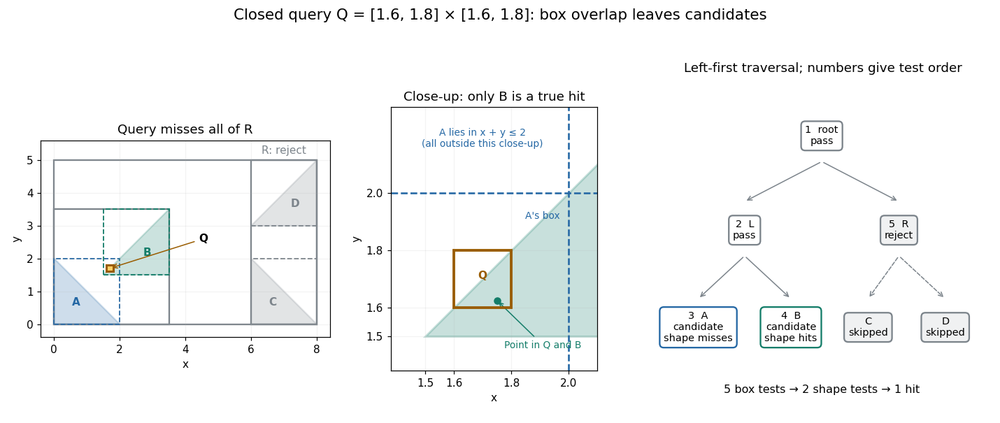

# Bounding volume hierarchy

↑ **Parent:** [Bounding volume](bounding-volume.md)  
ⓦ [Wiki](https://en.wikipedia.org/wiki/Bounding_volume_hierarchy)

A [bounding volume hierarchy](bounding-volume-hierarchy.md) is a [data structure](data-structure-split.md) arranged as a [rooted tree](rooted-tree.md): leaves store objects, and each internal node stores a [bounding volume](bounding-volume.md) enclosing its [children in a rooted tree](child-in-a-rooted-tree.md). Consequently, every node encloses all objects in its [subtree](subtree.md). A common choice is a [binary tree](binary-tree.md) of [axis-aligned bounding boxes](axis-aligned-bounding-box.md). The objects assigned to sibling [subtrees](subtree.md) can be different even when their [bounding volumes](bounding-volume.md) overlap.[§7.3, opening paragraphs and Figure 7.3: leaves, descendant bounds and rejection of a subtree](physically-based-rendering-from-theory-to-implementation-4th-edition-by-matt-pharr-and-others/7-3-bounding-volume-hierarchies.md)

Here is an exact two-dimensional example. Use the [triangles](triangle.md) $A,B$ from [bounding volume](bounding-volume.md), together with $C$ having [vertices of a polygon](vertex-of-a-polygon.md) $(6,0),(8,0),(6,2)$ and $D$ having [vertices of a polygon](vertex-of-a-polygon.md) $(6,3),(8,3),(8,5)$. Group $A,B$ under $L$, and $C,D$ under $R$. Their parent [axis-aligned bounding boxes](axis-aligned-bounding-box.md) and the box at the [root of a tree](root-of-a-tree.md) are

$$
B_L=[0,7/2]\times[0,7/2],\qquad B_R=[6,8]\times[0,5],\qquad B_{\mathrm{root}}=[0,8]\times[0,5].
$$

The diagram shows all seven nodes. Taking the [coordinate](coordinate-linear-algebra.md)-wise [minimum](minimum-of-a-subset-of-a-total-order.md) and [maximum](maximum-of-a-subset-of-a-total-order.md) of the two child boxes constructs each parent box; the resulting box contains the [set union](set-union.md) of the children, and can also contain empty space between them.

**[Figure 7](#bounding-box-enclosures-and-hierarchy). Four exact triangles, their enclosing boxes, and a seven-node bounding volume hierarchy arranged as a binary tree**.

A [bounding volume hierarchy traversal](bounding-volume-hierarchy-traversal.md) starts at the [root of a tree](root-of-a-tree.md) and discards a [subtree](subtree.md) when its [bounding volume](bounding-volume.md) misses the query. Accepted internal nodes expose their children; accepted leaves supply candidates for actual shape tests. Box2D's official [Collision: Dynamic Tree](collision-dynamic-tree.md) describes [axis-aligned bounding box](axis-aligned-bounding-box.md) region queries that return overlapping leaf boxes. A query box that bounds a different query shape can produce additional false candidates.

For the closed query [rectangle](rectangle.md)

$$
Q=[8/5,9/5]\times[8/5,9/5],
$$

left-first [depth-first search](depth-first-search.md) tests the node boxes in order: root, $L$, $A$, $B$, $R$. The first four overlap $Q$; $R$ does not, because its smallest $x$-[coordinate](coordinate-linear-algebra.md) is $6>9/5$. Pruning $R$ skips both $C$ and $D$. Five box tests leave two [broad phase](broad-phase.md) candidates. The [narrow phase](narrow-phase.md) rejects $A$, since $x+y\geq16/5>2$ throughout $Q$, and accepts $B$: the [point](point-geometry.md) $(7/4,13/8)$ belongs to both $Q$ and $B$. There are two detailed shape tests and one true hit.

**[Figure 8](#bounding-volume-hierarchy-query-pruning). An exact rectangle query prunes the right subtree and leaves two box candidates but only one triangle hit**.

For a query asking for all intersections, [time complexity](time-complexity.md) depends on the number $v$ of visited nodes and the cost $T_j$ of each candidate shape test. With fixed dimension and constant bookkeeping cost per node, the work is

$$
O\!\left(v+\sum_{j=1}^{c}T_j\right),
$$

where $c$ counts candidate objects and $O$ is [Big O notation](big-o-notation.md). A balanced [binary tree](binary-tree.md) has small [height of a binary tree](height-of-a-binary-tree.md), but a query can enter both children at every level. In this example a query containing $[0,8]\times[0,5]$ visits all seven nodes and tests all four [triangles](triangle.md). More generally, a [full binary tree](full-binary-tree.md) with $n$ single-object leaves has $2n-1$ nodes, so such a query takes $O(n)$ work for constant-cost shape tests even when its [height of a binary tree](height-of-a-binary-tree.md) is $O(\log n)$. Listing $n$ hits itself requires $n$ outputs. Small height alone gives no unconditional logarithmic query bound.

For [collision detection](collision-detection.md) between two [bounding volume hierarchies](bounding-volume-hierarchy.md), traverse pairs of nodes: reject disjoint pairs of [bounding volumes](bounding-volume.md), expand a nonleaf member of an accepted pair, and apply the [narrow phase](narrow-phase.md) at accepted leaf pairs. A single collection's self-query must exclude pairing an object with itself and avoid duplicate unordered pairs. If every object overlaps every other object, reporting all pairs already requires $n(n-1)/2$ results. Construction quality, empty space in boxes and the queries determine how much pruning is useful.[§32.1: the n(n−1)/2 pair baseline and worst-case quadratic broad-phase work](gpu-gems-3/chapter-32-broad-phase-collision-detection-with-cuda.md)

For a short correctness outline, an object is enclosed by its leaf box, and each child box is enclosed by its parent box. Repeated [subset](subset.md) relations carry this property to every ancestor. A true query intersection therefore prevents rejection at every ancestor of the object's leaf. Updating leaf boxes after motion also requires restoring all affected ancestor bounds before querying.

**Table of contents**

- [Bounding volume hierarchy traversal](bounding-volume-hierarchy-traversal.md)

## ↑ Ancestors (7)

1. [Bounding volume](bounding-volume.md)
2. [Computer aided geometric design](computer-aided-geometric-design-split.md)
3. [Numerical analysis](numerical-analysis-split.md)
4. [Analysis](analysis-split.md)
5. [Area of mathematics](area-of-mathematics.md)
6. [Mathematics](mathematics-split.md)
7. [Codex Wiki](split.md)

## ← Incoming links (8)

- [Axis-aligned bounding box](axis-aligned-bounding-box.md)
- [Bounding volume](bounding-volume.md)
- [Bounding volume hierarchy](bounding-volume-hierarchy.md)
- [Solution](past-exam-of-the-mathematics-course-of-the-university-of-cambridge/2002/iii/paper-59/6/solution.md)
- [Solution](past-exam-of-the-mathematics-course-of-the-university-of-cambridge/2003/iii/paper-68/4/solution.md)
- [Solution](past-exam-of-the-mathematics-course-of-the-university-of-cambridge/2005/iii/paper-66/6/iii/solution.md)
- [Solution](past-exam-of-the-mathematics-course-of-the-university-of-cambridge/2008/iii/paper-77/1/iii/solution.md)
- [Solution](past-exam-of-the-mathematics-course-of-the-university-of-cambridge/2008/iii/paper-77/6/solution.md)
