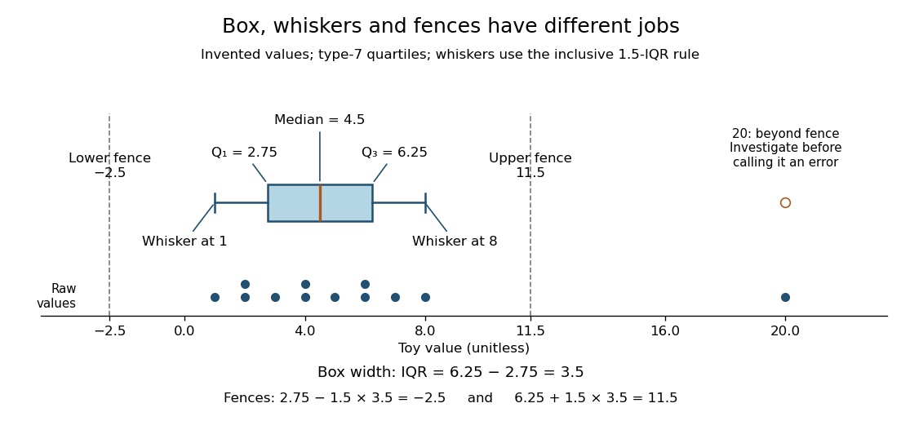

# Box plot

↑ **Parent:** [Descriptive statistics](descriptive-statistics.md)  
ⓦ [Wiki](https://en.wikipedia.org/wiki/Box_plot)

A [box plot](box-plot.md) compresses a [statistical sample](statistical-sample.md) into a box spanning its lower and upper [quartiles](quartile.md) $Q_1,Q_3$, a line at its [median](median.md) $Q_2$, and two whiskers. It makes location and central spread easy to compare across groups on a common value axis. The box represents the central half in terms of [quantile](quantile-function.md) levels; with ties or interpolated [quartiles](quartile.md), it need not contain exactly half the observations. Whisker endpoints require a stated convention: they can be the observed extremes, or they can stop short of separately marked observations. [NIST/SEMATECH, Box Plot, definition and variants](https://www.itl.nist.gov/div898/handbook/eda/section3/boxplot.htm)

Here is one explicitly toy dataset, reused under [histogram](histogram.md): twelve invented, unitless values, with repeated values counted separately, already arranged as [order statistics](order-statistic.md):

$$
(x_{(1)},\ldots,x_{(12)})=(1,2,2,3,4,4,5,6,6,7,8,20).
$$

For this [box plot](box-plot.md) we choose the interpolated [quartiles](quartile.md) defined under [quartile](quartile.md), using R's type-7 rule. This gives

$$
Q_1=2+\tfrac34(3-2)=2.75,\qquad Q_2=4+\tfrac12(5-4)=4.5,\qquad Q_3=6+\tfrac14(7-6)=6.25.
$$

The [interquartile range](interquartile-range.md) is $I=Q_3-Q_1=3.5$. Our whisker convention uses the fences

$$
L=Q_1-1.5I=-2.5,\qquad U=Q_3+1.5I=11.5.
$$

The whiskers end at the smallest and largest observations in the closed [interval](interval-mathematics.md) $[L,U]$: here $1$ and $8$. Values strictly outside the fences receive separate [outlier](outlier.md) markers: here only $20$. An observation exactly on a fence is retained within the whisker under this convention. The fences are thresholds, not observed whisker endpoints; the upper whisker is at $8$, not $11.5$. R's documented whisker rule likewise includes observations no more than $1.5$ box lengths away, although its box uses hinges, which can differ from our type-7 [quartiles](quartile.md). [R grDevices documentation, boxplot.stats, coef and hinges](https://stat.ethz.ch/R-manual/R-devel/library/grDevices/html/boxplot.stats.html)

**[Figure 1](#image-toy-box-plot-quartiles-define-the-box-observations-define-the-whiskers). Toy box plot: quartiles define the box, observations define the whiskers**. The twelve invented values are shown individually below the [box plot](box-plot.md), with repeated values stacked. Type-7 [quartiles](quartile.md) are $2.75,4.5,6.25$; the [interquartile range](interquartile-range.md) is $3.5$. Dashed fences at $-2.5$ and $11.5$ determine whiskers at $1$ and $8$ and a separate marker at $20$. The fence lines and raw-value strip are explanatory additions, not required parts of every [box plot](box-plot.md).

A separate [outlier](outlier.md) marker is a prompt to investigate, not a finding that the value is bad data and not an instruction to delete it. A distant observation can be a recording error, a legitimate unusual outcome, or evidence that the assumed [statistical model](statistical-model-split.md) misses some behavior. Check its provenance and context before deciding how to analyze it. No measurement-error claim is possible for our invented $20$: we deliberately put it there to demonstrate the rule. [NIST/SEMATECH, Detection of Outliers, labeling and investigation](https://www.itl.nist.gov/div898/handbook/eda/section3/eda35h.htm)

The beauty of a [box plot](box-plot.md) is its compact comparison of ordered positions rather than every observation. That compression also loses information: many different [statistical samples](statistical-sample.md) have the same [quartiles](quartile.md) and whiskers, so the box alone cannot reveal every cluster or gap that a [histogram](histogram.md) might show. For example, replacing the two invented $6$ values by $5.5$ and $6$ leaves the type-7 [quartiles](quartile.md), whiskers and separate marker unchanged. Displaying the individual values alongside the [box plot](box-plot.md) is especially helpful for such a small [statistical sample](statistical-sample.md). Always state both the [quartile](quartile.md) rule and the whisker rule; changing either can change which values are marked.

## ↑ Ancestors (5)

1. [Descriptive statistics](descriptive-statistics.md)
2. [Probability and statistics](probability-and-statistics-split.md)
3. [Area of mathematics](area-of-mathematics.md)
4. [Mathematics](mathematics-split.md)
5. [Codex Wiki](split.md)

## ← Incoming links (6)

- [Box plot](box-plot.md)
- [Histogram](histogram.md)
- [Interquartile range](interquartile-range.md)
- [Solution](past-exam-of-the-mathematics-course-of-the-university-of-cambridge/2005/iii/paper-41/1/solution.md)
- [Solution](past-exam-of-the-mathematics-course-of-the-university-of-cambridge/2009/iii/paper-102/1/a/solution.md)
- [Quartile](quartile.md)
