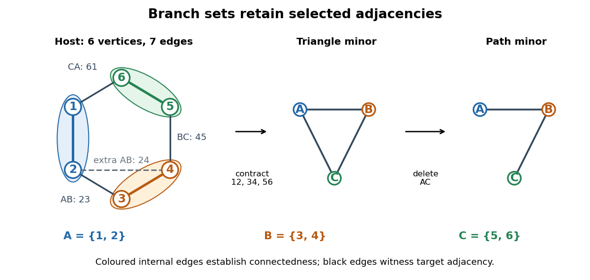

# Branch set of a graph minor

↑ **Parent:** [Graph minor](graph-minor.md)

A [branch set of a graph minor](branch-set-of-a-graph-minor.md) is the connected region representing one target [vertex](vertex-graph-theory.md). For finite [simple graphs](simple-graph.md) $G$ and $H$, a witness to $H\preccurlyeq G$ assigns a nonempty [set](set-split.md) $B_x\subseteq V(G)$ to each $x\in V(H)$, such that the [sets](set-split.md) are pairwise disjoint, each [induced subgraph](induced-subgraph.md) $G[B_x]$ is a [connected graph](connected-graph.md), and every $xy\in E(H)$ has a witnessing [edge](edge-of-a-graph.md) of $G$ between $B_x$ and $B_y$. Extra [edges](edge-of-a-graph.md) between [branch sets of a graph minor](branch-set-of-a-graph-minor.md) are allowed: they can be deleted. Unused [vertices](vertex-graph-theory.md) are also allowed.[Minor Containment and Disjoint Paths in almost-linear time by Tuukka Korhonen and others](minor-containment-and-disjoint-paths-in-almost-linear-time-by-tuukka-korhonen-and-others.md)

**[Figure 12](#image-connected-branch-sets-of-a-graph-minor-and-their-witnessing-edges-with-an-optional-edge-deletion). Connected branch sets of a graph minor and their witnessing edges, with an optional edge deletion**.

In the diagram, the host [graph](graph-split.md) has [vertex set](vertex-set.md) $\{1,2,3,4,5,6\}$ and [edges](edge-of-a-graph.md)

$$
12,\ 34,\ 56,\ 23,\ 45,\ 61,\ 24.
$$

Choose $B_A=\{1,2\}$, $B_B=\{3,4\}$, and $B_C=\{5,6\}$. Their internal [edges](edge-of-a-graph.md) $12,34,56$ establish connectedness. The [edges](edge-of-a-graph.md) $23,45,61$ witness $AB,BC,CA$, respectively, so they form a model of the [complete graph](complete-graph.md) $K_3$. The additional [edge](edge-of-a-graph.md) $24$ also joins $B_A$ to $B_B$; it supplies another witness for the same target [edge](edge-of-a-graph.md), not a fourth target [edge](edge-of-a-graph.md). Contracting $12,34,56$ and merging duplicate [edges](edge-of-a-graph.md) gives exactly $\{AB,BC,CA\}$.

The same [branch sets of a graph minor](branch-set-of-a-graph-minor.md) also witness the [path graph](path-graph.md) $A,B,C$: retain the witnesses $23,45$, and delete $61$ to remove the unwanted $AC$ adjacency. This demonstrates why the definition requires an [edge](edge-of-a-graph.md) for every target adjacency, without forbidding other adjacencies in the host [graph](graph-split.md). For a [complete graph](complete-graph.md) $K_t$, there are no unwanted pairs: its model consists of $t$ disjoint connected [branch sets of a graph minor](branch-set-of-a-graph-minor.md) with an [edge](edge-of-a-graph.md) between every pair.

To turn a model into an operation sequence, keep a [spanning tree](spanning-tree.md) inside each $G[B_x]$, keep one witnessing [edge](edge-of-a-graph.md) for each [edge](edge-of-a-graph.md) of $H$, and delete all other [edges](edge-of-a-graph.md) and unused [vertices](vertex-graph-theory.md). Contract each chosen [spanning tree](spanning-tree.md) to one [vertex](vertex-graph-theory.md). Disjointness prevents two target [vertices](vertex-graph-theory.md) from merging; connectedness provides the [edge contractions](edge-contraction.md) that merge each individual region. Conversely, track the original [vertices](vertex-graph-theory.md) merged into every surviving [vertex](vertex-graph-theory.md) during a deletion-and-[edge contraction](edge-contraction.md) sequence. They form disjoint connected [branch sets of a graph minor](branch-set-of-a-graph-minor.md), and each surviving [edge](edge-of-a-graph.md) comes from an original [edge](edge-of-a-graph.md) between its two regions. A list of these regions, their connecting [trees](tree-graph-theory.md), and their witnessing [edges](edge-of-a-graph.md) therefore gives a directly checkable certificate.

**Table of contents**

- [Random branch-set construction of a complete graph minor](random-branch-set-construction-of-a-complete-graph-minor.md)

## ↑ Ancestors (6)

1. [Graph minor](graph-minor.md)
2. [Graph theory](graph-theory-split.md)
3. [Foundations of mathematics](foundations-of-mathematics-split.md)
4. [Area of mathematics](area-of-mathematics.md)
5. [Mathematics](mathematics-split.md)
6. [Codex Wiki](split.md)

## ← Incoming links (5)

- [Branch set of a graph minor](branch-set-of-a-graph-minor.md)
- [Edge contraction](edge-contraction.md)
- [Graph minor](graph-minor.md)
- [Topological minor](topological-minor.md)
- [Wheel graph](wheel-graph.md)
