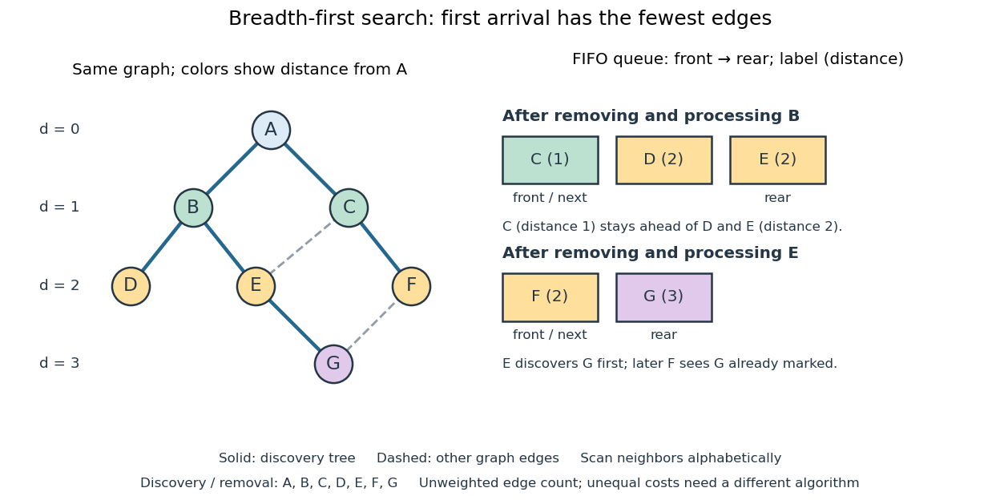

# Breadth-first search

↑ **Parent:** [Tree (graph theory)](tree-graph-theory.md)  
ⓦ [Wiki](https://en.wikipedia.org/wiki/Breadth-first_search)

[Breadth-first search](breadth-first-search.md) is a [graph search](graph-search.md) that explores successive layers of [graph distance](distance-graph-theory.md) from a starting [vertex](vertex-graph-theory.md) $s$. Here the [graph](graph-split.md) is an [undirected graph](undirected-graph.md) on a [finite set](finite-set.md) of [vertices](vertex-graph-theory.md), and distance counts [edges](edge-of-a-graph.md), with no differing [edge](edge-of-a-graph.md) weights. Mark $s$ as discovered, assign $d(s)=0$, and place it in a [FIFO queue](fifo-queue.md). Repeatedly remove the front [vertex](vertex-graph-theory.md) $u$ and scan its [adjacency list](adjacency-list.md). Whenever a [graph neighbour](neighbour-of-a-vertex.md) $v$ is still undiscovered, mark it immediately, record $u$ as its [parent in a rooted tree](parent-in-a-rooted-tree.md) in the discovery [tree](tree-graph-theory.md), assign $d(v)=d(u)+1$, and enqueue $v$ at the rear. Marking on insertion ensures that another [edge](edge-of-a-graph.md) cannot enqueue the same [vertex](vertex-graph-theory.md) again. [Sedgewick and Wayne, Algorithms: BreadthFirstPaths queue and discovery rule](https://raw.githubusercontent.com/kevin-wayne/algs4/master/src/main/java/edu/princeton/cs/algs4/BreadthFirstPaths.java)

Use the same [undirected graph](undirected-graph.md) as [depth-first search](depth-first-search.md), with [vertex set](vertex-set.md) $V=\{A,B,C,D,E,F,G\}$ and [edges](edge-of-a-graph.md)

$$
E=\{AB,AC,BD,BE,CE,CF,EG,FG\},
$$

where $XY$ denotes the unordered pair $\{X,Y\}$. Start at $A$ and scan [graph neighbours](neighbour-of-a-vertex.md) in [lexicographic order](lexicographic-order.md) of their one-letter labels. The diagram's generator computes the following layers and the [parent in a rooted tree](parent-in-a-rooted-tree.md) assigned to each discovered [vertex](vertex-graph-theory.md); the source is the [root of a tree](root-of-a-tree.md) and has no [parent in a rooted tree](parent-in-a-rooted-tree.md).

| [Graph distance](distance-graph-theory.md) from $A$ | [Vertices](vertex-graph-theory.md) in discovery order | [Parent in a rooted tree](parent-in-a-rooted-tree.md) in the same order |
| --- | --- | --- |
| $0$ | $A$ | none |
| $1$ | $B,C$ | $A,A$ |
| $2$ | $D,E,F$ | $B,B,C$ |
| $3$ | $G$ | $E$ |

**[Figure 13](#image-breadth-first-search-graph-distance-layers-and-two-ordered-fifo-queue-snapshots). Breadth-first search: graph distance layers and two ordered FIFO queue snapshots**. Solid [edges](edge-of-a-graph.md) record first discovery; dashed [edges](edge-of-a-graph.md) are still present in the original [graph](graph-split.md). The [FIFO queue](fifo-queue.md) contains $C,D,E$ after processing $B$ and $F,G$ after processing $E$, with its front on the left. Colors encode [graph distance](distance-graph-theory.md) in the [graph](graph-split.md) without [edge](edge-of-a-graph.md) weights.

The discovery and removal orders both happen to be $A,B,C,D,E,F,G$. After processing $B$, the [FIFO queue](fifo-queue.md) is $C,D,E$: $C$ must be processed before the newer $D,E$. Processing $C$ then skips the already discovered $E$ and enqueues $F$, giving $D,E,F$. Processing $D$ adds nothing. Processing $E$ discovers $G$, giving $F,G$; later $F$ sees $G$ already marked and leaves its [parent in a rooted tree](parent-in-a-rooted-tree.md) unchanged. The discovery [edges](edge-of-a-graph.md) are $AB,AC,BD,BE,CF,EG$, forming a [rooted tree](rooted-tree.md) on all seven [vertices](vertex-graph-theory.md) even though the original [graph](graph-split.md) contains [graph cycles](cycle-in-a-graph.md). The discovery [tree](tree-graph-theory.md) contains six [edges](edge-of-a-graph.md); it need not contain every examined [edge](edge-of-a-graph.md).

First arrival is shortest because the [FIFO queue](fifo-queue.md) keeps assigned distances in nondecreasing order, with entries from at most two consecutive layers. While processing distance $k$, newly discovered [vertices](vertex-graph-theory.md) receive distance $k+1$ and join the rear. If an undiscovered [vertex](vertex-graph-theory.md) had a shorter [graph path](path-in-a-graph.md), its preceding [vertex](vertex-graph-theory.md) on that [graph path](path-in-a-graph.md) would lie in an earlier layer and would already have discovered it. Thus $d(v)$ is the minimum number of [edges](edge-of-a-graph.md) from $s$ to $v$. This is a [mathematical induction](mathematical-induction.md) over the layers, not an assumption about the drawing. Following the [parent in a rooted tree](parent-in-a-rooted-tree.md) backwards at each step gives $G,E,B,A$; reverse that [sequence](sequence.md) to obtain the three-[edge](edge-of-a-graph.md) [graph path](path-in-a-graph.md) $A,B,E,G$. $A,C,F,G$ is another shortest [graph path](path-in-a-graph.md), but the specified [graph neighbour](neighbour-of-a-vertex.md) order makes $E$ discover $G$ first. Changing that order can change the [parent in a rooted tree](parent-in-a-rooted-tree.md) without changing [graph distances](distance-graph-theory.md). [MIT 6.006, lecture 13: distance layers and shortest paths, pp. 4–6](https://ocw.mit.edu/courses/6-006-introduction-to-algorithms-fall-2011/1208e162775f6f5cedfbb9f2b694ede0_MIT6_006F11_lec13.pdf)

The shortest-route guarantee concerns the [shortest path problem](shortest-path-problem.md) measured by [edge](edge-of-a-graph.md) count. It also minimizes total cost when every [edge](edge-of-a-graph.md) has the same positive cost. With unequal [edge](edge-of-a-graph.md) weights, first discovery need not minimize total cost; nonnegative costs can instead be handled by the [Dijkstra algorithm](dijkstra-algorithm.md). [Breadth-first search](breadth-first-search.md) is useful for minimum-hop routes and for finding all [vertices](vertex-graph-theory.md) within a specified [graph distance](distance-graph-theory.md). Its [FIFO queue](fifo-queue.md) finishes an older layer before the next one, whereas [depth-first search](depth-first-search.md) uses a [call stack](call-stack.md) or explicit [LIFO stack](stack-data-structure.md) to pursue one branch immediately.

With [adjacency lists](adjacency-list.md) and constant-cost discovery checks, together with constant worst-case or [amortized analysis](amortized-analysis.md) cost for [FIFO queue](fifo-queue.md) insertion and removal, the [time complexity](time-complexity.md) is $O(|V|+|E|)$ in [Big O notation](big-o-notation.md). Every reached [vertex](vertex-graph-theory.md) is enqueued and removed once, each incident [edge](edge-of-a-graph.md) is scanned at most twice in an [undirected graph](undirected-graph.md), and initializing all marks and distances takes $O(|V|)$. The [FIFO queue](fifo-queue.md) contains at most $|V|$ [vertices](vertex-graph-theory.md); the example's maximum is three. Discovery marks, distances and the recorded [parent in a rooted tree](parent-in-a-rooted-tree.md) for each nonroot [vertex](vertex-graph-theory.md) also give $O(|V|)$ auxiliary [space complexity](space-complexity.md), excluding the [graph](graph-split.md). An [array](array-data-structure.md) that shifts every entry on front removal can lose the linear [time complexity](time-complexity.md); the [FIFO queue](fifo-queue.md) abstraction alone does not make removal constant-cost. Ordering the [adjacency lists](adjacency-list.md) is a separate preprocessing cost.

A single start reaches only its [connected component of a graph](component-graph-theory.md). Unreached [vertices](vertex-graph-theory.md) retain distance $\infty$ and have no recorded [parent in a rooted tree](parent-in-a-rooted-tree.md). Restarting at each still-undiscovered [vertex](vertex-graph-theory.md), while preserving all discovery marks, produces a [forest](forest.md) covering the [graph](graph-split.md); each new [root of a tree](root-of-a-tree.md) gets distance zero, so these distances refer to that [root of a tree](root-of-a-tree.md), not to the original $s$.

## ↑ Ancestors (5)

1. [Tree (graph theory)](tree-graph-theory.md)
2. [Combinatorics](combinatorics-split.md)
3. [Area of mathematics](area-of-mathematics.md)
4. [Mathematics](mathematics-split.md)
5. [Codex Wiki](split.md)

## ← Incoming links (18)

- [Binary search tree](binary-search-tree.md)
- [Bipartite graph](bipartite-graph.md)
- [Breadth-first exploration of a binomial random graph](breadth-first-exploration-of-a-binomial-random-graph.md)
- [Breadth-first search](breadth-first-search.md)
- [Connected graph](connected-graph.md)
- [Depth-first search](depth-first-search.md)
- [Edmonds–Karp algorithm](edmonds-karp-algorithm.md)
- [FIFO queue](fifo-queue.md)
- [Solution](past-exam-of-the-mathematics-course-of-the-university-of-cambridge/2004/iii/paper-33/2/solution.md)
- [Solution](past-exam-of-the-mathematics-course-of-the-university-of-cambridge/2015/iii/paper-38/4/b/solution.md)
- [Solution](past-exam-of-the-mathematics-course-of-the-university-of-cambridge/2016/iii/paper-120/1/d/solution.md)
- [Solution](past-exam-of-the-mathematics-course-of-the-university-of-cambridge/2021/ii/paper-2/17g/b/solution.md)
- [Solution](past-exam-of-the-mathematics-course-of-the-university-of-cambridge/2026/iii/paper-122/1/a/solution.md)
- [Rooted tree](rooted-tree.md)
- [Shortest path problem](shortest-path-problem.md)
- [Spanning tree](spanning-tree.md)
- [Stack (data structure)](stack-data-structure.md)
- [Uniform labelled tree generation](uniform-labelled-tree-generation.md)
