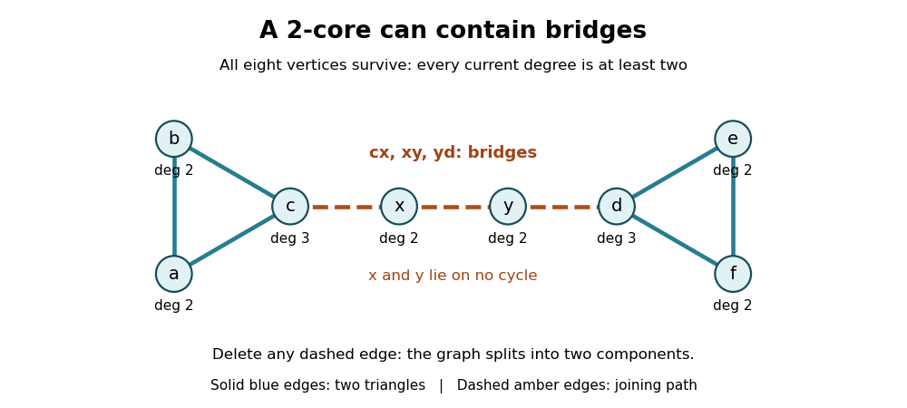

# Bridges and connectivity in the 2-core

↑ **Parent:** [2-core of a graph](2-core-of-a-graph.md)

A [2-core](2-core-of-a-graph.md) can contain [bridges in a graph](bridge-graph-theory.md), and even [vertices](vertex-graph-theory.md) that lie on no [cycle in a graph](cycle-in-a-graph.md). Consider the [dumbbell graph](dumbbell-graph.md), also called a barbell in this example, made of two disjoint [triangles in a graph](triangle-in-a-graph.md) joined by a [graph path](path-in-a-graph.md) with two internal [vertices](vertex-graph-theory.md):

$$
V=\{a,b,c,x,y,d,e,f\},\qquad E=\{ab,bc,ca,cx,xy,yd,de,ef,fd\}.
$$

Here $c,d$ have [degree of a vertex](degree-graph-theory.md) three, and every other [vertex](vertex-graph-theory.md) has [degree of a vertex](degree-graph-theory.md) two. No deletion is possible, so the whole [graph](graph-split.md) is its [2-core](2-core-of-a-graph.md). Yet $cx,xy,yd$ are [bridges in a graph](bridge-graph-theory.md): deleting any one separates the two triangles. None belongs to a [cycle in a graph](cycle-in-a-graph.md), and $x,y$ belong to no [cycle in a graph](cycle-in-a-graph.md) either. Keeping only [edges](edge-of-a-graph.md) on [graph cycles](cycle-in-a-graph.md) would incorrectly discard the entire joining [graph path](path-in-a-graph.md).

**[Figure 2](#image-every-vertex-of-this-dumbbell-graph-survives-in-the-2-core-including-the-joining-graph-path-whose-three-edges-are-bridges-in-a-graph). Every vertex of this dumbbell graph survives in the 2-core, including the joining graph path whose three edges are bridges in a graph**.

Every [cycle in a graph](cycle-in-a-graph.md) does survive pruning, because each of its [vertices](vertex-graph-theory.md) keeps its two cycle [graph neighbours](neighbour-of-a-vertex.md). The barbell shows that the converse fails: the [2-core](2-core-of-a-graph.md) can be larger than the [union](set-union.md) of all [graph cycles](cycle-in-a-graph.md). Its condition is local [minimum degree](minimum-degree-of-a-graph.md), not protection against a single connection failing.

A [biconnected component](biconnected-component.md) is a different object: a maximal connected [subgraph](subgraph.md) with no [cut vertex](cut-vertex.md) of its own. Under the block convention used here, the barbell has five [biconnected components](biconnected-component.md): its two triangles and its three individual joining [edges](edge-of-a-graph.md), each with its endpoints. Its [cut vertices](cut-vertex.md) are $c,x,y,d$. A 2-connected component with at least three [vertices](vertex-graph-theory.md) must remain connected after any single [vertex](vertex-graph-theory.md) is deleted; the whole barbell fails that test. An informal phrase such as "biconnected core" therefore needs its own definition and must not be substituted for [2-core](2-core-of-a-graph.md). Even an isolated [edge](edge-of-a-graph.md) is a block under this convention, although its [2-core](2-core-of-a-graph.md) is empty.

The usefulness of the [2-core](2-core-of-a-graph.md) is this precise separation of local persistence from global robustness. In a [connected graph](connected-graph.md) with nonempty [2-core](2-core-of-a-graph.md), the deleted [vertices](vertex-graph-theory.md) form a [forest](forest.md), with each of its [connected components of a graph](component-graph-theory.md) attached by exactly one [edge](edge-of-a-graph.md) to the [2-core](2-core-of-a-graph.md). Otherwise a deleted [graph cycle](cycle-in-a-graph.md), or a [graph path](path-in-a-graph.md) joining two surviving attachment points, would itself have survived. Stripping these attached [trees](tree-graph-theory-split.md) exposes a smaller structure for studying [graph cycles](cycle-in-a-graph.md), [graph excess](graph-excess.md) and the [graph kernel](graph-kernel.md), while preserving the joining [bridges in a graph](bridge-graph-theory.md) that organize that structure.

## ↑ Ancestors (6)

1. [2-core of a graph](2-core-of-a-graph.md)
2. [Graph theory](graph-theory-split.md)
3. [Foundations of mathematics](foundations-of-mathematics-split.md)
4. [Area of mathematics](area-of-mathematics.md)
5. [Mathematics](mathematics-split.md)
6. [Codex Wiki](split.md)

## ← Incoming links (1)

- [Graph kernel](graph-kernel.md)
