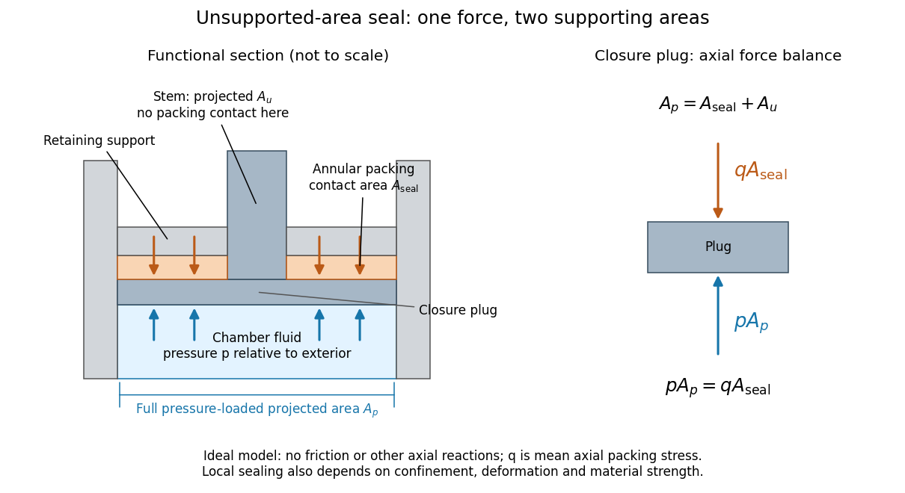

# Bridgman unsupported-area seal

↑ **Parent:** [Piston-cylinder pressure apparatus](piston-cylinder-pressure-apparatus.md)

Consider an ideal pressure-driven closure plug with a large chamber-facing [projected area](projected-area.md) $A_p$. Its opposite side seats against a smaller annular packing [surface area](surface-area.md) $A_{\rm seal}$. The remaining projected part $A_u=A_p-A_{\rm seal}>0$ is the unsupported area: it has no opposing packing contact in that plane. Here $p$ is the chamber [pressure](pressure-split.md) relative to the exterior. Let $q$ denote the mean axial compressive contact [stress](stress.md) on the packing, not the chamber's [hydrostatic stress](hydrostatic-stress.md).

**[Figure 7](#image-bridgman-unsupported-area-seal-unequal-surface-areas-make-the-packing-load-itself). Bridgman unsupported-area seal: unequal surface areas make the packing load itself**. Original functional section and [force](force-split.md) diagram, with no historical dimensions. Chamber [pressure](pressure-split.md) acts over $A_p$; the packing reaction acts over the smaller $A_{\rm seal}$. The central stem occupies the unsupported projected part $A_u$. Blue arrows show the chamber load on the closure; orange arrows show the opposing packing reaction. The drive [piston](piston.md) that pressurizes the chamber is a separate experimental function.

Neglect [friction](friction.md), the plug's [weight](weight-representation-theory.md), and other axial reactions. The plug's [Newton's second law](newton-s-second-law.md) in static balance is

$$
pA_p-qA_{\rm seal}=0,\qquad
q=p\frac{A_p}{A_{\rm seal}}
=p\left(1+\frac{A_u}{A_{\rm seal}}\right)>p.
$$

The load is the same on both sides; its smaller supporting [surface area](surface-area.md) raises the packing's mean contact [stress](stress.md). For a stipulated ratio $A_p/A_{\rm seal}=1.25$ and $p=1\,\mathrm{GPa}$, the ideal seating [stress](stress.md) is $q=1.25\,\mathrm{GPa}$. Its excess over chamber [pressure](pressure-split.md) is $0.25\,\mathrm{GPa}$. Reducing $A_u$ to zero removes this amplification. This is the elementary [force](force-split.md) balance behind self-energizing seating, consistent with the lecture's Figure 1 caption.[p. 53, Figure 1 caption: packing compression maintained above liquid pressure; the formula here is an idealized derivation](general-survey-of-certain-results-in-the-field-of-high-pressure-physics-by-percy-williams-bridgman.md)

The relation is a model, not a universal sealing law. The mean axial contact [stress](stress.md) need not equal the local contact [stress](stress.md) along every possible leakage path. Confinement and [plasticity in continuum mechanics](plasticity-physics.md) determine whether the packing closes a gap or instead extrudes into it. [Friction](friction.md) diverts load into other surfaces; material [plasticity in continuum mechanics](plasticity-physics.md) changes contact geometry; the vessel must carry its own [stress](stress.md). A finite initial seating load may also be needed before chamber [pressure](pressure-split.md) can develop. An arbitrarily small $A_{\rm seal}$ does not yield arbitrarily useful sealing: the assumptions fail when local deformation, extrusion or structural failure takes over.

## ↑ Ancestors (9)

1. [Piston-cylinder pressure apparatus](piston-cylinder-pressure-apparatus.md)
2. [High-pressure experimental metrology](high-pressure-experimental-metrology.md)
3. [Pressure measurement](pressure-measurement.md)
4. [Pressure](pressure-split.md)
5. [Thermodynamics](thermodynamics-split.md)
6. [Statistical physics](statistical-physics-split.md)
7. [Branches of physics](branches-of-physics.md)
8. [Physics](physics-split.md)
9. [Codex Wiki](split.md)

## ← Incoming links (2)

- [Bridgman unsupported-area seal](bridgman-unsupported-area-seal.md)
- [High-pressure experimental metrology](high-pressure-experimental-metrology.md)
