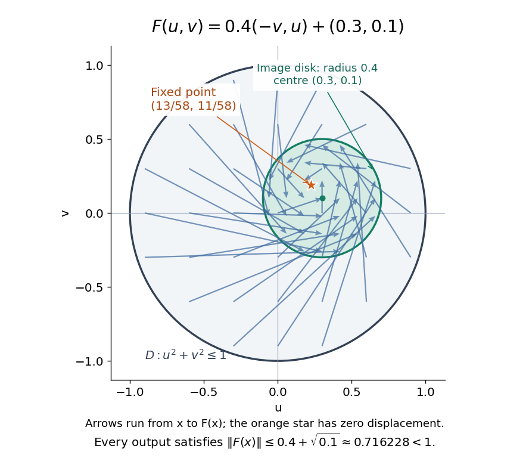
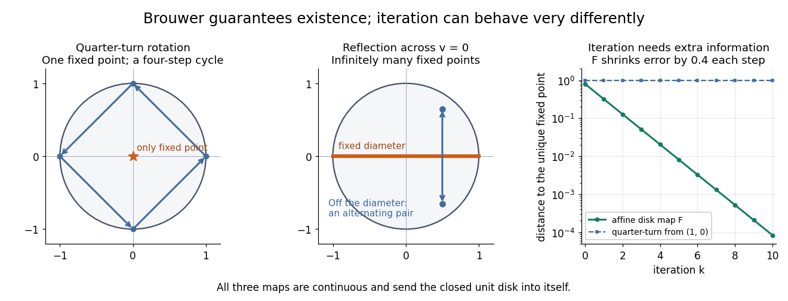

# Brouwer fixed-point theorem

↑ **Parent:** [Topological analysis](topological-analysis-split.md)  
ⓦ [Wiki](https://en.wikipedia.org/wiki/Brouwer_fixed-point_theorem)

The [Brouwer fixed-point theorem](brouwer-fixed-point-theorem.md) says that every [continuous map](continuous-map.md) $F:K\to K$ has a [fixed point](fixed-point.md) when $K$ is a nonempty [compact set](compact-space.md) and a [convex set](convex-set.md) in a [finite-dimensional vector space](finite-dimensional-vector-space.md) over the [real numbers](real-number.md). Equivalently, take $K\subseteq\mathbb R^n$ for a finite $n$, with the usual [Euclidean space](euclidean-norm.md) structure: there is some $x_*\in K$ such that $F(x_*)=x_*$. The conclusion guarantees at least one [fixed point](fixed-point.md), without asserting uniqueness or telling us how quickly to find one. [MIT lecture slides on Brouwer's theorem](https://courses.csail.mit.edu/6.5440/fall23/lectures/L23_images.pdf)

The standard pictures are a [closed ball](closed-ball.md), including a [closed unit ball](closed-unit-ball.md), and a [simplex](simplex.md). A filled [disk](disk-mathematics.md) qualifies; its bounding [circle](circle.md) alone does not. A [probability simplex](probability-simplex.md) also qualifies even though its [dimension](dimension-vector-space.md) is smaller than that of its ambient [Euclidean space](euclidean-norm.md). The hypotheses have concrete meanings: being a [convex set](convex-set.md) keeps every [line segment](line-segment.md) between allowed points inside $K$, and [compactness](compact-space.md) prevents escape or loss of a limiting point. In [Euclidean space](euclidean-norm.md), the [Heine-Borel theorem](heine-borel-theorem.md) identifies [compact sets](compact-space.md) with [closed sets](closed-set.md) that are [bounded sets](bounded-set.md). Crucially, every output must belong to the same $K$ as the input.

For a fully computable example, let $D=\{(u,v):u^2+v^2\leq1\}$ be the filled unit [disk](disk-mathematics.md). Apply a counterclockwise quarter-turn [rotation](rotation-mathematics.md), shrink by $0.4$, and add a [translation](translation-geometry.md):

$$
R_{90}(u,v)=(-v,u),\qquad F(u,v)=0.4R_{90}(u,v)+(0.3,0.1).
$$

This [affine map](affine-map.md) is a [continuous map](continuous-map.md). Because the [rotation](rotation-mathematics.md) preserves the [Euclidean norm](euclidean-norm.md), the [triangle inequality](triangle-inequality.md) gives, for every $x\in D$,

$$
\|F(x)\|\leq0.4\|x\|+\|(0.3,0.1)\|\leq0.4+\sqrt{0.1}\approx0.716228<1.
$$

Thus the whole image lies strictly inside $D$. More precisely, it is a [disk](disk-mathematics.md) of [radius](radius.md) $0.4$ centred at $(0.3,0.1)$. This containment check is what makes the [Brouwer fixed-point theorem](brouwer-fixed-point-theorem.md) applicable; a formula being a [continuous map](continuous-map.md) by itself would not suffice.

The [fixed point](fixed-point.md) can now be found by a [system of linear equations](system-of-linear-equations.md):

$$
u=-\frac25v+\frac3{10},\qquad v=\frac25u+\frac1{10},\qquad x_*=\left(\frac{13}{58},\frac{11}{58}\right)\approx(0.224138,0.189655).
$$

Indeed, substitution gives $F(x_*)=(-22/290+87/290,26/290+29/290)=x_*$. Its [Euclidean norm](euclidean-norm.md) is $\sqrt{290}/58\approx0.293610$, safely inside $D$. The figure shows arrows from sample inputs to their outputs; an arrow disappears at the [fixed point](fixed-point.md) because the displacement $F(x)-x$ vanishes there.

**[Figure 1](#image-a-quarter-turn-shrinking-and-translation-keep-a-disk-inside-itself). A quarter-turn, shrinking, and translation keep a disk inside itself**.

Repeated [iterations of a map](iterated-function.md) happen to succeed for this example. Starting at $x_0=(1,0)$ and setting $x_{k+1}=F(x_k)$ gives $x_1=(0.3,0.5)$, $x_2=(0.1,0.22)$, and $x_3=(0.212,0.14)$. Subtracting the [fixed point](fixed-point.md) equation yields $x_{k+1}-x_*=0.4R_{90}(x_k-x_*)$, so the [Euclidean distance](euclidean-distance.md) to $x_*$ shrinks by exactly $0.4$ each step. This extra fact follows from the [contraction mapping](contraction-mapping.md) property and the [Banach fixed-point theorem](contraction-mapping-theorem.md). It is additional information beyond the [Brouwer fixed-point theorem](brouwer-fixed-point-theorem.md).

The distinction becomes visible with two simpler [continuous maps](continuous-map.md) of the same [disk](disk-mathematics.md). The pure [rotation](rotation-mathematics.md) $G(u,v)=(-v,u)$ has exactly one [fixed point](fixed-point.md), $(0,0)$, since $u=-v$ and $v=u$ force both to vanish. Yet [iterations of a map](iterated-function.md) starting at $(1,0)$ here cycle through $(0,1)$, $(-1,0)$, and $(0,-1)$ forever. Their [Euclidean distance](euclidean-distance.md) from $(0,0)$ stays one, so there is no [convergence in a metric space](convergence-in-a-metric-space.md). The [reflection](reflection-mathematics.md) $H(u,v)=(u,-v)$ has an entire [line segment](line-segment.md) of [fixed points](fixed-point.md), namely $\{(u,0):-1\leq u\leq1\}$. Starting off that [line segment](line-segment.md) produces an alternating pair. Existence, uniqueness, and convergence of [iterations of a map](iterated-function.md) are separate questions.

**[Figure 2](#image-existence-of-a-fixed-point-does-not-imply-uniqueness-or-convergence-of-iteration). Existence of a fixed point does not imply uniqueness or convergence of iteration**.

Removing hypotheses changes the answer. Restrict the same quarter-turn [rotation](rotation-mathematics.md) to the [circle](circle.md) $S^1=\{(u,v):u^2+v^2=1\}$. It remains a [continuous map](continuous-map.md) into that [compact set](compact-space.md), but its only possible [fixed point](fixed-point.md), $(0,0)$, has been removed. The [circle](circle.md) is not a [convex set](convex-set.md). Conversely, on the unbounded [convex set](convex-set.md) $\mathbb R$, the [translation](translation-geometry.md) $t\mapsto t+1$ has no [fixed point](fixed-point.md); on the open [interval](interval-mathematics.md) $(0,1)$, $t\mapsto(t+1)/2$ also has none. Neither domain is a [compact set](compact-space.md). The finite-dimensional [closed ball](closed-ball.md) statement should likewise not be extended to arbitrary [infinite-dimensional vector spaces](infinite-dimensional-vector-space.md), where a [closed ball](closed-ball.md) need not be a [compact set](compact-space.md).

The one-dimensional version explains the connection to the [intermediate value theorem](intermediate-value-theorem.md). For a [continuous map](continuous-map.md) $f:[a,b]\to[a,b]$, put $h(t)=f(t)-t$. Then $h(a)\geq0$ and $h(b)\leq0$, so the [intermediate value theorem](intermediate-value-theorem.md) gives $h(c)=0$ for some $c\in[a,b]$. In higher [dimensions](dimension-vector-space.md), the [Brouwer fixed-point theorem](brouwer-fixed-point-theorem.md) supplies a corresponding existence principle when this scalar sign argument is unavailable. Its practical value is ensuring that a proposed equation $x=F(x)$ has a solution once a suitable domain is found; it supplies no general promise of a fast [algorithm](algorithm.md).

A useful application is [positive matrix eigenvector from simplex normalization](positive-matrix-eigenvector-from-simplex-normalization.md): rescale the output of a strictly positive [matrix](matrix.md) to make its entries sum to one. For example, take

$$
A=\begin{pmatrix}2&1\\1&2\end{pmatrix},\qquad x=(t,1-t),\quad 0\leq t\leq1.
$$

On this [probability simplex](probability-simplex.md), $Ax=(1+t,2-t)$ has entry sum $3$, so the normalized [continuous map](continuous-map.md) is $T(x)=((1+t)/3,(2-t)/3)$. Both entries are positive and sum to one, keeping the image inside the [probability simplex](probability-simplex.md). Its [fixed point](fixed-point.md) equation is $t=(1+t)/3$, hence $t=1/2$. Consequently $x_*=(1/2,1/2)$ satisfies $Ax_*=(3/2,3/2)=3x_*$: a strictly positive [eigenvector](eigenvector.md) with [eigenvalue](eigenvalue.md) $3$. In larger [dimensions](dimension-vector-space.md), the [Brouwer fixed-point theorem](brouwer-fixed-point-theorem.md) guarantees the corresponding positive [eigenvector](eigenvector.md) without requiring us to solve a [system of linear equations](system-of-linear-equations.md) in advance. The [fixed point](fixed-point.md) expresses preservation of relative weights, rather than preservation of their unnormalized size.

Proofs can be approached through the [no-retraction theorem](no-retraction-theorem.md) or [Sperner's lemma](sperner-s-lemma.md). In the latter approach, increasingly fine [triangulations](triangulation.md) locate approximate [fixed points](fixed-point.md); [compactness](compact-space.md) supplies a [convergent subsequence](convergent-subsequence.md), and [continuous maps](continuous-map.md) turn its limit into an exact [fixed point](fixed-point.md). [Daskalakis and Farina, Brouwer and Sperner](https://www.mit.edu/~6.7980/brouwer.html)

A primary historical reference is L. E. J. Brouwer's 1911 paper Über Abbildung von Mannigfaltigkeiten, whose digitized original is hosted by Zenodo under DOI 10.1007/BF01456812. This gives a direct route to the early literature behind the [Brouwer fixed-point theorem](brouwer-fixed-point-theorem.md). [Brouwer, Über Abbildung von Mannigfaltigkeiten, 1911](https://zenodo.org/records/1428286)

**Table of contents**

- [Positive matrix eigenvector from simplex normalization](positive-matrix-eigenvector-from-simplex-normalization.md)
- [Surjectivity of a continuous bounded-displacement map](surjectivity-of-a-continuous-bounded-displacement-map.md)
- [Brouwer inward-pointing zero lemma](brouwer-inward-pointing-zero-lemma.md)
- [Polynomial root from a disk self-map](polynomial-root-from-a-disk-self-map.md)
- [Poincaré-Miranda theorem](poincare-miranda-theorem.md)
  - [Clamped-map proof of planar path crossing](clamped-map-proof-of-planar-path-crossing.md)
- [Sperner's lemma](sperner-s-lemma.md)

## ↑ Ancestors (5)

1. [Topological analysis](topological-analysis-split.md)
2. [Analysis](analysis-split.md)
3. [Area of mathematics](area-of-mathematics.md)
4. [Mathematics](mathematics-split.md)
5. [Codex Wiki](split.md)

## ← Incoming links (37)

- [Brouwer fixed-point theorem](brouwer-fixed-point-theorem.md)
- [Brouwer gain-map proof of bimatrix equilibrium](brouwer-gain-map-proof-of-bimatrix-equilibrium.md)
- [Brouwer inward-pointing zero lemma](brouwer-inward-pointing-zero-lemma.md)
- [Gain-map proof of symmetric equilibrium](gain-map-proof-of-symmetric-equilibrium.md)
- [Nash equilibrium](nash-equilibrium.md)
- [No-retraction theorem](no-retraction-theorem.md)
- [Solution](past-exam-of-the-mathematics-course-of-the-university-of-cambridge/2005/ii/paper-1/11f/solution.md)
- [Solution](past-exam-of-the-mathematics-course-of-the-university-of-cambridge/2005/iii/paper-40/3/solution.md)
- [Solution](past-exam-of-the-mathematics-course-of-the-university-of-cambridge/2006/ii/paper-1/2g/solution.md)
- [Solution](past-exam-of-the-mathematics-course-of-the-university-of-cambridge/2007/ii/paper-4/2f/solution.md)
- [Solution](past-exam-of-the-mathematics-course-of-the-university-of-cambridge/2007/iii/paper-35/1/solution.md)
- [Solution](past-exam-of-the-mathematics-course-of-the-university-of-cambridge/2008/ii/paper-2/2f/a/solution.md)
- [Solution](past-exam-of-the-mathematics-course-of-the-university-of-cambridge/2008/ii/paper-2/2f/b/solution.md)
- [Solution](past-exam-of-the-mathematics-course-of-the-university-of-cambridge/2008/iii/paper-38/6/solution.md)
- [Solution](past-exam-of-the-mathematics-course-of-the-university-of-cambridge/2009/ii/paper-2/11f/a/solution.md)
- [Solution](past-exam-of-the-mathematics-course-of-the-university-of-cambridge/2009/ii/paper-2/11f/b/solution.md)
- [Solution](past-exam-of-the-mathematics-course-of-the-university-of-cambridge/2010/ii/paper-2/11f/i/solution.md)
- [Solution](past-exam-of-the-mathematics-course-of-the-university-of-cambridge/2010/ii/paper-2/11f/ii/solution.md)
- [Solution](past-exam-of-the-mathematics-course-of-the-university-of-cambridge/2010/ii/paper-2/11f/iii/solution.md)
- [Solution](past-exam-of-the-mathematics-course-of-the-university-of-cambridge/2012/iii/paper-32/2/solution.md)
- [Solution](past-exam-of-the-mathematics-course-of-the-university-of-cambridge/2012/iii/paper-55/2/solution.md)
- [Solution](past-exam-of-the-mathematics-course-of-the-university-of-cambridge/2013/iii/paper-38/5/a/solution.md)
- [Solution](past-exam-of-the-mathematics-course-of-the-university-of-cambridge/2015/ii/paper-2/9i/solution.md)
- [Solution](past-exam-of-the-mathematics-course-of-the-university-of-cambridge/2017/ii/paper-3/2f/a/solution.md)
- [Solution](past-exam-of-the-mathematics-course-of-the-university-of-cambridge/2017/ii/paper-3/2f/b/solution.md)
- [Solution](past-exam-of-the-mathematics-course-of-the-university-of-cambridge/2018/iii/paper-213/1/ii/solution.md)
- [Solution](past-exam-of-the-mathematics-course-of-the-university-of-cambridge/2021/ii/paper-4/2h/a/solution.md)
- [Solution](past-exam-of-the-mathematics-course-of-the-university-of-cambridge/2021/ii/paper-4/2h/c/solution.md)
- [Solution](past-exam-of-the-mathematics-course-of-the-university-of-cambridge/2022/ii/paper-4/12g/a/i/solution.md)
- [Solution](past-exam-of-the-mathematics-course-of-the-university-of-cambridge/2022/ii/paper-4/12g/b/solution.md)
- [Solution](past-exam-of-the-mathematics-course-of-the-university-of-cambridge/2022/ii/paper-4/12g/c/solution.md)
- [Solution](past-exam-of-the-mathematics-course-of-the-university-of-cambridge/2023/ii/paper-4/2f/iii/solution.md)
- [Solution](past-exam-of-the-mathematics-course-of-the-university-of-cambridge/2023/ii/paper-4/2f/iv/solution.md)
- [Solution](past-exam-of-the-mathematics-course-of-the-university-of-cambridge/2026/ii/paper-1/2i/solution.md)
- [Perron–Frobenius theorem](perron-frobenius-theorem.md)
- [Positive matrix eigenvector from simplex normalization](positive-matrix-eigenvector-from-simplex-normalization.md)
- [Symmetric Nash gain map](symmetric-nash-gain-map.md)
