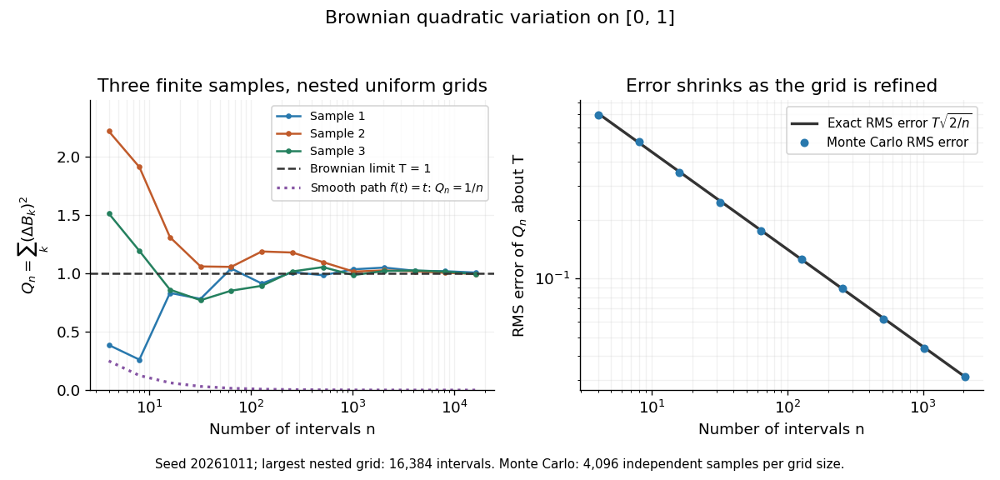

# Brownian motion

↑ **Parent:** [Stochastic process](stochastic-process-split.md)  
ⓦ [Wiki](https://en.wikipedia.org/wiki/Brownian_motion)

Standard one-dimensional [Brownian motion](brownian-motion-split.md) is a real-valued [stochastic process](stochastic-process-split.md) $(B_t)_{t\geq0}$ on a [probability space](probability-space-split.md) with three defining properties: $B_0=0$ [almost surely](almost-sure-convergence.md); its [sample paths](sample-path.md) $t\mapsto B_t$ are continuous [almost surely](almost-sure-convergence.md); and its [Brownian increments](brownian-increment.md) over any finite collection of disjoint time intervals are [independent](independent-random-variables.md), with

$$
B_t-B_s\sim N(0,t-s)
\qquad(0\leq s<t).
$$

Here $N(m,v)$ denotes the [normal distribution](normal-distribution.md) with [expectation](expected-value-split.md) $m$ and [variance](variance-split.md) $v$. The alternative symbol $W_t$ denotes the same kind of [stochastic process](stochastic-process-split.md). Continuity is a simultaneous statement about an entire [sample path](sample-path.md), rather than a separate assertion at each fixed time. Relative to its [natural Brownian filtration](natural-brownian-filtration.md), a future [Brownian increment](brownian-increment.md) is [independent](independent-random-variables.md) of all observations up to its starting time.

The normalization gives $B_t\sim N(0,t)$, so the [standard deviation](standard-deviation.md) of a [Brownian increment](brownian-increment.md) over duration $h$ is $\sqrt h$. For $h=1$, $0.01$, and $0.0001$, the corresponding [standard deviations](standard-deviation.md) are $1$, $0.1$, and $0.01$. Time becoming one hundred times shorter makes typical displacement ten times smaller. [Brownian scaling](brownian-scaling.md) expresses this rule for the whole [stochastic process](stochastic-process-split.md), while the [Brownian covariance kernel](brownian-covariance-kernel.md) describes how positions at different times remain related despite [independent increments](independent-increments.md).

For a concrete [probability](probability.md) calculation, let $\Phi$ be the [cumulative distribution function](cumulative-distribution-function.md) of $N(0,1)$. At time four, $B_4/2$ has that [normal distribution](normal-distribution.md), hence

$$
\mathbb P(|B_4|\leq1)=\Phi(1/2)-\Phi(-1/2)=2\Phi(1/2)-1\approx0.3829249225,
\qquad
\mathbb P(B_4>2)=1-\Phi(1)\approx0.1586552539.
$$

These numbers can be reproduced using the [error function](error-function.md): $\Phi(z)=(1+\operatorname{erf}(z/\sqrt2))/2$. In particular, zero [expectation](expected-value-split.md) does not mean small displacement: $\mathbb P(|B_1|\leq1)\approx0.6826894921$, but the same fixed interval contains only about $38.3\%$ of the [probability](probability.md) at time four.

The [probability density function](probability-density-function.md) of $B_t$, for $t>0$, is

$$
p(t,x)=\frac{1}{\sqrt{2\pi t}}e^{-x^2/(2t)}.
$$

Its [partial derivatives](partial-derivative.md) satisfy

$$
\partial_t p=\left(-\frac1{2t}+\frac{x^2}{2t^2}\right)p,
\qquad
\partial_x^2p=\left(-\frac1t+\frac{x^2}{t^2}\right)p,
\qquad
\partial_t p=\tfrac12\partial_x^2p.
$$

Thus the [normal distribution](normal-distribution.md) spreads according to the [heat equation](heat-equation.md). Starting at a fixed position $x_0$ replaces $x$ by $x-x_0$. This is a useful bridge between individual random trajectories and the deterministic evolution of their [probability density function](probability-density-function.md): the same [Brownian motion](brownian-motion-split.md) provides both descriptions.

Physical [diffusion](diffusion.md) uses its own scale. For constant [diffusion coefficient](diffusion-coefficient.md) $D>0$, the position model $X_t=x_0+\sqrt{2D}B_t$ has [variance](variance-split.md) $2Dt$, and its [probability density function](probability-density-function.md) satisfies $\partial_t p_D=D\partial_x^2p_D$. For example, $D=0.5\,\mathrm{\mu m^2/s}$ gives displacement [variance](variance-split.md) $4\,\mathrm{\mu m^2}$ after four seconds, hence [standard deviation](standard-deviation.md) $2\,\mathrm{\mu m}$. Standard [Brownian motion](brownian-motion-split.md) corresponds numerically to $D=1/2$ in chosen units; omitting the factor two changes the physical convention. Einstein's 1905 paper relates [diffusion](diffusion.md) to the mean squared displacement in precisely this convention. [Einstein, 1905 paper, English translation, section 4](https://djalil.chafai.net/docs/M2/history-brownian-motion/Einstein%20-%201905.pdf)

Continuity does not supply a smooth physical [velocity](velocity.md). The difference quotient $(B_{t+h}-B_t)/h$ has [normal distribution](normal-distribution.md) $N(0,1/h)$, so its [standard deviation](standard-deviation.md) grows as $h^{-1/2}$: for the three durations above it is $1$, $10$, and $100$. This calculation motivates the [nowhere differentiability of Brownian motion](nowhere-differentiability-of-brownian-motion.md), but it alone is not a proof of the simultaneous assertion at every time. The theorem says that, with [probability](probability.md) one, no finite [derivative](derivative.md) exists anywhere along the [sample path](sample-path.md). A drawn polygon only displays a finite grid; its straight segments cannot establish this theorem. See Theorem 7.1.6 in [Probability: Theory and Examples (fifth edition) by Rick Durrett](probability-theory-and-examples-fifth-edition-by-rick-durrett.md).

For physical particles, [Brownian motion](brownian-motion-split.md) is a model of position on suitable observation scales. It does not claim that microscopic [velocity](velocity.md) is a [derivative](derivative.md) of this idealized path. Einstein explicitly restricts his assumption of [independent increments](independent-increments.md) to intervals that are not too short. [Einstein, 1905 paper, English translation, section 4](https://djalil.chafai.net/docs/M2/history-brownian-motion/Einstein%20-%201905.pdf)

Another way to measure the roughness is [quadratic variation](quadratic-variation.md). On $[0,T]$, divide time into $n$ equal intervals and form

$$
Q_n=\sum_{k=1}^n(B_{kT/n}-B_{(k-1)T/n})^2.
$$

Writing each [Brownian increment](brownian-increment.md) as $\sqrt{T/n}Z_k$ with [independent](independent-random-variables.md) standard [normal random variables](gaussian-random-variable.md) gives $Q_n=(T/n)\sum_kZ_k^2$. Since $\mathbb EZ_k^2=1$ and $\mathbb EZ_k^4=3$, the [variance](variance-split.md) of $Z_k^2$ is $2$, and

$$
\mathbb E Q_n=T,
\qquad
\operatorname{Var}(Q_n)=\frac{2T^2}{n},
\qquad
\mathbb E[(Q_n-T)^2]=\frac{2T^2}{n}\longrightarrow0.
$$

This proves [mean-square convergence](convergence-in-l2.md) to $T$ along uniform partitions. For $T=2$ and $n=100$, the [expectation](expected-value-split.md) is $2$, the [variance](variance-split.md) is $0.08$, and the [root mean square](root-mean-square.md) of the error is $\sqrt{0.08}\approx0.2828427125$. For a general deterministic [partition of an interval](partition-of-an-interval.md) with lengths $h_k$, the same calculation gives error [variance](variance-split.md) $2\sum_kh_k^2\leq2T\max_kh_k$, so shrinking the largest interval also suffices.

The resulting [quadratic variation](quadratic-variation.md) is $[B]_T=T$, whereas the [smooth function](smooth-function.md) $f(t)=t$ gives $Q_n=T^2/n\to0$. This difference explains why the ordinary rules of [calculus](calculus-split.md) need the second-order correction in the [Itô formula](ito-s-lemma.md). In the figure, coarser sums reuse the same finest-grid [Brownian increments](brownian-increment.md); their individual values can oscillate with refinement even though the error tends to zero in [mean-square convergence](convergence-in-l2.md). Refining a fixed interpolating polygon forever would instead give zero [quadratic variation](quadratic-variation.md), so the finite-grid illustration must not be confused with the limiting [Brownian motion](brownian-motion-split.md).

**[Figure 1](#image-finite-brownian-quadratic-variation-sums-and-their-exact-root-mean-squared-error). Finite Brownian quadratic variation sums and their exact root mean squared error**.

Historically, Brown's 1828 report describes microscopic observations made in 1827, starting with particles released from pollen and extending to inorganic materials; this challenged an explanation based solely on living matter. His observations and the later mathematical model are distinct contributions. [Brown, 1828 report, reprinted in his collected works](https://en.wikisource.org/wiki/The_miscellaneous_botanical_works_of_Robert_Brown/Volume_1/A_brief_account_of_microscopical_observations_made_on_the_particles_contained_in_the_pollen_of_plants) Einstein's 1905 paper derived a quantitative connection between [kinetic theory](kinetic-theory-split.md), [diffusion](diffusion.md), and displacement. [Einstein, 1905 paper, English translation](https://djalil.chafai.net/docs/M2/history-brownian-motion/Einstein%20-%201905.pdf) Wiener's 1923 Differential-Space developed integration on spaces of paths, a foundation for [Wiener measure](wiener-measure.md); it also acknowledges earlier work and his own previous papers. These dates mark documented contributions rather than an assertion that each subject had a single discoverer. [Wiener, Differential-Space, 1923, sections 1 and 6](https://djalil.chafai.net/docs/M2/history-brownian-motion/Wiener%20-%201923.pdf)

**Table of contents**

- [Ballistic-to-diffusive Brownian displacement](ballistic-to-diffusive-brownian-displacement.md)
- [Brownian displacement conventions](brownian-displacement-conventions.md)
- [Radial Brownian displacement](radial-brownian-displacement.md)
- [Perrin sedimentation experiment](perrin-sedimentation-experiment.md)
  - [Sedimentation scale height](sedimentation-scale-height.md)
  - [Avogadro constant from sedimentation and diffusion](avogadro-constant-from-sedimentation-and-diffusion.md)
  - [Radius sensitivity in the Perrin sedimentation experiment](radius-sensitivity-in-the-perrin-sedimentation-experiment.md)
  - [Wall hindrance in Brownian diffusion](wall-hindrance-in-brownian-diffusion.md)
- [Strict comparison of one-sided and absolute Brownian maxima](strict-comparison-of-one-sided-and-absolute-brownian-maxima.md)
- [Brownian sign transform](brownian-sign-transform.md)
- [Cylindrical Brownian motion](cylindrical-brownian-motion.md)
- [Brownian motion under a quadratic time change](brownian-motion-under-a-quadratic-time-change.md)
- [Rotational invariance of Brownian motion](rotational-invariance-of-brownian-motion.md)
- [Brownian moment recursion](brownian-moment-recursion.md)
  - [Centered Brownian powers need not be martingales](centered-brownian-powers-need-not-be-martingales.md)
- [Planar Brownian motion avoids a fixed point](planar-brownian-motion-avoids-a-fixed-point.md)
- [Lévy area](levy-area.md)
- [Projection criterion for Brownian avoidance of affine subspaces](projection-criterion-for-brownian-avoidance-of-affine-subspaces.md)
- [Wiener sausage](wiener-sausage.md)
  - [Survival among independently moving Poisson traps](survival-among-independently-moving-poisson-traps.md)
- [Blumenthal zero-one law](blumenthal-zero-one-law.md)
- [Brownian increment](brownian-increment.md)
- [Brownian fluctuations exceed the square-root scale](brownian-fluctuations-exceed-the-square-root-scale.md)
- [Integrated Brownian motion](integrated-brownian-motion.md)
- [Integrated square of Brownian motion](integrated-square-of-brownian-motion.md)
  - [Laplace transform of the integrated square of Brownian motion](laplace-transform-of-the-integrated-square-of-brownian-motion.md)
- [Brownian time reversal on a finite interval](brownian-time-reversal-on-a-finite-interval.md)
  - [Independent Brownian arms at a deterministic time](independent-brownian-arms-at-a-deterministic-time.md)
- [Longitudinal Brownian field with transverse covariance](longitudinal-brownian-field-with-transverse-covariance.md)
- [Local maximum of Brownian motion](local-maximum-of-brownian-motion.md)
- [Nowhere monotonicity of Brownian motion](nowhere-monotonicity-of-brownian-motion.md)
- [Brownian hitting of lattice spheres](brownian-hitting-of-lattice-spheres.md)
- [Brownian paths are not uniformly continuous on the half-line](brownian-paths-are-not-uniformly-continuous-on-the-half-line.md)
- [Brownian filtration](brownian-filtration.md)
  - [Natural Brownian filtration](natural-brownian-filtration.md)
- [Martingale representation theorem](martingale-representation-theorem.md)
  - [Brownian martingale representation theorem](brownian-martingale-representation-theorem.md)
    - [Clark-Ocone formula for a smooth Brownian terminal payoff](clark-ocone-formula-for-a-smooth-brownian-terminal-payoff.md)
- [Exponential martingale for Brownian motion](exponential-martingale-for-brownian-motion.md)
- [Integral of Brownian motion](integral-of-brownian-motion.md)
  - [Brownian motion transform by three times its running average](brownian-motion-transform-by-three-times-its-running-average.md)
- [Diffusion coefficient](diffusion-coefficient.md)
  - [Mean squared displacement](mean-squared-displacement.md)
    - [Mean displacement magnitude of three-dimensional Brownian motion](mean-displacement-magnitude-of-three-dimensional-brownian-motion.md)
  - [Solutal diffusivity](solutal-diffusivity.md)
- [Orthogonal invariance of Brownian motion](orthogonal-invariance-of-brownian-motion.md)
- [Meeting time of two independent Brownian motions](meeting-time-of-two-independent-brownian-motions.md)
- [Wiener measure](wiener-measure.md)
  - [Wiener theorem](wiener-theorem.md)
  - [Cameron-Martin space of Wiener measure](cameron-martin-space-of-wiener-measure.md)
    - [Cameron-Martin theorem](cameron-martin-theorem.md)
      - [Cameron-Martin shifts on infinite Wiener path space](cameron-martin-shifts-on-infinite-wiener-path-space.md)
      - [Cameron-Martin theorem for a linear drift](cameron-martin-theorem-for-a-linear-drift.md)
        - [First-passage density of Brownian motion with positive drift](first-passage-density-of-brownian-motion-with-positive-drift.md)
- [Brownian Hölder regularity](brownian-holder-regularity.md)
- [Brownian zero set](brownian-zero-set.md)
- [Reflection invariance of Brownian motion](reflection-invariance-of-brownian-motion.md)
- [Critical exponential moment of a drifted Brownian hitting time](critical-exponential-moment-of-a-drifted-brownian-hitting-time.md)
- [Bessel process](bessel-process.md)
  - [Two-dimensional Bessel transition law](two-dimensional-bessel-transition-law.md)
  - [Squared Bessel process](squared-bessel-process.md)
    - [Additivity of independently driven squared Bessel processes](additivity-of-independently-driven-squared-bessel-processes.md)
  - [Oppositely driven Bessel exit probability](oppositely-driven-bessel-exit-probability.md)
  - [Truncation construction of a positive Bessel strong solution](truncation-construction-of-a-positive-bessel-strong-solution.md)
  - [Three-dimensional Bessel process](three-dimensional-bessel-process.md)
    - [Logarithmic escape rate of three-dimensional Brownian motion](logarithmic-escape-rate-of-three-dimensional-brownian-motion.md)
  - [Beta integral for strict ordering of coupled Bessel lifetimes](beta-integral-for-strict-ordering-of-coupled-bessel-lifetimes.md)
  - [Reciprocal three-dimensional Bessel strict local martingale](reciprocal-three-dimensional-bessel-strict-local-martingale.md)
  - [Bessel power local martingale](bessel-power-local-martingale.md)
    - [Stopped inverse radial power martingale classification](stopped-inverse-radial-power-martingale-classification.md)
    - [All-time minimum of a transient Bessel process](all-time-minimum-of-a-transient-bessel-process.md)
  - [Hitting-zero classification for a Bessel process](hitting-zero-classification-for-a-bessel-process.md)
    - [Finite-time access to zero for Bessel dimensions below two](finite-time-access-to-zero-for-bessel-dimensions-below-two.md)
  - [Scaling invariance of a Bessel process](scaling-invariance-of-a-bessel-process.md)
  - [Exponential Brownian-to-Bessel time change](exponential-brownian-to-bessel-time-change.md)
    - [Logarithmic growth of an exponential Brownian clock with positive drift](logarithmic-growth-of-an-exponential-brownian-clock-with-positive-drift.md)
  - [Power time change of a Bessel process](power-time-change-of-a-bessel-process.md)
- [Reflected Brownian motion](reflected-brownian-motion.md)
  - [Reflected Brownian motion with negative drift](reflected-brownian-motion-with-negative-drift.md)
    - [Stationary law of negatively drifted reflected Brownian motion](stationary-law-of-negatively-drifted-reflected-brownian-motion.md)
- [Brownian occupation time](brownian-occupation-time.md)
  - [Infinite occupation time of one-dimensional Brownian motion](infinite-occupation-time-of-one-dimensional-brownian-motion.md)
    - [Divergence of a driftless Brownian exponential clock](divergence-of-a-driftless-brownian-exponential-clock.md)
  - [Occupation-times formula](occupation-times-formula.md)
- [Planar Brownian motion](planar-brownian-motion.md)
  - [Area of a planar Brownian path](area-of-a-planar-brownian-path.md)
  - [Logarithmic radius of planar Brownian motion](logarithmic-radius-of-planar-brownian-motion.md)
    - [Winding at logarithmic radial passage levels](winding-at-logarithmic-radial-passage-levels.md)
  - [Planar Brownian stochastic area](planar-brownian-stochastic-area.md)
    - [Orthogonality of the radial martingale and planar Brownian area](orthogonality-of-the-radial-martingale-and-planar-brownian-area.md)
      - [Common-clock Brownian representation of radius and area](common-clock-brownian-representation-of-radius-and-area.md)
  - [Brownian excursion in the upper half-plane](brownian-excursion-in-the-upper-half-plane.md)
    - [Restriction probability of a Brownian half-plane excursion](restriction-probability-of-a-brownian-half-plane-excursion.md)
      - [Boundary derivative is an excursion avoidance probability](boundary-derivative-is-an-excursion-avoidance-probability.md)
  - [Conformal invariance of planar Brownian motion](conformal-invariance-of-planar-brownian-motion.md)
    - [Small-radius Brownian winding law](small-radius-brownian-winding-law.md)
    - [Cauchy exit law from a Brownian half-plane](cauchy-exit-law-from-a-brownian-half-plane.md)
    - [Complex exponential construction of planar Brownian motion](complex-exponential-construction-of-planar-brownian-motion.md)
    - [Power-map reduction for Brownian exit from a wedge](power-map-reduction-for-brownian-exit-from-a-wedge.md)
      - [Brownian wedge-exit probability](brownian-wedge-exit-probability.md)
    - [Conformal Brownian clock](conformal-brownian-clock.md)
      - [Finite exit from a conformal image of a bounded planar domain](finite-exit-from-a-conformal-image-of-a-bounded-planar-domain.md)
  - [Rotational invariance of planar Brownian motion](rotational-invariance-of-planar-brownian-motion.md)
  - [Recurrence of planar Brownian motion](recurrence-of-planar-brownian-motion.md)
    - [Polar point for planar Brownian motion](polar-point-for-planar-brownian-motion.md)
    - [Divergence of a positive planar Brownian occupation integral](divergence-of-a-positive-planar-brownian-occupation-integral.md)
  - [Brownian reflection coupling](brownian-reflection-coupling.md)
  - [Harmonic measure](harmonic-measure.md)
    - [Brownian exit law from a quadrant](brownian-exit-law-from-a-quadrant.md)
    - [Harmonic capacity from infinity in the upper half-plane](harmonic-capacity-from-infinity-in-the-upper-half-plane.md)
      - [Reflection lower bound for harmonic hull capacity](reflection-lower-bound-for-harmonic-hull-capacity.md)
      - [Radius gives no positive lower bound for disconnected harmonic hull capacity](radius-gives-no-positive-lower-bound-for-disconnected-harmonic-hull-capacity.md)
      - [Subadditivity of harmonic hull capacity](subadditivity-of-harmonic-hull-capacity.md)
    - [Harmonic-measure asymptotic at infinity](harmonic-measure-asymptotic-at-infinity.md)
    - [Möbius calculation of circular Brownian exit](mobius-calculation-of-circular-brownian-exit.md)
    - [Reflection identity for Brownian exit from a half-disc](reflection-identity-for-brownian-exit-from-a-half-disc.md)
    - [Bottom-boundary harmonic measure of a strip](bottom-boundary-harmonic-measure-of-a-strip.md)
    - [Upper-half-plane harmonic measure of the positive half-axis](upper-half-plane-harmonic-measure-of-the-positive-half-axis.md)
    - [Planar Brownian annulus hitting probability](planar-brownian-annulus-hitting-probability.md)
    - [Brownian entrance law to a disc from infinity](brownian-entrance-law-to-a-disc-from-infinity.md)
- [Coordinatewise coalescing coupling of Brownian motions](coordinatewise-coalescing-coupling-of-brownian-motions.md)
- [Strong law for Brownian motion](strong-law-for-brownian-motion.md)
- [Brownian loop measure](brownian-loop-measure.md)
  - [Pinned Brownian loop measure at an interior point](pinned-brownian-loop-measure-at-an-interior-point.md)
  - [Conformal restriction measure on simple loops](conformal-restriction-measure-on-simple-loops.md)
    - [Recovery of a loop measure from conformal deficits](recovery-of-a-loop-measure-from-conformal-deficits.md)
- [Nowhere differentiability of Brownian motion](nowhere-differentiability-of-brownian-motion.md)
- [Lévy characterization of Brownian motion](levy-characterization-of-brownian-motion.md)
  - [Lévy characterization of multidimensional Brownian motion](levy-characterization-of-multidimensional-brownian-motion.md)
- [Brownian scaling](brownian-scaling.md)
- [Recurrence of one-dimensional Brownian motion](recurrence-of-one-dimensional-brownian-motion.md)
- [Transience of Brownian motion in dimension at least three](transience-of-brownian-motion-in-dimension-at-least-three.md)
  - [Brownian sphere-hitting probability in dimension three](brownian-sphere-hitting-probability-in-dimension-three.md)
    - [Last visit to a bounded ball for three-dimensional Brownian motion](last-visit-to-a-bounded-ball-for-three-dimensional-brownian-motion.md)
- [Brownian exit time](brownian-exit-time.md)
  - [Brownian hitting probability of a ball](brownian-hitting-probability-of-a-ball.md)
    - [Small-ball Brownian hitting asymptotic](small-ball-brownian-hitting-asymptotic.md)
  - [Brownian exit-time expectation in an orthant](brownian-exit-time-expectation-in-an-orthant.md)
  - [Uniform ball sampling by Brownian stopping](uniform-ball-sampling-by-brownian-stopping.md)
    - [Brownian exit-time ball averaging identity](brownian-exit-time-ball-averaging-identity.md)
      - [Finiteness propagation of Brownian mean exit times](finiteness-propagation-of-brownian-mean-exit-times.md)
  - [Brownian exit from an interval](brownian-exit-from-an-interval.md)
    - [Asymmetric Brownian interval-exit transform](asymmetric-brownian-interval-exit-transform.md)
    - [Brownian exit-time skeleton](brownian-exit-time-skeleton.md)
      - [Gaussian limit of a Brownian exit skeleton](gaussian-limit-of-a-brownian-exit-skeleton.md)
      - [Brownian exit-skeleton clock convergence](brownian-exit-skeleton-clock-convergence.md)
    - [Laplace transform of symmetric Brownian interval-exit time](laplace-transform-of-symmetric-brownian-interval-exit-time.md)
    - [Brownian symmetric interval-exit moments](brownian-symmetric-interval-exit-moments.md)
    - [Conditional Brownian interval-exit time](conditional-brownian-interval-exit-time.md)
  - [Dynkin formula for Brownian motion](dynkin-formula-for-brownian-motion.md)
- [Brownian bridge](brownian-bridge.md)
  - [Time reversal of a Brownian bridge](time-reversal-of-a-brownian-bridge.md)
  - [Stochastic integral representation of a Brownian bridge](stochastic-integral-representation-of-a-brownian-bridge.md)
  - [F-Brownian bridge](f-brownian-bridge.md)
  - [Brownian bridge independence from its endpoint](brownian-bridge-independence-from-its-endpoint.md)
  - [Brownian-bridge crossing probability](brownian-bridge-crossing-probability.md)
- [Exponential Brownian martingale](exponential-brownian-martingale.md)
  - [Parameter derivative of the exponential Brownian martingale](parameter-derivative-of-the-exponential-brownian-martingale.md)
- [Gaussian-process characterization of Brownian motion](gaussian-process-characterization-of-brownian-motion.md)
- [Time inversion of Brownian motion](time-inversion-of-brownian-motion.md)
- [Brownian motion with drift](brownian-motion-with-drift.md)
  - [Drifted Brownian interval-exit probability](drifted-brownian-interval-exit-probability.md)
  - [Infinite-horizon singularity of Brownian motion with constant drift](infinite-horizon-singularity-of-brownian-motion-with-constant-drift.md)
  - [Finite-horizon maximum of Brownian motion with negative drift](finite-horizon-maximum-of-brownian-motion-with-negative-drift.md)
  - [Infinite-horizon crossing probability for Brownian motion with negative drift](infinite-horizon-crossing-probability-for-brownian-motion-with-negative-drift.md)
  - [Last passage time above a level for Brownian motion with negative drift](last-passage-time-above-a-level-for-brownian-motion-with-negative-drift.md)
- [Reflection principle (Wiener process)](reflection-principle-wiener-process.md)
  - [Brownian terminal-to-maximum ratio](brownian-terminal-to-maximum-ratio.md)
  - [Brownian reflection at a stopping time](brownian-reflection-at-a-stopping-time.md)
  - [Brownian running maximum](brownian-running-maximum.md)
    - [Gaussian maximal bound for Brownian motion](gaussian-maximal-bound-for-brownian-motion.md)
    - [Atomless maxima on separated Brownian intervals](atomless-maxima-on-separated-brownian-intervals.md)
    - [Finite-horizon maximum of Brownian motion with drift](finite-horizon-maximum-of-brownian-motion-with-drift.md)
      - [Joint endpoint and maximum law for drifted Brownian motion](joint-endpoint-and-maximum-law-for-drifted-brownian-motion.md)
    - [Integral lower envelope for the Brownian maximum](integral-lower-envelope-for-the-brownian-maximum.md)
    - [Brownian barrier survival asymptotic](brownian-barrier-survival-asymptotic.md)
    - [Maximum before a lower Brownian barrier](maximum-before-a-lower-brownian-barrier.md)
    - [Joint distribution of Brownian motion and its running maximum](joint-distribution-of-brownian-motion-and-its-running-maximum.md)
    - [Lévy identity for Brownian motion](levy-identity-for-brownian-motion.md)
    - [Time of the Brownian maximum](time-of-the-brownian-maximum.md)
      - [Brownian motion shifted at its finite-horizon maximum](brownian-motion-shifted-at-its-finite-horizon-maximum.md)
- [Brownian transition semigroup](brownian-transition-semigroup.md)
  - [Brownian transition density](brownian-transition-density.md)
    - [Killed Brownian transition density](killed-brownian-transition-density.md)
  - [Brownian compensator martingale](brownian-compensator-martingale.md)
- [Exponential test-function characterization of Brownian motion](exponential-test-function-characterization-of-brownian-motion.md)
  - [Conditional characteristic-function criterion for Brownian increments](conditional-characteristic-function-criterion-for-brownian-increments.md)

## ↑ Ancestors (6)

1. [Stochastic process](stochastic-process-split.md)
2. [Probability theory](probability-theory-split.md)
3. [Probability and statistics](probability-and-statistics-split.md)
4. [Area of mathematics](area-of-mathematics.md)
5. [Mathematics](mathematics-split.md)
6. [Codex Wiki](split.md)

## ← Incoming links (508)

- [Addition law for square-root branching diffusions](addition-law-for-square-root-branching-diffusions.md)
- [Additivity of independently driven squared Bessel processes](additivity-of-independently-driven-squared-bessel-processes.md)
- [Albert Einstein](albert-einstein.md)
- [Arctangent transform of a two-noise affine diffusion](arctangent-transform-of-a-two-noise-affine-diffusion.md)
- [Ashkin radiation-pressure trapping experiment](ashkin-radiation-pressure-trapping-experiment.md)
- [Asymmetric Brownian interval-exit transform](asymmetric-brownian-interval-exit-transform.md)
- [Atomless maxima on separated Brownian intervals](atomless-maxima-on-separated-brownian-intervals.md)
- [Bessel process](bessel-process.md)
- [Binary Brownian drift filter](binary-brownian-drift-filter.md)
- [Blumenthal zero-one law](blumenthal-zero-one-law.md)
- [Bounded Girsanov density for exit of an unstable linear diffusion](bounded-girsanov-density-for-exit-of-an-unstable-linear-diffusion.md)
- [Brownian barrier survival asymptotic](brownian-barrier-survival-asymptotic.md)
- [Brownian bridge independence from its endpoint](brownian-bridge-independence-from-its-endpoint.md)
- [Brownian conditioning by a stopped Bessel density](brownian-conditioning-by-a-stopped-bessel-density.md)
- [Brownian covariance kernel](brownian-covariance-kernel.md)
- [Brownian excursion in the upper half-plane](brownian-excursion-in-the-upper-half-plane.md)
- [Brownian exit law from a quadrant](brownian-exit-law-from-a-quadrant.md)
- [Brownian exit-time expectation in an orthant](brownian-exit-time-expectation-in-an-orthant.md)
- [Brownian exit-time skeleton](brownian-exit-time-skeleton.md)
- [Brownian filtration](brownian-filtration.md)
- [Brownian first-passage Laplace transform](brownian-first-passage-laplace-transform.md)
- [Brownian first-passage subordinator](brownian-first-passage-subordinator.md)
- [Brownian first-passage time](brownian-first-passage-time.md)
- [Brownian hitting of lattice spheres](brownian-hitting-of-lattice-spheres.md)
- [Brownian increment](brownian-increment.md)
- [Brownian local time](brownian-local-time.md)
- [Brownian martingale proof of Gaussian concentration](brownian-martingale-proof-of-gaussian-concentration.md)
- [Brownian motion](brownian-motion-split.md)
- [Brownian motion shifted at its finite-horizon maximum](brownian-motion-shifted-at-its-finite-horizon-maximum.md)
- [Brownian motion transform by three times its running average](brownian-motion-transform-by-three-times-its-running-average.md)
- [Brownian motion with drift](brownian-motion-with-drift.md)
- [Brownian portfolio exposures](brownian-portfolio-exposures.md)
- [Brownian radius estimate from endpoint displacements](brownian-radius-estimate-from-endpoint-displacements.md)
- [Brownian reflection at a stopping time](brownian-reflection-at-a-stopping-time.md)
- [Brownian representation of half-plane capacity](brownian-representation-of-half-plane-capacity.md)
- [Brownian scaling](brownian-scaling.md)
- [Brownian sheet](brownian-sheet.md)
- [Brownian sign transform](brownian-sign-transform.md)
- [Brownian sphere-hitting probability in dimension three](brownian-sphere-hitting-probability-in-dimension-three.md)
- [Brownian symmetric interval-exit moments](brownian-symmetric-interval-exit-moments.md)
- [Brownian terminal-to-maximum ratio](brownian-terminal-to-maximum-ratio.md)
- [Brownian time reversal on a finite interval](brownian-time-reversal-on-a-finite-interval.md)
- [Brownian upper law of the iterated logarithm](brownian-upper-law-of-the-iterated-logarithm.md)
- [Brownian zero mode of a fluctuating interface](brownian-zero-mode-of-a-fluctuating-interface.md)
- [Brownian zero set](brownian-zero-set.md)
- [Cameron-Martin theorem for a linear drift](cameron-martin-theorem-for-a-linear-drift.md)
- [Cauchy exit law from a Brownian half-plane](cauchy-exit-law-from-a-brownian-half-plane.md)
- [Cauchy law of an infinite-horizon Brownian exponential integral](cauchy-law-of-an-infinite-horizon-brownian-exponential-integral.md)
- [Cauchy process](cauchy-process.md)
- [Characteristic function under conditionally symmetric martingale increments](characteristic-function-under-conditionally-symmetric-martingale-increments.md)
- [Circle-average process of the Gaussian free field is Brownian motion](circle-average-process-of-the-gaussian-free-field-is-brownian-motion.md)
- [Complex exponential construction of planar Brownian motion](complex-exponential-construction-of-planar-brownian-motion.md)
- [Complex exponential of two orthogonal Brownian motions](complex-exponential-of-two-orthogonal-brownian-motions.md)
- [Conditional characteristic-function criterion for Brownian increments](conditional-characteristic-function-criterion-for-brownian-increments.md)
- [Conditionally Gaussian stochastic integral with an independent integrator](conditionally-gaussian-stochastic-integral-with-an-independent-integrator.md)
- [Conformal invariance of planar Brownian motion](conformal-invariance-of-planar-brownian-motion.md)
- [Conformal Markov property of SLE](conformal-markov-property-of-sle.md)
- [Constant market price of risk investment](constant-market-price-of-risk-investment.md)
- [Continuous Lévy process](continuous-levy-process.md)
- [Cosine-exponential Brownian local martingale](cosine-exponential-brownian-local-martingale.md)
- [Covariance function](covariance-function.md)
- [Cylindrical Brownian motion](cylindrical-brownian-motion.md)
- [Dambis-Dubins-Schwarz theorem](dambis-dubins-schwarz-theorem.md)
- [Dickey–Fuller test](dickey-fuller-test.md)
- [Diffusion amplitude](diffusion-amplitude.md)
- [Diffusion attenuation of a spin echo](diffusion-attenuation-of-a-spin-echo.md)
- [Diffusion limit](diffusion-limit.md)
- [Diffusion-limited cluster aggregation](diffusion-limited-cluster-aggregation.md)
- [Diffusion with hyperbolic tangent drift](diffusion-with-hyperbolic-tangent-drift.md)
- [Divergence of a driftless Brownian exponential clock](divergence-of-a-driftless-brownian-exponential-clock.md)
- [Divergence of a positive planar Brownian occupation integral](divergence-of-a-positive-planar-brownian-occupation-integral.md)
- [Domain Markov property of a chordal Loewner chain](domain-markov-property-of-a-chordal-loewner-chain.md)
- [Donsker's theorem](donsker-s-theorem.md)
- [Dyadic interval](dyadic-interval.md)
- [Dyadic quadratic variation of Brownian motion](dyadic-quadratic-variation-of-brownian-motion.md)
- [Dynkin formula for a diffusion](dynkin-formula-for-a-diffusion.md)
- [Dynkin formula for Brownian motion](dynkin-formula-for-brownian-motion.md)
- [Enhanced Brownian motion](enhanced-brownian-motion.md)
- [Equipartition theorem](equipartition-theorem.md)
- [Exponential Brownian time change to a stationary Ornstein-Uhlenbeck process](exponential-brownian-time-change-to-a-stationary-ornstein-uhlenbeck-process.md)
- [Exponential martingale for Brownian motion](exponential-martingale-for-brownian-motion.md)
- [Finite-horizon drift replacement by a change of measure](finite-horizon-drift-replacement-by-a-change-of-measure.md)
- [Finite-horizon exponential-utility portfolio](finite-horizon-exponential-utility-portfolio.md)
- [Fixed-level versus simultaneous Brownian passage-time equality](fixed-level-versus-simultaneous-brownian-passage-time-equality.md)
- [Fourth-moment deficit and bracket variance identity](fourth-moment-deficit-and-bracket-variance-identity.md)
- [Gaussian Brownian drift filter](gaussian-brownian-drift-filter.md)
- [Gaussian continuous martingale](gaussian-continuous-martingale.md)
- [Gaussian diffusion of a smooth initial profile](gaussian-diffusion-of-a-smooth-initial-profile.md)
- [Gaussian heat kernel](gaussian-heat-kernel.md)
- [Gaussian-process characterization of Brownian motion](gaussian-process-characterization-of-brownian-motion.md)
- [Gaussian white noise](gaussian-white-noise.md)
- [Gaussian white noise model](gaussian-white-noise-model.md)
- [Girsanov density for a stopped Bessel process](girsanov-density-for-a-stopped-bessel-process.md)
- [Global existence theorem for stochastic differential equations with Lipschitz coefficients](global-existence-theorem-for-stochastic-differential-equations-with-lipschitz-coefficients.md)
- [Harmonic functions of Brownian motion](harmonic-functions-of-brownian-motion.md)
- [Hasselmann stochastic climate model](hasselmann-stochastic-climate-model.md)
- [Heavy-traffic limit of a queue](heavy-traffic-limit-of-a-queue.md)
- [Independent Brownian arms at a deterministic time](independent-brownian-arms-at-a-deterministic-time.md)
- [Independent increments](independent-increments.md)
- [Infinite-horizon singularity of Brownian motion with constant drift](infinite-horizon-singularity-of-brownian-motion-with-constant-drift.md)
- [Infinite occupation time of one-dimensional Brownian motion](infinite-occupation-time-of-one-dimensional-brownian-motion.md)
- [Instantaneous covariance rank in a one-factor rate model](instantaneous-covariance-rank-in-a-one-factor-rate-model.md)
- [Integrated Brownian motion](integrated-brownian-motion.md)
- [Inverse-square Gaussian law of Brownian first passage](inverse-square-gaussian-law-of-brownian-first-passage.md)
- [Itô diffusion](ito-diffusion.md)
- [Itô integral](ito-integral.md)
- [Itô's lemma](ito-s-lemma.md)
- [Joint distribution of Brownian motion and its running maximum](joint-distribution-of-brownian-motion-and-its-running-maximum.md)
- [Kinematic reversibility of Stokes flow](kinematic-reversibility-of-stokes-flow.md)
- [Knight theorem for orthogonal martingales](knight-theorem-for-orthogonal-martingales.md)
- [Lamperti transform (diffusion)](lamperti-transform-diffusion.md)
- [Laplace transform of symmetric Brownian interval-exit time](laplace-transform-of-symmetric-brownian-interval-exit-time.md)
- [Last visit to a bounded ball for three-dimensional Brownian motion](last-visit-to-a-bounded-ball-for-three-dimensional-brownian-motion.md)
- [Lateral mobility of membrane proteins](lateral-mobility-of-membrane-proteins.md)
- [Learning hedge in a binary-drift investment model](learning-hedge-in-a-binary-drift-investment-model.md)
- [Lévy area](levy-area.md)
- [Lévy characterization of Brownian motion](levy-characterization-of-brownian-motion.md)
- [Lévy characterization of multidimensional Brownian motion](levy-characterization-of-multidimensional-brownian-motion.md)
- [Lévy identity for Brownian motion](levy-identity-for-brownian-motion.md)
- [Linear-boundary Brownian first-passage distribution](linear-boundary-brownian-first-passage-distribution.md)
- [Local maximum of Brownian motion](local-maximum-of-brownian-motion.md)
- [Longitudinal Brownian field with transverse covariance](longitudinal-brownian-field-with-transverse-covariance.md)
- [Market price of risk](market-price-of-risk.md)
- [Markov process](markov-process-split.md)
- [Martingale problem for Brownian motion](martingale-problem-for-brownian-motion.md)
- [Maximum occupation is not a hitting probability](maximum-occupation-is-not-a-hitting-probability.md)
- [Mean displacement magnitude of three-dimensional Brownian motion](mean-displacement-magnitude-of-three-dimensional-brownian-motion.md)
- [Molecular diffusion](molecular-diffusion.md)
- [Natural Brownian filtration](natural-brownian-filtration.md)
- [Nested polygonal approximation of Brownian rough paths](nested-polygonal-approximation-of-brownian-rough-paths.md)
- [Newtonian potential of the Brownian heat kernel](newtonian-potential-of-the-brownian-heat-kernel.md)
- [Nowhere monotonicity of Brownian motion](nowhere-monotonicity-of-brownian-motion.md)
- [Occupation approximations for Brownian local time](occupation-approximations-for-brownian-local-time.md)
- [Optical trap calibration uncertainty](optical-trap-calibration-uncertainty.md)
- [Optical trap relaxation time](optical-trap-relaxation-time.md)
- [Optical tweezers](optical-tweezers.md)
- [Ornstein-Uhlenbeck process](ornstein-uhlenbeck-process.md)
- [Orthogonal continuous local martingales](orthogonal-continuous-local-martingales.md)
- [Particle aggregation](particle-aggregation.md)
- [Solution](past-exam-of-the-mathematics-course-of-the-university-of-cambridge/2001/iii/paper-21/4/a/solution.md)
- [Solution](past-exam-of-the-mathematics-course-of-the-university-of-cambridge/2001/iii/paper-21/6/solution.md)
- [Solution](past-exam-of-the-mathematics-course-of-the-university-of-cambridge/2001/iii/paper-22/3/solution.md)
- [Solution](past-exam-of-the-mathematics-course-of-the-university-of-cambridge/2001/iii/paper-23/3/a/solution.md)
- [Solution](past-exam-of-the-mathematics-course-of-the-university-of-cambridge/2001/iii/paper-23/3/c/solution.md)
- [Solution](past-exam-of-the-mathematics-course-of-the-university-of-cambridge/2002/iii/paper-27/1/solution.md)
- [Solution](past-exam-of-the-mathematics-course-of-the-university-of-cambridge/2002/iii/paper-27/4/a/solution.md)
- [Solution](past-exam-of-the-mathematics-course-of-the-university-of-cambridge/2002/iii/paper-27/4/solution.md)
- [Solution](past-exam-of-the-mathematics-course-of-the-university-of-cambridge/2002/iii/paper-29/4/solution.md)
- [Solution](past-exam-of-the-mathematics-course-of-the-university-of-cambridge/2002/iii/paper-31/1/solution.md)
- [Solution](past-exam-of-the-mathematics-course-of-the-university-of-cambridge/2002/iii/paper-31/4/solution.md)
- [Solution](past-exam-of-the-mathematics-course-of-the-university-of-cambridge/2002/iii/paper-31/6/d/solution.md)
- [Solution](past-exam-of-the-mathematics-course-of-the-university-of-cambridge/2002/iii/paper-31/6/solution.md)
- [Solution](past-exam-of-the-mathematics-course-of-the-university-of-cambridge/2002/iii/paper-51/1/solution.md)
- [Solution](past-exam-of-the-mathematics-course-of-the-university-of-cambridge/2002/iii/paper-51/2/solution.md)
- [Solution](past-exam-of-the-mathematics-course-of-the-university-of-cambridge/2003/iii/paper-29/3/a/solution.md)
- [Solution](past-exam-of-the-mathematics-course-of-the-university-of-cambridge/2003/iii/paper-29/5/solution.md)
- [Solution](past-exam-of-the-mathematics-course-of-the-university-of-cambridge/2003/iii/paper-30/5/solution.md)
- [Solution](past-exam-of-the-mathematics-course-of-the-university-of-cambridge/2003/iii/paper-32/3/solution.md)
- [Solution](past-exam-of-the-mathematics-course-of-the-university-of-cambridge/2003/iii/paper-33/2/b/solution.md)
- [Solution](past-exam-of-the-mathematics-course-of-the-university-of-cambridge/2003/iii/paper-33/2/c/ii/solution.md)
- [Solution](past-exam-of-the-mathematics-course-of-the-university-of-cambridge/2003/iii/paper-33/3/solution.md)
- [Solution](past-exam-of-the-mathematics-course-of-the-university-of-cambridge/2004/iii/paper-28/2/b/solution.md)
- [Solution](past-exam-of-the-mathematics-course-of-the-university-of-cambridge/2004/iii/paper-28/4/solution.md)
- [Solution](past-exam-of-the-mathematics-course-of-the-university-of-cambridge/2004/iii/paper-30/2/b/solution.md)
- [Solution](past-exam-of-the-mathematics-course-of-the-university-of-cambridge/2004/iii/paper-30/3/a/solution.md)
- [Solution](past-exam-of-the-mathematics-course-of-the-university-of-cambridge/2004/iii/paper-30/3/b/solution.md)
- [Solution](past-exam-of-the-mathematics-course-of-the-university-of-cambridge/2004/iii/paper-30/3/c/solution.md)
- [Solution](past-exam-of-the-mathematics-course-of-the-university-of-cambridge/2004/iii/paper-30/5/b/solution.md)
- [Solution](past-exam-of-the-mathematics-course-of-the-university-of-cambridge/2004/iii/paper-34/3/solution.md)
- [Solution](past-exam-of-the-mathematics-course-of-the-university-of-cambridge/2004/iii/paper-34/5/solution.md)
- [Solution](past-exam-of-the-mathematics-course-of-the-university-of-cambridge/2004/iii/paper-34/6/solution.md)
- [Solution](past-exam-of-the-mathematics-course-of-the-university-of-cambridge/2004/iii/paper-35/5/b/solution.md)
- [Solution](past-exam-of-the-mathematics-course-of-the-university-of-cambridge/2004/iii/paper-67/2/d/solution.md)
- [Solution](past-exam-of-the-mathematics-course-of-the-university-of-cambridge/2005/ii/paper-4/28j/c/solution.md)
- [Solution](past-exam-of-the-mathematics-course-of-the-university-of-cambridge/2005/iii/paper-34/3/b/solution.md)
- [Solution](past-exam-of-the-mathematics-course-of-the-university-of-cambridge/2005/iii/paper-34/4/a/solution.md)
- [Solution](past-exam-of-the-mathematics-course-of-the-university-of-cambridge/2005/iii/paper-34/4/c/solution.md)
- [Solution](past-exam-of-the-mathematics-course-of-the-university-of-cambridge/2005/iii/paper-34/5/a/solution.md)
- [Solution](past-exam-of-the-mathematics-course-of-the-university-of-cambridge/2005/iii/paper-34/5/b/solution.md)
- [Solution](past-exam-of-the-mathematics-course-of-the-university-of-cambridge/2005/iii/paper-35/3/solution.md)
- [Solution](past-exam-of-the-mathematics-course-of-the-university-of-cambridge/2005/iii/paper-35/5/solution.md)
- [Solution](past-exam-of-the-mathematics-course-of-the-university-of-cambridge/2005/iii/paper-38/1/a/solution.md)
- [Solution](past-exam-of-the-mathematics-course-of-the-university-of-cambridge/2005/iii/paper-38/2/c/solution.md)
- [Solution](past-exam-of-the-mathematics-course-of-the-university-of-cambridge/2005/iii/paper-38/4/a/solution.md)
- [Solution](past-exam-of-the-mathematics-course-of-the-university-of-cambridge/2005/iii/paper-38/4/c/solution.md)
- [Solution](past-exam-of-the-mathematics-course-of-the-university-of-cambridge/2005/iii/paper-38/5/solution.md)
- [Solution](past-exam-of-the-mathematics-course-of-the-university-of-cambridge/2005/iii/paper-42/6/v/solution.md)
- [Solution](past-exam-of-the-mathematics-course-of-the-university-of-cambridge/2005/iii/paper-48/1/solution.md)
- [Solution](past-exam-of-the-mathematics-course-of-the-university-of-cambridge/2006/iii/paper-31/3/i/solution.md)
- [Solution](past-exam-of-the-mathematics-course-of-the-university-of-cambridge/2006/iii/paper-32/3/c/solution.md)
- [Solution](past-exam-of-the-mathematics-course-of-the-university-of-cambridge/2006/iii/paper-32/4/solution.md)
- [Solution](past-exam-of-the-mathematics-course-of-the-university-of-cambridge/2006/iii/paper-32/5/solution.md)
- [Solution](past-exam-of-the-mathematics-course-of-the-university-of-cambridge/2006/iii/paper-35/1/c/solution.md)
- [Solution](past-exam-of-the-mathematics-course-of-the-university-of-cambridge/2006/iii/paper-35/2/b/solution.md)
- [Solution](past-exam-of-the-mathematics-course-of-the-university-of-cambridge/2006/iii/paper-35/2/c/solution.md)
- [Solution](past-exam-of-the-mathematics-course-of-the-university-of-cambridge/2006/iii/paper-35/3/a/solution.md)
- [Solution](past-exam-of-the-mathematics-course-of-the-university-of-cambridge/2006/iii/paper-35/3/b/solution.md)
- [Solution](past-exam-of-the-mathematics-course-of-the-university-of-cambridge/2006/iii/paper-35/3/d/solution.md)
- [Solution](past-exam-of-the-mathematics-course-of-the-university-of-cambridge/2006/iii/paper-35/4/b/solution.md)
- [Solution](past-exam-of-the-mathematics-course-of-the-university-of-cambridge/2006/iii/paper-35/4/c/solution.md)
- [Solution](past-exam-of-the-mathematics-course-of-the-university-of-cambridge/2006/iii/paper-35/5/solution.md)
- [Solution](past-exam-of-the-mathematics-course-of-the-university-of-cambridge/2006/iii/paper-39/3/solution.md)
- [Solution](past-exam-of-the-mathematics-course-of-the-university-of-cambridge/2006/iii/paper-39/6/solution.md)
- [Solution](past-exam-of-the-mathematics-course-of-the-university-of-cambridge/2006/iii/paper-40/2/solution.md)
- [Solution](past-exam-of-the-mathematics-course-of-the-university-of-cambridge/2006/iii/paper-40/3/solution.md)
- [Solution](past-exam-of-the-mathematics-course-of-the-university-of-cambridge/2006/iii/paper-40/4/solution.md)
- [Solution](past-exam-of-the-mathematics-course-of-the-university-of-cambridge/2006/iii/paper-69/3/a/solution.md)
- [Solution](past-exam-of-the-mathematics-course-of-the-university-of-cambridge/2007/ii/paper-1/28j/ii/solution.md)
- [Solution](past-exam-of-the-mathematics-course-of-the-university-of-cambridge/2007/iii/paper-32/3/solution.md)
- [Solution](past-exam-of-the-mathematics-course-of-the-university-of-cambridge/2007/iii/paper-32/4/solution.md)
- [Solution](past-exam-of-the-mathematics-course-of-the-university-of-cambridge/2007/iii/paper-33/3/a/solution.md)
- [Solution](past-exam-of-the-mathematics-course-of-the-university-of-cambridge/2007/iii/paper-33/3/b/solution.md)
- [Solution](past-exam-of-the-mathematics-course-of-the-university-of-cambridge/2007/iii/paper-33/3/c/solution.md)
- [Solution](past-exam-of-the-mathematics-course-of-the-university-of-cambridge/2007/iii/paper-33/3/d/solution.md)
- [Solution](past-exam-of-the-mathematics-course-of-the-university-of-cambridge/2007/iii/paper-33/5/a/solution.md)
- [Solution](past-exam-of-the-mathematics-course-of-the-university-of-cambridge/2007/iii/paper-33/5/c/solution.md)
- [Solution](past-exam-of-the-mathematics-course-of-the-university-of-cambridge/2007/iii/paper-36/1/a/solution.md)
- [Solution](past-exam-of-the-mathematics-course-of-the-university-of-cambridge/2007/iii/paper-36/1/b/solution.md)
- [Solution](past-exam-of-the-mathematics-course-of-the-university-of-cambridge/2007/iii/paper-36/1/c/solution.md)
- [Solution](past-exam-of-the-mathematics-course-of-the-university-of-cambridge/2007/iii/paper-36/2/d/solution.md)
- [Solution](past-exam-of-the-mathematics-course-of-the-university-of-cambridge/2007/iii/paper-36/4/a/solution.md)
- [Solution](past-exam-of-the-mathematics-course-of-the-university-of-cambridge/2007/iii/paper-36/5/solution.md)
- [Solution](past-exam-of-the-mathematics-course-of-the-university-of-cambridge/2007/iii/paper-39/1/solution.md)
- [Solution](past-exam-of-the-mathematics-course-of-the-university-of-cambridge/2007/iii/paper-39/2/solution.md)
- [Solution](past-exam-of-the-mathematics-course-of-the-university-of-cambridge/2007/iii/paper-39/3/solution.md)
- [Solution](past-exam-of-the-mathematics-course-of-the-university-of-cambridge/2007/iii/paper-42/3/solution.md)
- [Solution](past-exam-of-the-mathematics-course-of-the-university-of-cambridge/2007/iii/paper-42/4/solution.md)
- [Solution](past-exam-of-the-mathematics-course-of-the-university-of-cambridge/2007/iii/paper-70/2/solution.md)
- [Solution](past-exam-of-the-mathematics-course-of-the-university-of-cambridge/2008/ii/paper-2/28j/a/solution.md)
- [Solution](past-exam-of-the-mathematics-course-of-the-university-of-cambridge/2008/iii/paper-34/6/solution.md)
- [Solution](past-exam-of-the-mathematics-course-of-the-university-of-cambridge/2008/iii/paper-36/2/a/solution.md)
- [Solution](past-exam-of-the-mathematics-course-of-the-university-of-cambridge/2008/iii/paper-36/2/b/solution.md)
- [Solution](past-exam-of-the-mathematics-course-of-the-university-of-cambridge/2008/iii/paper-36/4/c/solution.md)
- [Solution](past-exam-of-the-mathematics-course-of-the-university-of-cambridge/2008/iii/paper-37/2/a/solution.md)
- [Solution](past-exam-of-the-mathematics-course-of-the-university-of-cambridge/2008/iii/paper-37/3/c/solution.md)
- [Solution](past-exam-of-the-mathematics-course-of-the-university-of-cambridge/2008/iii/paper-37/4/a/solution.md)
- [Solution](past-exam-of-the-mathematics-course-of-the-university-of-cambridge/2008/iii/paper-37/4/b/solution.md)
- [Solution](past-exam-of-the-mathematics-course-of-the-university-of-cambridge/2008/iii/paper-37/4/c/solution.md)
- [Solution](past-exam-of-the-mathematics-course-of-the-university-of-cambridge/2008/iii/paper-37/5/a/solution.md)
- [Solution](past-exam-of-the-mathematics-course-of-the-university-of-cambridge/2008/iii/paper-37/5/b/solution.md)
- [Solution](past-exam-of-the-mathematics-course-of-the-university-of-cambridge/2008/iii/paper-37/5/c/solution.md)
- [Solution](past-exam-of-the-mathematics-course-of-the-university-of-cambridge/2008/iii/paper-37/6/b/solution.md)
- [Solution](past-exam-of-the-mathematics-course-of-the-university-of-cambridge/2008/iii/paper-39/4/i/solution.md)
- [Solution](past-exam-of-the-mathematics-course-of-the-university-of-cambridge/2008/iii/paper-39/6/i/solution.md)
- [Solution](past-exam-of-the-mathematics-course-of-the-university-of-cambridge/2009/ii/paper-3/29j/solution.md)
- [Solution](past-exam-of-the-mathematics-course-of-the-university-of-cambridge/2009/iii/paper-29/3/a/solution.md)
- [Solution](past-exam-of-the-mathematics-course-of-the-university-of-cambridge/2009/iii/paper-29/3/c/solution.md)
- [Solution](past-exam-of-the-mathematics-course-of-the-university-of-cambridge/2009/iii/paper-29/5/a/solution.md)
- [Solution](past-exam-of-the-mathematics-course-of-the-university-of-cambridge/2009/iii/paper-29/5/b/solution.md)
- [Solution](past-exam-of-the-mathematics-course-of-the-university-of-cambridge/2009/iii/paper-29/5/c/solution.md)
- [Solution](past-exam-of-the-mathematics-course-of-the-university-of-cambridge/2009/iii/paper-29/6/b/solution.md)
- [Solution](past-exam-of-the-mathematics-course-of-the-university-of-cambridge/2009/iii/paper-29/6/c/solution.md)
- [Solution](past-exam-of-the-mathematics-course-of-the-university-of-cambridge/2009/iii/paper-31/5/solution.md)
- [Solution](past-exam-of-the-mathematics-course-of-the-university-of-cambridge/2009/iii/paper-32/3/solution.md)
- [Solution](past-exam-of-the-mathematics-course-of-the-university-of-cambridge/2009/iii/paper-39/1/solution.md)
- [Solution](past-exam-of-the-mathematics-course-of-the-university-of-cambridge/2009/iii/paper-39/2/ii/solution.md)
- [Solution](past-exam-of-the-mathematics-course-of-the-university-of-cambridge/2009/iii/paper-39/4/i/solution.md)
- [Solution](past-exam-of-the-mathematics-course-of-the-university-of-cambridge/2009/iii/paper-39/4/ii/solution.md)
- [Solution](past-exam-of-the-mathematics-course-of-the-university-of-cambridge/2010/ii/paper-1/29i/solution.md)
- [Solution](past-exam-of-the-mathematics-course-of-the-university-of-cambridge/2010/iii/paper-27/2/solution.md)
- [Solution](past-exam-of-the-mathematics-course-of-the-university-of-cambridge/2010/iii/paper-27/3/solution.md)
- [Solution](past-exam-of-the-mathematics-course-of-the-university-of-cambridge/2010/iii/paper-27/4/b/solution.md)
- [Solution](past-exam-of-the-mathematics-course-of-the-university-of-cambridge/2010/iii/paper-27/4/c/solution.md)
- [Solution](past-exam-of-the-mathematics-course-of-the-university-of-cambridge/2010/iii/paper-28/2/b/ii/solution.md)
- [Solution](past-exam-of-the-mathematics-course-of-the-university-of-cambridge/2010/iii/paper-28/6/a/solution.md)
- [Solution](past-exam-of-the-mathematics-course-of-the-university-of-cambridge/2010/iii/paper-28/6/b/solution.md)
- [Solution](past-exam-of-the-mathematics-course-of-the-university-of-cambridge/2010/iii/paper-29/2/b/solution.md)
- [Solution](past-exam-of-the-mathematics-course-of-the-university-of-cambridge/2010/iii/paper-29/2/c/solution.md)
- [Solution](past-exam-of-the-mathematics-course-of-the-university-of-cambridge/2010/iii/paper-29/3/a/solution.md)
- [Solution](past-exam-of-the-mathematics-course-of-the-university-of-cambridge/2010/iii/paper-29/3/b/solution.md)
- [Solution](past-exam-of-the-mathematics-course-of-the-university-of-cambridge/2010/iii/paper-29/3/d/solution.md)
- [Solution](past-exam-of-the-mathematics-course-of-the-university-of-cambridge/2010/iii/paper-29/4/a/solution.md)
- [Solution](past-exam-of-the-mathematics-course-of-the-university-of-cambridge/2010/iii/paper-29/4/b/solution.md)
- [Solution](past-exam-of-the-mathematics-course-of-the-university-of-cambridge/2010/iii/paper-29/4/c/solution.md)
- [Solution](past-exam-of-the-mathematics-course-of-the-university-of-cambridge/2010/iii/paper-29/6/a/solution.md)
- [Solution](past-exam-of-the-mathematics-course-of-the-university-of-cambridge/2010/iii/paper-31/1/solution.md)
- [Solution](past-exam-of-the-mathematics-course-of-the-university-of-cambridge/2010/iii/paper-39/2/c/solution.md)
- [Solution](past-exam-of-the-mathematics-course-of-the-university-of-cambridge/2010/iii/paper-39/2/d/solution.md)
- [Solution](past-exam-of-the-mathematics-course-of-the-university-of-cambridge/2010/iii/paper-39/5/b/solution.md)
- [Solution](past-exam-of-the-mathematics-course-of-the-university-of-cambridge/2011/ii/paper-3/29j/i/solution.md)
- [Solution](past-exam-of-the-mathematics-course-of-the-university-of-cambridge/2012/iii/paper-33/3/d/solution.md)
- [Solution](past-exam-of-the-mathematics-course-of-the-university-of-cambridge/2012/iii/paper-33/5/a/solution.md)
- [Solution](past-exam-of-the-mathematics-course-of-the-university-of-cambridge/2012/iii/paper-33/5/b/solution.md)
- [Solution](past-exam-of-the-mathematics-course-of-the-university-of-cambridge/2012/iii/paper-33/5/c/solution.md)
- [Solution](past-exam-of-the-mathematics-course-of-the-university-of-cambridge/2012/iii/paper-33/6/a/solution.md)
- [Solution](past-exam-of-the-mathematics-course-of-the-university-of-cambridge/2012/iii/paper-33/6/b/solution.md)
- [Solution](past-exam-of-the-mathematics-course-of-the-university-of-cambridge/2012/iii/paper-34/4/b/solution.md)
- [Solution](past-exam-of-the-mathematics-course-of-the-university-of-cambridge/2012/iii/paper-34/4/c/solution.md)
- [Solution](past-exam-of-the-mathematics-course-of-the-university-of-cambridge/2012/iii/paper-34/6/c/solution.md)
- [Solution](past-exam-of-the-mathematics-course-of-the-university-of-cambridge/2012/iii/paper-35/1/b/solution.md)
- [Solution](past-exam-of-the-mathematics-course-of-the-university-of-cambridge/2012/iii/paper-35/1/c/ii/solution.md)
- [Solution](past-exam-of-the-mathematics-course-of-the-university-of-cambridge/2012/iii/paper-35/3/a/solution.md)
- [Solution](past-exam-of-the-mathematics-course-of-the-university-of-cambridge/2012/iii/paper-35/3/b/solution.md)
- [Solution](past-exam-of-the-mathematics-course-of-the-university-of-cambridge/2012/iii/paper-35/3/c/solution.md)
- [Solution](past-exam-of-the-mathematics-course-of-the-university-of-cambridge/2012/iii/paper-43/4/solution.md)
- [Solution](past-exam-of-the-mathematics-course-of-the-university-of-cambridge/2013/iii/paper-24/3/a/solution.md)
- [Solution](past-exam-of-the-mathematics-course-of-the-university-of-cambridge/2013/iii/paper-24/5/a/solution.md)
- [Solution](past-exam-of-the-mathematics-course-of-the-university-of-cambridge/2013/iii/paper-24/6/a/solution.md)
- [Solution](past-exam-of-the-mathematics-course-of-the-university-of-cambridge/2013/iii/paper-25/1/c/3/solution.md)
- [Solution](past-exam-of-the-mathematics-course-of-the-university-of-cambridge/2013/iii/paper-25/4/c/solution.md)
- [Solution](past-exam-of-the-mathematics-course-of-the-university-of-cambridge/2013/iii/paper-25/5/e/solution.md)
- [Solution](past-exam-of-the-mathematics-course-of-the-university-of-cambridge/2013/iii/paper-25/6/e/solution.md)
- [Solution](past-exam-of-the-mathematics-course-of-the-university-of-cambridge/2013/iii/paper-39/1/a/solution.md)
- [Solution](past-exam-of-the-mathematics-course-of-the-university-of-cambridge/2013/iii/paper-40/2/solution.md)
- [Solution](past-exam-of-the-mathematics-course-of-the-university-of-cambridge/2013/iii/paper-40/3/solution.md)
- [Solution](past-exam-of-the-mathematics-course-of-the-university-of-cambridge/2013/iii/paper-40/4/solution.md)
- [Solution](past-exam-of-the-mathematics-course-of-the-university-of-cambridge/2014/iii/paper-26/3/2/solution.md)
- [Solution](past-exam-of-the-mathematics-course-of-the-university-of-cambridge/2014/iii/paper-26/3/3/i/solution.md)
- [Solution](past-exam-of-the-mathematics-course-of-the-university-of-cambridge/2014/iii/paper-26/3/3/ii/solution.md)
- [Solution](past-exam-of-the-mathematics-course-of-the-university-of-cambridge/2014/iii/paper-26/3/3/iii/solution.md)
- [Solution](past-exam-of-the-mathematics-course-of-the-university-of-cambridge/2014/iii/paper-26/4/1/solution.md)
- [Solution](past-exam-of-the-mathematics-course-of-the-university-of-cambridge/2014/iii/paper-26/4/2/solution.md)
- [Solution](past-exam-of-the-mathematics-course-of-the-university-of-cambridge/2014/iii/paper-26/5/solution.md)
- [Solution](past-exam-of-the-mathematics-course-of-the-university-of-cambridge/2014/iii/paper-27/1/b/solution.md)
- [Solution](past-exam-of-the-mathematics-course-of-the-university-of-cambridge/2014/iii/paper-27/2/a/solution.md)
- [Solution](past-exam-of-the-mathematics-course-of-the-university-of-cambridge/2014/iii/paper-27/2/b/solution.md)
- [Solution](past-exam-of-the-mathematics-course-of-the-university-of-cambridge/2014/iii/paper-27/5/c/1/solution.md)
- [Solution](past-exam-of-the-mathematics-course-of-the-university-of-cambridge/2014/iii/paper-27/6/c/solution.md)
- [Solution](past-exam-of-the-mathematics-course-of-the-university-of-cambridge/2014/iii/paper-27/6/d/solution.md)
- [Solution](past-exam-of-the-mathematics-course-of-the-university-of-cambridge/2014/iii/paper-29/1/solution.md)
- [Solution](past-exam-of-the-mathematics-course-of-the-university-of-cambridge/2014/iii/paper-29/2/c/solution.md)
- [Solution](past-exam-of-the-mathematics-course-of-the-university-of-cambridge/2014/iii/paper-29/3/e/solution.md)
- [Solution](past-exam-of-the-mathematics-course-of-the-university-of-cambridge/2014/iii/paper-29/4/solution.md)
- [Solution](past-exam-of-the-mathematics-course-of-the-university-of-cambridge/2015/ii/paper-2/27k/i/solution.md)
- [Solution](past-exam-of-the-mathematics-course-of-the-university-of-cambridge/2015/iii/paper-29/3/i/solution.md)
- [Solution](past-exam-of-the-mathematics-course-of-the-university-of-cambridge/2015/iii/paper-29/4/i/solution.md)
- [Solution](past-exam-of-the-mathematics-course-of-the-university-of-cambridge/2015/iii/paper-29/4/ii/solution.md)
- [Solution](past-exam-of-the-mathematics-course-of-the-university-of-cambridge/2015/iii/paper-30/2/a/solution.md)
- [Solution](past-exam-of-the-mathematics-course-of-the-university-of-cambridge/2015/iii/paper-30/2/b/solution.md)
- [Solution](past-exam-of-the-mathematics-course-of-the-university-of-cambridge/2015/iii/paper-30/2/d/solution.md)
- [Solution](past-exam-of-the-mathematics-course-of-the-university-of-cambridge/2015/iii/paper-30/3/a/solution.md)
- [Solution](past-exam-of-the-mathematics-course-of-the-university-of-cambridge/2015/iii/paper-30/3/c/solution.md)
- [Solution](past-exam-of-the-mathematics-course-of-the-university-of-cambridge/2015/iii/paper-30/3/d/solution.md)
- [Solution](past-exam-of-the-mathematics-course-of-the-university-of-cambridge/2015/iii/paper-30/5/a/solution.md)
- [Solution](past-exam-of-the-mathematics-course-of-the-university-of-cambridge/2015/iii/paper-30/5/c/solution.md)
- [Solution](past-exam-of-the-mathematics-course-of-the-university-of-cambridge/2015/iii/paper-36/2/solution.md)
- [Solution](past-exam-of-the-mathematics-course-of-the-university-of-cambridge/2015/iii/paper-37/1/b/solution.md)
- [Solution](past-exam-of-the-mathematics-course-of-the-university-of-cambridge/2016/iii/paper-201/4/a/solution.md)
- [Solution](past-exam-of-the-mathematics-course-of-the-university-of-cambridge/2016/iii/paper-201/4/c/solution.md)
- [Solution](past-exam-of-the-mathematics-course-of-the-university-of-cambridge/2016/iii/paper-201/4/d/solution.md)
- [Solution](past-exam-of-the-mathematics-course-of-the-university-of-cambridge/2016/iii/paper-201/6/c/solution.md)
- [Solution](past-exam-of-the-mathematics-course-of-the-university-of-cambridge/2016/iii/paper-202/1/d/solution.md)
- [Solution](past-exam-of-the-mathematics-course-of-the-university-of-cambridge/2016/iii/paper-202/2/b/solution.md)
- [Solution](past-exam-of-the-mathematics-course-of-the-university-of-cambridge/2016/iii/paper-202/2/d/solution.md)
- [Solution](past-exam-of-the-mathematics-course-of-the-university-of-cambridge/2016/iii/paper-202/3/a/solution.md)
- [Solution](past-exam-of-the-mathematics-course-of-the-university-of-cambridge/2016/iii/paper-202/3/b/solution.md)
- [Solution](past-exam-of-the-mathematics-course-of-the-university-of-cambridge/2016/iii/paper-202/3/c/solution.md)
- [Solution](past-exam-of-the-mathematics-course-of-the-university-of-cambridge/2016/iii/paper-202/4/d/solution.md)
- [Solution](past-exam-of-the-mathematics-course-of-the-university-of-cambridge/2016/iii/paper-202/5/a/solution.md)
- [Solution](past-exam-of-the-mathematics-course-of-the-university-of-cambridge/2016/iii/paper-202/5/c/solution.md)
- [Solution](past-exam-of-the-mathematics-course-of-the-university-of-cambridge/2016/iii/paper-202/6/b/solution.md)
- [Solution](past-exam-of-the-mathematics-course-of-the-university-of-cambridge/2016/iii/paper-202/6/c/solution.md)
- [Solution](past-exam-of-the-mathematics-course-of-the-university-of-cambridge/2016/iii/paper-202/6/d/solution.md)
- [Solution](past-exam-of-the-mathematics-course-of-the-university-of-cambridge/2016/iii/paper-203/1/a/solution.md)
- [Solution](past-exam-of-the-mathematics-course-of-the-university-of-cambridge/2016/iii/paper-203/3/a/solution.md)
- [Solution](past-exam-of-the-mathematics-course-of-the-university-of-cambridge/2016/iii/paper-203/4/d/solution.md)
- [Solution](past-exam-of-the-mathematics-course-of-the-university-of-cambridge/2016/iii/paper-209/3/solution.md)
- [Solution](past-exam-of-the-mathematics-course-of-the-university-of-cambridge/2016/iii/paper-211/1/a/solution.md)
- [Solution](past-exam-of-the-mathematics-course-of-the-university-of-cambridge/2016/iii/paper-211/1/b/solution.md)
- [Solution](past-exam-of-the-mathematics-course-of-the-university-of-cambridge/2016/iii/paper-211/1/c/solution.md)
- [Solution](past-exam-of-the-mathematics-course-of-the-university-of-cambridge/2016/iii/paper-211/2/c/solution.md)
- [Solution](past-exam-of-the-mathematics-course-of-the-university-of-cambridge/2017/ii/paper-2/27j/a/solution.md)
- [Solution](past-exam-of-the-mathematics-course-of-the-university-of-cambridge/2017/iii/paper-201/6/b/solution.md)
- [Solution](past-exam-of-the-mathematics-course-of-the-university-of-cambridge/2017/iii/paper-201/6/c/solution.md)
- [Solution](past-exam-of-the-mathematics-course-of-the-university-of-cambridge/2017/iii/paper-201/6/d/solution.md)
- [Solution](past-exam-of-the-mathematics-course-of-the-university-of-cambridge/2017/iii/paper-202/2/c/solution.md)
- [Solution](past-exam-of-the-mathematics-course-of-the-university-of-cambridge/2017/iii/paper-202/3/a/solution.md)
- [Solution](past-exam-of-the-mathematics-course-of-the-university-of-cambridge/2017/iii/paper-202/3/b/solution.md)
- [Solution](past-exam-of-the-mathematics-course-of-the-university-of-cambridge/2017/iii/paper-202/3/d/solution.md)
- [Solution](past-exam-of-the-mathematics-course-of-the-university-of-cambridge/2017/iii/paper-202/3/e/solution.md)
- [Solution](past-exam-of-the-mathematics-course-of-the-university-of-cambridge/2017/iii/paper-202/4/a/solution.md)
- [Solution](past-exam-of-the-mathematics-course-of-the-university-of-cambridge/2017/iii/paper-202/4/d/solution.md)
- [Solution](past-exam-of-the-mathematics-course-of-the-university-of-cambridge/2017/iii/paper-202/5/c/solution.md)
- [Solution](past-exam-of-the-mathematics-course-of-the-university-of-cambridge/2017/iii/paper-203/1/b/solution.md)
- [Solution](past-exam-of-the-mathematics-course-of-the-university-of-cambridge/2017/iii/paper-203/4/d/solution.md)
- [Solution](past-exam-of-the-mathematics-course-of-the-university-of-cambridge/2017/iii/paper-316/4/vi/solution.md)
- [Solution](past-exam-of-the-mathematics-course-of-the-university-of-cambridge/2018/iii/paper-201/4/a/solution.md)
- [Solution](past-exam-of-the-mathematics-course-of-the-university-of-cambridge/2018/iii/paper-201/4/b/solution.md)
- [Solution](past-exam-of-the-mathematics-course-of-the-university-of-cambridge/2018/iii/paper-201/4/c/solution.md)
- [Solution](past-exam-of-the-mathematics-course-of-the-university-of-cambridge/2018/iii/paper-201/4/d/solution.md)
- [Solution](past-exam-of-the-mathematics-course-of-the-university-of-cambridge/2018/iii/paper-201/5/a/solution.md)
- [Solution](past-exam-of-the-mathematics-course-of-the-university-of-cambridge/2018/iii/paper-202/1/iii/solution.md)
- [Solution](past-exam-of-the-mathematics-course-of-the-university-of-cambridge/2018/iii/paper-202/2/i/solution.md)
- [Solution](past-exam-of-the-mathematics-course-of-the-university-of-cambridge/2018/iii/paper-202/2/ii/solution.md)
- [Solution](past-exam-of-the-mathematics-course-of-the-university-of-cambridge/2018/iii/paper-202/2/iv/solution.md)
- [Solution](past-exam-of-the-mathematics-course-of-the-university-of-cambridge/2018/iii/paper-202/3/i/solution.md)
- [Solution](past-exam-of-the-mathematics-course-of-the-university-of-cambridge/2018/iii/paper-202/3/iii/solution.md)
- [Solution](past-exam-of-the-mathematics-course-of-the-university-of-cambridge/2018/iii/paper-202/4/ii/solution.md)
- [Solution](past-exam-of-the-mathematics-course-of-the-university-of-cambridge/2018/iii/paper-202/4/iii/solution.md)
- [Solution](past-exam-of-the-mathematics-course-of-the-university-of-cambridge/2018/iii/paper-202/6/ii/solution.md)
- [Solution](past-exam-of-the-mathematics-course-of-the-university-of-cambridge/2018/iii/paper-202/6/iv/solution.md)
- [Solution](past-exam-of-the-mathematics-course-of-the-university-of-cambridge/2018/iii/paper-203/1/d/solution.md)
- [Solution](past-exam-of-the-mathematics-course-of-the-university-of-cambridge/2018/iii/paper-203/2/c/solution.md)
- [Solution](past-exam-of-the-mathematics-course-of-the-university-of-cambridge/2018/iii/paper-203/4/c/solution.md)
- [Solution](past-exam-of-the-mathematics-course-of-the-university-of-cambridge/2018/iii/paper-211/5/c/solution.md)
- [Solution](past-exam-of-the-mathematics-course-of-the-university-of-cambridge/2018/iii/paper-211/6/a/solution.md)
- [Solution](past-exam-of-the-mathematics-course-of-the-university-of-cambridge/2018/iii/paper-310/2/solution.md)
- [Solution](past-exam-of-the-mathematics-course-of-the-university-of-cambridge/2018/iii/paper-335/1/i/solution.md)
- [Solution](past-exam-of-the-mathematics-course-of-the-university-of-cambridge/2018/iii/paper-344/1/d/solution.md)
- [Solution](past-exam-of-the-mathematics-course-of-the-university-of-cambridge/2019/iii/paper-201/4/a/solution.md)
- [Solution](past-exam-of-the-mathematics-course-of-the-university-of-cambridge/2019/iii/paper-202/1/1/2/solution.md)
- [Solution](past-exam-of-the-mathematics-course-of-the-university-of-cambridge/2020/ii/paper-3/29k/a/i/solution.md)
- [Solution](past-exam-of-the-mathematics-course-of-the-university-of-cambridge/2020/ii/paper-4/29k/i/solution.md)
- [Solution](past-exam-of-the-mathematics-course-of-the-university-of-cambridge/2021/ii/paper-4/29k/a/solution.md)
- [Solution](past-exam-of-the-mathematics-course-of-the-university-of-cambridge/2021/iii/paper-201/4/a/solution.md)
- [Solution](past-exam-of-the-mathematics-course-of-the-university-of-cambridge/2021/iii/paper-220/3/b/ii/solution.md)
- [Solution](past-exam-of-the-mathematics-course-of-the-university-of-cambridge/2021/iii/paper-220/3/b/solution.md)
- [Solution](past-exam-of-the-mathematics-course-of-the-university-of-cambridge/2021/iii/paper-220/4/c/solution.md)
- [Solution](past-exam-of-the-mathematics-course-of-the-university-of-cambridge/2022/ii/paper-3/29k/b/solution.md)
- [Solution](past-exam-of-the-mathematics-course-of-the-university-of-cambridge/2023/ii/paper-3/29k/a/solution.md)
- [Solution](past-exam-of-the-mathematics-course-of-the-university-of-cambridge/2023/ii/paper-3/29k/d/solution.md)
- [Solution](past-exam-of-the-mathematics-course-of-the-university-of-cambridge/2023/iii/paper-202/1/b/solution.md)
- [Solution](past-exam-of-the-mathematics-course-of-the-university-of-cambridge/2024/iii/paper-201/4/a/solution.md)
- [Solution](past-exam-of-the-mathematics-course-of-the-university-of-cambridge/2024/iii/paper-201/5/a/solution.md)
- [Solution](past-exam-of-the-mathematics-course-of-the-university-of-cambridge/2024/iii/paper-202/1/a/i/solution.md)
- [Solution](past-exam-of-the-mathematics-course-of-the-university-of-cambridge/2024/iii/paper-202/1/b/i/solution.md)
- [Solution](past-exam-of-the-mathematics-course-of-the-university-of-cambridge/2024/iii/paper-202/1/b/iii/solution.md)
- [Solution](past-exam-of-the-mathematics-course-of-the-university-of-cambridge/2024/iii/paper-202/1/c/solution.md)
- [Solution](past-exam-of-the-mathematics-course-of-the-university-of-cambridge/2024/iii/paper-202/2/b/i/solution.md)
- [Solution](past-exam-of-the-mathematics-course-of-the-university-of-cambridge/2024/iii/paper-202/3/c/solution.md)
- [Solution](past-exam-of-the-mathematics-course-of-the-university-of-cambridge/2024/iii/paper-202/4/a/solution.md)
- [Solution](past-exam-of-the-mathematics-course-of-the-university-of-cambridge/2024/iii/paper-202/5/b/solution.md)
- [Solution](past-exam-of-the-mathematics-course-of-the-university-of-cambridge/2024/iii/paper-202/6/a/solution.md)
- [Solution](past-exam-of-the-mathematics-course-of-the-university-of-cambridge/2024/iii/paper-203/2/a/solution.md)
- [Solution](past-exam-of-the-mathematics-course-of-the-university-of-cambridge/2024/iii/paper-203/2/b/solution.md)
- [Solution](past-exam-of-the-mathematics-course-of-the-university-of-cambridge/2024/iii/paper-203/4/d/solution.md)
- [Solution](past-exam-of-the-mathematics-course-of-the-university-of-cambridge/2025/ii/paper-4/29k/b/solution.md)
- [Solution](past-exam-of-the-mathematics-course-of-the-university-of-cambridge/2025/iii/paper-201/1/a/solution.md)
- [Solution](past-exam-of-the-mathematics-course-of-the-university-of-cambridge/2025/iii/paper-202/3/b/solution.md)
- [Solution](past-exam-of-the-mathematics-course-of-the-university-of-cambridge/2026/iii/paper-201/3/d/solution.md)
- [Solution](past-exam-of-the-mathematics-course-of-the-university-of-cambridge/2026/iii/paper-201/4/a/solution.md)
- [Solution](past-exam-of-the-mathematics-course-of-the-university-of-cambridge/2026/iii/paper-201/4/c/solution.md)
- [Solution](past-exam-of-the-mathematics-course-of-the-university-of-cambridge/2026/iii/paper-202/1/a/solution.md)
- [Solution](past-exam-of-the-mathematics-course-of-the-university-of-cambridge/2026/iii/paper-353/4/b/i/solution.md)
- [Solution](past-exam-of-the-mphil-in-micro-and-nanotechnology-enterprise-course-of-the-university-of-cambridge/2017/paper-2/section-b/23b/i/solution.md)
- [Solution](past-exam-of-the-mphil-in-micro-and-nanotechnology-enterprise-course-of-the-university-of-cambridge/2018/paper-2/section-b/21a/iii/solution.md)
- [Solution](past-exam-of-the-mphil-in-micro-and-nanotechnology-enterprise-course-of-the-university-of-cambridge/2021/paper-2/section-a-iii/18/i/solution.md)
- [Solution](past-exam-of-the-mphil-in-micro-and-nanotechnology-enterprise-course-of-the-university-of-cambridge/2021/paper-2/section-a-iii/18/iii/solution.md)
- [Solution](past-exam-of-the-mphil-in-micro-and-nanotechnology-enterprise-course-of-the-university-of-cambridge/2021/paper-2/section-b/22/i/solution.md)
- [Solution](past-exam-of-the-mphil-in-micro-and-nanotechnology-enterprise-course-of-the-university-of-cambridge/2023/paper-2/section-b/23/i/solution.md)
- [Solution](past-exam-of-the-quantum-condensed-matter-course-of-the-university-of-cambridge/2007/section-a/a2/b/solution.md)
- [Solution](past-exam-of-the-quantum-condensed-matter-course-of-the-university-of-cambridge/2007/section-a/a2/d/solution.md)
- [Solution](past-exam-of-the-quantum-condensed-matter-course-of-the-university-of-cambridge/2009/section-a/a1/a/solution.md)
- [Solution](past-exam-of-the-soft-condensed-matter-course-of-the-university-of-cambridge/2012/paper-1/1/a/solution.md)
- [Solution](past-exam-of-the-soft-condensed-matter-course-of-the-university-of-cambridge/2012/paper-1/3/e/solution.md)
- [Solution](past-exam-of-the-soft-condensed-matter-course-of-the-university-of-cambridge/2014/paper-1/4/solution.md)
- [Solution](past-exam-of-the-soft-condensed-matter-course-of-the-university-of-cambridge/2016/paper-1/3/solution.md)
- [Solution](past-exam-of-the-soft-condensed-matter-course-of-the-university-of-cambridge/2021/section-b/5/d/solution.md)
- [Solution](past-exam-of-the-theoretical-physics-ii-course-of-the-university-of-cambridge/2015/paper-1/2/c/solution.md)
- [Solution](past-exam-of-the-thermal-and-statistical-physics-course-of-the-university-of-cambridge/2012/paper-1/2/b/solution.md)
- [Solution](past-exam-of-the-thermal-and-statistical-physics-course-of-the-university-of-cambridge/2016/paper-1/2/b/solution.md)
- [Pathwise quadratic variation distinguishes Brownian speeds](pathwise-quadratic-variation-distinguishes-brownian-speeds.md)
- [Perrin sedimentation experiment](perrin-sedimentation-experiment.md)
- [Planar rotational diffusion](planar-rotational-diffusion.md)
- [Portfolio with constant stock value in bond units](portfolio-with-constant-stock-value-in-bond-units.md)
- [Probabilistic representation of the heat equation with time-dependent Dirichlet data](probabilistic-representation-of-the-heat-equation-with-time-dependent-dirichlet-data.md)
- [Probability theory](probability-theory-split.md)
- [Projection criterion for Brownian avoidance of affine subspaces](projection-criterion-for-brownian-avoidance-of-affine-subspaces.md)
- [Protoplanetary dust coagulation](protoplanetary-dust-coagulation.md)
- [Quadratic covariations of an analytic Brownian image](quadratic-covariations-of-an-analytic-brownian-image.md)
- [Realized absolute covariation](realized-absolute-covariation.md)
- [Recovery of a continuous Brownian integrand from short increments](recovery-of-a-continuous-brownian-integrand-from-short-increments.md)
- [Recurrence of one-dimensional Brownian motion](recurrence-of-one-dimensional-brownian-motion.md)
- [Reflected Brownian motion with negative drift](reflected-brownian-motion-with-negative-drift.md)
- [Robert Brown](robert-brown.md)
- [Rotational diffusion](rotational-diffusion.md)
- [Rotational invariance of Brownian motion](rotational-invariance-of-brownian-motion.md)
- [Same-noise stationary Ornstein-Uhlenbeck processes](same-noise-stationary-ornstein-uhlenbeck-processes.md)
- [Scaling classification of a continuous-time symmetric simple random walk](scaling-classification-of-a-continuous-time-symmetric-simple-random-walk.md)
- [Schramm–Loewner evolution](schramm-loewner-evolution-split.md)
- [Sharp-k smoothing filter](sharp-k-smoothing-filter.md)
- [Single-beam gradient trapping experiment](single-beam-gradient-trapping-experiment.md)
- [Skorokhod embedding theorem](skorokhod-embedding-theorem.md)
- [Skorokhod space](skorokhod-space.md)
- [Small-radius Brownian winding law](small-radius-brownian-winding-law.md)
- [Smoluchowski equation](smoluchowski-equation.md)
- [Space-time harmonic functions along Brownian motion](space-time-harmonic-functions-along-brownian-motion.md)
- [Space-time Hermite polynomial](space-time-hermite-polynomial.md)
- [Square-root stock implied volatility](square-root-stock-implied-volatility.md)
- [Squared Bessel process](squared-bessel-process.md)
- [Stationary increments](stationary-increments.md)
- [Stationary trapped Brownian displacement](stationary-trapped-brownian-displacement.md)
- [Stochastic calculus](stochastic-calculus-split.md)
- [Stock-numeraire measure in the Black-Scholes model](stock-numeraire-measure-in-the-black-scholes-model.md)
- [Stokes settling velocity](stokes-settling-velocity.md)
- [Stopped inverse radial power martingale classification](stopped-inverse-radial-power-martingale-classification.md)
- [Strict generalized inverse of a nondecreasing function](strict-generalized-inverse-of-a-nondecreasing-function.md)
- [Strict local martingale failure of the law of one price](strict-local-martingale-failure-of-the-law-of-one-price.md)
- [Strict order preservation for scalar Lipschitz diffusions](strict-order-preservation-for-scalar-lipschitz-diffusions.md)
- [Strong existence](strong-existence.md)
- [Strong solution of a stochastic differential equation](strong-solution-of-a-stochastic-differential-equation.md)
- [Subordination of a Lévy process](subordination-of-a-levy-process.md)
- [Support of enhanced Brownian motion](support-of-enhanced-brownian-motion.md)
- [Survival among independently moving Poisson traps](survival-among-independently-moving-poisson-traps.md)
- [Tanaka equation](tanaka-equation.md)
- [Thermal calibration of an optical trap](thermal-calibration-of-an-optical-trap.md)
- [Thermal motion](thermal-motion.md)
- [Thermal noise](thermal-noise.md)
- [Three-dimensional Bessel process](three-dimensional-bessel-process.md)
- [Time inversion of Brownian motion](time-inversion-of-brownian-motion.md)
- [Transience of Brownian motion in dimension at least three](transience-of-brownian-motion-in-dimension-at-least-three.md)
- [Truncation construction of a positive Bessel strong solution](truncation-construction-of-a-positive-bessel-strong-solution.md)
- [Uniform ball sampling by Brownian stopping](uniform-ball-sampling-by-brownian-stopping.md)
- [Up-and-out power claim](up-and-out-power-claim.md)
- [Upper-half-plane harmonic measure of the positive half-axis](upper-half-plane-harmonic-measure-of-the-positive-half-axis.md)
- [Wiener measure](wiener-measure.md)
- [Wiener sausage](wiener-sausage.md)
- [Wiener theorem](wiener-theorem.md)
