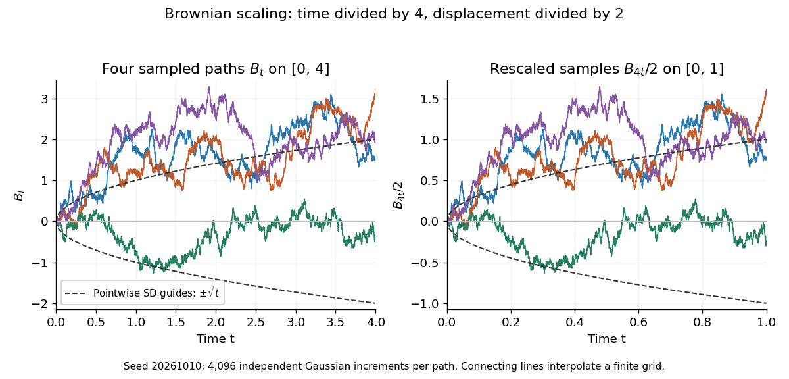

# Brownian scaling

↑ **Parent:** [Brownian motion](brownian-motion-split.md)

For every $c>0$, the [stochastic process](stochastic-process-split.md) $\widetilde B_t=c^{-1/2}B_{ct}$ is standard [Brownian motion](brownian-motion-split.md). Its [Brownian increments](brownian-increment.md) remain [independent](independent-random-variables.md) and have [variance](variance-split.md) $c^{-1}c(t-s)=t-s$; continuity and the zero starting value are preserved. Equivalently,

$$
(B_{ct})_{t\geq0}\overset d=(\sqrt c B_t)_{t\geq0}.
$$

Equality here is of whole-process distributions, including every [finite-dimensional distribution](finite-dimensional-distribution.md). It is not an equality of the two expressions along a particular realization. With $c=4$, speeding time up fourfold requires dividing displacement by two to recover the standard law. The figure applies exactly these coordinate changes to four finite samples; the shared colors indicate reused samples, while the dashed lines show pointwise [standard deviations](standard-deviation.md), not bounds on entire [sample paths](sample-path.md).

**[Figure 4](#image-seeded-gaussian-samples-before-and-after-brownian-scaling-with-c-equal-to-four). Seeded Gaussian samples before and after Brownian scaling with c equal to four**.

The same square-root normalization explains how a [simple random walk](simple-random-walk.md) approaches [Brownian motion](brownian-motion-split.md). Let $S_k=\sum_{j=1}^k\xi_j$, where the [independent](independent-random-variables.md) steps take values $+1$ and $-1$ with equal [probability](probability.md). Then $R_n(t)=S_{\lfloor nt\rfloor}/\sqrt n$ has [variance](variance-split.md) $\lfloor nt\rfloor/n$. Its [linear interpolation](linear-interpolation.md) is

$$
Y_n(t)=\frac{S_k+(nt-k)\xi_{k+1}}{\sqrt n},\qquad k=\lfloor nt\rfloor,
$$

and $\sup_{0\leq t\leq1}|Y_n(t)-R_n(t)|\leq1/\sqrt n$. [Donsker's theorem](donsker-s-theorem.md) says $Y_n\Rightarrow B$ in $C[0,1]$ with the [uniform norm](supremum-norm.md): this is [convergence in distribution](convergence-in-distribution.md) of random paths. The interpolation bound vanishes, but the theorem does not assert pointwise convergence of an arbitrarily fixed walk to an independently chosen [Brownian motion](brownian-motion-split.md). The usefulness is that many-step discrete motion has a universal continuous limit.[Theorem 8.1.4](probability-theory-and-examples-fifth-edition-by-rick-durrett.md)

## ↑ Ancestors (7)

1. [Brownian motion](brownian-motion-split.md)
2. [Stochastic process](stochastic-process-split.md)
3. [Probability theory](probability-theory-split.md)
4. [Probability and statistics](probability-and-statistics-split.md)
5. [Area of mathematics](area-of-mathematics.md)
6. [Mathematics](mathematics-split.md)
7. [Codex Wiki](split.md)

## ← Incoming links (39)

- [Area of a planar Brownian path](area-of-a-planar-brownian-path.md)
- [Brownian first-passage time](brownian-first-passage-time.md)
- [Brownian motion](brownian-motion-split.md)
- [Capacity-parametrized scale invariance of a Loewner chain](capacity-parametrized-scale-invariance-of-a-loewner-chain.md)
- [Integral lower envelope for the Brownian maximum](integral-lower-envelope-for-the-brownian-maximum.md)
- [Logarithmic escape rate of three-dimensional Brownian motion](logarithmic-escape-rate-of-three-dimensional-brownian-motion.md)
- [Solution](past-exam-of-the-mathematics-course-of-the-university-of-cambridge/2001/iii/paper-21/4/e/solution.md)
- [Solution](past-exam-of-the-mathematics-course-of-the-university-of-cambridge/2003/iii/paper-29/3/a/solution.md)
- [Solution](past-exam-of-the-mathematics-course-of-the-university-of-cambridge/2007/iii/paper-32/3/solution.md)
- [Solution](past-exam-of-the-mathematics-course-of-the-university-of-cambridge/2007/iii/paper-33/3/b/solution.md)
- [Solution](past-exam-of-the-mathematics-course-of-the-university-of-cambridge/2007/iii/paper-33/3/c/solution.md)
- [Solution](past-exam-of-the-mathematics-course-of-the-university-of-cambridge/2007/iii/paper-33/3/d/solution.md)
- [Solution](past-exam-of-the-mathematics-course-of-the-university-of-cambridge/2007/iii/paper-33/4/b/solution.md)
- [Solution](past-exam-of-the-mathematics-course-of-the-university-of-cambridge/2007/iii/paper-36/1/d/solution.md)
- [Solution](past-exam-of-the-mathematics-course-of-the-university-of-cambridge/2007/iii/paper-39/1/solution.md)
- [Solution](past-exam-of-the-mathematics-course-of-the-university-of-cambridge/2007/iii/paper-39/4/solution.md)
- [Solution](past-exam-of-the-mathematics-course-of-the-university-of-cambridge/2008/iii/paper-36/4/c/solution.md)
- [Solution](past-exam-of-the-mathematics-course-of-the-university-of-cambridge/2008/iii/paper-37/2/a/solution.md)
- [Solution](past-exam-of-the-mathematics-course-of-the-university-of-cambridge/2008/iii/paper-37/4/a/solution.md)
- [Solution](past-exam-of-the-mathematics-course-of-the-university-of-cambridge/2009/iii/paper-29/5/c/solution.md)
- [Solution](past-exam-of-the-mathematics-course-of-the-university-of-cambridge/2010/iii/paper-27/1/b/solution.md)
- [Solution](past-exam-of-the-mathematics-course-of-the-university-of-cambridge/2010/iii/paper-27/2/solution.md)
- [Solution](past-exam-of-the-mathematics-course-of-the-university-of-cambridge/2010/iii/paper-29/2/d/solution.md)
- [Solution](past-exam-of-the-mathematics-course-of-the-university-of-cambridge/2010/iii/paper-29/4/c/solution.md)
- [Solution](past-exam-of-the-mathematics-course-of-the-university-of-cambridge/2012/iii/paper-35/1/c/i/solution.md)
- [Solution](past-exam-of-the-mathematics-course-of-the-university-of-cambridge/2014/iii/paper-29/1/solution.md)
- [Solution](past-exam-of-the-mathematics-course-of-the-university-of-cambridge/2016/iii/paper-201/4/d/solution.md)
- [Solution](past-exam-of-the-mathematics-course-of-the-university-of-cambridge/2017/ii/paper-2/27j/c/solution.md)
- [Solution](past-exam-of-the-mathematics-course-of-the-university-of-cambridge/2018/iii/paper-201/5/d/solution.md)
- [Solution](past-exam-of-the-mathematics-course-of-the-university-of-cambridge/2018/iii/paper-202/4/iii/solution.md)
- [Solution](past-exam-of-the-mathematics-course-of-the-university-of-cambridge/2018/iii/paper-203/1/d/solution.md)
- [Solution](past-exam-of-the-mathematics-course-of-the-university-of-cambridge/2019/iii/paper-203/2/a/solution.md)
- [Solution](past-exam-of-the-mathematics-course-of-the-university-of-cambridge/2023/iii/paper-203/3/c/solution.md)
- [Solution](past-exam-of-the-mathematics-course-of-the-university-of-cambridge/2024/iii/paper-203/2/a/solution.md)
- [Solution](past-exam-of-the-mathematics-course-of-the-university-of-cambridge/2024/iii/paper-203/3/b/solution.md)
- [Solution](past-exam-of-the-mathematics-course-of-the-university-of-cambridge/2026/iii/paper-201/3/e/solution.md)
- [Scaling invariance of a Bessel process](scaling-invariance-of-a-bessel-process.md)
- [Scaling invariance of SLE](scaling-invariance-of-sle.md)
- [Transience of Brownian motion in dimension at least three](transience-of-brownian-motion-in-dimension-at-least-three.md)
