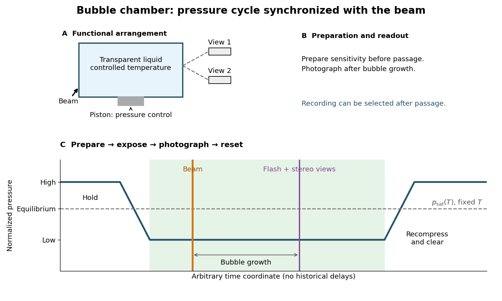

# Bubble-chamber pressure cycle

↑ **Parent:** [Bubble chamber](bubble-chamber.md)

Reduce [pressure](pressure-split.md) before beam arrival; photograph bubbles from several views, then recompress.[How it works, sequence](how-it-works-bubble-chamber-cern-teaching-archive.md)

Unlike the [Blackett-Occhialini triggered cloud-chamber experiment](blackett-occhialini-triggered-cloud-chamber-experiment.md), Glaser used counter-controlled flashes after expansion. A [detector trigger](trigger-particle-physics.md) can select recording in sensitive [liquid](liquid.md); subsequent expansion cannot recover a vanished latent track.[pp. 537, 541, 550: timing distinction](elementary-particles-and-bubble-chambers-by-donald-arthur-glaser.md)

**[Figure 13](#image-bubble-chamber-pressure-cycle-and-photographic-readout). Bubble-chamber pressure cycle and photographic readout**. Original functional diagram with an arbitrary time coordinate and chosen normalized pressure levels. The dashed equilibrium line assumes fixed temperature; no measured waveform, apparatus scale or historical delay is reproduced.

The diagram deliberately separates the preparation through [thermodynamics](thermodynamics-split.md) from the readout decision. Its green interval is a stipulated operating window, not a prediction from [pressure](pressure-split.md) alone. Excess [superheating](superheating.md) can increase unwanted [nucleation](nucleation.md); insufficient [superheating](superheating.md) can suppress tracks. A useful proposed sensitivity check holds the readout settings fixed while varying [pressure](pressure-split.md) or [temperature](temperature-split.md), with matched background exposures. A proposed timing check moves the beam within the cycle; a proposed optical check varies flash delay to distinguish growing bubbles from changes in [spatial resolution](spatial-resolution.md). These are experimental design examples, not additional historical measurements.

## ↑ Ancestors (5)

1. [Bubble chamber](bubble-chamber.md)
2. [Particle detector](particle-detector.md)
3. [Particle detection](particle-detection-split.md)
4. [Physics](physics-split.md)
5. [Codex Wiki](split.md)

## ← Incoming links (2)

- [Alvarez hydrogen-bubble-chamber reconstruction and resonances](alvarez-hydrogen-bubble-chamber-reconstruction-and-resonances.md)
- [Bubble-chamber pressure cycle](bubble-chamber-pressure-cycle.md)
