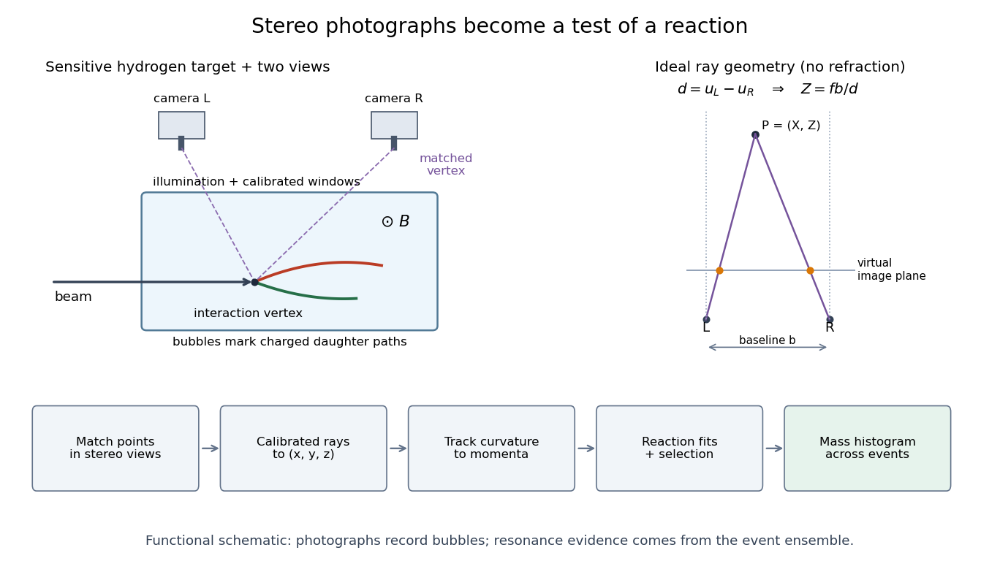

# Bubble-chamber stereo reconstruction

↑ **Parent:** [Alvarez hydrogen-bubble-chamber reconstruction and resonances](alvarez-hydrogen-bubble-chamber-reconstruction-and-resonances.md)

[Stereoscopy](stereoscopy.md) supplies depth because different [cameras](camera.md) see different projections of the same track. A functional reconstruction first matches the same interaction vertex and track segments across views. A calibrated lens and window model maps each measured image coordinate back to a ray inside the [liquid](liquid.md). [Refraction](refraction.md) at the windows must be included. Intersecting the rays, or finding their closest agreement when measurements have errors, estimates three-dimensional coordinates. Several points then determine a [trajectory](trajectory.md), rather than only a projected arc.

An original ideal-camera model makes the geometry explicit. Take two parallel pinhole [cameras](camera.md) with centers $(0,0,0)$ and $(b,0,0)$, focal [length](length.md) $f$, and optical axes along $z$. Use virtual image planes in front of the pinholes so that image coordinates have the same orientation as the scene. A point $(X,Y,Z)$ then gives

$$
u_L=\frac{fX}{Z},\qquad u_R=\frac{f(X-b)}{Z},\qquad
v_L=v_R=\frac{fY}{Z}.
$$

Subtracting the horizontal image coordinates gives disparity $d=u_L-u_R=fb/Z$, hence

$$
Z=\frac{fb}{d},\qquad X=\frac{Zu_L}{f},\qquad Y=\frac{Zv_L}{f}.
$$

For stipulated $b=0.20\,\mathrm m$, $f=0.050\,\mathrm m$, $u_L=0.010\,\mathrm m$, $u_R=0.005\,\mathrm m$ and $v_L=0.002\,\mathrm m$, the reconstructed point is $(0.40,0.08,2.0)\,\mathrm m$. These are ideal optical inputs, not dimensions of Alvarez's apparatus. This model omits [refraction](refraction.md) and lens distortion; actual calibration replaces its simple ray geometry. Since $|dZ/dd|=fb/d^2$, the same disparity error gives worse depth precision for distant points.

**[Figure 15](#image-from-stereo-bubble-photographs-to-coordinates-momenta-and-an-event-ensemble). From stereo bubble photographs to coordinates, momenta and an event ensemble**. Original functional diagram. The chamber, camera positions and tracks are schematic, not a historical mechanical drawing. The parallel-camera ray construction illustrates an idealized model without refraction.

The [Lorentz force](lorentz-force.md) then supplies a [momentum](momentum-split.md) scale. With [magnetic field](magnetic-field-split.md) $B$ uniform and negligible [stopping power](stopping-power.md) over a fitted segment, [bubble-chamber track readout](bubble-chamber-track-readout.md) gives $p_\perp=|q|Br$. The local three-dimensional [helix](helix.md) tangent supplies the missing direction: if $\alpha$ is its angle to the field, $p=p_\perp/\sin\alpha$. In practical units,

$$
\frac{p_\perp}{\mathrm{GeV}/c}=0.299792458\left|\frac qe\right|\frac B{\mathrm T}\frac r{\mathrm m}.
$$

Here $e$ is the [elementary charge](elementary-charge.md) and $c$ the [speed of light](speed-of-light.md). A short, almost straight arc poorly constrains its [radius of curvature](radius-of-curvature.md); a visually sharp track can therefore have poor [momentum](momentum-split.md) precision.

## ↑ Ancestors (7)

1. [Alvarez hydrogen-bubble-chamber reconstruction and resonances](alvarez-hydrogen-bubble-chamber-reconstruction-and-resonances.md)
2. [Hydrogen bubble chamber](hydrogen-bubble-chamber.md)
3. [Bubble chamber](bubble-chamber.md)
4. [Particle detector](particle-detector.md)
5. [Particle detection](particle-detection-split.md)
6. [Physics](physics-split.md)
7. [Codex Wiki](split.md)
