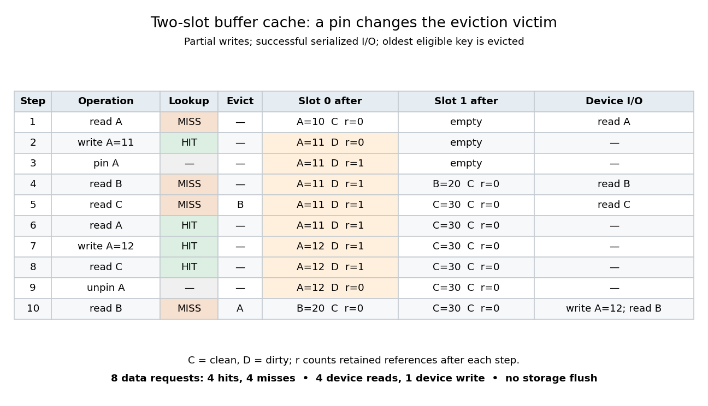

# Buffer cache access trace

↑ **Parent:** [Buffer cache state model](buffer-cache-state-model.md)

Let $A,B,C$ be three distinct [buffer cache keys](buffer-cache-key.md) on one device. Use two initially empty slots, [LRU replacement](lru-replacement.md) refreshed at each completed request, and synchronous successful [buffer cache writeback](buffer-cache-writeback.md) of a dirty victim. Each request acquires its target, finishes any fill, reads or partially modifies it, and releases the client reference. An explicit pin on $A$ remains after request 2 through request 7; pin and unpin do not refresh recency. No other references, invalidations, background writes or durability operations occur. Initial backing contents are represented by the [integers](integer.md) $A=10,B=20,C=30$; partial writes change the tracked value of $A$ to 11 and then 12 while preserving the unshown remainder.

**[Figure 27](#image-exact-cache-hits-cache-misses-retained-references-and-buffer-cache-evictions-in-a-two-slot-buffer-cache). Exact cache hits, cache misses, retained references and buffer cache evictions in a two-slot buffer cache**.

The eight data requests are read $A$, write $A=11$, read $B$, read $C$, read $A$, write $A=12$, read $C$, and read $B$ after unpinning $A$. They yield four [cache hits](cache-hit.md), four [cache misses](cache-miss.md), four device reads and one device write. The pin and unpin are lifetime operations, excluded from the data-request count. At the read of $C$, $A$ is older than $B$ but pinned, so the [clean buffer](clean-buffer.md) for $B$ is evicted instead. Reading $A$ then returns 11 without device access even though its backing value is still 10. The second write supersedes 11; reading $C$ makes $A$ the older entry again. After unpinning, the final read of $B$ writes back 12 before evicting $A$. After that request, backing $A$ contains 12, while the resident keys are $C,B$.

This example exposes the value of retaining modified contents: a [cache hit](cache-hit.md) can return a newer value than a device read would. It also exposes the cost of [reference counting](reference-counting.md) constraints: a pinned older entry forces a different victim. An independent capacity sweep gives two [cache hits](cache-hit.md), six [cache misses](cache-miss.md) and two device writes with one slot and no pin, but three [cache hits](cache-hit.md), five [cache misses](cache-miss.md) and two device writes with two slots and no pin. With one slot and the stipulated pin, the read of $B$ cannot proceed. With three slots, both pin choices give five [cache hits](cache-hit.md), three [cache misses](cache-miss.md) and no eviction-triggered write; $A$ remains dirty with value 12, so the absence of a device write does not establish [file-system transaction durability](file-system-transaction-durability.md).

## ↑ Ancestors (6)

1. [Buffer cache state model](buffer-cache-state-model.md)
2. [Buffer cache](buffer-cache.md)
3. [File system](file-system.md)
4. [Operating system](operating-system.md)
5. [Computer science](computer-science-split.md)
6. [Codex Wiki](split.md)

## ← Incoming links (1)

- [Buffer cache validity](buffer-cache-validity.md)
