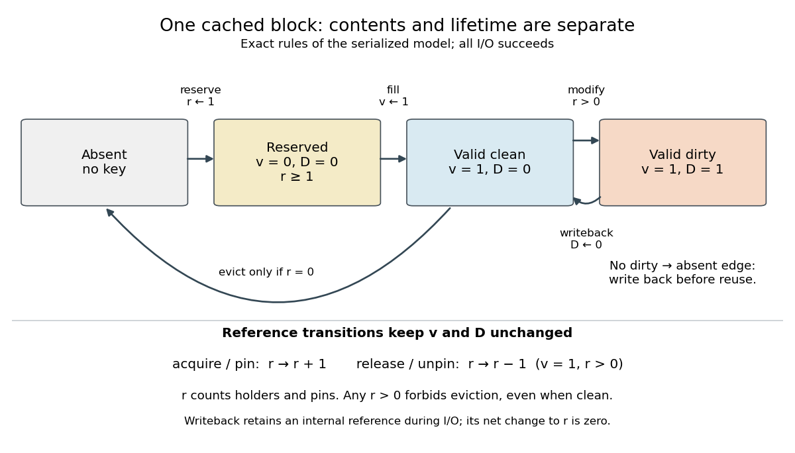

# Buffer cache state model

↑ **Parent:** [Buffer cache](buffer-cache.md)

Use one fixed-size [buffered device block](buffered-device-block.md) per [buffer cache key](buffer-cache-key.md), serialized operations, successful reads and writes, and no outside changes to the backing contents. Record an absent state or a reserved key with validity $v$, dirty flag $D$, and retained-reference count $r$. The [bits](bit.md) $v,D$ describe contents, while the nonnegative [integer](integer.md) $r$ describes lifetime. Every [dirty buffer](dirty-buffer.md) is valid, so $D=1$ implies $v=1$. Reservation begins at $(v,D,r)=(0,0,1)$; successful fill changes only $v$ to 1. Modifying a valid retained structure sets $D=1$. Releasing a caller changes $r$, not $v$ or $D$.

**[Figure 26](#image-buffer-cache-validity-dirty-buffers-and-retained-references-impose-different-state-transition-rules). Buffer cache validity, dirty buffers and retained references impose different state-transition rules**.

The first diagram separates contents transitions from reference transitions. [Buffer cache writeback](buffer-cache-writeback.md) temporarily retains the structure while transferring its contents; that internal reference is acquired and released inside the single serialized operation shown. [Buffer cache eviction](buffer-cache-eviction.md) requires a valid [clean buffer](clean-buffer.md) with $r=0$. The diagram omits read errors, explicit cancellation of invalid reservations, concurrent writes, invalidation and journal ordering. In particular, a journal can forbid otherwise possible [buffer cache writeback](buffer-cache-writeback.md) until its [write-ahead logging](write-ahead-logging.md) dependencies are satisfied.

For a small independent check, bound $r$ to $0,1,2$. Starting absent, allow reservation, acquisition, successful fill, modification, successful [buffer cache writeback](buffer-cache-writeback.md), release of a valid retained structure, and eligible [buffer cache eviction](buffer-cache-eviction.md). Exactly nine abstract states are reachable: absent, two invalid reservations with $r=1,2$, and six valid states combining $D=0,1$ with $r=0,1,2$. Every transition preserves $D\le v$; the only eviction source has $(v,D,r)=(1,0,0)$. This bounded [finite-state machine](finite-state-machine.md) check supports these safety rules, not a claim that work always completes.

**Table of contents**

- [Buffer cache access trace](buffer-cache-access-trace.md)

## ↑ Ancestors (5)

1. [Buffer cache](buffer-cache.md)
2. [File system](file-system.md)
3. [Operating system](operating-system.md)
4. [Computer science](computer-science-split.md)
5. [Codex Wiki](split.md)

## ← Incoming links (3)

- [Buffer cache eviction](buffer-cache-eviction.md)
- [Buffer cache writeback](buffer-cache-writeback.md)
- [Pinned buffer](pinned-buffer.md)
