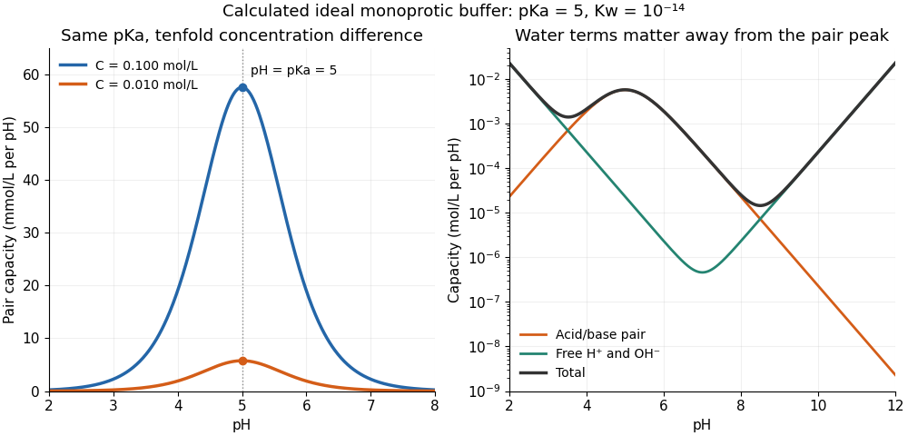

# Buffer capacity and concentration

↑ **Parent:** [Buffer capacity](buffer-capacity.md)

Stipulate [pKa](pka.md) $5$ and $K_w=10^{-14}$; these are model inputs, not measurements of an identified substance. At [pH](ph.md) $5$ the pair contribution is $0.575646\ldots C$. For [analytical concentrations](analytical-concentration.md) $C=0.010$ and $0.100\,\mathrm{mol\,L^{-1}}$, respectively, it is

$$
\beta_{\mathrm{pair}}=0.00575646\ldots\quad\text{and}\quad0.0575646\ldots\;\mathrm{mol\,L^{-1}\ per\ pH}.
$$

The free [hydrogen ion](hydrogen-ion.md) and [hydroxide](hydroxide.md) contribution is the same at this [pH](ph.md), $\beta_{\mathrm{water}}=(\ln10)(10^{-5}+10^{-9})\,\mathrm{mol\,L^{-1}}=0.0000230282\ldots\,\mathrm{mol\,L^{-1}}$ per [pH](ph.md). The full [buffer capacities](buffer-capacity.md) are therefore approximately $0.00577949$ and $0.0575877\,\mathrm{mol\,L^{-1}}$ per [pH](ph.md). Identical [pH](ph.md) fixes the free [hydrogen ion](hydrogen-ion.md) [thermodynamic activity](thermodynamic-activity.md); it does not fix the inventory of [weak acid](weak-acid.md) and [conjugate base](conjugate-base.md) available for [neutralization](neutralization.md).

**[Figure 74](#monoprotic-buffer-capacity-concentration). At fixed pKa, the pair contribution to buffer capacity scales with analytical concentration**. Ideal [monoprotic acid](monoprotic-acid.md) model with stipulated [pKa](pka.md) $5$ and $K_w=10^{-14}$. Left: the pair contribution for two [analytical concentrations](analytical-concentration.md), with its maximum at [pH](ph.md) equal to [pKa](pka.md). Right: pair, free [hydrogen ion](hydrogen-ion.md) and [hydroxide](hydroxide.md), and total contributions for $C=0.010\,\mathrm{mol\,L^{-1}}$, on a [logarithmic scale](logarithmic-scale.md). Curves are calculated, not measured; the constant ideal [activity coefficient](activity-coefficient.md) assumption limits their interpretation in real samples.

At one unit of [pH](ph.md) on either side of [pKa](pka.md), $r=10$ or $0.1$, giving $\beta_{\mathrm{pair}}/\beta_{\mathrm{pair,max}}=40/121\approx0.331$. The partners still form a [buffer solution](buffer-solution.md), but its local resistance is only about one third of the maximum for that [analytical concentration](analytical-concentration.md). At fixed [pH](ph.md), the pair contribution scales exactly with $C$; the full [buffer capacity](buffer-capacity.md) contains the additional $C$-independent [water](water.md) contribution. Consequently, extreme [dilution](dilution.md) does not justify dropping [self-ionization of water](self-ionization-of-water.md).

## ↑ Ancestors (5)

1. [Buffer capacity](buffer-capacity.md)
2. [Buffer solution](buffer-solution.md)
3. [Acid-base chemistry](acid-base-chemistry.md)
4. [Chemistry](chemistry-split.md)
5. [Codex Wiki](split.md)
