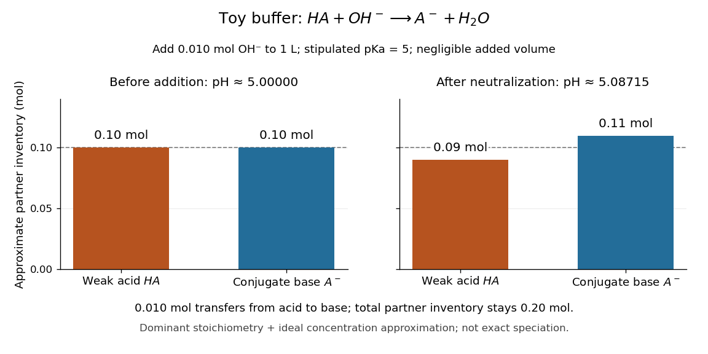
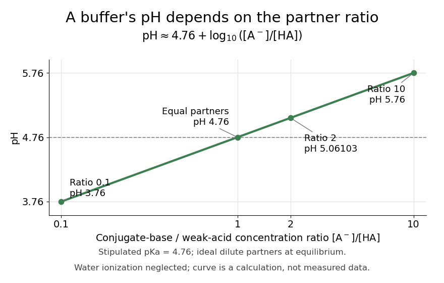

# Buffer solution

↑ **Parent:** [Acid-base chemistry](acid-base-chemistry.md)  
ⓦ [Wiki](https://en.wikipedia.org/wiki/Buffer_solution)

A [buffer solution](buffer-solution.md) contains appreciable quantities of a [weak acid](weak-acid.md) and its [conjugate base](conjugate-base.md), and resists changes in [pH](ph.md) caused by small quantities of added [chemical acid](acid-chemistry.md) or [chemical base](base-chemistry.md). The [conjugate base](conjugate-base.md) accepts added [protons](proton.md); the [weak acid](weak-acid.md) supplies [protons](proton.md) when a [chemical base](base-chemistry.md) consumes them. Consuming most of either partner undermines the buffering action. See [Flowers et al., Chemistry 2e, buffers](https://openstax.org/books/chemistry-2e/pages/14-6-buffers).

For a separate toy calculation, stipulate [pKa](pka.md) $5$ for a [weak acid](weak-acid.md) $\mathrm{HA}$; this is an input, not measured material data. Initially $1\,\mathrm L$ of [buffer solution](buffer-solution.md) contains $0.10\,\mathrm{mol}$ of $\mathrm{HA}$ and $0.10\,\mathrm{mol}$ of its [conjugate base](conjugate-base.md) $\mathrm A^-$. In the ideal [concentration](concentration.md) approximation, the [Henderson-Hasselbalch equation](henderson-hasselbalch-equation.md) gives initial [pH](ph.md) $5$. Add $0.010\,\mathrm{mol}$ of [hydroxide](hydroxide.md) with negligible volume change. The dominant [neutralization](neutralization.md) has one-to-one [stoichiometry](stoichiometry.md):

$$
\mathrm{HA}+\mathrm{OH}^-\longrightarrow\mathrm A^-+\mathrm H_2\mathrm O.
$$

Each [mole](mole-unit.md) of consumed [hydroxide](hydroxide.md) removes one [mole](mole-unit.md) of [weak acid](weak-acid.md) and forms one [mole](mole-unit.md) of [conjugate base](conjugate-base.md) and [water](water.md). Thus the inventories after [neutralization](neutralization.md) are

$$
n_{\mathrm{HA}}\approx(0.10-0.01)\,\mathrm{mol}=0.09\,\mathrm{mol},\qquad
n_{\mathrm A^-}\approx(0.10+0.01)\,\mathrm{mol}=0.11\,\mathrm{mol}.
$$

The shared volume cancels from the [concentration](concentration.md) ratio. The [Henderson-Hasselbalch equation](henderson-hasselbalch-equation.md) therefore predicts

$$
\mathrm{pH}\approx5+\log_{10}\!\left(\frac{0.11}{0.09}\right)=5+\log_{10}\!\left(\frac{11}{9}\right)=5.0871501757\ldots.
$$

This small increase illustrates how conversion between abundant partners absorbs added [chemical base](base-chemistry.md). The calculation neglects the tiny free [hydronium](hydronium.md) and [hydroxide](hydroxide.md) inventories, changes during re-establishment of [chemical equilibrium](chemical-equilibrium.md), [self-ionization of water](self-ionization-of-water.md), and [activity coefficient](activity-coefficient.md) corrections. The displayed inventories approximate the final [chemical species](chemical-species.md) distribution; they are not an exact solution of all [chemical equilibrium](chemical-equilibrium.md) conditions.

**[Figure 71](#image-added-hydroxide-transfers-a-finite-inventory-from-weak-acid-to-conjugate-base). Added hydroxide transfers a finite inventory from weak acid to conjugate base**. Toy [pKa](pka.md) $5$, initial volume $1\,\mathrm L$, and negligible added volume. Bars show the dominant [neutralization](neutralization.md) bookkeeping before and after adding $0.010\,\mathrm{mol}$ of [hydroxide](hydroxide.md); the [pH](ph.md) values use the ideal [concentration](concentration.md) approximation. The acid-plus-base inventory stays $0.20\,\mathrm{mol}$. Neither the bars nor the [pH](ph.md) values are measured material data or exact speciation.

A [buffer solution](buffer-solution.md) has a finite [buffer capacity](buffer-capacity.md): its [weak acid](weak-acid.md) inventory supplies protection against added [chemical base](base-chemistry.md), and its [conjugate base](conjugate-base.md) inventory supplies protection against added [chemical acid](acid-chemistry.md). Here an addition approaching $0.10\,\mathrm{mol}$ of [hydroxide](hydroxide.md) uses up the available $\mathrm{HA}$ in the dominant [stoichiometry](stoichiometry.md) calculation. Close to that limit, the neglected [chemical equilibrium](chemical-equilibrium.md) contributions matter; once $\mathrm{HA}$ is exhausted, inserting a zero denominator into the [Henderson-Hasselbalch equation](henderson-hasselbalch-equation.md) cannot predict the actual [pH](ph.md). Excess [hydroxide](hydroxide.md) and the remaining [chemical species](chemical-species.md) require a fresh [chemical equilibrium](chemical-equilibrium.md) calculation. This is why a [buffer solution](buffer-solution.md) stabilizes conditions for [chemical reactions](chemical-reaction.md) over a finite range of additions. See [Flowers et al., Chemistry 2e, buffer capacity and added base](https://openstax.org/books/chemistry-2e/pages/14-6-buffers).

For the pair $\mathrm{HA}/\mathrm A^-$, rearranging the [acid dissociation constant](acid-dissociation-constant.md) gives the activity relation

$$
\mathrm{pH}=\mathrm pK_a+\log_{10}\!\left(\frac{a_{\mathrm A^-}}{a_{\mathrm{HA}}}\right).
$$

With [thermodynamic activity](thermodynamic-activity.md) of [water](water.md) approximated by one and ideal dilute [thermodynamic activities](thermodynamic-activity.md) for both partners, this yields the familiar [Henderson-Hasselbalch equation](henderson-hasselbalch-equation.md):

$$
\mathrm{pH}\approx\mathrm pK_a+\log_{10}\!\left(\frac{[\mathrm A^-]}{[\mathrm{HA}]}\right).
$$

The [concentrations](concentration.md) are at [chemical equilibrium](chemical-equilibrium.md); using initial values requires negligible equilibration changes. Below, also neglect [self-ionization of water](self-ionization-of-water.md) and competing [chemical reactions](chemical-reaction.md).

Stipulate $\mathrm pK_a=4.76$ for an illustrative [weak acid](weak-acid.md), without identifying it with a measured substance. A [conjugate base](conjugate-base.md) to [weak acid](weak-acid.md) [concentration](concentration.md) ratio of two gives

$$
\mathrm{pH}\approx4.76+\log_{10}2=5.061029995\ldots\approx5.06103.
$$

Equal [concentrations](concentration.md) give a ratio of one, whose [logarithm](logarithm.md) is zero, hence [pH](ph.md) $4.76$. Multiplying the ratio by ten raises [pH](ph.md) by one: ratios $0.1$, $1$, and $10$ give [pH](ph.md) values $3.76$, $4.76$, and $5.76$. The ratio controls the ideal prediction, while the absolute quantities control how much added [chemical acid](acid-chemistry.md) or [chemical base](base-chemistry.md) the [buffer solution](buffer-solution.md) can accommodate.

**[Figure 72](#image-the-henderson-hasselbalch-equation-turns-a-tenfold-ratio-change-into-one-unit-of-ph). The Henderson-Hasselbalch equation turns a tenfold ratio change into one unit of pH**. The stipulated [weak acid](weak-acid.md) has $\mathrm pK_a=4.76$. Points mark [conjugate base](conjugate-base.md) to [weak acid](weak-acid.md) [concentration](concentration.md) ratios $0.1$, $1$, $2$, and $10$. The curve uses ideal dilute [thermodynamic activities](thermodynamic-activity.md), [chemical equilibrium](chemical-equilibrium.md), and negligible [self-ionization of water](self-ionization-of-water.md); it is a calculation, rather than measured data.

**Table of contents**

- [Henderson-Hasselbalch equation](henderson-hasselbalch-equation.md)
- [Buffer capacity](buffer-capacity.md)
  - [Buffer capacity of a monoprotic acid](buffer-capacity-of-a-monoprotic-acid.md)
  - [Buffer capacity and concentration](buffer-capacity-and-concentration.md)
  - [Finite titrant response of a buffer](finite-titrant-response-of-a-buffer.md)
  - [Buffer capacity measurement](buffer-capacity-measurement.md)

## ↑ Ancestors (3)

1. [Acid-base chemistry](acid-base-chemistry.md)
2. [Chemistry](chemistry-split.md)
3. [Codex Wiki](split.md)

## ← Incoming links (22)

- [Acid-base chemistry](acid-base-chemistry.md)
- [Acid (chemistry)](acid-chemistry.md)
- [Adenosine triphosphate](adenosine-triphosphate.md)
- [Antibody affinity](antibody-affinity.md)
- [Antibody equilibrium occupancy](antibody-equilibrium-occupancy.md)
- [Antibody surface plasmon resonance experiment](antibody-surface-plasmon-resonance-experiment.md)
- [Buffer capacity](buffer-capacity.md)
- [Buffer capacity and concentration](buffer-capacity-and-concentration.md)
- [Buffer capacity measurement](buffer-capacity-measurement.md)
- [Buffer solution](buffer-solution.md)
- [Disulfide bond](disulfide-bond.md)
- [Finite titrant response of a buffer](finite-titrant-response-of-a-buffer.md)
- [Glass electrode](glass-electrode.md)
- [Glycine titration](glycine-titration.md)
- [Glycine titration experiment](glycine-titration-experiment.md)
- [Henderson-Hasselbalch equation](henderson-hasselbalch-equation.md)
- [Ionic strength](ionic-strength.md)
- [Islet perifusion experiment](islet-perifusion-experiment.md)
- [Neutralization](neutralization.md)
- [Ribozyme](ribozyme.md)
- [Weak acid dissociation measurement](weak-acid-dissociation-measurement.md)
- [Western blot transfer](western-blot-transfer.md)
