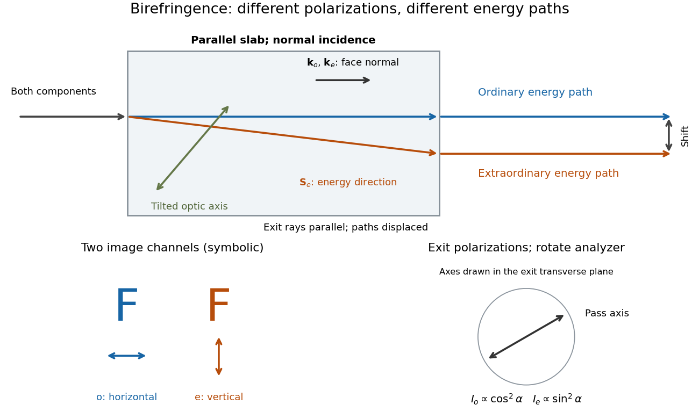

# Calcite double-image experiment

↑ **Parent:** [Birefringence](birefringence.md)

Place a clear [calcite](https://en.wikipedia.org/wiki/Calcite) specimen on a transparency bearing printed words on an overhead projector. The projected readout is two copies of the lettering. Put a rotatable linear [polarizer](polarizer.md) after the specimen: suitable orientations suppress one copy or the other. These are the actual apparatus and observations in the University of Iowa demonstration.[Demonstration 6H35.15, Equipment and Procedure: crystals, polarizers, printed overhead transparency, two sets of words and selective extinction; final note on natural defects](polarization-calcite-and-iceland-spar-by-university-of-iowa-department-of-physics-and-astronomy.md)

For a useful control, remove the specimen while keeping the transparency, projector and screen fixed: the doubling should disappear. Replace it, hold it stationary and rotate only the [polarizer](polarizer.md); complementary brightness changes distinguish two [linear polarizations](linear-polarization.md) from an accidental duplicate transparency. These are suggested controls, rather than additional reported measurements. Ideally the two copies obey complementary [Malus's law](malus-s-law.md) curves, $I_o(\alpha)=I_{o,\max}\cos^2\alpha$ and $I_e(\alpha)=I_{e,\max}\sin^2\alpha$, with [angle](angle.md) $\alpha$ measured from the exiting [ordinary wave](ordinary-wave.md)'s [linear polarization](linear-polarization.md). Unequal maxima do not invalidate the test. Finite [polarizer](polarizer.md) extinction, poor focus and specimen defects limit visibility; image separation alone does not determine either [refractive index](refractive-index.md) without the specimen geometry.

**[Figure 1](#image-separated-ordinary-wave-and-extraordinary-wave-paths-carry-different-linear-polarizations). Separated ordinary wave and extraordinary wave paths carry different linear polarizations**. An ideal parallel slab with a tilted [optic axis](optic-axis.md) illustrates [birefringent walk-off](birefringent-walk-off.md) at normal incidence. Both internal [wavevectors](wavevector.md) are normal to the faces, but the [extraordinary wave](extraordinary-wave.md)'s [Poynting vector](poynting-vector.md) is tilted. The rays emerge parallel with a lateral displacement. The paired letters symbolize two image channels, not an optical prescription for the projector. The [polarizer](polarizer.md) inset shows how an exiting channel is selected.

## ↑ Ancestors (8)

1. [Birefringence](birefringence.md)
2. [Linear anisotropic dielectric](linear-anisotropic-dielectric.md)
3. [Maxwell equations in matter](maxwell-equations-in-matter.md)
4. [Maxwell equations](maxwell-equations-split.md)
5. [Electromagnetism](electromagnetism-split.md)
6. [Branches of physics](branches-of-physics.md)
7. [Physics](physics-split.md)
8. [Codex Wiki](split.md)

## ← Incoming links (1)

- [Birefringence](birefringence.md)
