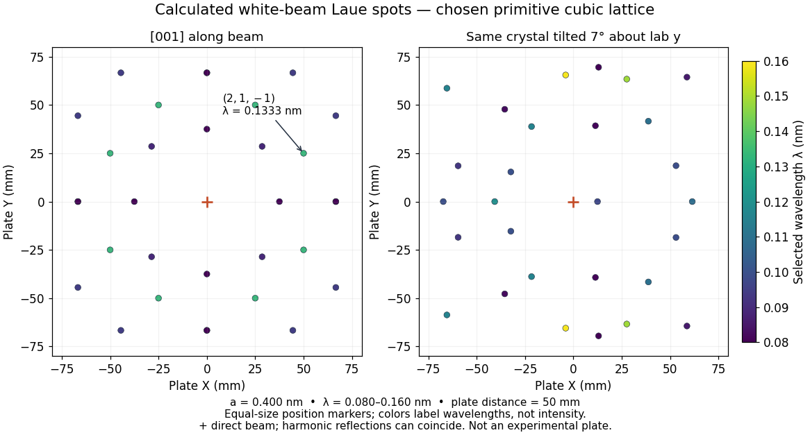

# Calculated transmission Laue pattern

↑ **Parent:** [Laue method](laue-method.md)

Choose a [primitive cubic lattice](primitive-cubic-lattice.md) with $a=0.400\,\mathrm{nm}$, one identical point scatterer per [primitive unit cell](primitive-unit-cell.md), incident direction $\mathbf s_{\rm in}=(0,0,1)$, and the continuous [wavelength](wavelength.md) band $0.080\leq\lambda\leq0.160\,\mathrm{nm}$. This is a hypothetical model, not the [zinc blende](sphalerite.md) specimen of the [Laue X-ray diffraction experiment of 1912](laue-x-ray-diffraction-experiment-of-1912.md). Write a candidate [reciprocal lattice](reciprocal-lattice.md) vector as $\mathbf G=(2\pi/a)(h,k,-m)$ with $m>0$, and set $S=h^2+k^2+m^2$. The [Laue equations](laue-equations.md) and [elastic scattering](elastic-scattering.md) give

$$
\lambda=\frac{2am}{S},\qquad
\mathbf s_{\rm out}=\left(\frac{2mh}{S},\frac{2mk}{S},1-\frac{2m^2}{S}\right).
$$

A transmission [photographic plate](photographic-plate.md) at $z=L>0$ intercepts only $s_{{\rm out},z}>0$. Its coordinates relative to the direct beam are

$$
X=L\frac{s_{{\rm out},x}}{s_{{\rm out},z}}=\frac{2Lmh}{h^2+k^2-m^2},\qquad
Y=\frac{2Lmk}{h^2+k^2-m^2}.
$$

For $(h,k,-m)=(2,1,-1)$ and $L=50\,\mathrm{mm}$, $S=6$, $\lambda=0.13333\ldots\,\mathrm{nm}$ and $\mathbf s_{\rm out}=(2/3,1/3,2/3)$, so $(X,Y)=(50,25)\,\mathrm{mm}$. Its length is one, and each component difference satisfies the corresponding [Laue equations](laue-equations.md). This verifies a direction and a selected [wavelength](wavelength.md), without predicting an exposure or measured [wave intensity](intensity-physics.md).

**[Figure 5](#image-calculated-white-beam-laue-method-spots-and-their-response-to-crystal-tilt). Calculated white-beam Laue method spots and their response to crystal tilt**. [Source](laue-polychromatic-spot-pattern.py). Original calculation for the stated [primitive cubic lattice](primitive-cubic-lattice.md) and a square detector with $|X|,|Y|\leq75\,\mathrm{mm}$. Left: the cubic $[001]$ direction is along the incident beam. Right: rotate the same [crystal structure](crystal-structure.md) by $7^\circ$ about the laboratory $y$ axis, keeping source and detector fixed. Color gives the selected [wavelength](wavelength.md); equal marker sizes convey positions rather than [wave intensities](intensity-physics.md). Harmonic reflections can overlap. Neither panel copies, simulates the chemistry of, or fits an experimental plate.

The first panel has fourfold symmetry because its chosen [Bravais lattice](bravais-lattice.md), beam axis and square detector share that symmetry. For the tilted panel, apply a [rotation matrix](rotation-matrix.md) $R$ to each index vector, set $v=R(h,k,l)$, and use $\lambda=-2av_z/|v|^2$ and $\mathbf s_{\rm out}=(0,0,1)+(\lambda/a)v$. All indices with $|(h,k,l)|\leq2a/\lambda_{\min}=10$ suffice: [elastic scattering](elastic-scattering.md) bounds $|\mathbf G|\leq2|\mathbf k_{\rm in}|$. Thus the plotted spectral and angular selection is complete within this ideal point model and detector window. Multiples of an index vector select inversely scaled [wavelengths](wavelength.md) and can land on the same spot; a white-beam spot need not identify a unique [diffraction order](diffraction-order.md).

## ↑ Ancestors (9)

1. [Laue method](laue-method.md)
2. [X-ray diffraction](x-ray-diffraction.md)
3. [Crystal scattering](crystal-scattering.md)
4. [Scattering amplitude](scattering-amplitude.md)
5. [Quantum scattering](quantum-scattering-split.md)
6. [Quantum mechanics](quantum-mechanics-split.md)
7. [Branches of physics](branches-of-physics.md)
8. [Physics](physics-split.md)
9. [Codex Wiki](split.md)
