# Calculus

↑ **Parent:** [Real analysis](real-analysis.md)  
ⓦ [Wiki](https://en.wikipedia.org/wiki/Calculus)

Calculus connects **local change** with **accumulated change**. A [derivative](#derivative) asks how fast a [function](function.md) changes near one input; an [integral](integral.md) adds its contributions across an [interval](real-analysis.md#interval-mathematics). The [fundamental theorem of calculus](#fundamental-theorem-of-calculus) explains why these operations fit together: accumulating a continuous rate produces a quantity whose [derivative](#derivative) is that rate.

For example, suppose a particle moves along a [straight line](euclidean-geometry.md#straight-line) with [position](classical-mechanics.md#position) $s(t)=t^2+t$ metres at time $t$ seconds. Its [velocity](classical-mechanics.md#velocity) is $s'(t)=2t+1$ metres per second. Between $t=0$ and $t=3$, adding the [velocity](classical-mechanics.md#velocity) over time gives

$$
\int_0^3(2t+1)\,dt=s(3)-s(0)=12\text{ metres}.
$$

Here the [velocity](classical-mechanics.md#velocity) stays positive, so the [displacement](classical-mechanics.md#displacement) also equals the distance travelled. If the particle reverses direction, the [integral](integral.md) of its signed [velocity](classical-mechanics.md#velocity) still gives [displacement](classical-mechanics.md#displacement), while the [integral](integral.md) of its [speed](classical-mechanics.md#speed) gives total distance.

This is useful because local rules are often easier to specify than whole trajectories. A [differential equation](differential-equation.md) can prescribe a particle's [velocity](classical-mechanics.md#velocity) or a population's growth rate; [integration](integral.md) then reconstructs its evolution, subject to an [initial condition](differential-equation.md#initial-condition). In the other direction, a [derivative](#derivative) extracts local information from a known [function](function.md), and [optimization](mathematical-optimization.md) uses that information to locate or approach promising inputs. The same two operations therefore connect measurement, prediction and design.

The visual connection is developed in [derivative](#derivative), [integral](integral.md) and [fundamental theorem of calculus](#fundamental-theorem-of-calculus). The definitions depend on [limits](#limit-of-a-function), which turn progressively finer finite measurements into exact mathematical statements. A graph with a corner need not have a [derivative](#derivative) there, and the conditions permitting [integration](integral.md) or interchange of [limits](#limit-of-a-function) matter; calculus is more than a collection of symbolic rules.

Historically, Isaac Newton described changing quantities and their rates in the language of fluents and fluxions; his manuscript _History of the Method of Fluxions_ records that approach.[Isaac Newton, History of the Method of Fluxions, Cambridge University Library MS Add. 3968](https://www.newtonproject.ox.ac.uk/view/texts/normalized/NATP00356) Gottfried Wilhelm Leibniz's _Nova methodus pro maximis et minimis_ appeared in _Acta Eruditorum_ in October 1684, pp. 467–473; the original article is preserved in the HKUST Library collection.[Gottfried Wilhelm Leibniz, Nova methodus pro maximis et minimis, 1684](https://digitalcollections.hkust.edu.hk/Detail/objects/b540295) The modern [limit](#limit-of-a-function) definitions used here should not be read back into those seventeenth-century formulations.

**Table of contents**

- [Differential calculus](#differential-calculus)
- [Floor and ceiling functions](#floor-and-ceiling-functions)
  - [Integer count in a closed interval](#integer-count-in-a-closed-interval)
  - [Floor function](#floor-function)
    - [Floor-division grouping](#floor-division-grouping)
    - [Floor division](#floor-division)
    - [Floor quotient grouping](#floor-quotient-grouping)
    - [Floor sum](#floor-sum)
      - [Floor-sum rearrangement](#floor-sum-rearrangement)
      - [Euclidean floor-sum transformation](#euclidean-floor-sum-transformation)
    - [Fractional part](#fractional-part)
  - [Ceiling function](#ceiling-function)
    - [Ceiling count for fixed-size batches](#ceiling-count-for-fixed-size-batches)
  - [Truncation toward zero](#truncation-toward-zero)
- [Integral](integral.md)
  - [Domain of integration](integral.md#domain-of-integration)
  - [Integration by substitution](integral.md#integration-by-substitution)
    - [Trigonometric substitution](integral.md#trigonometric-substitution)
  - [Average value of a function](integral.md#average-value-of-a-function)
  - [Linearity of integration](integral.md#linearity-of-integration)
  - [Signed area under a graph](integral.md#signed-area-under-a-graph)
    - [Total geometric area under a graph](integral.md#total-geometric-area-under-a-graph)
  - [Definite integral](integral.md#definite-integral)
    - [Integration limit](integral.md#integration-limit)
    - [Distance traveled from velocity](integral.md#distance-traveled-from-velocity)
  - [Wallis integrals](integral.md#wallis-integrals)
  - [Dipole line-integral identity](integral.md#dipole-line-integral-identity)
  - [Integrand](integral.md#integrand)
  - [Multiple integral](integral.md#multiple-integral)
    - [Triple integral](integral.md#triple-integral)
    - [Volume element](integral.md#volume-element)
    - [Iterated integral](integral.md#iterated-integral)
    - [Odd-integrand cancellation by reflection](integral.md#odd-integrand-cancellation-by-reflection)
  - [Integral representation](integral.md#integral-representation)
    - [Trigonometric integral](integral.md#trigonometric-integral)
      - [Cosine integral](integral.md#cosine-integral)
      - [Sine integral](integral.md#sine-integral)
  - [Lebesgue integration](integral.md#lebesgue-integration)
    - [Prékopa–Leindler inequality](integral.md#prekopa-leindler-inequality)
    - [Absolute continuity of the Lebesgue integral](integral.md#absolute-continuity-of-the-lebesgue-integral)
  - [Time integral](integral.md#time-integral)
  - [Double integral](integral.md#double-integral)
  - [Monotonicity of the Lebesgue integral](integral.md#monotonicity-of-the-lebesgue-integral)
  - [Antiderivative](integral.md#antiderivative)
    - [Constant of integration](integral.md#constant-of-integration)
      - [Antiderivatives on disconnected domains](integral.md#antiderivatives-on-disconnected-domains)
    - [Additive constant](integral.md#additive-constant)
  - [Gaussian integral](integral.md#gaussian-integral)
    - [Gaussian integral with an inverse-square term](integral.md#gaussian-integral-with-an-inverse-square-term)
    - [Gaussian moment recurrence](integral.md#gaussian-moment-recurrence)
      - [Odd Gaussian moments on a half-line](integral.md#odd-gaussian-moments-on-a-half-line)
      - [Full-line Gaussian moment recurrence](integral.md#full-line-gaussian-moment-recurrence)
    - [Polar-coordinate proof of the Gaussian integral](integral.md#polar-coordinate-proof-of-the-gaussian-integral)
    - [Linear-source multivariate Gaussian integral](integral.md#linear-source-multivariate-gaussian-integral)
    - [Dawson function](integral.md#dawson-function)
      - [Gaussian drift primitives](integral.md#gaussian-drift-primitives)
    - [Error function](integral.md#error-function)
      - [Error function and the normal distribution](integral.md#error-function-and-the-normal-distribution)
      - [Inverse error function](integral.md#inverse-error-function)
      - [Error-function diffusion front](integral.md#error-function-diffusion-front)
      - [Quadrant asymptotics of the error function](integral.md#quadrant-asymptotics-of-the-error-function)
      - [Complementary error function](integral.md#complementary-error-function)
        - [Complementary error function tail bound](integral.md#complementary-error-function-tail-bound)
        - [Faddeeva function](integral.md#faddeeva-function)
          - [Gaussian pole integral](integral.md#gaussian-pole-integral)
- [Taylor polynomial](#taylor-polynomial)
  - [Multivariate Taylor polynomial](#multivariate-taylor-polynomial)
    - [Second-order relative change of a monomial](#second-order-relative-change-of-a-monomial)
- [Exponential function](#exponential-function)
  - [Exponential growth](#exponential-growth)
    - [Doubling time](#doubling-time)
  - [e (mathematical constant)](#e-mathematical-constant)
    - [Compounding limit for e](#compounding-limit-for-e)
    - [Irrationality of e](#irrationality-of-e)
  - [Exponential series](#exponential-series)
    - [Exponential series divided by a shifted index](#exponential-series-divided-by-a-shifted-index)
  - [Complex exponential function](#complex-exponential-function)
    - [Modulus of the complex exponential](#modulus-of-the-complex-exponential)
    - [Complex sine function](#complex-sine-function)
      - [Periodicity of the complex sine](#periodicity-of-the-complex-sine)
  - [Logarithm](#logarithm)
    - [Geometric-series bound for the logarithmic remainder](#geometric-series-bound-for-the-logarithmic-remainder)
    - [Irrational logarithm criterion](#irrational-logarithm-criterion)
    - [Concavity of the logarithm](#concavity-of-the-logarithm)
    - [Logarithmic integral function](#logarithmic-integral-function)
    - [Natural logarithm](#natural-logarithm)
      - [Mercator series](#mercator-series)
      - [Logarithmic integral representation of the natural logarithm](#logarithmic-integral-representation-of-the-natural-logarithm)
    - [Logarithmic scale](#logarithmic-scale)
      - [Order of magnitude](#order-of-magnitude)
      - [Logarithmic midpoint](#logarithmic-midpoint)
      - [Semi-log plot](#semi-log-plot)
      - [Log-log plot](#log-log-plot)
    - [Logarithm inequality](#logarithm-inequality)
      - [Rational lower bound for the natural logarithm](#rational-lower-bound-for-the-natural-logarithm)
    - [Operator monotonicity of logarithm](#operator-monotonicity-of-logarithm)
  - [Gaussian function](#gaussian-function)
    - [Taylor expansion of a translated Gaussian](#taylor-expansion-of-a-translated-gaussian)
    - [Gaussian decay dominates every power](#gaussian-decay-dominates-every-power)
    - [Gaussian dyadic summation bound](#gaussian-dyadic-summation-bound)
  - [Hyperbolic function](#hyperbolic-function)
    - [Hyperbolic angle](#hyperbolic-angle)
    - [Inverse hyperbolic functions](#inverse-hyperbolic-functions)
    - [Hyperbolic cosine](#hyperbolic-cosine)
      - [Catenary from hyperbolic cosine](#catenary-from-hyperbolic-cosine)
      - [Factorial-tail irrationality proof for a hyperbolic cosine](#factorial-tail-irrationality-proof-for-a-hyperbolic-cosine)
      - [Inverse hyperbolic cosine](#inverse-hyperbolic-cosine)
        - [Real inverse-hyperbolic antiderivative branches](#real-inverse-hyperbolic-antiderivative-branches)
    - [Hyperbolic sine](#hyperbolic-sine)
    - [Hyperbolic cotangent](#hyperbolic-cotangent)
      - [Partial-fraction expansion of the hyperbolic cotangent](#partial-fraction-expansion-of-the-hyperbolic-cotangent)
    - [Hyperbolic secant](#hyperbolic-secant)
      - [Exponential moment of the hyperbolic secant](#exponential-moment-of-the-hyperbolic-secant)
- [Fundamental theorem of calculus](#fundamental-theorem-of-calculus)
  - [Fundamental theorem of calculus for Lebesgue integration](#fundamental-theorem-of-calculus-for-lebesgue-integration)
- [Mean value theorem](#mean-value-theorem)
  - [Cauchy mean value theorem](#cauchy-mean-value-theorem)
  - [Endpoint secant-tangent approximation](#endpoint-secant-tangent-approximation)
- [Rolle theorem](#rolle-theorem)
  - [Rolle root count with multiplicities](#rolle-root-count-with-multiplicities)
- [Taylor's theorem](#taylor-s-theorem)
  - [Taylor expansion from a periodic derivative equation](#taylor-expansion-from-a-periodic-derivative-equation)
  - [Integral first-order Taylor formula for a vector map](#integral-first-order-taylor-formula-for-a-vector-map)
  - [Integral remainder in Taylor theorem](#integral-remainder-in-taylor-theorem)
    - [Logarithmic series from an integral Taylor remainder](#logarithmic-series-from-an-integral-taylor-remainder)
  - [Taylor expansion](#taylor-expansion)
    - [Peano zero](#peano-zero)
    - [Parabolic approximation](#parabolic-approximation)
  - [Taylor formula for a polynomial](#taylor-formula-for-a-polynomial)
  - [Taylor theorem with Lagrange remainder](#taylor-theorem-with-lagrange-remainder)
    - [Lagrange remainder](#lagrange-remainder)
  - [Taylor remainder](#taylor-remainder)
  - [Taylor formula with integral remainder](#taylor-formula-with-integral-remainder)
  - [Taylor series](#taylor-series)
    - [Maclaurin series](#maclaurin-series)
- [Limit of a function](#limit-of-a-function)
  - [Exponential concentration of a weighted mean](#exponential-concentration-of-a-weighted-mean)
  - [Root limit of a finite sum of powers](#root-limit-of-a-finite-sum-of-powers)
  - [One-sided limit](#one-sided-limit)
  - [Continuous function](#continuous-function)
    - [Epsilon-delta definition of continuity](#epsilon-delta-definition-of-continuity)
      - [Continuity bounds for the square function](#continuity-bounds-for-the-square-function)
    - [Continuous functions preserve convergent sequences](#continuous-functions-preserve-convergent-sequences)
    - [Blancmange curve](#blancmange-curve)
    - [Bounded continuous functions](#bounded-continuous-functions)
    - [Upper semicontinuity](#upper-semicontinuity)
    - [Oscillation multiplied by a vanishing amplitude](#oscillation-multiplied-by-a-vanishing-amplitude)
    - [Lower semicontinuity](#lower-semicontinuity)
    - [Discontinuity of a function](#discontinuity-of-a-function)
      - [Removable discontinuity](#removable-discontinuity)
      - [Jump discontinuity](#jump-discontinuity)
    - [Sequential lower semicontinuity](#sequential-lower-semicontinuity)
      - [Sublevel set](#sublevel-set)
        - [Compact sublevel set](#compact-sublevel-set)
      - [Closed-sublevel-set characterization of lower semicontinuity](#closed-sublevel-set-characterization-of-lower-semicontinuity)
    - [Locally constant function](#locally-constant-function)
      - [Compactly supported locally constant function](#compactly-supported-locally-constant-function)
    - [Intermediate value theorem](#intermediate-value-theorem)
      - [Intermediate value theorem hypotheses and counterexamples](#intermediate-value-theorem-hypotheses-and-counterexamples)
      - [A cubic root from existence to a quantitative bracket](#a-cubic-root-from-existence-to-a-quantitative-bracket)
      - [Nested-bracket proof of the intermediate value theorem](#nested-bracket-proof-of-the-intermediate-value-theorem)
      - [Continuous image of a real interval](#continuous-image-of-a-real-interval)
      - [Interval order theorem for continuous injections](#interval-order-theorem-for-continuous-injections)
      - [Horizontal chord of reciprocal-integer length](#horizontal-chord-of-reciprocal-integer-length)
      - [Zero on a line segment](#zero-on-a-line-segment)
      - [Telescoping increment lemma](#telescoping-increment-lemma)
      - [Continuous bijection of the real line is monotone](#continuous-bijection-of-the-real-line-is-monotone)
    - [Composition of continuous functions](#composition-of-continuous-functions)
    - [Continuity set of a function](#continuity-set-of-a-function)
    - [Right-continuous function](#right-continuous-function)
      - [Càdlàg](#cadlag)
    - [Uniformly continuous function](#uniformly-continuous-function)
      - [Decay of a nonnegative uniformly continuous integrable function](#decay-of-a-nonnegative-uniformly-continuous-integrable-function)
  - [Squeeze theorem](#squeeze-theorem)
- [Derivative](#derivative)
  - [Related rates](#related-rates)
  - [Power rule](#power-rule)
  - [Logarithmic differentiation](#logarithmic-differentiation)
  - [Regularity of a power times a function with a simple zero](#regularity-of-a-power-times-a-function-with-a-simple-zero)
  - [Local linear approximation](#local-linear-approximation)
  - [Symmetric second derivative](#symmetric-second-derivative)
  - [Symmetric second differences detect an affine corner](#symmetric-second-differences-detect-an-affine-corner)
  - [Symmetric first-order differences remove an affine corner](#symmetric-first-order-differences-remove-an-affine-corner)
  - [Vanishing symmetric second derivative forces an affine function](#vanishing-symmetric-second-derivative-forces-an-affine-function)
  - [One-sided derivative](#one-sided-derivative)
  - [Tangent line](#tangent-line)
    - [Common tangent](#common-tangent)
    - [Tangent through the origin to an exponential curve](#tangent-through-the-origin-to-an-exponential-curve)
    - [Normal line to a plane curve](#normal-line-to-a-plane-curve)
  - [Automatic differentiation](#automatic-differentiation)
  - [Differentiation](#differentiation)
  - [Second derivative](#second-derivative)
  - [Difference quotient](#difference-quotient)
    - [Discrete integration by parts](#discrete-integration-by-parts)
  - [Total derivative](#total-derivative)
  - [L'Hôpital's rule](#l-hopital-s-rule)
    - [Derivative quotient limits on partial domains](#derivative-quotient-limits-on-partial-domains)
  - [Darboux's theorem (analysis)](#darboux-s-theorem-analysis)
    - [Intermediate secant slope from endpoint derivatives](#intermediate-secant-slope-from-endpoint-derivatives)
  - [Product rule](#product-rule)
    - [Differentiability restored by a quadratic zero](#differentiability-restored-by-a-quadratic-zero)
    - [Leibniz rule](#leibniz-rule)
      - [Generalized Leibniz rule](#generalized-leibniz-rule)
    - [Nondifferentiable factor with a differentiable nondegenerate product](#nondifferentiable-factor-with-a-differentiable-nondegenerate-product)
  - [Quotient rule](#quotient-rule)
  - [Chain rule](#chain-rule)
    - [Linear approximation](#linear-approximation)
    - [Multivariable chain rule](#multivariable-chain-rule)
      - [Second derivatives under a two-variable coordinate change](#second-derivatives-under-a-two-variable-coordinate-change)
      - [Derivative along a curve](#derivative-along-a-curve)
        - [Derivative of a vector field dotted with curve velocity](#derivative-of-a-vector-field-dotted-with-curve-velocity)
    - [Nondifferentiable inner function with a differentiable nondegenerate composite](#nondifferentiable-inner-function-with-a-differentiable-nondegenerate-composite)
    - [Second derivative chain rule](#second-derivative-chain-rule)
- [Monotonic function](#monotonic-function)
  - [Derivative criterion for monotonicity](#derivative-criterion-for-monotonicity)
  - [Monotone mean-value point of an integral average](#monotone-mean-value-point-of-an-integral-average)
  - [Nonincreasing function](#nonincreasing-function)
  - [Non-strict inverse of a continuous nondecreasing function](#non-strict-inverse-of-a-continuous-nondecreasing-function)
  - [Left-continuous cumulative function of an atomic measure](#left-continuous-cumulative-function-of-an-atomic-measure)
  - [Nondecreasing function](#nondecreasing-function)
  - [Strict generalized inverse of a nondecreasing function](#strict-generalized-inverse-of-a-nondecreasing-function)
  - [Strictly increasing function](#strictly-increasing-function)
    - [Continuity of an increasing interval surjection](#continuity-of-an-increasing-interval-surjection)
  - [Strictly decreasing function](#strictly-decreasing-function)
  - [Lebesgue theorem on differentiability of monotone functions](#lebesgue-theorem-on-differentiability-of-monotone-functions)
- [Multivariable calculus](multivariable-calculus.md)
  - [Volume integral](multivariable-calculus.md#volume-integral)
    - [Volume of a solid with affine thickness](multivariable-calculus.md#volume-of-a-solid-with-affine-thickness)
  - [Fundamental theorem of calculus along a line segment](multivariable-calculus.md#fundamental-theorem-of-calculus-along-a-line-segment)
  - [Partial derivative](multivariable-calculus.md#partial-derivative)
    - [Partial derivatives do not imply continuity](multivariable-calculus.md#partial-derivatives-do-not-imply-continuity)
    - [Mixed partial derivative](multivariable-calculus.md#mixed-partial-derivative)
      - [Unequal mixed partial derivatives](multivariable-calculus.md#unequal-mixed-partial-derivatives)
      - [Symmetry of second derivatives](multivariable-calculus.md#symmetry-of-second-derivatives)
    - [Time derivative](multivariable-calculus.md#time-derivative)
    - [Spatial derivative](multivariable-calculus.md#spatial-derivative)
    - [Directional derivative](multivariable-calculus.md#directional-derivative)
      - [Directional derivatives do not imply differentiability](multivariable-calculus.md#directional-derivatives-do-not-imply-differentiability)
      - [Directional derivative of a convex function is sublinear](multivariable-calculus.md#directional-derivative-of-a-convex-function-is-sublinear)
    - [Gradient](multivariable-calculus.md#gradient)
      - [Gradient of a radial function](multivariable-calculus.md#gradient-of-a-radial-function)
      - [Gradient of a dot product](multivariable-calculus.md#gradient-of-a-dot-product)
      - [Gradient field](multivariable-calculus.md#gradient-field)
    - [Total differential](multivariable-calculus.md#total-differential)
  - [Hessian matrix](multivariable-calculus.md#hessian-matrix)
    - [Quadratic growth from a bounded Hessian](multivariable-calculus.md#quadratic-growth-from-a-bounded-hessian)
    - [Higher-order test for separated extrema](multivariable-calculus.md#higher-order-test-for-separated-extrema)
    - [Negative semidefinite matrix](multivariable-calculus.md#negative-semidefinite-matrix)
    - [Second-derivative test](multivariable-calculus.md#second-derivative-test)
      - [Existence of second partial derivatives does not justify the Hessian test](multivariable-calculus.md#existence-of-second-partial-derivatives-does-not-justify-the-hessian-test)
      - [Critical points escaping to infinity in a Gaussian-weighted bilinear function](multivariable-calculus.md#critical-points-escaping-to-infinity-in-a-gaussian-weighted-bilinear-function)
    - [Nondegenerate critical point](multivariable-calculus.md#nondegenerate-critical-point)
  - [Vector calculus](multivariable-calculus.md#vector-calculus)
    - [Euclidean scalar-gradient stress identity](multivariable-calculus.md#euclidean-scalar-gradient-stress-identity)
    - [Vector Analysis (book)](multivariable-calculus.md#vector-analysis-book)
    - [Dot-product gradient identity](multivariable-calculus.md#dot-product-gradient-identity)
    - [Helmholtz decomposition](multivariable-calculus.md#helmholtz-decomposition)
    - [Divergence of a cross product](multivariable-calculus.md#divergence-of-a-cross-product)
    - [Vector field](multivariable-calculus.md#vector-field)
      - [Flow of a vector field](multivariable-calculus.md#flow-of-a-vector-field)
      - [Time-dependent vector field](multivariable-calculus.md#time-dependent-vector-field)
        - [Finite-time flow completeness on a compact manifold](multivariable-calculus.md#finite-time-flow-completeness-on-a-compact-manifold)
      - [Radial dilation tangency to homogeneous zero sets](multivariable-calculus.md#radial-dilation-tangency-to-homogeneous-zero-sets)
      - [Divergence and curl of a radial vector field](multivariable-calculus.md#divergence-and-curl-of-a-radial-vector-field)
        - [Radial power-law flux through a spherical shell](multivariable-calculus.md#radial-power-law-flux-through-a-spherical-shell)
      - [Azimuthal inverse-radius vector field](multivariable-calculus.md#azimuthal-inverse-radius-vector-field)
      - [Integral curve of a vector field](multivariable-calculus.md#integral-curve-of-a-vector-field)
        - [Curvature of an integral curve of a vector field](multivariable-calculus.md#curvature-of-an-integral-curve-of-a-vector-field)
      - [Axisymmetric vector field](multivariable-calculus.md#axisymmetric-vector-field)
      - [Solenoidal vector field](multivariable-calculus.md#solenoidal-vector-field)
        - [Solenoidal flux depends on the oriented boundary](multivariable-calculus.md#solenoidal-flux-depends-on-the-oriented-boundary)
        - [Poloidal-toroidal decomposition](multivariable-calculus.md#poloidal-toroidal-decomposition)
          - [Poloidal magnetic energy bound by the radial scalar gradient](multivariable-calculus.md#poloidal-magnetic-energy-bound-by-the-radial-scalar-gradient)
    - [Spherically symmetric function](multivariable-calculus.md#spherically-symmetric-function)
    - [Helicity conservation by tangent boundary conditions](multivariable-calculus.md#helicity-conservation-by-tangent-boundary-conditions)
    - [Divergence](multivariable-calculus.md#divergence)
      - [Divergence of a Riemannian vector field](multivariable-calculus.md#divergence-of-a-riemannian-vector-field)
      - [Cylindrically radial divergence](multivariable-calculus.md#cylindrically-radial-divergence)
      - [Distributional divergence](multivariable-calculus.md#distributional-divergence)
      - [Divergence in polar coordinates](multivariable-calculus.md#divergence-in-polar-coordinates)
      - [Product rule for divergence](multivariable-calculus.md#product-rule-for-divergence)
      - [Total divergence](multivariable-calculus.md#total-divergence)
        - [Total divergences in a variational principle](multivariable-calculus.md#total-divergences-in-a-variational-principle)
      - [Divergence of a curl is zero](multivariable-calculus.md#divergence-of-a-curl-is-zero)
    - [Curl](multivariable-calculus.md#curl)
      - [Curl of a gradient](multivariable-calculus.md#curl-of-a-gradient)
      - [Irrotational vector field](multivariable-calculus.md#irrotational-vector-field)
      - [Vector potential](multivariable-calculus.md#vector-potential)
        - [Radial vector potential of a solenoidal vector field](multivariable-calculus.md#radial-vector-potential-of-a-solenoidal-vector-field)
      - [Curl of the curl identity](multivariable-calculus.md#curl-of-the-curl-identity)
    - [Laplacian](multivariable-calculus.md#laplacian)
      - [Rotational invariance of the Laplacian](multivariable-calculus.md#rotational-invariance-of-the-laplacian)
      - [Laplacian as departure from a local average](multivariable-calculus.md#laplacian-as-departure-from-a-local-average)
      - [Gaussian diffusion of a smooth initial profile](multivariable-calculus.md#gaussian-diffusion-of-a-smooth-initial-profile)
      - [Laplacian in polar coordinates](multivariable-calculus.md#laplacian-in-polar-coordinates)
        - [Cartesian second derivatives in polar coordinates](multivariable-calculus.md#cartesian-second-derivatives-in-polar-coordinates)
      - [Product rule for the Laplacian](multivariable-calculus.md#product-rule-for-the-laplacian)
      - [Biharmonic operator](multivariable-calculus.md#biharmonic-operator)
        - [Clamped biharmonic problem](multivariable-calculus.md#clamped-biharmonic-problem)
        - [Biharmonic equation](multivariable-calculus.md#biharmonic-equation)
          - [Separated polar solutions of the biharmonic equation](multivariable-calculus.md#separated-polar-solutions-of-the-biharmonic-equation)
          - [Complex analytic representation of biharmonic functions](multivariable-calculus.md#complex-analytic-representation-of-biharmonic-functions)
          - [Spherical mean of a biharmonic function](multivariable-calculus.md#spherical-mean-of-a-biharmonic-function)
    - [Divergence and curl of a cross product](multivariable-calculus.md#divergence-and-curl-of-a-cross-product)
      - [Curl of a cross product](multivariable-calculus.md#curl-of-a-cross-product)
    - [Levi-Civita symbol](multivariable-calculus.md#levi-civita-symbol)
      - [Rotation invariance of the Levi-Civita symbol](multivariable-calculus.md#rotation-invariance-of-the-levi-civita-symbol)
      - [Contraction of two Levi-Civita symbols](multivariable-calculus.md#contraction-of-two-levi-civita-symbols)
        - [Levi-Civita formulas for a three-dimensional determinant and inverse](multivariable-calculus.md#levi-civita-formulas-for-a-three-dimensional-determinant-and-inverse)
      - [Lagrange identity for the cross product](multivariable-calculus.md#lagrange-identity-for-the-cross-product)
      - [Triple product](multivariable-calculus.md#triple-product)
        - [Vector triple product](multivariable-calculus.md#vector-triple-product)
    - [Feasible inner products with two unit vectors](multivariable-calculus.md#feasible-inner-products-with-two-unit-vectors)
    - [Conservative vector field](multivariable-calculus.md#conservative-vector-field)
      - [Integrating-factor equation for a planar vector field](multivariable-calculus.md#integrating-factor-equation-for-a-planar-vector-field)
      - [Periods obstruct a periodic potential](multivariable-calculus.md#periods-obstruct-a-periodic-potential)
      - [Potential of a conservative vector field](multivariable-calculus.md#potential-of-a-conservative-vector-field)
        - [Radial integral potential for a curl-free field](multivariable-calculus.md#radial-integral-potential-for-a-curl-free-field)
    - [Divergence theorem](multivariable-calculus.md#divergence-theorem)
      - [Vector curl form of the divergence theorem](multivariable-calculus.md#vector-curl-form-of-the-divergence-theorem)
      - [Conical flux by closing with a cap](multivariable-calculus.md#conical-flux-by-closing-with-a-cap)
      - [Flux of a vector field with an integrable tangential singularity](multivariable-calculus.md#flux-of-a-vector-field-with-an-integrable-tangential-singularity)
      - [Polynomial flux through a half-ellipsoid](multivariable-calculus.md#polynomial-flux-through-a-half-ellipsoid)
      - [Removing a singular axis in a flux integral](multivariable-calculus.md#removing-a-singular-axis-in-a-flux-integral)
      - [Gradient volume-to-boundary identity](multivariable-calculus.md#gradient-volume-to-boundary-identity)
      - [Vector gradient form of the divergence theorem](multivariable-calculus.md#vector-gradient-form-of-the-divergence-theorem)
      - [Boundary integral of position and normal components](multivariable-calculus.md#boundary-integral-of-position-and-normal-components)
      - [An entire bounded vector field cannot have nonzero constant divergence](multivariable-calculus.md#an-entire-bounded-vector-field-cannot-have-nonzero-constant-divergence)
      - [Riemannian divergence theorem](multivariable-calculus.md#riemannian-divergence-theorem)
    - [Fundamental theorem for line integrals](multivariable-calculus.md#fundamental-theorem-for-line-integrals)
      - [Path independence](multivariable-calculus.md#path-independence)
        - [Coinciding path integrals need not imply a conservative field](multivariable-calculus.md#coinciding-path-integrals-need-not-imply-a-conservative-field)
        - [Agreement of two path integrals does not imply conservativeness](multivariable-calculus.md#agreement-of-two-path-integrals-does-not-imply-conservativeness)
    - [Stokes theorem](multivariable-calculus.md#stokes-theorem)
      - [Cross-product form of Stokes theorem](multivariable-calculus.md#cross-product-form-of-stokes-theorem)
      - [Circulation around a hole in an oriented surface](multivariable-calculus.md#circulation-around-a-hole-in-an-oriented-surface)
      - [Vector-valued Stokes identity](multivariable-calculus.md#vector-valued-stokes-identity)
      - [Stokes flux through an annular paraboloid](multivariable-calculus.md#stokes-flux-through-an-annular-paraboloid)
    - [Surface integral](multivariable-calculus.md#surface-integral)
      - [Rotational flux through an ellipsoidal graph patch](multivariable-calculus.md#rotational-flux-through-an-ellipsoidal-graph-patch)
      - [Flux of a linear field through a sphere](multivariable-calculus.md#flux-of-a-linear-field-through-a-sphere)
      - [Oriented surface element of an ellipsoid of revolution](multivariable-calculus.md#oriented-surface-element-of-an-ellipsoid-of-revolution)
      - [Flux of the position vector through a cone](multivariable-calculus.md#flux-of-the-position-vector-through-a-cone)
      - [Vector surface element of a graph](multivariable-calculus.md#vector-surface-element-of-a-graph)
      - [Oriented surface element](multivariable-calculus.md#oriented-surface-element)
      - [Parametrized surface](multivariable-calculus.md#parametrized-surface)
      - [Surface area of a graph](multivariable-calculus.md#surface-area-of-a-graph)
      - [Flux integral](multivariable-calculus.md#flux-integral)
        - [Radial flux through a truncated unit sphere](multivariable-calculus.md#radial-flux-through-a-truncated-unit-sphere)
    - [Green theorem](multivariable-calculus.md#green-theorem)
      - [Boundary formula for planar area](multivariable-calculus.md#boundary-formula-for-planar-area)
      - [Green theorem circulation examples](multivariable-calculus.md#green-theorem-circulation-examples)
      - [Green theorem with holes](multivariable-calculus.md#green-theorem-with-holes)
    - [Line integral](multivariable-calculus.md#line-integral)
      - [Improper line integral](multivariable-calculus.md#improper-line-integral)
      - [Vector line integral weighted by a scalar field](multivariable-calculus.md#vector-line-integral-weighted-by-a-scalar-field)
    - [Tensor divergence theorem](multivariable-calculus.md#tensor-divergence-theorem)
      - [Integration by parts for tensor fields](multivariable-calculus.md#integration-by-parts-for-tensor-fields)
  - [Jacobian matrix and determinant](multivariable-calculus.md#jacobian-matrix-and-determinant)
    - [Jacobian matrix](multivariable-calculus.md#jacobian-matrix)
      - [Finite-difference Jacobian](multivariable-calculus.md#finite-difference-jacobian)
      - [Spatial derivative control in perturbations of the identity map](multivariable-calculus.md#spatial-derivative-control-in-perturbations-of-the-identity-map)
      - [Jacobian determinant](multivariable-calculus.md#jacobian-determinant)
        - [Jacobian determinant as a divergence](multivariable-calculus.md#jacobian-determinant-as-a-divergence)
  - [Change of variables formula](multivariable-calculus.md#change-of-variables-formula)
    - [Ordered-cone substitution by products and ratios](multivariable-calculus.md#ordered-cone-substitution-by-products-and-ratios)
    - [Ratio-product coordinates](multivariable-calculus.md#ratio-product-coordinates)
    - [Squared-radius difference substitution](multivariable-calculus.md#squared-radius-difference-substitution)
    - [Weighted inverse multiplicity](multivariable-calculus.md#weighted-inverse-multiplicity)
    - [Rational square diffeomorphism](multivariable-calculus.md#rational-square-diffeomorphism)
    - [Hyperbolic substitution](multivariable-calculus.md#hyperbolic-substitution)
    - [Monotone substitution inequality](multivariable-calculus.md#monotone-substitution-inequality)
    - [Area formula (geometric measure theory)](multivariable-calculus.md#area-formula-geometric-measure-theory)
    - [Polar coordinates](multivariable-calculus.md#polar-coordinates)
      - [Logarithmic polar coordinate change](multivariable-calculus.md#logarithmic-polar-coordinate-change)
      - [Polar area element](multivariable-calculus.md#polar-area-element)
      - [Cylindrical coordinate system](multivariable-calculus.md#cylindrical-coordinate-system)
        - [Azimuthal derivative of a cylindrical vector Fourier mode](multivariable-calculus.md#azimuthal-derivative-of-a-cylindrical-vector-fourier-mode)
        - [Cylindrical radius](multivariable-calculus.md#cylindrical-radius)
      - [Cardioid](multivariable-calculus.md#cardioid)
        - [Area and perimeter of a cardioid](multivariable-calculus.md#area-and-perimeter-of-a-cardioid)
        - [Polar cap between a cardioid and a circle](multivariable-calculus.md#polar-cap-between-a-cardioid-and-a-circle)
    - [Orthogonal coordinates](multivariable-calculus.md#orthogonal-coordinates)
      - [Parabolic cylindrical coordinates](multivariable-calculus.md#parabolic-cylindrical-coordinates)
      - [Divergence and curl from orthogonal coordinate gradients](multivariable-calculus.md#divergence-and-curl-from-orthogonal-coordinate-gradients)
      - [Gradient in orthogonal coordinates](multivariable-calculus.md#gradient-in-orthogonal-coordinates)
      - [Circular torus coordinates](multivariable-calculus.md#circular-torus-coordinates)
      - [Bipolar coordinates](multivariable-calculus.md#bipolar-coordinates)
        - [Dirichlet problem between bipolar coordinate circles](multivariable-calculus.md#dirichlet-problem-between-bipolar-coordinate-circles)
      - [Elliptic cylindrical coordinates](multivariable-calculus.md#elliptic-cylindrical-coordinates)
        - [Vector calculus in elliptic cylindrical coordinates](multivariable-calculus.md#vector-calculus-in-elliptic-cylindrical-coordinates)
      - [Parabolic coordinates](multivariable-calculus.md#parabolic-coordinates)
      - [Del in cylindrical and spherical coordinates](multivariable-calculus.md#del-in-cylindrical-and-spherical-coordinates)
      - [Hyperspherical coordinates](multivariable-calculus.md#hyperspherical-coordinates)
        - [Spherical coordinate system](multivariable-calculus.md#spherical-coordinate-system)
          - [Longitude](multivariable-calculus.md#longitude)
          - [Colatitude](multivariable-calculus.md#colatitude)
          - [Polar angle](multivariable-calculus.md#polar-angle)
          - [Exponential spherical mass factor](multivariable-calculus.md#exponential-spherical-mass-factor)
          - [Radial unit vector in spherical coordinates](multivariable-calculus.md#radial-unit-vector-in-spherical-coordinates)
          - [Scale factors of orthogonal coordinates](multivariable-calculus.md#scale-factors-of-orthogonal-coordinates)
          - [Curl in spherical coordinates](multivariable-calculus.md#curl-in-spherical-coordinates)
        - [Volume of an n-ball](multivariable-calculus.md#volume-of-an-n-ball)
        - [Surface area of an n-sphere](multivariable-calculus.md#surface-area-of-an-n-sphere)
  - [Differentiable map](multivariable-calculus.md#differentiable-map)
    - [Functionally independent functions](multivariable-calculus.md#functionally-independent-functions)
    - [Derivative of a map into a level set](multivariable-calculus.md#derivative-of-a-map-into-a-level-set)
    - [Fréchet derivative](multivariable-calculus.md#frechet-derivative)
      - [Differentiability under equivalent norms](multivariable-calculus.md#differentiability-under-equivalent-norms)
      - [Hadamard differentiability](multivariable-calculus.md#hadamard-differentiability)
        - [Hadamard remainder near a compact set](multivariable-calculus.md#hadamard-remainder-near-a-compact-set)
        - [Stieltjes bilinear functional under a variation constraint](multivariable-calculus.md#stieltjes-bilinear-functional-under-a-variation-constraint)
      - [Fréchet differentiability](multivariable-calculus.md#frechet-differentiability)
      - [Derivative of matrix inversion](multivariable-calculus.md#derivative-of-matrix-inversion)
    - [Continuously differentiable function](multivariable-calculus.md#continuously-differentiable-function)
    - [Invertible linear map](multivariable-calculus.md#invertible-linear-map)
    - [Mean value inequality](multivariable-calculus.md#mean-value-inequality)
      - [Zero derivative on a connected open set](multivariable-calculus.md#zero-derivative-on-a-connected-open-set)
    - [Inverse function theorem](multivariable-calculus.md#inverse-function-theorem)
      - [Derivative of a local inverse map](multivariable-calculus.md#derivative-of-a-local-inverse-map)
        - [First three derivatives of an inverse function](multivariable-calculus.md#first-three-derivatives-of-an-inverse-function)
      - [Constant rank theorem](multivariable-calculus.md#constant-rank-theorem)
        - [Rank-one level curves from a characteristic differential equation](multivariable-calculus.md#rank-one-level-curves-from-a-characteristic-differential-equation)
      - [Local diffeomorphism](multivariable-calculus.md#local-diffeomorphism)
        - [Noninjective map with constant Jacobian determinant](multivariable-calculus.md#noninjective-map-with-constant-jacobian-determinant)
        - [Open map](multivariable-calculus.md#open-map)
      - [Implicit function theorem](multivariable-calculus.md#implicit-function-theorem)
        - [Holomorphic implicit function theorem](multivariable-calculus.md#holomorphic-implicit-function-theorem)
        - [Implicit differentiation](multivariable-calculus.md#implicit-differentiation)
          - [Reciprocity rule for constrained partial derivatives](multivariable-calculus.md#reciprocity-rule-for-constrained-partial-derivatives)
          - [Cyclic partial derivative identity](multivariable-calculus.md#cyclic-partial-derivative-identity)
- [Symmetry in integration](#symmetry-in-integration)
- [Integration by parts](#integration-by-parts)
  - [Sine-weighted power integral recurrence](#sine-weighted-power-integral-recurrence)
  - [Boundary term](#boundary-term)
- [Hyperbolic tangent](#hyperbolic-tangent)
  - [Inverse hyperbolic tangent](#inverse-hyperbolic-tangent)
  - [Small-argument expansion of the hyperbolic tangent](#small-argument-expansion-of-the-hyperbolic-tangent)
  - [Hyperbolic-function identity](#hyperbolic-function-identity)
  - [Hyperbolic Pythagorean identity](#hyperbolic-pythagorean-identity)
- [Even function](#even-function)
- [Odd function](#odd-function)
  - [Odd extension](#odd-extension)

## Differential calculus

↑ **Parent:** [Calculus](calculus.md)  
ⓦ [Wiki](https://en.wikipedia.org/wiki/Differential_calculus)

[Differential calculus](#differential-calculus) studies [derivatives](#derivative): how a [function](function.md) changes near an input and how that local information describes its graph or evolution. Its tools include [linear approximation](#linear-approximation), higher [derivatives](#derivative), and [Taylor series](#taylor-series); applications include finding [velocity](classical-mechanics.md#velocity) from [position](classical-mechanics.md#position) and studying [optimization](mathematical-optimization.md) through [critical points](analysis.md#critical-point).

## Floor and ceiling functions

↑ **Parent:** [Calculus](calculus.md)  
ⓦ [Wiki](https://en.wikipedia.org/wiki/Floor_and_ceiling_functions)

The [floor function](#floor-function) and [ceiling function](#ceiling-function) turn a [real number](arithmetic.md#real-number) into directed [integer](integer.md) bounds. They answer two different questions: which [integer](integer.md) is the largest one that does not exceed $x$, and which is the smallest one that is not less than $x$?

$$
\lfloor x\rfloor\leq x<\lfloor x\rfloor+1,\qquad
\lceil x\rceil-1<x\leq\lceil x\rceil.
$$

Both outputs are [integers](integer.md). These are exact mathematical operations; they need not choose the closest [integer](integer.md), and they do not refer to [roundoff error](numerical-analysis.md#round-off-error) in [floating-point arithmetic](floating-point-arithmetic.md).

For example,

$$
\begin{array}{c|r|r|r}
x&\lfloor x\rfloor&\lceil x\rceil&\{x\}\\\hline
2.7&2&3&0.7\\
2&2&2&0\\
-2.7&-3&-2&0.3\\
-2&-2&-2&0
\end{array}
$$

The [fractional part](#fractional-part) is $\{x\}=x-\lfloor x\rfloor$. The negative example matters: discarding the digits after the decimal point would give $-2$, which is [truncation toward zero](#truncation-toward-zero), rather than the [floor function](#floor-function)'s value $-3$. At an [integer](integer.md), the [floor function](#floor-function) and [ceiling function](#ceiling-function) agree and the [fractional part](#fractional-part) vanishes.

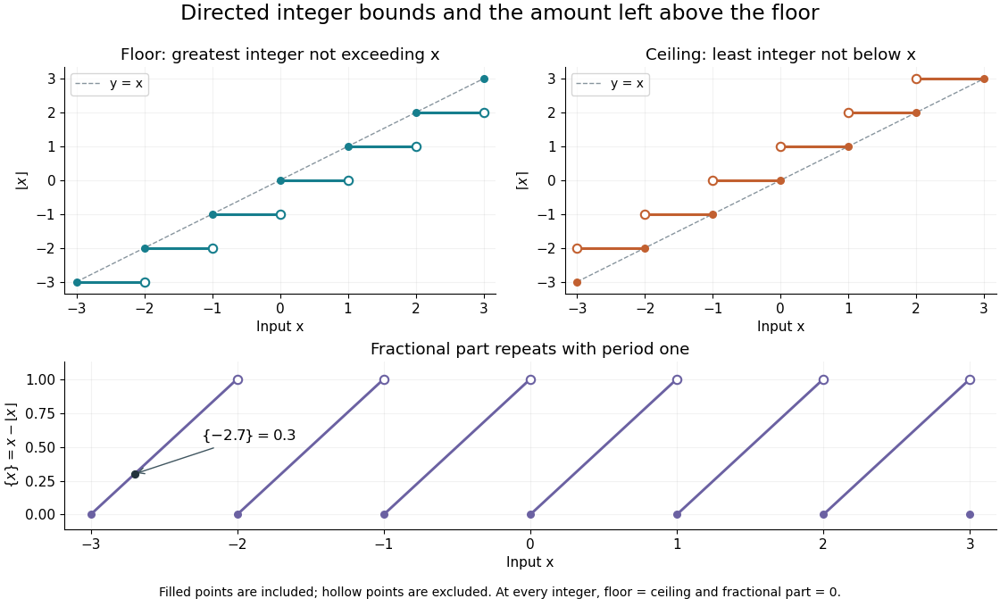

**[Figure 1](#image-floor-and-ceiling-give-enclosing-integers-fractional-part-repeats-on-each-unit-interval). Floor and ceiling give enclosing integers; fractional part repeats on each unit interval**.

The usefulness is a bridge from continuous quantities to discrete decisions. An [integer count in a closed interval](#integer-count-in-a-closed-interval) uses both bounds. A [ceiling count for fixed-size batches](#ceiling-count-for-fixed-size-batches) counts how many containers or pages are needed; a [floor function](#floor-function) counts how many complete groups fit. In [Euclidean division](integer.md#euclidean-division), the same bounds specify the quotient, while the [fractional part](#fractional-part) records the scaled [remainder](integer.md#remainder). A small amount of notation removes many cases that would otherwise have to be stated separately.

The reflection identity

$$
\lceil x\rceil=-\lfloor-x\rfloor
$$

follows by reflecting the ordered [integers](integer.md) across zero: the largest one below $-x$ becomes the smallest one above $x$. For every [integer](integer.md) $m$, translation gives $\lfloor x+m\rfloor=\lfloor x\rfloor+m$ and $\lceil x+m\rceil=\lceil x\rceil+m$. These formulas turn upper bounds into lower bounds and move examples between neighboring [intervals](real-analysis.md#interval-mathematics).

For a historical example of the notation in use, Kenneth E. Iverson's 1962 conference paper _A Programming Language_ lists the [floor function](#floor-function), [ceiling function](#ceiling-function) and residue operation alongside the ordinary [arithmetic operations](numerical-analysis.md#arithmetic-operation). It states the two defining inequalities above, then extends operations component by component to [vectors](vector-space.md#vector) and [matrices](vector-space.md#matrix). This shows their role as tools for describing [algorithms](algorithm.md), rather than merely conventions for writing decimal numbers. [Iverson, A Programming Language, AFIPS Spring Joint Computer Conference, May 1962, Basic Operations; transcription with typography changes documented at the end](https://www.jsoftware.com/papers/AFIPS196205a.htm)

### Integer count in a closed interval

↑ **Parent:** [Floor and ceiling functions](#floor-and-ceiling-functions)

For [real numbers](arithmetic.md#real-number) $a\leq b$, the [integers](integer.md) in the [closed interval](real-analysis.md#closed-real-interval) $[a,b]$ begin at $\lceil a\rceil$ and end at $\lfloor b\rfloor$, if there are any. Their number is therefore

$$
|[a,b]\cap\mathbb Z|=\max\!\left(0,\lfloor b\rfloor-\lceil a\rceil+1\right).
$$

The extra one includes both ends of the resulting [integer interval](integer.md#integer-interval). The [maximum](set.md#maximum-of-a-subset-of-a-total-order) with zero handles an empty [intersection](set.md#set-intersection): $[0.2,0.8]$ contains no [integer](integer.md), even though it has positive length.

For $[-2.7,1.1]$, the [ceiling function](#ceiling-function) selects $-2$ and the [floor function](#floor-function) selects $1$, giving $1-(-2)+1=4$. The four points are $-2,-1,0,1$. For $[-2,2]$, the count is five, not four: the real length $2-(-2)$ and the number of [integer](integer.md) points are different quantities.

The endpoint convention matters. For the half-open [interval](real-analysis.md#interval-mathematics) $[a,b)$ with $a\leq b$, the last allowed [integer](integer.md) is $\lceil b\rceil-1$, so the count becomes $\max(0,\lceil b\rceil-\lceil a\rceil)$. This handles an [integer](integer.md) endpoint $b$ without including it accidentally. For example, $[-2,2)$ has four [integer](integer.md) points.

### Floor function

↑ **Parent:** [Floor and ceiling functions](#floor-and-ceiling-functions)

The floor $\lfloor x\rfloor$ is the greatest [integer](integer.md) not exceeding the [real number](arithmetic.md#real-number) $x$. Equivalently, $\lfloor x\rfloor=m$ exactly when $m\leq x<m+1$, for an [integer](integer.md) $m$. The [floor function](#floor-function) is constant on each such half-open [interval](real-analysis.md#interval-mathematics) and has a [discontinuity of a function](#discontinuity-of-a-function) at each [integer](integer.md).

For nonnegative [integers](integer.md) $N$ and positive [integers](integer.md) $k$, $\lfloor N/k\rfloor$ is the number of complete groups of size $k$ that fit into $N$ items. With $N=102$ and $k=20$, five complete groups use 100 items. [Euclidean division](integer.md#euclidean-division) writes $102=20\cdot5+2$, retaining the two-item [remainder](integer.md#remainder) rather than treating the [quotient](arithmetic.md#quotient) $102/20=5.1$ as a number of complete groups.

#### Floor-division grouping

↑ **Parent:** [Floor function](#floor-function)

For a positive [integer](integer.md) $n$, indices with the same quotient $q=\lfloor n/i\rfloor$ form intervals. If an interval begins at $l$, it ends at $r=\lfloor n/q\rfloor$. There are $O(\sqrt n)$ distinct quotients: either $i\le\sqrt n$, or the quotient is below $\sqrt n$. This permits summing constant-quotient blocks instead of visiting every index.

#### Floor division

↑ **Parent:** [Floor function](#floor-function)

The operation returning $\lfloor a/b\rfloor$ for $b\ne0$. It rounds the exact quotient toward negative infinity; for nonnegative [integers](integer.md) and positive $b$, it is the quotient in [Euclidean division](integer.md#euclidean-division).

#### Floor quotient grouping

↑ **Parent:** [Floor function](#floor-function)

An [algorithm](algorithm.md) for evaluating sums that depend on $\lfloor N/i\rfloor$. If $q=\lfloor N/l\rfloor$, then all indices from $l$ through $r=\lfloor N/q\rfloor$ have quotient $q$. Jumping to $r+1$ visits only $O(\sqrt N)$ blocks rather than all $N$ indices.

#### Floor sum

↑ **Parent:** [Floor function](#floor-function)

A floor sum adds values of a [floor function](#floor-function), often in the form $F(n,a,b,m)=\sum_{i=0}^{n-1}\lfloor(ai+b)/m\rfloor$ for [integers](integer.md) $n\ge0$, $m>0$, $a$, and $b$. If $a,b\ge0$, it counts [lattice points](quantum-scattering.md#lattice-point) $(i,j)$ with $0\le i<n$ and $1\le j\le(ai+b)/m$. Splitting $a$ and $b$ into quotients and remainders isolates an [arithmetic progression](arithmetic.md#arithmetic-progression) and a constant contribution; swapping the remaining counting axes leads to an [Euclidean algorithm](number-theory.md#euclidean-algorithm) reduction.

##### Floor-sum rearrangement

↑ **Parent:** [Floor sum](#floor-sum)

For an [arithmetic function](arithmetic-function.md) $a$, changing the order of the finite [summation](arithmetic.md#summation) gives $\sum_{d=1}^n a(d)\lfloor n/d\rfloor=\sum_{t=1}^n\sum_{d\le\lfloor n/t\rfloor}a(d)$. Both sides count pairs of [positive integers](integer.md#positive-integer) $(d,t)$ with $dt\le n$, assigning weight $a(d)$ to each pair. This expresses a weighted [floor sum](#floor-sum) in terms of a [summatory function](arithmetic-function.md#summatory-function).

##### Euclidean floor-sum transformation

↑ **Parent:** [Floor sum](#floor-sum)

#### Fractional part

↑ **Parent:** [Floor function](#floor-function)  
ⓦ [Wiki](https://en.wikipedia.org/wiki/Fractional_part)

The fractional part of a [real number](arithmetic.md#real-number) is

$$
\{x\}=x-\lfloor x\rfloor\in[0,1).
$$

It is the amount left after removing the lower enclosing [integer](integer.md), even for negative inputs. Thus $\{-2.7\}=-2.7-(-3)=0.3$. It is not the signed string of digits obtained by [truncation toward zero](#truncation-toward-zero).

Translation by an [integer](integer.md) leaves the [fractional part](#fractional-part) unchanged: $\{x+m\}=\{x\}$. It is therefore a [periodic function](function.md#periodic-function) with period one, increasing from zero toward one on each unit [interval](real-analysis.md#interval-mathematics), then returning to zero at the next [integer](integer.md). In [Euclidean division](integer.md#euclidean-division) $N=kq+r$ with $0\leq r<k$, $\{N/k\}=r/k$; for $102/20$, this is $2/20=0.1$.

The notation is useful for following repeated motion modulo an [integer](integer.md). In [normality and equidistribution under integer multiplication](number-theory.md#normality-and-equidistribution-under-integer-multiplication), the values $\{K^n x\}$ shift the digits of a [positional notation](integer.md#positional-notation); the [fractional part](#fractional-part) discards the leading [integer](integer.md) portion without losing the remaining digits. Its braces must be distinguished by context from the braces denoting a [set](set.md).

### Ceiling function

↑ **Parent:** [Floor and ceiling functions](#floor-and-ceiling-functions)

The ceiling function gives the least [integer](integer.md) large enough to meet a real lower bound. For a [real number](arithmetic.md#real-number) $x$,

$$
\lceil x\rceil=m\quad\Longleftrightarrow\quad m-1<x\leq m,\qquad m\in\mathbb Z.
$$

Thus $\lceil2.7\rceil=3$, $\lceil-2.7\rceil=-2$, and $\lceil2\rceil=2$. The operation rounds upward in the [total order](set.md#total-order) on the [real numbers](arithmetic.md#real-number), which can move a negative input towards zero. Its difference from the input obeys $0\leq\lceil x\rceil-x<1$. Python's `math.ceil` implements this least-integer definition. [Python 3.14 math.ceil documentation: the least integer at least x](https://docs.python.org/3.14/library/math.html#math.ceil).

The [ceiling count for fixed-size batches](#ceiling-count-for-fixed-size-batches) is a direct application. Suppose each box holds at most $k$ items, with positive [integer](integer.md) $k$, and there are $N\geq0$ items. The smallest number of boxes with enough capacity is $\lceil N/k\rceil$: a candidate count $b$ must satisfy $bk\geq N$. For $N=101$, $k=20$, **six boxes are needed**, leaving $120-101=19$ unused places. Exactly 100 items need only five boxes, and zero items need zero boxes. Adding one to the [floor function](#floor-function) result unconditionally would therefore overcount at exact multiples of $k$.

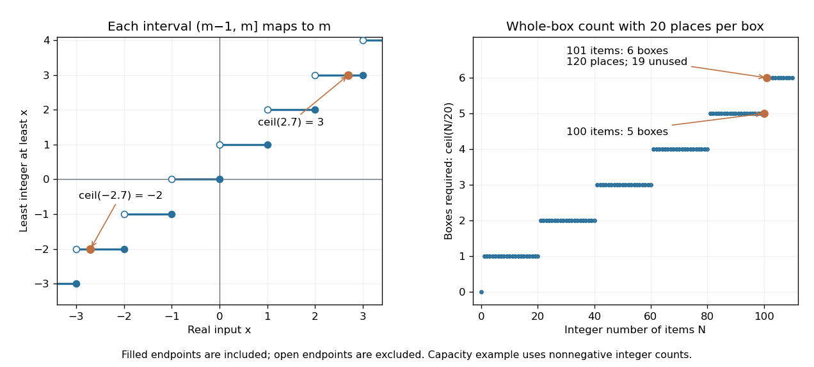

**[Figure 2](#image-the-ceiling-function-retains-the-endpoint-on-the-left-and-counts-enough-whole-containers). The ceiling function retains the endpoint on the left and counts enough whole containers**. Left: open and filled endpoints distinguish the half-open [intervals](real-analysis.md#interval-mathematics) $(m-1,m]$ where $\lceil x\rceil=m$, including negative inputs. Right: the original capacity example uses 20 items per box; 101 items need six boxes, while an exact multiple of 20 needs no extra box. The right-hand inputs are integer item counts.

For nonnegative [integer](integer.md) $N$ and positive [integer](integer.md) $k$, [Euclidean division](integer.md#euclidean-division) gives the exact identity

$$
\boxed{\left\lceil\frac Nk\right\rceil=\left\lfloor\frac{N+k-1}{k}\right\rfloor.}
$$

Write $N=qk+r$, $0\leq r<k$. The count is $q$ when the [remainder](integer.md#remainder) is zero and $q+1$ otherwise, and the right-hand side encodes these two cases. This argument specifies the domain of the identity; arbitrary negative denominators require their own sign conventions.

The [ceiling function](#ceiling-function) is a [nondecreasing function](#nondecreasing-function), constant on each of the half-open [intervals](real-analysis.md#interval-mathematics) $(m-1,m]$, and has a [discontinuity of a function](#discontinuity-of-a-function) at every [integer](integer.md). It is tied to the [floor function](#floor-function) by $\lceil x\rceil=-\lfloor-x\rfloor$. Adding an [integer](integer.md) $j$ shifts its output by the same amount: $\lceil x+j\rceil=\lceil x\rceil+j$. At an [integer](integer.md) the floor and ceiling agree; at every other input they differ by one. These statements refer to exact [real numbers](arithmetic.md#real-number); an input already perturbed by [floating-point arithmetic](floating-point-arithmetic.md) can land on the other side of a threshold.

#### Ceiling count for fixed-size batches

↑ **Parent:** [Ceiling function](#ceiling-function)

Suppose $N$ is a nonnegative [integer](integer.md) count of items and each batch holds at most $k$ items, where $k$ is a positive [integer](integer.md). The smallest sufficient number of batches is

$$
b=\left\lceil\frac Nk\right\rceil.
$$

Indeed, $bk\geq N$ exactly when the [integer](integer.md) $b$ is at least $N/k$. If $N=0$, no batches are needed. If $N$ is a multiple of $k$, no partly filled batch is needed.

For $102$ items with capacity $20$ per batch, $b=\lceil5.1\rceil=6$. Five batches can be full and the sixth holds two items, leaving $6\cdot20-102=18$ unused places. This is a different question from the five complete groups counted by $\lfloor102/20\rfloor$.

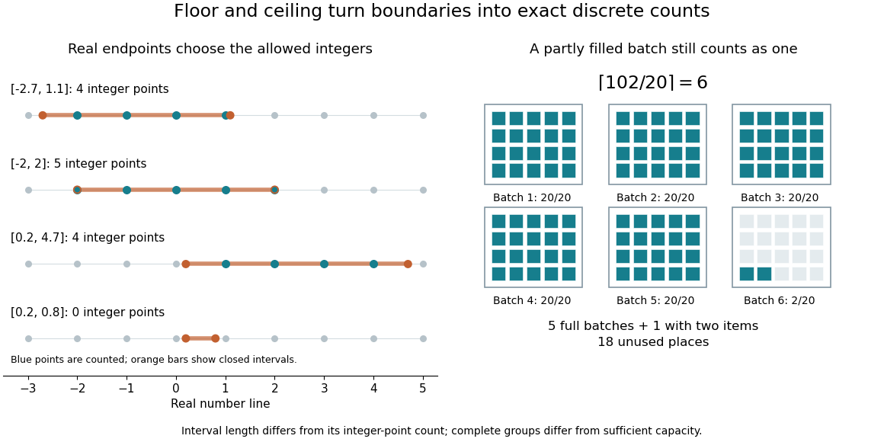

**[Figure 3](#image-endpoint-aware-integer-counts-and-six-twenty-place-batches-needed-for-102-items). Endpoint-aware integer counts and six twenty-place batches needed for 102 items**.

Writing the [Euclidean division](integer.md#euclidean-division) $N=kq+r$, $0\leq r<k$, gives the equivalent rule $b=q$ when $r=0$, and $b=q+1$ when $r>0$. This explains the [ceiling function](#ceiling-function)'s jump: one extra item beyond a complete multiple demands a whole additional batch. For exact [integer arithmetic](arithmetic.md#integer-arithmetic), the identity $b=\lfloor(N+k-1)/k\rfloor$ avoids a fractional intermediate value; an implementation still needs an [integer](integer.md) representation large enough to hold $N+k-1$.

### Truncation toward zero

↑ **Parent:** [Floor and ceiling functions](#floor-and-ceiling-functions)

Truncation toward zero removes the fractional magnitude of a [real number](arithmetic.md#real-number), giving the [integer](integer.md) obtained by applying the [floor function](#floor-function) to its [absolute value](real-analysis.md#absolute-value) and restoring the original sign; a magnitude below one gives zero. More precisely,

$$
\operatorname{trunc}(x)=\begin{cases}\lfloor x\rfloor&x\geq0,\\\lceil x\rceil&x<0.\end{cases}
$$

The result is zero for $-1<x<1$. For example, $\operatorname{trunc}(2.7)=2$ and $\operatorname{trunc}(-2.7)=-2$, whereas $\lfloor-2.7\rfloor=-3$. Python's `math.trunc` uses this towards-zero convention, so replacing it by `math.floor` changes calculations with negative noninteger inputs. [Python 3.14 math.trunc documentation: floor on positive inputs, ceiling on negative inputs](https://docs.python.org/3.14/library/math.html#math.trunc).

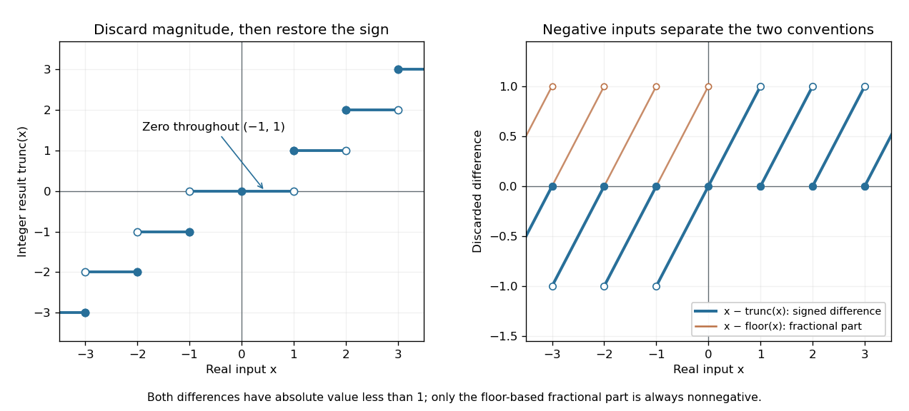

**[Figure 4](#image-truncation-toward-zero-is-symmetric-in-sign-while-the-fractional-part-defined-by-the-floor-function-is-always-nonnegative). Truncation toward zero is symmetric in sign, while the fractional part defined by the floor function is always nonnegative**. Left: exact integer endpoint values distinguish the two sign-dependent truncation rules; a whole neighborhood of zero maps to zero. Right: $x-\operatorname{trunc}(x)$ takes the sign of a noninteger input, while $x-\lfloor x\rfloor$ lies in $[0,1)$ on both sides of zero. Open endpoints show excluded limiting values.

For every [real number](arithmetic.md#real-number) $x$,

$$
|x-\operatorname{trunc}(x)|<1,\qquad \operatorname{trunc}(-x)=-\operatorname{trunc}(x).
$$

The discarded difference $x-\operatorname{trunc}(x)$ has the sign of $x$ when $x$ is noninteger. In contrast, the [fractional part](#fractional-part) $x-\lfloor x\rfloor$ is always in $[0,1)$. At $x=-2.7$, these two differences are $-0.7$ and $0.3$. Thus specifying a signed fractional remainder requires specifying which integer-valued operation is used.

Unlike the [floor function](#floor-function) and [ceiling function](#ceiling-function), [truncation toward zero](#truncation-toward-zero) need not commute with adding an [integer](integer.md). At $x=-0.7$ and $j=1$, $\operatorname{trunc}(x+j)=\operatorname{trunc}(0.3)=0$, whereas $\operatorname{trunc}(x)+j=1$. This matters if negative coordinates are assigned to equal-width bins by converting a quotient to an [integer](integer.md): $x=-0.7$ belongs to the bin $[-1,0)$ under the [floor function](#floor-function), but truncation gives zero. The appropriate operation follows from the declared bin [intervals](real-analysis.md#interval-mathematics).

[Truncation toward zero](#truncation-toward-zero) is a [nondecreasing function](#nondecreasing-function) with a [discontinuity of a function](#discontinuity-of-a-function) at each nonzero [integer](integer.md). It has no [discontinuity of a function](#discontinuity-of-a-function) at zero, because it is identically zero on $(-1,1)$. Its agreement with the [floor function](#floor-function) on the positive side and the [ceiling function](#ceiling-function) on the negative side explains the different closed endpoints in the diagram.

## Integral

↑ **Parent:** [Calculus](calculus.md)

[This section is present in another page, follow this link to view it.](integral.md)

## Taylor polynomial

↑ **Parent:** [Calculus](calculus.md)

A [Taylor polynomial](#taylor-polynomial) replaces a [function](function.md) near a chosen point by a [polynomial](polynomial.md) with matching [derivatives](#derivative). If $f$ has [derivatives](#derivative) through order $n$ at $a$, define

$$
T_{n,a}(x)=\sum_{k=0}^n\frac{f^{(k)}(a)}{k!}(x-a)^k.
$$

The [factorial](combinatorics.md#factorial) denominator makes $T_{n,a}^{(j)}(a)=f^{(j)}(a)$ for $0\leq j\leq n$. This determines a unique [polynomial](polynomial.md) of [degree of a polynomial](polynomial.md#degree-of-a-polynomial) at most $n$. Order zero matches the value, order one also matches the [tangent line](#tangent-line), and order two also incorporates the second [derivative](#derivative). Matching more local information is useful because [polynomials](polynomial.md) are easy to evaluate, differentiate, and integrate. The distinction between the finite [Taylor polynomial](#taylor-polynomial) and the infinite [Taylor series](#taylor-series) is developed in [OpenStax, Taylor and Maclaurin series](https://openstax.org/books/calculus-volume-2/pages/6-3-taylor-and-maclaurin-series).

For a computed example, let $f(x)=\sqrt{1+x}$ and expand at zero. Its first three [derivatives](#derivative) give

$$
f(0)=1,\qquad f'(0)=\frac12,\qquad f''(0)=-\frac14,\qquad T_{2,0}(x)=1+\frac x2-\frac{x^2}8.
$$

At $x=0.1$, the linear approximation is $1.05$ and the quadratic approximation is $1.04875$, compared with $\sqrt{1.1}\approx1.048808848$. The quadratic correction captures the downward bending of the [square root](algebra.md#square-root) and reduces the absolute difference from about $0.00119115$ to $0.0000588482$.

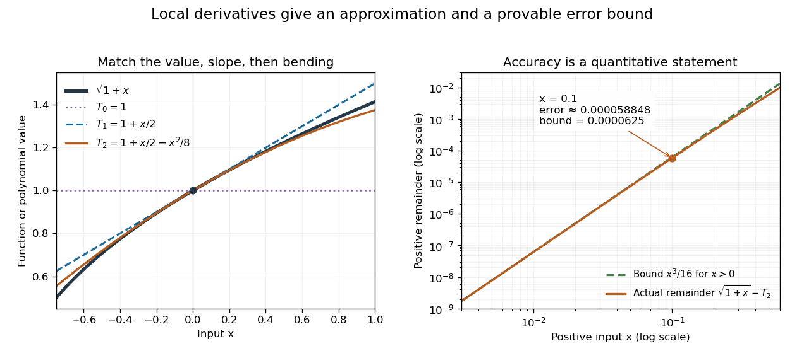

**[Figure 5](#image-matching-more-derivatives-improves-a-local-square-root-approximation-and-the-third-derivative-supplies-an-error-bound). Matching more derivatives improves a local square-root approximation, and the third derivative supplies an error bound**.

The [Taylor remainder](#taylor-remainder) turns this convenient approximation into a controlled calculation. On $[0,0.1]$, $f'''(x)=3/[8(1+x)^{5/2}]$ is positive and at most $3/8$. The [Taylor theorem with Lagrange remainder](#taylor-theorem-with-lagrange-remainder) therefore gives

$$
0<\sqrt{1.1}-1.04875\leq\frac{(3/8)(0.1)^3}{3!}=\frac1{16000}.
$$

Consequently **$1.04875<\sqrt{1.1}\leq1.0488125$** follows without using the displayed decimal evaluation as evidence. The [Taylor polynomial](#taylor-polynomial) and the [Taylor remainder](#taylor-remainder) play different roles: the former supplies an answer that is easy to compute, while the latter specifies what accuracy is justified. Farther from the expansion point, the same low-degree [polynomial](polynomial.md) need not remain accurate.

### Multivariate Taylor polynomial

↑ **Parent:** [Taylor polynomial](#taylor-polynomial)

The multivariate Taylor polynomial of total degree $p$ at $x_0$ is

$$
T_{x_0,p}(x)=\sum_{|\alpha|\leq p}
\frac{D^\alpha f(x_0)}{\alpha!}(x-x_0)^\alpha.
$$

#### Second-order relative change of a monomial

↑ **Parent:** [Multivariate Taylor polynomial](#multivariate-taylor-polynomial)

For positive $a,b$, fixed real $p,q$, and $f(a,b)=a^pb^q$, change the inputs to $a(1+h),b(1+j)$ with $h,j$ small. The ratio of the new value to the old one is exactly $(1+h)^p(1+j)^q$. Applying the [binomial series](sequence-and-series.md#binomial-series) to each factor and multiplying proves the displayed [Taylor expansion](#taylor-expansion). Positive inputs and $1+h,1+j>0$ make arbitrary real exponents well defined. A percentage change of $k$ in $a$ means $h=k/100$, not $h=k$. The mixed term $pqhj$ is required even though there is no such term in either one-variable expansion separately.

## Exponential function

↑ **Parent:** [Calculus](calculus.md)  
ⓦ [Wiki](https://en.wikipedia.org/wiki/Exponential_function)

The real [exponential function](#exponential-function) $\exp(x)=e^x$ converts addition into multiplication:

$$
\exp(x+y)=\exp(x)\exp(y),\qquad \exp(0)=1,\qquad \frac{d}{dx}\exp(x)=\exp(x).
$$

Its values are positive, and it defines a [bijection](function.md#bijection) from the [real numbers](arithmetic.md#real-number) to the positive [real numbers](arithmetic.md#real-number). The [natural logarithm](#natural-logarithm) is its [inverse function](function.md#inverse-function). These properties connect arithmetic with [calculus](calculus.md): adding an amount to the input multiplies the output by a fixed factor, and the local rate of change equals the current value. The [exponential series](#exponential-series) gives one construction; an equivalent characterization is the unique [solution of a differential equation](differential-equation.md#solution-of-a-differential-equation) $y'=y$, $y(0)=1$.

For a concrete example, $y(t)=10e^{0.2t}$ starts at $10$ and satisfies $y'=0.2y$. The absolute [derivative](#derivative) increases with $y$, while the relative rate $y'/y$ stays $0.2$. At $t=5$, $y=10e\approx27.1828$ and $y'\approx5.43656$. The [exponential function](#exponential-function) therefore models accumulation proportional to what is already present, rather than addition of a fixed amount at every step. A positive constant rate gives [exponential growth](#exponential-growth); a negative one gives [exponential decay](analysis.md#exponential-decay).

Every positive real base $b\ne1$ fits the same construction through $b^x=e^{x\ln b}$. Thus its [derivative](#derivative) is $(\ln b)b^x$: base $e$ is special because $\ln e=1$. The [exponential function](#exponential-function) is also unchanged in form by [differentiation](#differentiation) and [integration](integral.md), helping explain its repeated appearance in [linear ordinary differential equations](linear-ordinary-differential-equation.md). Its real definition, inverse relationship, and derivative rules are developed in [OpenStax, integrals, exponential functions, and logarithms](https://openstax.org/books/calculus-volume-1/pages/6-7-integrals-exponential-functions-and-logarithms).

### Exponential growth

↑ **Parent:** [Exponential function](#exponential-function)  
ⓦ [Wiki](https://en.wikipedia.org/wiki/Exponential_growth)

A positive quantity undergoes [exponential growth](#exponential-growth) at constant rate $r>0$ when $y'=ry$. For $y_0>0$, the [solution of a differential equation](differential-equation.md#solution-of-a-differential-equation) is $y(t)=y_0e^{rt}$. Every interval of duration $\Delta t$ multiplies the value by the same factor $e^{r\Delta t}$, independently of its starting value.

#### Doubling time

↑ **Parent:** [Exponential growth](#exponential-growth)  
ⓦ [Wiki](https://en.wikipedia.org/wiki/Doubling_time)

The interval required to double a quantity under constant-rate [exponential growth](#exponential-growth). Solving $e^{rt_2}=2$ with the [natural logarithm](#natural-logarithm) gives $t_2=\ln2/r$. At $r=0.2$ per time unit, it is approximately $3.46574$ time units; every subsequent doubling takes the same interval.

### e (mathematical constant)

↑ **Parent:** [Exponential function](#exponential-function)  
ⓦ [Wiki](https://en.wikipedia.org/wiki/e_(mathematical_constant))

[Euler's number](#e-mathematical-constant) is the value $\exp(1)=\sum_{n=0}^{\infty}1/n!$ of the [exponential function](#exponential-function), approximately $2.71828$. It is the base of the [natural logarithm](#natural-logarithm). Its factorial-series tail gives an elementary proof of the [irrationality of e](#irrationality-of-e). The [compounding limit for e](#compounding-limit-for-e) shows how the same constant arises from repeated small multiplications.

#### Compounding limit for e

↑ **Parent:** [e (mathematical constant)](#e-mathematical-constant)

Start at one and apply $n$ updates, each multiplying the current value by $1+1/n$. The final value is $(1+1/n)^n$: one update gives $2$, two give $2.25$, ten give approximately $2.59374$, and one hundred give approximately $2.70481$. Increasing the number of steps, while reducing each increment proportionally, approaches [Euler's number](#e-mathematical-constant) rather than producing unbounded accumulation.

**[Figure 6](#image-repeated-smaller-proportional-updates-approach-euler-s-number-over-one-fixed-interval). Repeated smaller proportional updates approach Euler's number over one fixed interval**.

The [natural logarithm](#natural-logarithm) makes the [limit](#limit-of-a-function) transparent. For $u>0$, its [integral](integral.md) definition gives $u/(1+u)\leq\ln(1+u)\leq u$, by bounding $1/t$ on $[1,1+u]$. With $u=1/n$,

$$
\frac1{1+1/n}\leq n\ln(1+1/n)\leq1.
$$

The [squeeze theorem](#squeeze-theorem) gives a logarithmic [limit](#limit-of-a-function) of one; continuity of the [exponential function](#exponential-function) gives $(1+1/n)^n\to e$. This links a discrete multiplicative rule with continuous [exponential growth](#exponential-growth), without assuming that a finite number of steps equals the limiting value.

#### Irrationality of e

↑ **Parent:** [e (mathematical constant)](#e-mathematical-constant)

If [Euler's number](#e-mathematical-constant) were $a/b$, choose $n\geq\max(b,2)$ and multiply its factorial-series tail by $n!$. This produces an [integer](integer.md), but the tail is positive and smaller than $\sum_{j\geq1}(n+1)^{-j}=1/n<1$. The contradiction proves that the number is an [irrational number](algebra.md#irrational-number). The argument rules out a hypothetical rational remainder by placing it in an impossible [integer](integer.md) interval.

### Exponential series

↑ **Parent:** [Exponential function](#exponential-function)

The exponential function has the everywhere-convergent [power series](sequence-and-series.md#power-series)

$$
e^x=\sum_{n=0}^{\infty}\frac{x^n}{n!}.
$$

#### Exponential series divided by a shifted index

↑ **Parent:** [Exponential series](#exponential-series)

For a positive integer $k$, multiply the [exponential series](#exponential-series) by $t^{k-1}$ and integrate term by term from zero to $x$. Its [uniform convergence](sequence-and-series.md#uniform-convergence) on every compact interval justifies the operation and proves the title identity. The resulting [power series](sequence-and-series.md#power-series) converges absolutely for every real or complex $x$, by the [ratio test](sequence-and-series.md#ratio-test). Repeated [integration by parts](#integration-by-parts) evaluates the right side as an exponential times a [polynomial](polynomial.md), with its constant chosen to make the integral vanish at zero.

### Complex exponential function

↑ **Parent:** [Exponential function](#exponential-function)

The complex exponential is the entire function

$$
e^z=\sum_{n=0}^{\infty}\frac{z^n}{n!}.
$$

It maps $\mathbb C$ onto $\mathbb C^*$ and has kernel $2\pi i\mathbb Z$.

#### Modulus of the complex exponential

↑ **Parent:** [Complex exponential function](#complex-exponential-function)

For real $x,y$, the [complex exponential function](#complex-exponential-function) has $e^{x+iy}=e^x(\cos y+i\sin y)$. Since the trigonometric factor lies on the [unit circle](complex-analysis.md#complex-unit-circle),

$$
|e^z|=e^{\operatorname{Re}z}.
$$

Thus the [real part](complex-analysis.md#real-part) of the exponent controls its [modulus](complex-analysis.md#modulus), while the [imaginary part](complex-analysis.md#imaginary-part) controls its direction on the complex plane.

#### Complex sine function

↑ **Parent:** [Complex exponential function](#complex-exponential-function)

The complex sine is the entire function

$$
\sin z=\frac{e^{iz}-e^{-iz}}{2i}.
$$

For real $x,y$, $\sin(x+iy)=\sin x\cosh y+i\cos x\sinh y$.

##### Periodicity of the complex sine

↑ **Parent:** [Complex sine function](#complex-sine-function)

The kernel $2\pi i\mathbb Z$ of the [complex exponential function](#complex-exponential-function) gives

$$
\sin(z+2\pi)
=\frac{e^{iz}e^{2\pi i}-e^{-iz}e^{-2\pi i}}{2i}
=\sin z.
$$

The same period appears as the translation generated by the [monodromy of the complex inverse sine](complex-analysis.md#monodromy-of-the-complex-inverse-sine).

### Logarithm

↑ **Parent:** [Exponential function](#exponential-function)  
ⓦ [Wiki](https://en.wikipedia.org/wiki/Logarithm)

For a positive real base $b\ne1$, the [logarithm](#logarithm) is the [inverse function](function.md#inverse-function) of the [exponential function](#exponential-function) $t\mapsto b^t$:

$$
\log_b x=t\quad\Longleftrightarrow\quad b^t=x,\qquad x>0.
$$

It asks which exponent produces a given positive number. Thus $\log_2 8=3$ and $\log_2(1/8)=-3$. The base restrictions matter: $b=1$ would produce only one value, while a negative base does not define $b^t$ as a real-valued [function](function.md) for every real exponent.

The useful transformation is

$$
\log_b(xy)=\log_bx+\log_by,\qquad \log_b(x/y)=\log_bx-\log_by.
$$

For example, $8\cdot16=128$ corresponds to $3+4=7$ in base two. Products become sums and ratios become differences. The [logarithm](#logarithm) does not generally convert a sum into a sum of logarithms. Base conversion uses the [natural logarithm](#natural-logarithm): $\log_bx=\ln x/\ln b$. It also gives $d(\log_bx)/dx=1/(x\ln b)$, positive when $b>1$ and negative when $0<b<1$.

Historically, [John Napier](mathematics.md#john-napier)'s 1614 Mirifici logarithmorum canonis descriptio presented logarithmic tables and their use, documented in [the Smithsonian Libraries' digitized original](https://library.si.edu/digital-library/book/mirificilogarit00napi). Tables made multiplication-heavy calculations more manageable by replacing products with addition and a lookup. The 1619 Constructio title page below belongs to a later publication from the same work on [logarithms](#logarithm). These historical publications preceded the modern [inverse function](function.md#inverse-function) and [integral](integral.md) presentation used here.

**[Figure 7](#image-title-page-of-napier-s-1619-mirifici-logarithmorum-canonis-constructio). Title page of Napier's 1619 Mirifici logarithmorum canonis constructio**. [Source](https://commons.wikimedia.org/wiki/File:Napier's\_Constructio\_Latin\_title\_page.jpg).

#### Geometric-series bound for the logarithmic remainder

↑ **Parent:** [Logarithm](#logarithm)

For $0<u<1$, the [power series](sequence-and-series.md#power-series) for the [logarithm](#logarithm) gives $-\log(1-u)-u=\sum_{n=2}^\infty u^n/n<\frac12\sum_{n=2}^\infty u^n=u^2/[2(1-u)]$. The inequality is strict because $1/n<1/2$ for every $n\geq3$.

#### Irrational logarithm criterion

↑ **Parent:** [Logarithm](#logarithm)

For [integers](integer.md) $a,b>1$, rationality of $\log_a b$ is equivalent to equality of some positive [integer](integer.md) powers $a^p=b^q$. Exponentiation proves one direction and taking [logarithms](#logarithm) proves the other. Thus multiplicatively independent [integers](integer.md) give an [irrational number](algebra.md#irrational-number) as their logarithm ratio. For distinct prime bases and arguments, [unique factorization](algebra.md#unique-factorization-in-an-integral-domain) supplies that independence.

#### Concavity of the logarithm

↑ **Parent:** [Logarithm](#logarithm)

The [logarithm](#logarithm) is [strictly concave](real-analysis.md#strictly-concave-function) on positive real numbers, as its second [derivative](#derivative) is negative. Thus the [Jensen inequality](real-analysis.md#jensen-s-inequality) gives $\int\log f\,d\mu\le\log\int f\,d\mu$ for a [probability measure](probability-space.md#probability-measure) and an integrable positive $f$, whenever the left side is defined. It also controls the negative logarithmic part of [convex](real-analysis.md#convex-function) combinations of strictly positive functions.

#### Logarithmic integral function

↑ **Parent:** [Logarithm](#logarithm)  
ⓦ [Wiki](https://en.wikipedia.org/wiki/Logarithmic_integral_function)

The [Cauchy principal value](complex-analysis.md#cauchy-principal-value) integral $\operatorname{li}(x)=\operatorname{PV}\int_0^xdt/\log t$ is the logarithmic integral. The offset version $\operatorname{Li}(x)=\int_2^xdt/\log t$ differs by a constant and is often used with the [prime-counting function](number-theory.md#prime-counting-function). It has $\operatorname{Li}(x)\sim x/\log x$.

#### Natural logarithm

↑ **Parent:** [Logarithm](#logarithm)  
ⓦ [Wiki](https://en.wikipedia.org/wiki/Natural_logarithm)

The [natural logarithm](#natural-logarithm) $\ln x$ is the [logarithm](#logarithm) with base [Euler's number](#e-mathematical-constant), and the [inverse function](function.md#inverse-function) of the real [exponential function](#exponential-function). A particularly geometric definition is

$$
\ln x=\int_1^x\frac{dt}{t},\qquad x>0.
$$

For $x>1$, it is the [area](differential-geometry.md#surface-area) under the [hyperbola](euclidean-geometry.md#hyperbola) $y=1/t$ from $1$ to $x$. For $0<x<1$, the reversed [integration](integral.md) limits give a negative value. The [fundamental theorem of calculus](#fundamental-theorem-of-calculus) gives $(\ln x)'=1/x$, so the [natural logarithm](#natural-logarithm) is increasing, while $(\ln x)''=-1/x^2$ gives [concavity](real-analysis.md#concave-function).

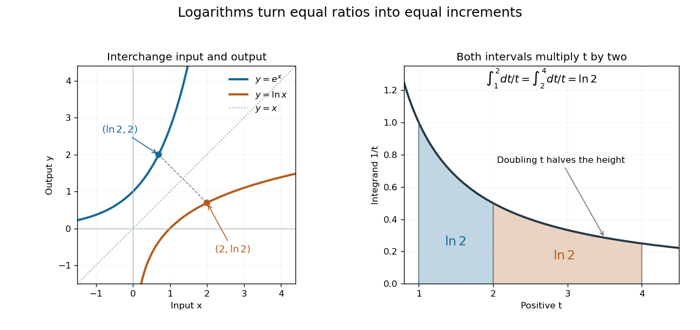

**[Figure 8](#image-exponential-function-and-natural-logarithm-graphs-reflect-across-y-x-equal-multiplicative-intervals-have-equal-logarithmic-areas). Exponential function and natural logarithm graphs reflect across $y=x$; equal multiplicative intervals have equal logarithmic areas**.

The [change of variables](multivariable-calculus.md#change-of-variables-formula) $t=au$ shows $\int_a^{ab}dt/t=\int_1^bdu/u=\ln b$ for $a,b>0$. Thus the intervals from $1$ to $2$ and from $2$ to $4$ each contribute [area](differential-geometry.md#surface-area) $\ln2$, explaining $\ln4=2\ln2$. Equal ratios give equal increments on a [logarithmic scale](#logarithmic-scale), even though the ordinary differences grow. This makes the [natural logarithm](#natural-logarithm) useful for comparing multiplicative changes and solving for time in [exponential growth](#exponential-growth) or [exponential decay](analysis.md#exponential-decay). The [integral](integral.md) construction and [inverse function](function.md#inverse-function) properties are discussed in [OpenStax, the natural logarithm as an integral](https://openstax.org/books/calculus-volume-1/pages/6-7-integrals-exponential-functions-and-logarithms).

##### Mercator series

↑ **Parent:** [Natural logarithm](#natural-logarithm)  
ⓦ [Wiki](https://en.wikipedia.org/wiki/Mercator_series)

Integrating the [geometric series](sequence-and-series.md#geometric-series) for $1/(1+x)$ from zero to $x$ gives the displayed [power series](sequence-and-series.md#power-series) for $|x|<1$. It has [radius of convergence](sequence-and-series.md#radius-of-convergence) one. At $x=1$ the [alternating series test](sequence-and-series.md#alternating-series-test) gives [conditional convergence](sequence-and-series.md#conditional-convergence) to $\ln2$; at $x=-1$ the negative [harmonic series](sequence-and-series.md#harmonic-series) diverges. Replacing $x$ by $-w$ gives $\ln(1-w)=-\sum_{n\ge1}w^n/n$. An expression formed by substituting a nonlinear function for $w$ need not have the same convergence range after it is re-expanded as a [Taylor series](#taylor-series) in the new variable.

##### Logarithmic integral representation of the natural logarithm

↑ **Parent:** [Natural logarithm](#natural-logarithm)

The [natural logarithm](#natural-logarithm) has the parameter-integral representation

$$
\boxed{\int_0^1\frac{t^x-1}{\ln t}\,dt=\ln(1+x),\qquad x>-1.}
$$

For $0<t<1$, the identity $(t^x-1)/\ln t=\int_0^x t^s\,ds$ shows convergence: the [absolute value](real-analysis.md#absolute-value) is at most $|x|t^{\min(x,0)}$, which is integrable when $x>-1$. At $t=1$, the apparent singularity is removable, with limiting value $x$.

Write the left side as $I(x)$. On a compact parameter [interval](real-analysis.md#interval-mathematics) $c\leq x\leq d$ with $c>-1$, its differentiated integrand $t^x$ is bounded by the integrable [function](function.md) $t^c$. The [dominated convergence theorem](measure-theory.md#dominated-convergence-theorem) justifies [differentiation under the integral sign](analysis.md#differentiation-under-the-integral-sign), giving $I'(x)=\int_0^1t^xdt=1/(1+x)$. Since $I(0)=0$, the [fundamental theorem of calculus](#fundamental-theorem-of-calculus) gives $I(x)=\ln(1+x)$. At $x=-1$, the original [improper integral](real-analysis.md#improper-integral) diverges as $-\int_0dt/[t|\ln t|]$, and it also diverges for $x<-1$.

#### Logarithmic scale

↑ **Parent:** [Logarithm](#logarithm)  
ⓦ [Wiki](https://en.wikipedia.org/wiki/Logarithmic_scale)

A [logarithmic scale](#logarithmic-scale) places a positive quantity $x$ according to a [logarithm](#logarithm), so equal [ratios](arithmetic.md#ratio) occupy equal distances. For example, $1,2,4,8$ are equally spaced under the [natural logarithm](#natural-logarithm) because every successive difference is $\ln2$. An ordinary [linear scale](arithmetic.md#linear-scale) instead gives equal distances to equal differences: $1,2,3,4$.

For a base $b>1$ and a positive reference $x_0$, define the axis position

$$
u=\log_b(x/x_0),\qquad x>0.
$$

The reference has the same units as $x$, making $x/x_0$ a [dimensionless quantity](physics.md#dimensionless-quantity). The distance between two positions is

$$
u_2-u_1=\log_b(x_2/x_1).
$$

Multiplying both values by the same positive factor preserves that distance. Replacing $x_0$ by $cx_0$ translates every position by $-\log_b c$; changing the base rescales positions through $\log_b z=\ln z/\ln b$. Neither change alters which [ratios](arithmetic.md#ratio) receive equal gaps.

In base ten, the values $1,10,100,1000$ occupy positions $0,1,2,3$ when $x_0=1$. The differences between neighboring values grow from nine to ninety to nine hundred, but every step spans one [order of magnitude](#order-of-magnitude). The values $2,20,200$ occupy positions $0.30103,1.30103,2.30103$: the same spacing shifted by $\log_{10}2$. This lets one plot small and large positive quantities together while keeping equal proportional changes equally visible.

A [logarithmic scale](#logarithmic-scale) is a rule for position, not an instruction to relabel the tick marks with their [logarithms](#logarithm). A mark labelled $100$ still means the original value one hundred. Ordinary real [logarithms](#logarithm) exclude zero and negative inputs. Omitting such values or clipping them to a plotting boundary does not give them genuine logarithmic positions; the plotting choice needs to be clear.[Matplotlib 3.10.7 documentation; Matplotlib 3.10.7, Log scale: Logarithms with other bases and Dealing with negative values](computer-science-bibliography.md#matplotlib-3-10-7-documentation/log-scale)

##### Order of magnitude

↑ **Parent:** [Logarithmic scale](#logarithmic-scale)  
ⓦ [Wiki](https://en.wikipedia.org/wiki/Order_of_magnitude)

For positive quantities, a difference of one [order of magnitude](#order-of-magnitude) means a factor of ten; a difference of $n$ [orders of magnitude](#order-of-magnitude) means a factor of $10^n$. The logarithmic difference $\log_{10}(x_2/x_1)$ records this comparison, without subtracting the quantities themselves. For example, $1000$ is three [orders of magnitude](#order-of-magnitude) above one, regardless of a common change of units. Roughly assigning a single value to an [order of magnitude](#order-of-magnitude) also requires a rounding convention; powers of ten are the reference levels.

##### Logarithmic midpoint

↑ **Parent:** [Logarithmic scale](#logarithmic-scale)

For positive endpoints $a,b$, halfway along a [logarithmic scale](#logarithmic-scale) means

$$
\log_{\beta}(m/x_0)=\frac{\log_{\beta}(a/x_0)+\log_{\beta}(b/x_0)}2.
$$

Here $\beta>1$ is the base. Equivalently, using the [natural logarithm](#natural-logarithm), $2\ln(m/x_0)=\ln(a/x_0)+\ln(b/x_0)$. The [product of numbers](arithmetic.md#product-of-numbers) identity for [logarithms](#logarithm) gives $m^2=ab$, so **the midpoint is the [geometric mean](arithmetic.md#geometric-mean) $\sqrt{ab}$**. The two endpoints lie at equal multiplicative distances because $m/a=b/m$.

For $a=10$ and $b=100$, this midpoint is $\sqrt{1000}\approx31.6228$, giving a factor of $\sqrt{10}$ on each side. The [arithmetic mean](arithmetic.md#arithmetic-mean) $55$ is halfway on a [linear scale](arithmetic.md#linear-scale), but its two [ratios](arithmetic.md#ratio) are $55/10=5.5$ and $100/55\approx1.81818$. Thus reading halfway between the marks $10$ and $100$ as $55$ on a [logarithmic scale](#logarithmic-scale) gives the wrong value.

**[Figure 9](#image-equal-ratios-give-equal-logarithmic-gaps-and-the-geometric-mean-is-halfway-between-two-positive-values). Equal ratios give equal logarithmic gaps, and the geometric mean is halfway between two positive values**. Original rulers calculated from [logarithms](#logarithm). The lower rulers cover the same endpoints $10$ and $100$: the blue [geometric mean](arithmetic.md#geometric-mean) is centered on the [logarithmic scale](#logarithmic-scale), while the orange [arithmetic mean](arithmetic.md#arithmetic-mean) is centered on the [linear scale](arithmetic.md#linear-scale). Tick labels show original values.

##### Semi-log plot

↑ **Parent:** [Logarithmic scale](#logarithmic-scale)  
ⓦ [Wiki](https://en.wikipedia.org/wiki/Semi-log_plot)

A [semi-log plot](#semi-log-plot) uses a [logarithmic scale](#logarithmic-scale) on one axis and a [linear scale](arithmetic.md#linear-scale) on the other. Which axis is logarithmic matters. Plotting $x$ against $\log y$ makes positive [exponential functions](#exponential-function) appear as [straight lines](euclidean-geometry.md#straight-line); plotting $\log x$ against $y$ instead makes an affine function of a [logarithm](#logarithm) appear straight. The plotting operations change positions while retaining the original tick values.[Matplotlib 3.10.7 documentation; Matplotlib 3.10.7, Log scale: Convenience functions semilogx, semilogy, and loglog; distinction between horizontal and vertical logarithmic axes](computer-science-bibliography.md#matplotlib-3-10-7-documentation/log-scale)

Take the original dimensionless [mathematical model](mathematics.md#mathematical-model) $y(t)=3e^{0.4t}$ for $0\leq t\leq8$. It has [exponential growth](#exponential-growth), with $y(0)=3$, $y(4)\approx14.8591$, and $y(8)\approx73.5976$. Taking a base-ten [logarithm](#logarithm) gives

$$
\log_{10}y=\log_{10}3+\frac{0.4}{\ln10}t.
$$

The [slope](euclidean-geometry.md#slope) in these transformed positions is $0.4/\ln10\approx0.173718$, although the original relative growth rate $y'/y$ is $0.4$. Equal steps of two in $t$ multiply $y$ by $e^{0.8}\approx2.22554$. The corresponding ordinary gains increase, so the left plot bends while the right plot is straight.

**[Figure 10](#image-the-same-exponential-growth-model-bends-on-a-linear-scale-and-is-straight-on-a-semi-log-plot-with-a-logarithmic-vertical-axis). The same exponential growth model bends on a linear scale and is straight on a semi-log plot with a logarithmic vertical axis**. Original exact [mathematical model](mathematics.md#mathematical-model) $y(t)=3e^{0.4t}$, not measurements. Both panels show identical values at the same $t$. Right-hand tick labels retain the original $y$ values, with equal gaps for each doubling. The stated [slope](euclidean-geometry.md#slope) is for $(t,\log_{10}y)$, not the original [derivative](#derivative) $y'$.

One practical use is checking a proposed [exponential distribution](continuous-probability-distribution.md#exponential-distribution) for failure times. For rate $\lambda>0$ and $t\geq0$, its [cumulative distribution function](probability-distribution.md#cumulative-distribution-function) is $F(t)=1-e^{-\lambda t}$, so the reciprocal [survival function](survival-analysis.md#survival-function) $y=1/[1-F(t)]$ satisfies $\log_{10}y=\lambda t/\ln10$. Estimated [probabilities](probability-theory.md#probability) can therefore be placed on a logarithmic vertical axis and compared with a [straight line](euclidean-geometry.md#straight-line). Agreement supports compatibility with the chosen [statistical model](statistical-model.md); a roughly straight finite sample does not establish a unique physical mechanism.[NIST and SEMATECH e-Handbook of Statistical Methods, §8.2.2.1 Probability plotting: Exponential Model, logarithmic vertical-axis transformation and interpretation of approximate straightness](mathematics-bibliography.md#nist-and-sematech-e-handbook-of-statistical-methods/8-2-2-1-probability-plotting)

##### Log-log plot

↑ **Parent:** [Logarithmic scale](#logarithmic-scale)  
ⓦ [Wiki](https://en.wikipedia.org/wiki/Log–log_plot)

A [log-log plot](#log-log-plot) uses [logarithmic scales](#logarithmic-scale) on both axes. For a positive [power law](analysis.md#power-law) $y=Cx^p$ with $x,C>0$, positive references $x_0,y_0$ give

$$
\log_b(y/y_0)=\log_b(Cx_0^p/y_0)+p\log_b(x/x_0).
$$

Its transformed [slope](euclidean-geometry.md#slope) is the exponent $p$ when both axes use the same [logarithm](#logarithm) base and the [slope](euclidean-geometry.md#slope) is measured in logarithmic coordinate units. For example, $y=2x^2$ takes the values $2,8,32$ at $x=1,2,4$. Every doubling of $x$ quadruples $y$, giving [slope](euclidean-geometry.md#slope) two on a [log-log plot](#log-log-plot).

This differs from a [semi-log plot](#semi-log-plot): a [power law](analysis.md#power-law) has constant proportional response to a proportional change of input, whereas [exponential growth](#exponential-growth) has constant proportional response to an additive change of input. Both can appear straight with appropriate axes, so one must read the scale labels before interpreting a [slope](euclidean-geometry.md#slope).

#### Logarithm inequality

↑ **Parent:** [Logarithm](#logarithm)

For $x>0$, [concavity](real-analysis.md#concave-function) of the [natural logarithm](#natural-logarithm) gives

$$
\ln x\leq x-1.
$$

Equivalently, $\log_bx\leq(\log_be)(x-1)$ for $b>1$.

##### Rational lower bound for the natural logarithm

↑ **Parent:** [Logarithm inequality](#logarithm-inequality)

For $t>0$, the [natural logarithm](#natural-logarithm) satisfies

$$
\boxed{\ln(1+t)>\frac{2t}{2+t}.}
$$

To prove it, put $h(t)=\ln(1+t)-2t/(2+t)$. Then $h(0)=0$ and the [derivative](#derivative) is $h'(t)=t^2/[(1+t)(2+t)^2]>0$. More precisely,

$$
h(t)=\int_0^t\frac{s^2}{(1+s)(2+s)^2}\,ds.
$$

This positive [integral](integral.md) controls errors in symmetric approximations to the [logarithm](#logarithm). After writing $x=1+t$, the bound is $\ln x>2(x-1)/(x+1)$ for $x>1$; the inequality reverses for $0<x<1$ by replacing $x$ with $1/x$.

#### Operator monotonicity of logarithm

↑ **Parent:** [Logarithm](#logarithm)

For positive-definite [Hermitian operators](hilbert-space.md#hermitian-operator),

$$
0<A\leq B\quad\Longrightarrow\quad\log A\leq\log B.
$$

The same statement on supports follows by regularizing with a positive multiple of the identity and taking a [limit](#limit-of-a-function).

### Gaussian function

↑ **Parent:** [Exponential function](#exponential-function)  
ⓦ [Wiki](https://en.wikipedia.org/wiki/Gaussian_function)

A Gaussian function has the form $A\exp[-a(x-b)^2]$ with $a>0$. Its integral and moments reduce by translation and scaling to the [Gaussian integral](integral.md#gaussian-integral).

#### Taylor expansion of a translated Gaussian

↑ **Parent:** [Gaussian function](#gaussian-function)

Multiply the two [exponential series](#exponential-series) in $e^{-(x-a)^2}=e^{-a^2}e^{2ax}e^{-x^2}$ to obtain the displayed [Taylor expansion](#taylor-expansion). Its first three nonzero terms depend on the real parameter $a$. For $a\ne0,\pm1/\sqrt2$, they end at degree two. At $a=0$, odd coefficients vanish and the first three terms are $1-x^2+x^4/2$. At $a=\pm1/\sqrt2$, the quadratic coefficient vanishes, leaving $e^{-1/2}(1+2ax-4ax^3/3)$ as the first three nonzero terms. Parameter-dependent vanishing coefficients must be checked when a question counts nonzero terms rather than prescribing an expansion order.

#### Gaussian decay dominates every power

↑ **Parent:** [Gaussian function](#gaussian-function)

For every fixed $m\ge0$, choose an integer $N>m/2$. The positive [exponential series](#exponential-series) gives $e^{t^2}\ge t^{2N}/N!$, so $|t|^m e^{-t^2}\le N!|t|^{m-2N}\to0$. Equivalently, $|x|^{-m}e^{-1/x^2}\to0$ as $x\to0$.

#### Gaussian dyadic summation bound

↑ **Parent:** [Gaussian function](#gaussian-function)

For fixed $c,h>0$, $L\ge1$ and $\varepsilon\ge0$, complete the square in the exponent. A translated [Gaussian function](#gaussian-function) summed on a fixed-spaced lattice has mass $O(\sqrt L)$ uniformly in the translate, by comparison with its integral and its maximum. This keeps a square-root logarithm, rather than the full number of dyadic intervals, when summing exponentially damped [exponential sum](analytic-number-theory.md#exponential-sum) bounds.

### Hyperbolic function

↑ **Parent:** [Exponential function](#exponential-function)  
ⓦ [Wiki](https://en.wikipedia.org/wiki/Hyperbolic_function)

[Hyperbolic functions](#hyperbolic-function) combine the [exponential function](#exponential-function) to describe a [hyperbola](euclidean-geometry.md#hyperbola) much as [trigonometric functions](geometry-and-topology.md#trigonometric-function) describe a [circle](topology.md#circle). Their two basic members are the [hyperbolic cosine](#hyperbolic-cosine) and [hyperbolic sine](#hyperbolic-sine), defined for every [real number](arithmetic.md#real-number) $t$ by

$$
\cosh t=\frac{e^t+e^{-t}}2,\qquad \sinh t=\frac{e^t-e^{-t}}2.
$$

Their [derivatives](#derivative) exchange the two [functions](function.md):

$$
\frac{d}{dt}\cosh t=\sinh t,\qquad \frac{d}{dt}\sinh t=\cosh t.
$$

These formulas follow by applying [differentiation](#differentiation) to the [exponential function](#exponential-function) definitions. [Gilbert Strang and Edwin Herman, OpenStax Calculus Volume 2, §2.9: hyperbolic definitions and derivatives](https://openstax.org/books/calculus-volume-2/pages/2-9-calculus-of-the-hyperbolic-functions)

Adding and subtracting gives $\cosh t+\sinh t=e^t$ and $\cosh t-\sinh t=e^{-t}$. Multiplying these equalities proves the [hyperbolic Pythagorean identity](#hyperbolic-pythagorean-identity):

$$
\boxed{\cosh^2t-\sinh^2t=1.}
$$

Consequently the [parametric equation](geometry-and-topology.md#parametric-equation) $(x,y)=(\cosh t,\sinh t)$ traverses the entire right branch of the unit [hyperbola](euclidean-geometry.md#hyperbola) $x^2-y^2=1$, where $x\geq1$. For example, $t=0$ gives $(1,0)$, while $t=\pm1$ gives approximately $(1.543,\pm1.175)$. Compare $(\cos\theta,\sin\theta)$ on the [unit circle](complex-analysis.md#complex-unit-circle), where the squared coordinates add to one. The minus sign changes the geometry from a closed [circle](topology.md#circle) to an unbounded [hyperbola](euclidean-geometry.md#hyperbola).

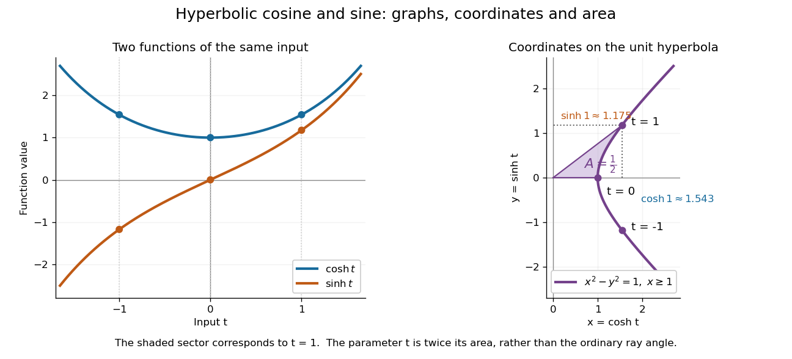

**[Figure 11](#image-hyperbolic-cosine-and-sine-become-the-coordinates-of-the-right-branch-of-a-unit-hyperbola). Hyperbolic cosine and sine become the coordinates of the right branch of a unit hyperbola**. The same inputs $t=-1,0,1$ are marked on both [function](function.md) graphs and the unit [hyperbola](euclidean-geometry.md#hyperbola). The shaded region has [area](differential-geometry.md#surface-area) $1/2$ and corresponds to [hyperbolic angle](#hyperbolic-angle) $t=1$.

The other members are ratios and reciprocals: [hyperbolic tangent](#hyperbolic-tangent) is $\tanh t=\sinh t/\cosh t$, [hyperbolic cotangent](#hyperbolic-cotangent) is $\coth t=\cosh t/\sinh t$, and [hyperbolic secant](#hyperbolic-secant) is $\operatorname{sech}t=1/\cosh t$; denominators must be nonzero. The [hyperbolic sine](#hyperbolic-sine) and [hyperbolic cosine](#hyperbolic-cosine) both solve the [second-order linear differential equation](linear-ordinary-differential-equation.md#second-order-linear-differential-equation) $f''=f$. In fact $f(t)=A\cosh t+B\sinh t$ has $f(0)=A$ and $f'(0)=B$, making this [basis](vector-space.md#basis) convenient for an [initial value problem](differential-equation.md#initial-value-problem). Their geometry also makes [hyperbolic substitution](multivariable-calculus.md#hyperbolic-substitution) useful for [integrals](integral.md) containing $\sqrt{1+u^2}$, and the [hyperbolic cosine](#hyperbolic-cosine) gives the physical [catenary](analysis.md#catenary) of a hanging chain.

#### Hyperbolic angle

↑ **Parent:** [Hyperbolic function](#hyperbolic-function)

A [hyperbolic angle](#hyperbolic-angle) $t$ is twice the signed [area](differential-geometry.md#surface-area) $A$ enclosed by the two rays from the origin to $(1,0)$ and $(\cosh t,\sinh t)$ and the intervening arc of the unit [hyperbola](euclidean-geometry.md#hyperbola). Counterclockwise traversal is positive: $t>0$ gives an ordinary [area](differential-geometry.md#surface-area) $t/2$ above the horizontal axis, and $t<0$ gives signed [area](differential-geometry.md#surface-area) $t/2$ below it. This parallels the [unit circle](complex-analysis.md#complex-unit-circle), whose sector has [area](differential-geometry.md#surface-area) $\theta/2$ for an [angle](geometry-and-topology.md#angle) $\theta$ measured in [radians](geometry-and-topology.md#radian).

To check the [area](differential-geometry.md#surface-area) interpretation, write $x(u)=\cosh u$ and $y(u)=\sinh u$. [Green's theorem](multivariable-calculus.md#green-theorem) expresses the signed [area](differential-geometry.md#surface-area) as a [line integral](multivariable-calculus.md#line-integral); the straight radial edges contribute zero, leaving

$$
A(t)=\frac12\int_0^t\bigl(x(u)y'(u)-y(u)x'(u)\bigr)\,du=\frac12\int_0^t\bigl(\cosh^2u-\sinh^2u\bigr)\,du=\frac t2.
$$

Thus $t$ is an [area](differential-geometry.md#surface-area) parameter, rather than the ordinary [angle](geometry-and-topology.md#angle) of the ray. For $t>0$, that ordinary [angle](geometry-and-topology.md#angle) is $\arctan(\tanh t)$; it stays below $\pi/4$ even as the [hyperbolic angle](#hyperbolic-angle) grows without bound.

#### Inverse hyperbolic functions

↑ **Parent:** [Hyperbolic function](#hyperbolic-function)  
ⓦ [Wiki](https://en.wikipedia.org/wiki/Inverse_hyperbolic_functions)

The inverse hyperbolic functions invert the [hyperbolic functions](#hyperbolic-function), with real branches on their standard ranges and complex branches obtained through [analytic continuation](holomorphic-function.md#analytic-continuation). For example, $\operatorname{arsinh}z=\log(z+\sqrt{z^2+1})$ on a chosen branch; the [multivalued inverse hyperbolic sine](holomorphic-function.md#multivalued-inverse-hyperbolic-sine) records all inverse values.

#### Hyperbolic cosine

↑ **Parent:** [Hyperbolic function](#hyperbolic-function)

The [hyperbolic cosine](#hyperbolic-cosine) is the [even function](#even-function)

$$
\cosh x=\frac{e^x+e^{-x}}2.
$$

It has [derivative](#derivative) $\sinh x$ and second [derivative](#derivative) $\cosh x>0$, so it is a strictly [convex function](real-analysis.md#convex-function). Its unique [global minimum](analysis.md#global-minimum) is $\cosh0=1$, and its [image](set-theory.md#image-of-a-function) is $[1,\infty)$. For example, $\cosh(-1)=\cosh1\approx1.543081$. On the unit [hyperbola](euclidean-geometry.md#hyperbola), the [hyperbolic cosine](#hyperbolic-cosine) is the horizontal coordinate; as a graph against $x$, it is a symmetric bowl.

Its [Taylor series](#taylor-series) begins

$$
\cosh x=1+\frac{x^2}{2!}+\frac{x^4}{4!}+\cdots.
$$

The positive fourth-order term explains why the bowl resembles a [parabola](euclidean-geometry.md#parabola) near its minimum yet differs from one away from it. Restricting to $x\geq0$ gives the [inverse hyperbolic cosine](#inverse-hyperbolic-cosine).

##### Catenary from hyperbolic cosine

↑ **Parent:** [Hyperbolic cosine](#hyperbolic-cosine)

A [catenary](analysis.md#catenary) is the static shape of an ideal flexible, inextensible chain hanging under its own [gravitational weight](force.md#weight-physics) in a [uniform gravitational field](classical-mechanics.md#uniform-gravitational-field), with uniform [linear mass density](fluid-mechanics.md#linear-mass-density) along its [arc length](riemannian-geometry.md#arc-length). With the lowest point above $x=0$, one convenient vertical origin gives

$$
y(x)=a\cosh(x/a),\qquad a>0.
$$

Here $a$ has units of [length](physics.md#length). The supports and the chain's [arc length](riemannian-geometry.md#arc-length) determine the scale and position; horizontal and vertical shifts give the general [catenary](analysis.md#catenary). [Robert Hunt, Cambridge Mathematical Methods II: worked example, The Catenary](https://www.damtp.cam.ac.uk/user/reh10/lectures/nst-mmii-handout3.pdf)

For $a=1$, the three points at $x=-1,0,1$ have heights $\cosh1\approx1.543081$, $1$, and $\cosh1\approx1.543081$. If heights should instead be measured from the lowest point, subtract $a$:

$$
y_{\mathrm{shifted}}(x)=a\bigl(\cosh(x/a)-1\bigr).
$$

The same three heights are then approximately $0.543081$, $0$, and $0.543081$. The shift changes the vertical origin and preserves the [catenary](analysis.md#catenary) shape.

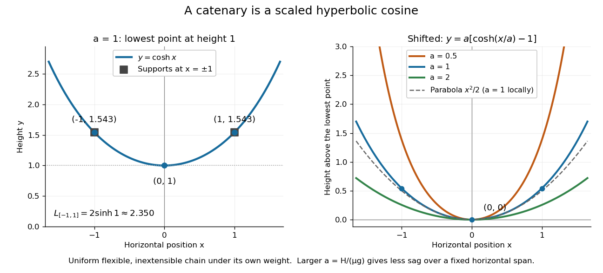

**[Figure 12](#image-a-hanging-chain-follows-a-scaled-hyperbolic-cosine-with-an-optional-shift-of-its-lowest-point-to-zero). A hanging chain follows a scaled hyperbolic cosine, with an optional shift of its lowest point to zero**. The left panel marks $x=-1,0,1$ on $y=\cosh x$. The right panel puts the lowest point at zero, compares three positive scales $a$, and shows the local [parabola](euclidean-geometry.md#parabola) $y=x^2/2$ for $a=1$.

The scale also measures [tension](force.md#tension): if $H>0$ is its constant horizontal component, $\mu$ is the [linear mass density](fluid-mechanics.md#linear-mass-density), and $g$ is the magnitude of [gravitational acceleration](newton-s-law-of-universal-gravitation.md#gravitational-acceleration), then $a=H/(\mu g)$. A short [force](force.md) balance explains this. For the portion from the lowest point to $x\geq0$, with [arc length](riemannian-geometry.md#arc-length) $s(x)$, vertical [tension](force.md#tension) balances its [gravitational weight](force.md#weight-physics) and horizontal [tension](force.md#tension) gives

$$
Hy'(x)=\mu g\,s(x),\qquad s'(x)=\sqrt{1+y'(x)^2}.
$$

Applying [differentiation](#differentiation) yields $ay''=\sqrt{1+y'^2}$. The proposed [hyperbolic cosine](#hyperbolic-cosine) solves this [differential equation](differential-equation.md), because $y'=\sinh(x/a)$ and $ay''=\cosh(x/a)=\sqrt{1+\sinh^2(x/a)}$. This is the mechanism behind the shape, under the stated ideal chain assumptions.

The same identity simplifies the [arc length](riemannian-geometry.md#arc-length) between symmetric supports at $x=\pm b$:

$$
L=\int_{-b}^b\sqrt{1+y'(x)^2}\,dx=\int_{-b}^b\cosh(x/a)\,dx=2a\sinh(b/a).
$$

For $a=b=1$, $L\approx2.350402$, exceeding the horizontal span of two. A larger $a$ at fixed $b$ gives a shallower sag: the [Taylor series](#taylor-series) gives $a(\cosh(x/a)-1)=x^2/(2a)+x^4/(24a^3)+\cdots$. Thus a [parabola](euclidean-geometry.md#parabola) is a local approximation, while the exact ideal chain shape is a [catenary](analysis.md#catenary). The useful connection is that the same [hyperbolic Pythagorean identity](#hyperbolic-pythagorean-identity) controls its coordinates, [force](force.md) balance, and [arc length](riemannian-geometry.md#arc-length).

##### Factorial-tail irrationality proof for a hyperbolic cosine

↑ **Parent:** [Hyperbolic cosine](#hyperbolic-cosine)

For a fixed positive integer $q$, $\cosh(1/q)=\sum_{k\ge0}q^{-2k}/(2k)!$ is irrational. If it were rational with denominator $b$, choose $N$ large enough that $b\mid(2N)!$. After multiplication by $q^{2N}(2N)!$, the finite partial sum is an integer and the remaining positive tail is bounded by a geometric series whose ratio is at most $1/[q^2(2N+1)(2N+2)]$. For sufficiently large $N$, this tail is strictly between zero and one, contradicting its integer value. Only a finite integer partial sum is used; convergence of an infinite series of rationals does not itself prove irrationality.

##### Inverse hyperbolic cosine

↑ **Parent:** [Hyperbolic cosine](#hyperbolic-cosine)

For $x\geq1$, the inverse [hyperbolic cosine](#hyperbolic-cosine) on its nonnegative real branch is $\operatorname{arcosh}x=\log(x+\sqrt{x^2-1})$. It is the real cosine member of the [inverse hyperbolic functions](#inverse-hyperbolic-functions).

###### Real inverse-hyperbolic antiderivative branches

↑ **Parent:** [Inverse hyperbolic cosine](#inverse-hyperbolic-cosine)

For $a>0$ and $|x|>a$, the displayed real [antiderivative](integral.md#antiderivative) equals $\operatorname{arcosh}(x/a)$ on the right component and $-\operatorname{arcosh}(-x/a)$ on the left, up to constants. Differentiating the absolute logarithm gives $1/\sqrt{x^2-a^2}$ on both components. The constants are independent because the domain is disconnected. The integrals from either finite singular boundary are [improper integrals](real-analysis.md#improper-integral) that converge, since their integrands diverge only like the inverse square root of distance to that boundary.

#### Hyperbolic sine

↑ **Parent:** [Hyperbolic function](#hyperbolic-function)

The [hyperbolic sine](#hyperbolic-sine) is the [odd function](#odd-function)

$$
\sinh x=\frac{e^x-e^{-x}}2.
$$

Its [derivative](#derivative) is $\cosh x\geq1$, so it increases strictly from $-\infty$ to $\infty$ and is a [bijection](function.md#bijection) of $\mathbb R$ onto itself. For example, $\sinh0=0$, $\sinh1\approx1.175201$, and $\sinh(-1)\approx-1.175201$. It is the vertical coordinate on the unit [hyperbola](euclidean-geometry.md#hyperbola) parametrized by $(\cosh x,\sinh x)$.

The [Taylor series](#taylor-series)

$$
\sinh x=x+\frac{x^3}{3!}+\frac{x^5}{5!}+\cdots
$$

shows that $\sinh x\approx x$ near zero. Its [tangent line](#tangent-line) there is $y=x$; unlike the ordinary [sine](geometry-and-topology.md#sine), the [hyperbolic sine](#hyperbolic-sine) grows without bound. Its [antiderivative](integral.md#antiderivative) is $\cosh x+C$. In the [catenary](analysis.md#catenary) $y=a\cosh(x/a)$, the [hyperbolic sine](#hyperbolic-sine) gives both the slope, through the [derivative](#derivative) $y'=\sinh(x/a)$, and the [arc length](riemannian-geometry.md#arc-length) $s(x)=a\sinh(x/a)$ from the lowest point for $x\geq0$.

#### Hyperbolic cotangent

↑ **Parent:** [Hyperbolic function](#hyperbolic-function)

The hyperbolic cotangent is $\coth x=\cosh x/\sinh x$ where $\sinh x\ne0$.

##### Partial-fraction expansion of the hyperbolic cotangent

↑ **Parent:** [Hyperbolic cotangent](#hyperbolic-cotangent)

The [hyperbolic-sine infinite product](sequence-and-series.md#hyperbolic-sine-infinite-product) gives, by taking its logarithmic derivative,

$$
\coth z=\frac1z+2z\sum_{n=1}^{\infty}\frac1{z^2+\pi^2n^2}.
$$

The identity holds away from the poles, with locally convergent sums. For real $z>0$, it makes $(z\coth z-1)/z^2$ positive and strictly decreasing. It is useful for [Hartmann flow](resistive-magnetohydrodynamics.md#hartmann-flow) flux monotonicity and small-argument expansions of [hyperbolic functions](#hyperbolic-function).

#### Hyperbolic secant

↑ **Parent:** [Hyperbolic function](#hyperbolic-function)

The hyperbolic secant is

$$
\operatorname{sech}x=\frac1{\cosh x}.
$$

##### Exponential moment of the hyperbolic secant

↑ **Parent:** [Hyperbolic secant](#hyperbolic-secant)

For real $|a|<\pi$, integrate $g(z)=e^{az}/\cosh\pi z$ around a rectangle of height $i$ and width $2R$. Only the [simple pole](isolated-singularity.md#simple-pole) $i/2$ lies inside, with [residue](analysis.md#residue) $e^{ia/2}/(\pi i)$. Since $g(x+i)=-e^{ia}g(x)$, the reversed top edge adds $e^{ia}$ times the bottom integral. The two vertical edges vanish as $R\to\infty$, using $|a|<\pi$. The [residue theorem](analysis.md#residue-theorem) gives $(1+e^{ia})J=2e^{ia/2}$, proving the formula. The condition is also the exact convergence range: the two tails decay with exponents $\pi-a$ and $\pi+a$.

## Fundamental theorem of calculus

↑ **Parent:** [Calculus](calculus.md)  
ⓦ [Wiki](https://en.wikipedia.org/wiki/Fundamental_theorem_of_calculus)

The fundamental theorem of calculus says that **accumulation and local change undo one another**, under appropriate regularity conditions. If $f$ is a [continuous function](#continuous-function) on $[a,b]$ and

$$
A(x)=\int_a^x f(t)\,dt,
$$

then $A$ is [differentiable](analysis.md#differentiable-function) for $a<x<b$ and $A'(x)=f(x)$. Conversely, if $G$ is an [antiderivative](integral.md#antiderivative) of $f$ on this [interval](real-analysis.md#interval-mathematics), continuous at its endpoints, then

$$
\boxed{\int_a^b f(x)\,dx=G(b)-G(a).}
$$

The first statement turns an [integral](integral.md) into a [function](function.md) with a known [derivative](#derivative); the second turns an entire accumulation into two endpoint values.

For $f(t)=1+2t$, accumulation from zero gives $A(x)=x+x^2$. At $x=2$, its [derivative](#derivative) is $A'(2)=5$, exactly the current value $f(2)$. The accumulated value there is $A(2)=6$, and by $x=3$ it has reached $A(3)=12$. The accumulated quantity and its rate are different [functions](function.md), linked by [differentiation](#differentiation).

**[Figure 13](#image-the-instantaneous-rate-determines-the-tangent-to-the-accumulation-curve). The instantaneous rate determines the tangent to the accumulation curve**.

This connection makes the theorem useful far beyond geometric [area](differential-geometry.md#surface-area). It recovers [displacement](classical-mechanics.md#displacement) from [velocity](classical-mechanics.md#velocity), gives a [probability](probability-theory.md#probability) from a [probability density function](continuous-probability-distribution.md#probability-density-function), and converts many [differential equations](differential-equation.md) into [integral equations](analysis.md#integral-equation). The striking economy is that information spread across a whole [interval](real-analysis.md#interval-mathematics) can sometimes be recovered from an [antiderivative](integral.md#antiderivative) at its two boundaries.

A short explanation of the first part is that

$$
\frac{A(x+h)-A(x)}h=\frac1h\int_x^{x+h}f(t)\,dt
$$

is the local average of $f$. [Continuity](#continuous-function) makes this average approach $f(x)$. For the second part, $G-A$ has zero [derivative](#derivative) and is constant by the [mean value theorem](#mean-value-theorem). These are the ideas behind the proof; the endpoint and regularity conditions make them valid.

An early geometric form of this connection appears in Isaac Barrow's _Lectiones geometricae_ (1670), Lecture X, Proposition 11. The original volume is catalogued by CESIMA, and Michael Nauenberg's historical research reproduces and examines the geometric argument.[Isaac Barrow, Lectiones geometricae, 1670](https://cesimadigital.pucsp.br/handle/bcd/3675)[Michael Nauenberg, Barrow and Leibniz on the fundamental theorem of the calculus, 2011](https://arxiv.org/abs/1111.6145)

### Fundamental theorem of calculus for Lebesgue integration

↑ **Parent:** [Fundamental theorem of calculus](#fundamental-theorem-of-calculus)

If $g\in L^1(a,b)$, then $F(x)=F(a)+\int_a^xg(s)\,ds$ is [absolutely continuous](sobolev-space.md#absolutely-continuous-function) and satisfies $F'=g$ [almost everywhere](measure-theory.md#almost-everywhere). Conversely, every absolutely continuous function has this form.

## Mean value theorem

↑ **Parent:** [Calculus](calculus.md)  
ⓦ [Wiki](https://en.wikipedia.org/wiki/Mean_value_theorem)

The [mean value theorem](#mean-value-theorem) says that an average rate of change is attained as an instantaneous rate somewhere between the endpoints. Let $a<b$ and let the [real-valued function](function.md#real-valued-function) $f:[a,b]\to\mathbb R$ be [continuous](#continuous-function) on the [closed interval](real-analysis.md#closed-real-interval) $[a,b]$ and [differentiable](analysis.md#differentiable-function) on the [open interval](topology.md#open-interval) $(a,b)$. Then there exists $c\in(a,b)$ such that

$$
f'(c)=\frac{f(b)-f(a)}{b-a}.
$$

The right-hand side is the [slope](euclidean-geometry.md#slope) of the [secant line](euclidean-geometry.md#secant-line) joining $(a,f(a))$ to $(b,f(b))$; the left-hand side is the [slope](euclidean-geometry.md#slope) of the [tangent line](#tangent-line) at $(c,f(c))$. The [derivative](#derivative) need not be [continuous](#continuous-function), and the [function](function.md) need not be [differentiable](analysis.md#differentiable-function) at the endpoints. [OpenStax, Calculus Volume 1, Section 4.4: mean value theorem](https://openstax.org/books/calculus-volume-1/pages/4-4-the-mean-value-theorem)

For the [polynomial](polynomial.md) $f(x)=x^2$ on $[1,3]$, the [secant line](euclidean-geometry.md#secant-line) has [slope](euclidean-geometry.md#slope) $(9-1)/(3-1)=4$. Since the [derivative](#derivative) is $f'(x)=2x$, the required interior point is $c=2$. The [tangent line](#tangent-line) there is $y=4+4(x-2)=4x-4$, whereas the [secant line](euclidean-geometry.md#secant-line) is $y=1+4(x-1)=4x-3$. Their equal [slopes](euclidean-geometry.md#slope) make them parallel, but they are distinct [straight lines](euclidean-geometry.md#straight-line): the theorem equates rates, not heights.

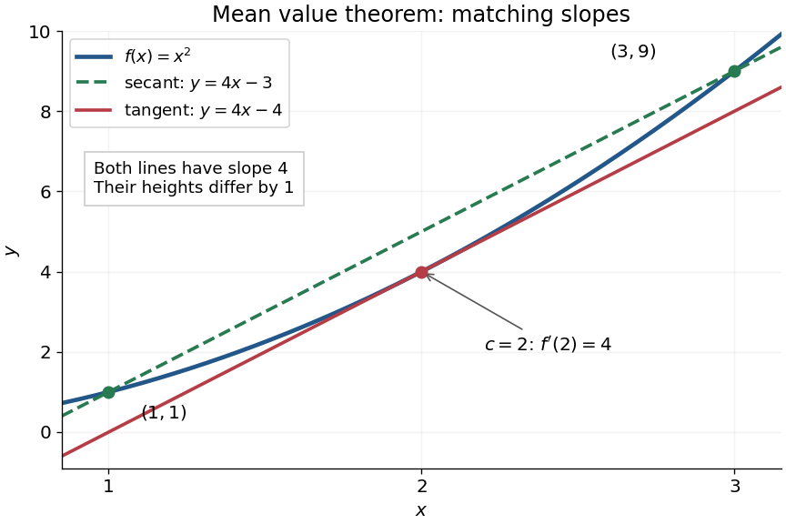

**[Figure 14](#image-the-secant-line-and-interior-tangent-line-to-x-2-have-equal-slopes-but-different-heights). The secant line and interior tangent line to $x^2$ have equal slopes but different heights**.

The practical strength is that the unknown point $c$ can disappear from an estimate. Under the same hypotheses, if the [derivative](#derivative) satisfies $|f'(x)|\leq M$ throughout $(a,b)$, where $M\geq0$, then

$$
|f(b)-f(a)|=|f'(c)|\,|b-a|\leq M|b-a|.
$$

Applying this to every subinterval proves [Lipschitz continuity](real-analysis.md#lipschitz-continuity) with [Lipschitz bound](real-analysis.md#lipschitz-bound) $M$. For example, $f(x)=x^2$ on $[1,3]$ has $|f'(x)|\leq6$, so an input change of size at most $\delta$ changes its output by at most $6\delta$, as long as both inputs lie in that [interval](real-analysis.md#interval-mathematics). A local [derivative](#derivative) bound therefore controls finite changes without computing an [integral](integral.md). The sign of the [derivative](#derivative) similarly gives the [derivative criterion for monotonicity](#derivative-criterion-for-monotonicity).

Taking $M=0$ shows that a [function](function.md) with zero [derivative](#derivative) throughout a [real interval](real-analysis.md#interval-mathematics) is a [constant function](function.md#constant-function), provided it is [continuous](#continuous-function) at any included endpoints. The [interval](real-analysis.md#interval-mathematics) condition is essential: on the [domain of a function](function.md#domain-of-a-function) $(-2,-1)\cup(1,2)$, the [function](function.md) equal to zero on the left [interval](real-analysis.md#interval-mathematics) and one on the right [interval](real-analysis.md#interval-mathematics) has zero [derivative](#derivative) everywhere. It is a [locally constant function](#locally-constant-function), yet not a [constant function](function.md#constant-function) on the whole [domain of a function](function.md#domain-of-a-function). The [mean value theorem](#mean-value-theorem) cannot cross the gap.

A concise proof subtracts the [secant line](euclidean-geometry.md#secant-line): set $m=(f(b)-f(a))/(b-a)$ and $h(x)=f(x)-f(a)-m(x-a)$. Then $h(a)=h(b)=0$, and [Rolle's theorem](#rolle-theorem) gives an interior point with $h'(c)=f'(c)-m=0$. The geometric idea is to remove the average trend and find a horizontal [tangent line](#tangent-line) in what remains.

### Cauchy mean value theorem

↑ **Parent:** [Mean value theorem](#mean-value-theorem)

For $a<b$ and [real-valued functions](function.md#real-valued-function) $f,g$ that are [continuous](#continuous-function) on the [closed interval](real-analysis.md#closed-real-interval) $[a,b]$ and [differentiable](analysis.md#differentiable-function) on the [open interval](topology.md#open-interval) $(a,b)$, there exists $\xi\in(a,b)$ with

$$
[f(b)-f(a)]g'(\xi)=[g(b)-g(a)]f'(\xi).
$$

Apply [Rolle's theorem](#rolle-theorem) to the [linear combination](vector-space.md#linear-combination) $h(x)=[f(b)-f(a)]g(x)-[g(b)-g(a)]f(x)$, which has equal endpoint values. The displayed product identity permits zero [derivatives](#derivative). For the ratio form, additionally assume $g'(x)\ne0$ for every $x\in(a,b)$. Then [Rolle's theorem](#rolle-theorem) ensures $g(b)\ne g(a)$, so both denominators below are nonzero:

$$
\frac{f(b)-f(a)}{g(b)-g(a)}=\frac{f'(\xi)}{g'(\xi)}.
$$

Neither [derivative](#derivative) needs to be [continuous](#continuous-function), and $f'$ may vanish. Choosing $g(x)=x$ recovers the [mean value theorem](#mean-value-theorem); the ratio form also gives the zero-over-zero endpoint case of [L'Hôpital's rule](#l-hopital-s-rule). [Jiří Lebl, Basic Analysis I, Section 4.2, Theorem 4.2.5](https://www.jirka.org/ra/html/sec_mvt.html)

### Endpoint secant-tangent approximation

↑ **Parent:** [Mean value theorem](#mean-value-theorem)

If $f$ is continuous at an interval endpoint, differentiable in its interior, and has a finite one-sided derivative there, then its secant slope and tangent slope are arbitrarily close at some interior point. Apply the [mean value theorem](#mean-value-theorem) on a short endpoint interval; both the secant at its far endpoint and the secant at the resulting intermediate point approach the same one-sided derivative. No continuity of the derivative is required.

## Rolle theorem

↑ **Parent:** [Calculus](calculus.md)  
ⓦ [Wiki](https://en.wikipedia.org/wiki/Rolle_theorem)

[Rolle's theorem](#rolle-theorem) is the equal-endpoint case of the [mean value theorem](#mean-value-theorem). Let $a<b$ and let the [real-valued function](function.md#real-valued-function) $f:[a,b]\to\mathbb R$ be [continuous](#continuous-function) on the [closed interval](real-analysis.md#closed-real-interval) $[a,b]$ and [differentiable](analysis.md#differentiable-function) on the [open interval](topology.md#open-interval) $(a,b)$. If $f(a)=f(b)$, there exists $c\in(a,b)$ with $f'(c)=0$. Geometrically, a [tangent line](#tangent-line) somewhere in the [interior](topology.md#interior-topology) is horizontal, like the [secant line](euclidean-geometry.md#secant-line) joining the endpoints. [OpenStax, Calculus Volume 1, Section 4.4: Rolle's theorem](https://openstax.org/books/calculus-volume-1/pages/4-4-the-mean-value-theorem)

For the [polynomial](polynomial.md) $f(x)=x(x-2)$ on $[0,2]$, both endpoint values are zero and the [derivative](#derivative) is $f'(x)=2x-2$. Thus $c=1$, where $f(1)=-1$, and the horizontal [tangent line](#tangent-line) is $y=-1$. The horizontal [secant line](euclidean-geometry.md#secant-line) is $y=0$: equal endpoint values do not force the interior [tangent line](#tangent-line) to pass through those endpoints.

The [absolute value function](real-analysis.md#absolute-value) $f(x)=|x|$ on $[-1,1]$ exposes the importance of [differentiability](analysis.md#differentiability). It is [continuous](#continuous-function) and $f(-1)=f(1)=1$, so the [secant line](euclidean-geometry.md#secant-line) has [slope](euclidean-geometry.md#slope) zero. However,

$$
f'(x)=\begin{cases}-1,&-1<x<0,\\1,&0<x<1,\end{cases}
$$

and the [derivative](#derivative) does not exist at zero because the [one-sided derivatives](#one-sided-derivative) disagree. Every existing [derivative](#derivative) in the [interior](topology.md#interior-topology) is nonzero. The corner fails a hypothesis of both [Rolle's theorem](#rolle-theorem) and the [mean value theorem](#mean-value-theorem), so neither conclusion is guaranteed.

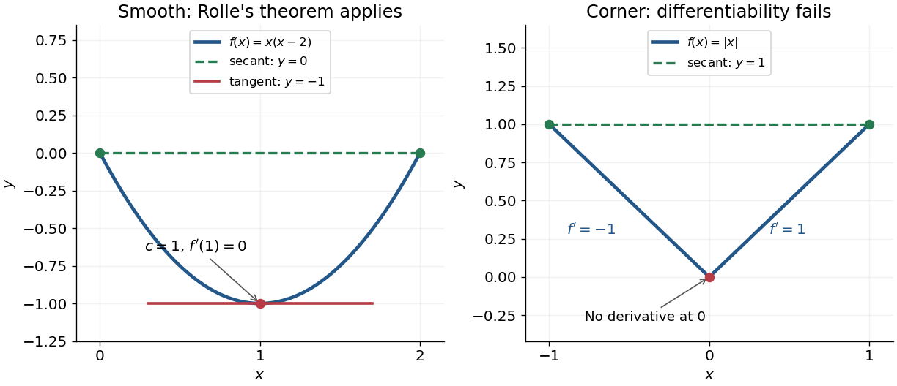

**[Figure 15](#image-rolle-s-theorem-gives-a-horizontal-tangent-line-for-a-polynomial-while-a-corner-defeats-differentiability). Rolle's theorem gives a horizontal tangent line for a polynomial, while a corner defeats differentiability**.

For a short proof, the [extreme value theorem](real-analysis.md#extreme-value-theorem) supplies a greatest and a least value on $[a,b]$. If $f$ is a [constant function](function.md#constant-function), every interior point works. Otherwise at least one of these values differs from the common endpoint value, so it is attained at an interior [extremum](mathematical-optimization.md#maximum-and-minimum). At an interior [local maximum](analysis.md#local-maximum) or [local minimum](analysis.md#local-minimum), [differentiability](analysis.md#differentiability) forces the [derivative](#derivative) to be zero: the [difference quotients](#difference-quotient) from the two sides have opposite weak signs and the same [limit](#limit-of-a-function).

This turns repeated values into information about [derivatives](#derivative). Two distinct [roots of a polynomial](polynomial.md#root-of-a-polynomial) force a root of its [derivative](#derivative) between them; iterating this idea gives the [Rolle root count with multiplicities](#rolle-root-count-with-multiplicities). More generally, a [differentiable function](analysis.md#differentiable-function) with nonzero [derivative](#derivative) throughout a [real interval](real-analysis.md#interval-mathematics) cannot repeat a value there, hence is [injective](algebra.md#injective-function). The beauty is that knowing only two equal values guarantees an exact local feature somewhere between them.

### Rolle root count with multiplicities

↑ **Parent:** [Rolle theorem](#rolle-theorem)

If a nonzero real [polynomial](polynomial.md) has $N$ roots in an open real interval, counted with [multiplicity of a root](polynomial.md#multiplicity-of-a-root), its derivative has at least $N-1$ roots in that interval, also counted with multiplicity, provided $N\ge1$. Each root of multiplicity $m$ becomes a root of the derivative of multiplicity $m-1$. The [Rolle theorem](#rolle-theorem) supplies one further root between each pair of distinct consecutive roots. Thus $k$ distinct roots of multiplicities $m_j$ give at least $\sum_j(m_j-1)+(k-1)=N-1$ derivative roots.

<h2 id="taylor-s-theorem">Taylor's theorem</h2>

↑ **Parent:** [Calculus](calculus.md)  
ⓦ [Wiki](https://en.wikipedia.org/wiki/Taylor's_theorem)

[Taylor's theorem](#taylor-s-theorem) expresses a sufficiently [differentiable function](analysis.md#differentiable-function) as a finite [Taylor polynomial](#taylor-polynomial) plus a [Taylor remainder](#taylor-remainder). One convenient version assumes $f$ is $n+1$ times continuously [differentiable](analysis.md#differentiable-function) on the segment between $a$ and $x$. Then

$$
f(x)=T_{n,a}(x)+R_{n,a}(x),\qquad R_{n,a}(x)=\frac{f^{(n+1)}(\xi)}{(n+1)!}(x-a)^{n+1}
$$

for some intermediate point $\xi$, when $x\ne a$. Thus a bound $|f^{(n+1)}|\leq M$ on that segment gives $|R_{n,a}(x)|\leq M|x-a|^{n+1}/(n+1)!$. The intermediate point usually need not be computed: bounding the [derivative](#derivative) throughout the segment is enough. This is why local approximation can yield reliable numerical bounds. A finite [Taylor polynomial](#taylor-polynomial) does not require an infinite [Taylor series](#taylor-series) to represent the [function](function.md).

Historically, the Royal Society holds [Brook Taylor](mathematics.md#brook-taylor)'s letter of 26 July 1712 to John Machin. Its catalogue connects his work on [Kepler's second law](mathematical-physics.md#kepler-s-second-law) with the expansion later published in the 1715 Methodus incrementorum directa et inversa. This is a documented route from an orbital calculation to a general approximation method, rather than a claim that every earlier use of such expansions began with Taylor. See [Royal Society archive, letter MS/82/2](https://catalogues.royalsociety.org/calmview/Record.aspx?id=MS%2F82%2F2&src=CalmView.Catalog).

### Taylor expansion from a periodic derivative equation

↑ **Parent:** [Taylor's theorem](#taylor-s-theorem)

For a smooth real [function](function.md) satisfying the displayed equation with positive [integer](integer.md) $r$, differentiating makes $f^{(j+r)}=f^{(j)}$. On any [compact](topology.md#compact-space) interval, all [derivatives](#derivative) are therefore bounded by the maximum of the bounds of $f,f',\ldots,f^{(r-1)}$. The [Taylor formula with integral remainder](#taylor-formula-with-integral-remainder) consequently has error at most $M R^{n+1}/(n+1)!$, which tends to zero uniformly for $|x|\le R$. Hence the [function](function.md) equals its globally convergent [Taylor series](#taylor-series). For $r=3$ and initial [derivatives](#derivative) $(1,0,0)$, it is $\sum_{k\ge0}x^{3k}/(3k)!$.

### Integral first-order Taylor formula for a vector map

↑ **Parent:** [Taylor's theorem](#taylor-s-theorem)

For a continuously differentiable [vector-valued function](function.md#vector-valued-function) whose domain contains the segment from $x$ to $x+h$, apply the [fundamental theorem of calculus](#fundamental-theorem-of-calculus) componentwise to $t\mapsto F(x+th)$. The resulting integral matrix is valid even when there is no common intermediate point giving a vector mean-value formula. For a [score function](statistical-modelling.md#informant-function), it integrates the [Hessian matrix](multivariable-calculus.md#hessian-matrix) along the segment to a candidate estimate.

### Integral remainder in Taylor theorem

↑ **Parent:** [Taylor's theorem](#taylor-s-theorem)

If $f$ has $k+1$ continuous derivatives, its Taylor remainder about $a$ is

$$
R_k(x)=\frac1{k!}\int_a^x(x-t)^kf^{(k+1)}(t)\,dt.
$$

#### Logarithmic series from an integral Taylor remainder

↑ **Parent:** [Integral remainder in Taylor theorem](#integral-remainder-in-taylor-theorem)

The [integral remainder in Taylor theorem](#integral-remainder-in-taylor-theorem) for $\log(1-t)$ gives the exact finite identity

$$
-\log(1-t)=\sum_{k=1}^N\frac{t^k}{k}+\int_0^t\frac{(t-x)^N}{(1-x)^{N+1}}\,dx.
$$

For $0\leq x\leq t<1$, $(t-x)/(1-x)\leq t$, so the nonnegative remainder is at most $t^{N+1}/(1-t)$ and tends to zero. At $t=1/2$ it is at most $2^{-N}$, proving both convergence to $\log2$ and an explicit error bound without assuming the logarithmic [power series](sequence-and-series.md#power-series) beforehand.

### Taylor expansion

↑ **Parent:** [Taylor's theorem](#taylor-s-theorem)

A Taylor expansion about a point consists of successive derivative terms there, together with either a finite remainder or an infinite [Taylor series](#taylor-series) when that series represents the function.

#### Peano zero

↑ **Parent:** [Taylor expansion](#taylor-expansion)

A Peano zero through order $r$ means that the [function](function.md) admits the zero [Taylor polynomial](#taylor-polynomial) with remainder $o(|t|^r)$ at $x_0$. This does not assert the existence of ordinary iterated [derivatives](#derivative) on a neighborhood. For example, multiplying $t^{r+1}$ by a bounded [continuous function](#continuous-function) with [dense](topology.md#dense-set) points of nondifferentiability preserves this estimate while destroying neighborhood [differentiability](analysis.md#differentiability).

#### Parabolic approximation

↑ **Parent:** [Taylor expansion](#taylor-expansion)

A parabolic approximation retains terms through second order in a local [Taylor expansion](#taylor-expansion). Near the closest point of a circle of radius $a$ and its tangent line, the separation is $x^2/(2a)+O(x^4/a^3)$.

### Taylor formula for a polynomial

↑ **Parent:** [Taylor's theorem](#taylor-s-theorem)

For a polynomial $p$ of degree at most $m$, the Taylor formula is exact:

$$
p(t)=\sum_{j=0}^m\frac{p^{(j)}(x)}{j!}(t-x)^j.
$$

### Taylor theorem with Lagrange remainder

↑ **Parent:** [Taylor's theorem](#taylor-s-theorem)

If $f$ is $n$ times differentiable between $a$ and $x$, then for some $\xi$ strictly between them,

$$
f(x)=\sum_{j=0}^{n-1}\frac{f^{(j)}(a)}{j!}(x-a)^j
+\frac{f^{(n)}(\xi)}{n!}(x-a)^n.
$$

#### Lagrange remainder

↑ **Parent:** [Taylor theorem with Lagrange remainder](#taylor-theorem-with-lagrange-remainder)

The [Taylor remainder](#taylor-remainder) in this form evaluates one higher [derivative](#derivative) at an intermediate point $\xi$ between the expansion point $a$ and $x$. If $|f^{(n+1)}|\leq M$ on that interval, then $|R_n(x)|\leq M|x-a|^{n+1}/(n+1)!$. This bounds truncation error without knowing the particular intermediate point. The differentiability hypotheses are those of the [Taylor theorem with Lagrange remainder](#taylor-theorem-with-lagrange-remainder).

### Taylor remainder

↑ **Parent:** [Taylor's theorem](#taylor-s-theorem)

The Taylor remainder is the difference between a function and a finite [Taylor polynomial](#taylor-polynomial). Bounds on higher derivatives or their [Hölder continuity](sobolev-space.md#holder-condition) control this error.

### Taylor formula with integral remainder

↑ **Parent:** [Taylor's theorem](#taylor-s-theorem)

If $f^{(m-1)}$ is locally absolutely continuous, then its Taylor remainder can be written as an integral involving the weak derivative $f^{(m)}$. This form permits norm bounds when the highest derivative is only integrable.

### Taylor series

↑ **Parent:** [Taylor's theorem](#taylor-s-theorem)  
ⓦ [Wiki](https://en.wikipedia.org/wiki/Taylor_series)

For a [function](function.md) with [derivatives](#derivative) of every order at $a$, its [Taylor series](#taylor-series) is the [power series](sequence-and-series.md#power-series)

$$
\sum_{n=0}^{\infty}\frac{f^{(n)}(a)}{n!}(x-a)^n.
$$

Its [partial sums](sequence-and-series.md#partial-sum) are [Taylor polynomials](#taylor-polynomial). At $a=0$ it is called a [Maclaurin series](#maclaurin-series). Forming the coefficients, proving that its [partial sums](sequence-and-series.md#partial-sum) form a [convergent sequence](sequence-and-series.md#convergent-sequence), and proving that their [limit](#limit-of-a-function) equals $f(x)$ are separate tasks. A [smooth function](analysis.md#smooth-function) provides all the coefficients, but a [real analytic function](analysis.md#real-analytic-function) is additionally represented locally by the resulting [power series](sequence-and-series.md#power-series).

For the [exponential function](#exponential-function), every [derivative](#derivative) of $e^x$ at zero equals one, giving

$$
e^x=\sum_{n=0}^{\infty}\frac{x^n}{n!}.
$$

Here equality holds for every real $x$: the [Taylor remainder](#taylor-remainder) is bounded by $e^{|x|}|x|^{N+1}/(N+1)!$, which tends to zero for each fixed $x$. At $x=1$, the degree-five [Taylor polynomial](#taylor-polynomial) is $163/60\approx2.71666667$, and the absolute difference from $e$ is less than $e/720$. The [factorial](combinatorics.md#factorial) denominator eventually overwhelms every fixed power, allowing local [derivative](#derivative) information to reconstruct this [function](function.md) throughout the real line.

The [geometric series](sequence-and-series.md#geometric-series) shows why the region of validity matters. For $f(x)=1/(1-x)$, the [Taylor series](#taylor-series) at zero is $\sum_{k\geq0}x^k$, with [radius of convergence](sequence-and-series.md#radius-of-convergence) one. For $x\ne1$, its finite [Taylor polynomial](#taylor-polynomial) satisfies the exact identity

$$
\frac1{1-x}-\sum_{k=0}^N x^k=\frac{x^{N+1}}{1-x}.
$$

At $x=1/2$ and $N=5$, the remainder is $1/32$. At $x=0.9$, the same degree-five [polynomial](polynomial.md) has value $4.68559$ and remainder $5.31441$, although the [Taylor series](#taylor-series) still converges to $10$ there. Convergence of the infinite expression does not guarantee accuracy from a particular small number of terms. For $|x|>1$, even the terms fail to tend to zero, so this [power series](sequence-and-series.md#power-series) cannot represent the [function](function.md). The standard expansions and the conditions for [convergent series](sequence-and-series.md#convergent-series) are discussed in [OpenStax, working with Taylor series](https://openstax.org/books/calculus-volume-2/pages/6-4-working-with-taylor-series).

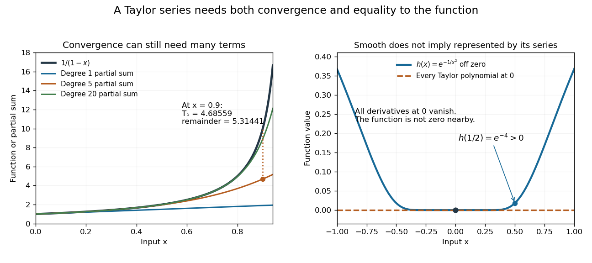

**[Figure 16](#image-geometric-partial-sums-converge-slowly-near-their-convergence-boundary-while-a-smooth-flat-function-has-an-identically-zero-taylor-series). Geometric partial sums converge slowly near their convergence boundary, while a smooth flat function has an identically zero Taylor series**.

A stronger caution comes from the [flat function](analysis.md#flat-function)

$$
h(x)=\begin{cases}e^{-1/x^2},&x\ne0,\\0,&x=0.\end{cases}
$$

It is a [smooth function](analysis.md#smooth-function) with $h^{(n)}(0)=0$ for every $n$, so every [Taylor polynomial](#taylor-polynomial) at zero is zero and its [Taylor series](#taylor-series) converges everywhere to zero. Nevertheless $h(1/2)=e^{-4}>0$. Off zero, repeated [differentiation](#differentiation) produces a [polynomial](polynomial.md) in $1/x$ times $e^{-1/x^2}$; the exponential decay makes each required [limit](#limit-of-a-function) at zero vanish. This explains how all the local coefficients can miss a positive [function](function.md) arbitrarily close to the centre. [Real analyticity](analysis.md#real-analytic-function) supplies the additional condition that rules out this behavior.

#### Maclaurin series

↑ **Parent:** [Taylor series](#taylor-series)

A [Taylor series](#taylor-series) centred at zero. Its coefficients are the [derivatives](#derivative) there divided by the corresponding [factorials](combinatorics.md#factorial).

## Limit of a function

↑ **Parent:** [Calculus](calculus.md)  
ⓦ [Wiki](https://en.wikipedia.org/wiki/Limit_of_a_function)

The limit records the value approached by a function as its argument approaches a point.

### Exponential concentration of a weighted mean

↑ **Parent:** [Limit of a function](#limit-of-a-function)

For finitely many real numbers $a_1,\ldots,a_m$, let $M=\max_ja_j$. Divide numerator and denominator of their exponentially weighted mean by $e^{M/\tau}$. Every term with $a_j<M$ vanishes as $\tau\downarrow0$, while each maximizer contributes $M$ to the numerator and one to the denominator. Their quotient therefore tends to $M$, even when the maximum is negative or attained more than once. The finiteness of the list is used to pass the [limit](#limit-of-a-function) through each sum.

### Root limit of a finite sum of powers

↑ **Parent:** [Limit of a function](#limit-of-a-function)

For finitely many fixed nonnegative [real numbers](arithmetic.md#real-number) $b_1,\ldots,b_m$, with $m\geq1$,

$$
\boxed{\lim_{p\to\infty}\left(\sum_{j=1}^m b_j^p\right)^{1/p}=\max_{1\leq j\leq m}b_j.}
$$

Let $M$ be that maximum. If $M=0$, every term is zero. Otherwise $M^p\leq\sum b_j^p\leq mM^p$ for $p>0$. Taking roots gives $M\leq(\sum b_j^p)^{1/p}\leq m^{1/p}M$, and $m^{1/p}\to1$. The [squeeze theorem](#squeeze-theorem) proves the result, including ties between the largest bases. For example, $(1+a^p+(a^2/2)^p)^{1/p}$ tends to $\max(1,a,a^2/2)$ for $a\geq0$. The finiteness and fixed number of terms supply the upper factor $m$; an infinite [sum](arithmetic.md#sum) needs further hypotheses.

### One-sided limit

↑ **Parent:** [Limit of a function](#limit-of-a-function)  
ⓦ [Wiki](https://en.wikipedia.org/wiki/One-sided_limit)

A one-sided limit restricts the argument to values above or below the limiting point. It is denoted $\lim_{x\downarrow a}f(x)$ from above and $\lim_{x\uparrow a}f(x)$ from below.

### Continuous function

↑ **Parent:** [Limit of a function](#limit-of-a-function)  
ⓦ [Wiki](https://en.wikipedia.org/wiki/Continuous_function)

A [continuous function](#continuous-function) sends sufficiently nearby [function inputs](function.md#function-input) to nearby [function outputs](function.md#function-output). For a [real-valued function](function.md#real-valued-function) $f:D\to\mathbb R$ and a point $a\in D$ that is an [accumulation point](topology.md#limit-point) of $D$, this means

$$
\lim_{\substack{x\to a\\x\in D}}f(x)=f(a).
$$

The approached value and the assigned value must agree. [Continuity](#continuous-function) on $D$ means [continuity](#continuous-function) at every point of the [domain of a function](function.md#domain-of-a-function). At an endpoint of an [interval](real-analysis.md#interval-mathematics), only approaches inside that [domain of a function](function.md#domain-of-a-function) count. The [epsilon-delta definition of continuity](#epsilon-delta-definition-of-continuity) below also applies at an isolated point, where [continuity](#continuous-function) holds automatically.[§2.4, Continuity at a Point: definition; Continuity over an Interval: one-sided endpoint conditions](mathematics-bibliography.md#calculus-volume-1-by-gilbert-strang-and-others/calculus-volume-1-§2-4-continuity)

For the [polynomial function](polynomial.md#polynomial-function) $f(x)=x^2$, approaching $1$ makes the [function output](function.md#function-output) approach $f(1)=1$. The [continuity bounds for the square function](#continuity-bounds-for-the-square-function) turn this observation into an explicit guarantee: $|x-1|<0.2$ implies $|x^2-1|<0.6$. This is useful whenever a small error in an [function input](function.md#function-input) must produce a controlled error in an [function output](function.md#function-output). The required input tolerance can depend on the point and on the chosen output tolerance.

The [absolute value](real-analysis.md#absolute-value) [function](function.md) $g(x)=|x|$ is also a [continuous function](#continuous-function), including at zero: $|g(x)-g(0)|=|x|$. But its left and right [derivatives](#derivative) there are $-1$ and $1$, so it is not a [differentiable function](analysis.md#differentiable-function) at zero. [Continuity](#continuous-function) controls values without requiring a [tangent line](#tangent-line). Conversely, a [differentiable function](analysis.md#differentiable-function) is [continuous](#continuous-function) wherever it is [differentiable](analysis.md#differentiable-function): if $f(a+h)-f(a)=h(f'(a)+o(1))$, the difference tends to zero with $h$.

Several useful consequences reuse this one local idea. [Addition](arithmetic.md#addition), [multiplication](arithmetic.md#multiplication) and [function composition](function.md#function-composition) preserve [continuity](#continuous-function); a [quotient of functions](function.md#quotient-of-functions) is [continuous](#continuous-function) where its denominator is nonzero. On an [interval](real-analysis.md#interval-mathematics), the [intermediate value theorem](#intermediate-value-theorem) turns [continuity](#continuous-function) into a guarantee that no intermediate [function output](function.md#function-output) is skipped. On a [compact set](topology.md#compact-space), the [extreme value theorem](real-analysis.md#extreme-value-theorem) guarantees attained maximum and minimum values. Those extra hypotheses matter: [continuity](#continuous-function) alone on an unbounded [domain of a function](function.md#domain-of-a-function) does not provide a global bound or an attained [global maximum](function.md#global-maximum).

A [rational function](isolated-singularity.md#rational-function) such as $x\mapsto1/x$ is [continuous](#continuous-function) on its [domain of a function](function.md#domain-of-a-function) $\mathbb R\setminus\{0\}$. Zero is excluded from that [domain of a function](function.md#domain-of-a-function); the missing point prevents a [continuous](#continuous-function) extension there, but it does not make the existing map [discontinuous](#discontinuity-of-a-function) at one of its actual inputs. Always state the [domain of a function](function.md#domain-of-a-function) before judging [continuity](#continuous-function).

#### Epsilon-delta definition of continuity

↑ **Parent:** [Continuous function](#continuous-function)

A [function](function.md) $f:D\to\mathbb R$ is [continuous](#continuous-function) at $a\in D$ when

$$
\text{for every }\varepsilon>0\text{ there is a }\delta>0\text{ such that}
\quad x\in D,\ |x-a|<\delta\ \Longrightarrow\ |f(x)-f(a)|<\varepsilon.
$$

First choose the required output tolerance $\varepsilon$; then choose an input tolerance $\delta$ that works for every allowed [function input](function.md#function-input) in that window. Picking a different $\delta$ separately after seeing each $x$ would reverse the [quantifiers](mathematical-logic.md#quantifier) and lose this guarantee. There is no need to exclude $x=a$, because the output difference is then zero.

At an isolated point of the [domain of a function](function.md#domain-of-a-function), choose a small enough window that its only allowed [function input](function.md#function-input) is $a$. This proves [continuity](#continuous-function) there directly. At a point with arbitrarily close other inputs, the same definition is the [limit of a function](#limit-of-a-function) condition $f(x)\to f(a)$. For [metric spaces](topological-analysis.md#metric-space), replace the two [absolute values](real-analysis.md#absolute-value) by their [distance functions](topological-analysis.md#metric); for arbitrary [topological spaces](topology.md#topological-space), the corresponding definition is a [continuous map](topology.md#continuous-map).

The input tolerance may depend on $a$. A single choice valid everywhere on the [domain of a function](function.md#domain-of-a-function) is the stronger requirement of [uniform continuity](topological-analysis.md#uniform-continuity). The [continuous function](#continuous-function) $x\mapsto x^2$ on $\mathbb R$ shows the difference: for any proposed $\delta>0$, the points $a=1/\delta$ and $b=a+\delta/2$ have $|b-a|<\delta$, yet $b^2-a^2=1+\delta^2/4>1$. Thus the fixed output tolerance $\varepsilon=1$ admits no global input tolerance on the [real line](real-analysis.md#real-line).

##### Continuity bounds for the square function

↑ **Parent:** [Epsilon-delta definition of continuity](#epsilon-delta-definition-of-continuity)

For $f(x)=x^2$ at any real $a$, [polynomial factorization](polynomial.md#factorization-of-polynomials) gives

$$
|f(x)-f(a)|=|x-a|\,|x+a|.
$$

If $|x-a|<1$, the [triangle inequality](topological-analysis.md#triangle-inequality) yields $|x+a|\leq|x-a|+2|a|<2|a|+1$. Therefore the displayed choice of $\delta$ makes $|x-a|<\delta$ imply $|f(x)-f(a)|<\varepsilon$. This proves [continuity](#continuous-function) and gives an explicit local error bound, rather than an inference from a drawing.

At $a=1$ and $\varepsilon=0.6$, this sufficient choice is $\delta=0.2$. The permitted [function inputs](function.md#function-input) satisfy $0.8<x<1.2$; their actual [function outputs](function.md#function-output) lie in $(0.64,1.44)$, inside the requested band $(0.4,1.6)$. A sufficient input window need not be the largest possible one.

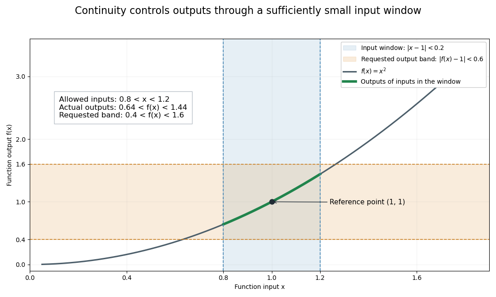

**[Figure 17](#image-an-input-window-that-guarantees-the-requested-output-tolerance-for-the-square-function). An input window that guarantees the requested output tolerance for the square function**. For the [polynomial function](polynomial.md#polynomial-function) $f(x)=x^2$ at $a=1$, the blue input window has $\delta=0.2$ and the orange output band has $\varepsilon=0.6$. The highlighted [function graph](function.md#graph-of-a-function) segment lies inside their overlap. The illustration shows an exact mathematical example, rather than measured values.

#### Continuous functions preserve convergent sequences

↑ **Parent:** [Continuous function](#continuous-function)

For $f:D\to\mathbb R$ and $a\in D$, [continuity](#continuous-function) at $a$ is equivalent to the following condition: every [sequence](sequence-and-series.md#sequence) $(x_n)$ in $D$ with $x_n\to a$ satisfies $f(x_n)\to f(a)$. This is useful when a [numerical method](numerical-analysis.md#numerical-method) or a [proof](foundations-of-mathematics.md#mathematical-proof) approaches a point through successively refined [function inputs](function.md#function-input): applying a [continuous function](#continuous-function) preserves the intended [limit](#limit-of-a-function).

For the forward direction, choose $\delta$ from the [epsilon-delta definition of continuity](#epsilon-delta-definition-of-continuity). A [convergent sequence](sequence-and-series.md#convergent-sequence) eventually lies in that input window, so its [function outputs](function.md#function-output) eventually lie in the requested output band. Conversely, if [continuity](#continuous-function) fails, there is some $\varepsilon_0>0$ for which every input window contains an allowed $x$ with $|f(x)-f(a)|\geq\varepsilon_0$. Choosing such an $x_n$ within $1/n$ of $a$ gives $x_n\to a$ while $f(x_n)$ does not tend to $f(a)$. This converse relies on the countable shrinking windows available in [metric spaces](topological-analysis.md#metric-space); a general [topological space](topology.md#topological-space) needs a different formulation.

#### Blancmange curve

↑ **Parent:** [Continuous function](#continuous-function)  
ⓦ [Wiki](https://en.wikipedia.org/wiki/Blancmange_curve)

The Takagi function is a continuous nowhere [differentiable function](analysis.md#differentiable-function). The triangular summands are continuous and the geometric tail is bounded uniformly. On dyadic intervals of length $2^{-N}$, all terms of index at least $N$ vanish at both endpoints, while every lower summand has slope $+1$ or $-1$. Each refinement therefore changes the secant slope by exactly one in absolute value. The [secants straddling a differentiability point](analysis.md#secants-straddling-a-differentiability-point) lemma rules out a derivative at every real point.

#### Bounded continuous functions

↑ **Parent:** [Continuous function](#continuous-function)

[Bounded continuous functions](#bounded-continuous-functions) on a topological space form a [Banach space](banach-space.md) with the [supremum norm](normed-vector-space.md#supremum-norm). A uniform limit is continuous and bounded, proving completeness. This space differs from the bounded uniformly [continuous functions](#continuous-function): free-transport composition is jointly continuous in time and position, but need not be continuous in the global sup [norm](normed-vector-space.md#norm) as time varies.

#### Upper semicontinuity

↑ **Parent:** [Continuous function](#continuous-function)

A real or extended-real [function](function.md) is [upper semicontinuous](#upper-semicontinuity) when every strict sublevel set is open. Equivalently its negative is [lower semicontinuous](#lower-semicontinuity). An arbitrary infimum of continuous [functions](function.md) is [upper semicontinuous](#upper-semicontinuity), even when the infimum is over an uncountable family; its strict sublevel sets are unions of the corresponding open sublevel sets.

#### Oscillation multiplied by a vanishing amplitude

↑ **Parent:** [Continuous function](#continuous-function)

If $|h(x)|\leq C$ near $c$ and $a(x)\to0$ as $x\to c$, then $a(x)h(x)\to0$ by the [squeeze theorem](#squeeze-theorem), even if $h$ has no limit. Defining the product to be zero at $c$ gives continuity there. For example, $\sqrt{|x|}\sin(1/\sin x)$ extends continuously at zero; the same oscillation near a nonzero multiple of $\pi$ has nonvanishing amplitude and does not have a continuous zero extension.

#### Lower semicontinuity

↑ **Parent:** [Continuous function](#continuous-function)

A function is lower semicontinuous when its strict superlevel sets are open, equivalently when its sublevel sets are closed. In Euclidean spaces this is the [sequential lower semicontinuity](#sequential-lower-semicontinuity) condition $f(x)\leq\liminf_k f(x_k)$ whenever $x_k\to x$. This closedness property is essential to existence of proximal minimizers.

#### Discontinuity of a function

↑ **Parent:** [Continuous function](#continuous-function)

A [function](function.md) is [discontinuous](#discontinuity-of-a-function) at a point in its [domain of a function](function.md#domain-of-a-function) when it fails the [epsilon-delta definition of continuity](#epsilon-delta-definition-of-continuity) there. Two basic failures are an incorrect assigned value and unequal [one-sided limits](#one-sided-limit). They demand different repairs.

For a [removable discontinuity](#removable-discontinuity), consider

$$
r(x)=\begin{cases}x^2,&x\neq0,\\1,&x=0.\end{cases}
$$

The [limit](#limit-of-a-function) at zero is $0$, but $r(0)=1$. Replacing that one value by $0$ gives the [continuous](#continuous-function) square [function](function.md). The [sequence](sequence-and-series.md#sequence) $x_n=1/n$ makes the mismatch visible: $r(x_n)=1/n^2\to0\neq r(0)$. A [removable discontinuity](#removable-discontinuity) can also describe an expression with a missing value, in which case the question is whether a [continuous](#continuous-function) extension to the missing input exists.

For a [jump discontinuity](#jump-discontinuity), take $j(x)=0$ for $x<0$ and $j(x)=1$ for $x\geq0$. The left and right [one-sided limits](#one-sided-limit) at zero are $0$ and $1$. No assignment to $j(0)$ can equal both, so changing only the point value cannot make the [function](function.md) [continuous](#continuous-function) there. Contrast both examples with the corner of $|x|$: that [function](function.md) is [continuous](#continuous-function) at zero even though its [derivative](#derivative) is absent.

**[Figure 18](#image-a-continuous-corner-a-removable-point-value-mismatch-and-a-jump-discontinuity). A continuous corner, a removable point-value mismatch, and a jump discontinuity**. The three original [function graphs](function.md#graph-of-a-function) separate [continuity](#continuous-function) from [differentiability](analysis.md#differentiability). Open markers show excluded graph points; filled markers show assigned values. The jump has no vertical connector, because intermediate heights are not values of that [function](function.md).

##### Removable discontinuity

↑ **Parent:** [Discontinuity of a function](#discontinuity-of-a-function)

A removable discontinuity has an existing finite limit that differs from the assigned point value, or a missing point value. Changing the point value removes it. Integrals and [Fourier coefficients](fourier-series.md#fourier-coefficient) do not detect changes on a set of measure zero, so purely integral hypotheses cannot prohibit this kind of discontinuity for an arbitrary representative.

##### Jump discontinuity

↑ **Parent:** [Discontinuity of a function](#discontinuity-of-a-function)

A jump occurs when both finite one-sided limits of a function exist but differ. Unlike an isolated change in value, a jump changes limiting values on whole one-sided neighbourhoods. [One-sided Fourier spectrum excludes jumps](partial-differential-equation.md#one-sided-fourier-spectrum-excludes-jumps) explains an obstruction to jumps for functions with only nonnegative [Fourier coefficients](fourier-series.md#fourier-coefficient).

#### Sequential lower semicontinuity

↑ **Parent:** [Continuous function](#continuous-function)

An extended-real functional $f$ is sequentially lower semicontinuous when $x_n\to x$ implies $f(x)\leq\liminf_nf(x_n)$.

##### Sublevel set

↑ **Parent:** [Sequential lower semicontinuity](#sequential-lower-semicontinuity)

A [sublevel set](#sublevel-set) consists of points whose objective value is at most a chosen threshold. [Coercivity](real-analysis.md#coercive-function) makes finite [sublevel sets](#sublevel-set) bounded, while [sequential lower semicontinuity](#sequential-lower-semicontinuity) makes them [sequentially closed sets](topology.md#sequentially-closed-set) in the selected [topology](topology.md).

###### Compact sublevel set

↑ **Parent:** [Sublevel set](#sublevel-set)

A [sublevel set](#sublevel-set) which is [compact](topology.md#compact-space). A [good rate function](convergence-of-random-variables.md#good-rate-function) has this property for every finite level.

##### Closed-sublevel-set characterization of lower semicontinuity

↑ **Parent:** [Sequential lower semicontinuity](#sequential-lower-semicontinuity)

On a metric space, a functional is [sequentially lower semicontinuous](#sequential-lower-semicontinuity) exactly when every sublevel set $\{x:f(x)\leq\eta\}$ is closed.

#### Locally constant function

↑ **Parent:** [Continuous function](#continuous-function)  
ⓦ [Wiki](https://en.wikipedia.org/wiki/Locally_constant_function)

A function is locally constant when every point has a neighbourhood on which the function is constant.

##### Compactly supported locally constant function

↑ **Parent:** [Locally constant function](#locally-constant-function)

The space $C_c^\infty(X)$ consists of locally constant complex functions with compact support. On a [locally profinite group](topological-group.md#locally-profinite-group), finite compact-open coset covers of the support show that every such function is fixed by one common [compact-open subgroup](topological-group.md#compact-open-subgroup) under right translation. The symbol infinity describes local constancy in this context, not real differentiability.

#### Intermediate value theorem

↑ **Parent:** [Continuous function](#continuous-function)  
ⓦ [Wiki](https://en.wikipedia.org/wiki/Intermediate_value_theorem)

The [intermediate value theorem](#intermediate-value-theorem) says that a real-valued [continuous function](#continuous-function) cannot skip a value between two of its outputs. Let $a<b$ and let $f:[a,b]\to\mathbb R$ be a [continuous function](#continuous-function) on the entire [closed interval](real-analysis.md#closed-real-interval) $[a,b]$. Then

$$
\min\{f(a),f(b)\}\leq y\leq\max\{f(a),f(b)\}
\quad\Longrightarrow\quad
\text{there exists }c\in[a,b]\text{ with }f(c)=y.
$$

The word "between" includes both endpoint values: choose $c=a$ when $y=f(a)$, or $c=b$ when $y=f(b)$. If $y$ is strictly between them, every such $c$ lies in the [open interval](topology.md#open-interval) $(a,b)$. [Continuity](#continuous-function) on $[a,b]$ means [continuity](#continuous-function) at every interior point, together with the endpoint [one-sided limits](#one-sided-limit) $\lim_{x\to a^+}f(x)=f(a)$ and $\lim_{x\to b^-}f(x)=f(b)$. No [derivative](#derivative) is required.[§2.4, Continuity over an Interval and Theorem 2.11, The Intermediate Value Theorem](mathematics-bibliography.md#calculus-volume-1-by-gilbert-strang-and-others)

For finding a [zero of a function](polynomial.md#zero-of-a-function), the useful special case is

$$
f(a)f(b)<0\quad\Longrightarrow\quad
\text{there exists }c\in(a,b)\text{ with }f(c)=0.
$$

Strictly opposite endpoint signs certify a [root bracket](numerical-analysis.md#root-bracket), because zero is strictly between $f(a)$ and $f(b)$. If an endpoint value is already zero, that endpoint supplies a [zero of a function](polynomial.md#zero-of-a-function) directly; an interior [zero of a function](polynomial.md#zero-of-a-function) need not exist. For example, $f(x)=x$ on $[0,1]$ has its only [zero of a function](polynomial.md#zero-of-a-function) at the left endpoint. The [intermediate value theorem](#intermediate-value-theorem) guarantees existence, but neither uniqueness nor a necessary sign-change test. Its numerical usefulness is that the [bisection method](numerical-analysis.md#bisection-method) can turn existence into successively tighter [root brackets](numerical-analysis.md#root-bracket).

##### Intermediate value theorem hypotheses and counterexamples

↑ **Parent:** [Intermediate value theorem](#intermediate-value-theorem)

Three explicit [functions](function.md) separate the hypotheses from the conclusion. These are original mathematical illustrations, not measured data.

The [polynomial function](polynomial.md#polynomial-function) $h(x)=x^3-x=x(x-1)(x+1)$ is a [continuous function](#continuous-function) on $[-3/2,3/2]$, with $h(-3/2)=-15/8$ and $h(3/2)=15/8$. The [intermediate value theorem](#intermediate-value-theorem) guarantees at least one [zero of a function](polynomial.md#zero-of-a-function) in the interior, while the [polynomial factorization](polynomial.md#factorization-of-polynomials) displays three: $-1,0,1$. Thus strict opposite signs do not establish uniqueness.

The everywhere-defined [function](function.md)

$$
j(x)=\begin{cases}-1,&-1\leq x<0,\\1,&0\leq x\leq1\end{cases}
$$

has $j(-1)=-1$ and $j(1)=1$, yet no [zero of a function](polynomial.md#zero-of-a-function). Its [jump discontinuity](#jump-discontinuity) at zero is exactly where the [continuity](#continuous-function) hypothesis fails. A drawn vertical connector would be misleading: the [function graph](function.md#graph-of-a-function) contains neither the intermediate heights nor a [zero of a function](polynomial.md#zero-of-a-function) at that jump. Even [continuity](#continuous-function) only on the interior is insufficient: setting $q(x)=-1$ for $0\leq x<1$ and $q(1)=1$ gives opposite endpoint signs on $[0,1]$ with no [zero of a function](polynomial.md#zero-of-a-function), because the left [one-sided limit](#one-sided-limit) at $1$ is not $q(1)$.

The [polynomial function](polynomial.md#polynomial-function) $t(x)=x^2$ on $[-1,1]$ is a [continuous function](#continuous-function), and $t(-1)=t(1)=1$, yet $t(0)=0$. Its [root of a polynomial](polynomial.md#root-of-a-polynomial) at zero has [multiplicity of a root](polynomial.md#multiplicity-of-a-root) two. The [function graph](function.md#graph-of-a-function) touches its horizontal [tangent line](#tangent-line) there and stays positive on both sides: existence of a [zero of a function](polynomial.md#zero-of-a-function) does not require a sign change. More generally, near a real [root of a polynomial](polynomial.md#root-of-a-polynomial) $r$, a [polynomial factorization](polynomial.md#factorization-of-polynomials) $p(x)=(x-r)^{2m}u(x)$ with $m\geq1$ and $u(r)\neq0$ has the same sign on both sides sufficiently close to $r$, since the [continuous function](#continuous-function) $u$ retains its sign. The [intermediate value theorem](#intermediate-value-theorem) does not rule out values outside the range between endpoint outputs.[§2.4, Example 2.37: positive endpoint values do not exclude an interior zero; Theorem 2.11 requires continuity on the whole interval](mathematics-bibliography.md#calculus-volume-1-by-gilbert-strang-and-others)

**[Figure 19](#image-intermediate-value-hypotheses-three-continuous-roots-a-jump-with-no-root-and-a-double-root-without-a-sign-change). Intermediate value hypotheses: three continuous roots, a jump with no root, and a double root without a sign change**.

##### A cubic root from existence to a quantitative bracket

↑ **Parent:** [Intermediate value theorem](#intermediate-value-theorem)

Consider the original worked example $f(x)=x^3+x-1$ on $[0,1]$. First, existence: a [polynomial function](polynomial.md#polynomial-function) is a [continuous function](#continuous-function), and $f(0)=-1<0<1=f(1)$. The [intermediate value theorem](#intermediate-value-theorem) therefore supplies a [zero of a function](polynomial.md#zero-of-a-function) $r\in(0,1)$, even before its value has been calculated.

Second, uniqueness is a separate argument. The [derivative](#derivative) is $f'(x)=3x^2+1>0$. The [derivative criterion for monotonicity](#derivative-criterion-for-monotonicity), obtained from the [mean value theorem](#mean-value-theorem), makes $f$ a [strictly increasing function](#strictly-increasing-function). Two distinct [zeros of a function](polynomial.md#zero-of-a-function) would contradict that strict increase. Thus this [root bracket](numerical-analysis.md#root-bracket) contains exactly one [zero of a function](polynomial.md#zero-of-a-function); indeed the same [derivative](#derivative) argument proves uniqueness on the entire [real line](real-analysis.md#real-line).

Third, localization uses the existing [bisection method](numerical-analysis.md#bisection-method). Set $[a_0,b_0]=[0,1]$; after $k$ completed halvings, retain $[a_k,b_k]$ with opposite endpoint signs. Each update tests the old [midpoint](convex-set.md#midpoint) $m_{k-1}=(a_{k-1}+b_{k-1})/2$. The first five exact updates are

$$
\begin{array}{c|c|r|c}
k&\text{tested }m_{k-1}&f(m_{k-1})&\text{retained }[a_k,b_k]\\\hline
1&1/2&-3/8&[1/2,1]\\
2&3/4&11/64&[1/2,3/4]\\
3&5/8&-67/512&[5/8,3/4]\\
4&11/16&51/4096&[5/8,11/16]\\
5&21/32&-2003/32768&[21/32,11/16]
\end{array}
$$

Every retained [root bracket](numerical-analysis.md#root-bracket) contains $r$ by the [intermediate value theorem](#intermediate-value-theorem). After ten halvings, exact arithmetic gives

$$
a_{10}=\frac{349}{512},\qquad b_{10}=\frac{699}{1024},\qquad
f(a_{10})=-\frac{220923}{134217728}<0,
\qquad f(b_{10})=\frac{744899}{1073741824}>0.
$$

Hence $0.681640625<r<0.6826171875$. The new [midpoint](convex-set.md#midpoint) and its [bisection error bound](numerical-analysis.md#bisection-error-bound) are

$$
m_{10}=\frac{1397}{2048}=0.68212890625,\qquad
|m_{10}-r|\leq\frac{1}{2048}=0.00048828125.
$$

This [midpoint](convex-set.md#midpoint) is the estimate after the tenth update; the last tested point was $m_9=699/1024$. In general the retained width is $2^{-k}$, so the [bisection error bound](numerical-analysis.md#bisection-error-bound) is $2^{-(k+1)}$. Nine halvings already suffice for an error at most $10^{-3}$, since $2^{-10}=0.0009765625<10^{-3}$. This guarantee comes from the width of the [root bracket](numerical-analysis.md#root-bracket), independently of any displayed decimal approximation to the unknown [zero of a function](polynomial.md#zero-of-a-function). Endpoint signs must be established reliably if evaluations use [floating-point arithmetic](floating-point-arithmetic.md).

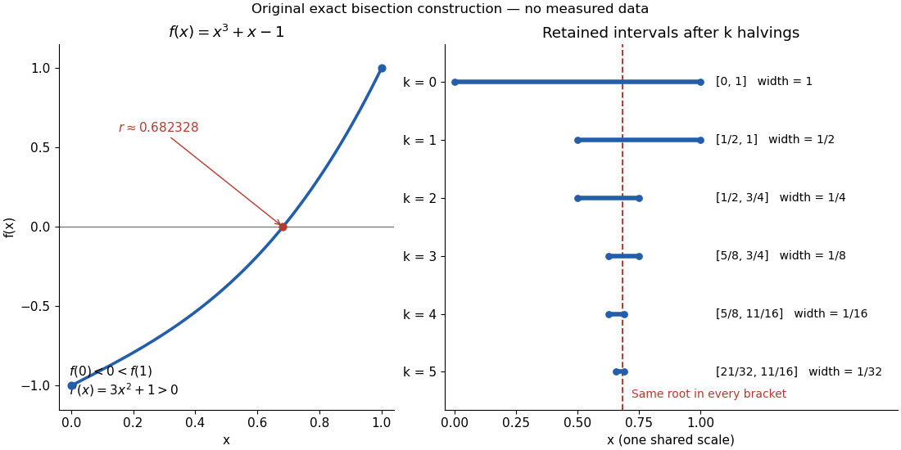

**[Figure 20](#image-the-cubic-x-cubed-plus-x-minus-one-its-unique-root-and-the-first-five-nested-bisection-brackets). The cubic x cubed plus x minus one: its unique root and the first five nested bisection brackets**.

##### Nested-bracket proof of the intermediate value theorem

↑ **Parent:** [Intermediate value theorem](#intermediate-value-theorem)

For a short proof outline, endpoint values give the non-strict cases immediately. If $y$ is strictly between $f(a)$ and $f(b)$, apply the [bisection method](numerical-analysis.md#bisection-method) to the [continuous function](#continuous-function) $g(x)=f(x)-y$. A [midpoint](convex-set.md#midpoint) with $g=0$ finishes the proof. Otherwise retain [nested intervals](real-analysis.md#nested-intervals) $[a_k,b_k]$ with strictly opposite signs and widths $(b-a)2^{-k}$. The [nested interval theorem](real-analysis.md#nested-interval-theorem), using [completeness of the real numbers](sequence-and-series.md#completeness-of-the-real-numbers), gives a common point $c$ to which both endpoint [sequences](sequence-and-series.md#sequence) converge. After reversing the sign of $g$ if necessary, $g(a_k)<0<g(b_k)$. [Continuity](#continuous-function) makes both endpoint value [sequences](sequence-and-series.md#sequence) converge to $g(c)$, forcing $g(c)\leq0$ and $g(c)\geq0$, hence $f(c)=y$. The original endpoint values differ from $y$, so $c\in(a,b)$. This proof explains why a jump can defeat the construction: shrinking a candidate [closed interval](real-analysis.md#closed-real-interval) cannot supply the missing [continuity](#continuous-function).

##### Continuous image of a real interval

↑ **Parent:** [Intermediate value theorem](#intermediate-value-theorem)

A [continuous function](#continuous-function) on any [real interval](real-analysis.md#interval-mathematics) has image a [real interval](real-analysis.md#interval-mathematics). Given two image values and an intermediate value, choose preimages and apply the [intermediate value theorem](#intermediate-value-theorem) on the closed segment joining them, which stays inside the domain. Neither compactness nor boundedness of the original interval is needed. In particular $f(x)=\sin(1/x)/x$ on $(0,1]$ is a continuous surjection onto $\mathbb R$: its values are unbounded above and below, so its interval image contains every real number.

##### Interval order theorem for continuous injections

↑ **Parent:** [Intermediate value theorem](#intermediate-value-theorem)

A continuous injective real-valued function on a real interval is strictly monotone. A value outside the interval between two endpoint values would, by the [intermediate value theorem](#intermediate-value-theorem), create a repeated value. Applying this observation to subintervals gives consistent strict ordering. If the left endpoint value is smaller than the right endpoint value, the function is strictly increasing; otherwise it is strictly decreasing.

##### Horizontal chord of reciprocal-integer length

↑ **Parent:** [Intermediate value theorem](#intermediate-value-theorem)

If $f:[0,1]\to\mathbb R$ is continuous and $f(0)=f(1)$, then for every positive integer $n$ there is $\alpha\in[0,1-1/n]$ with $f(\alpha+1/n)=f(\alpha)$. For $n>1$, the continuous difference $h_n(x)=f(x+1/n)-f(x)$ satisfies $\sum_{j=0}^{n-1}h_n(j/n)=0$. Either one sampled difference is zero or two have opposite signs; the [intermediate value theorem](#intermediate-value-theorem) then supplies a zero between them. For $n=1$, the endpoint chord suffices.

##### Zero on a line segment

↑ **Parent:** [Intermediate value theorem](#intermediate-value-theorem)

If a continuous real-valued function on a real or complex vector space has opposite signs at two points, restricting it to the line segment between them and applying the intermediate value theorem gives a zero.

##### Telescoping increment lemma

↑ **Parent:** [Intermediate value theorem](#intermediate-value-theorem)

If a continuous $g:[0,na]\to\mathbb R$ satisfies $g(na)-g(0)=na$, then the increments

$$
h(x)=g(x+a)-g(x)-a
$$

satisfy $\sum_{k=0}^{n-1}h(ka)=0$. Continuity forces $h$ to vanish somewhere on $[0,(n-1)a]$.

##### Continuous bijection of the real line is monotone

↑ **Parent:** [Intermediate value theorem](#intermediate-value-theorem)

Every continuous injective function from a real interval to the real line is strictly monotone. A continuous bijection $\mathbb R\to\mathbb R$ therefore has a continuous inverse.

#### Composition of continuous functions

↑ **Parent:** [Continuous function](#continuous-function)

If $f$ is continuous at $x$ and $g$ is continuous at $f(x)$, then $g\circ f$ is continuous at $x$.

#### Continuity set of a function

↑ **Parent:** [Continuous function](#continuous-function)

The continuity set of a function is the set of points where it is continuous. For a real function $f$, define its oscillation at $x$ by

$$
\omega_f(x)=\inf_{r>0}\sup\{|f(y)-f(z)|:y,z\in(x-r,x+r)\}.
$$

The sets $\{x:\omega_f(x)<\varepsilon\}$ are open, and $f$ is continuous at $x$ exactly when $\omega_f(x)=0$. Hence its continuity set is the $G_\delta$ [Borel set](measure-theory.md#borel-set)

$$
\bigcap_{n=1}^{\infty}\{x:\omega_f(x)<1/n\}.
$$

#### Right-continuous function

↑ **Parent:** [Continuous function](#continuous-function)

A function $f$ on the real line is right-continuous at $t$ when $f(s)\to f(t)$ as $s\downarrow t$.

Two-sided [continuity](#continuous-function) requires both the right and left limits to equal the function value.

<h5 id="cadlag">Càdlàg</h5>

↑ **Parent:** [Right-continuous function](#right-continuous-function)  
ⓦ [Wiki](https://en.wikipedia.org/wiki/Càdlàg)

A càdlàg function is right-continuous and has a finite left limit at every positive time. The name abbreviates the French phrase /continue à droite, limites à gauche/.

#### Uniformly continuous function

↑ **Parent:** [Continuous function](#continuous-function)

A [uniformly continuous function](#uniformly-continuous-function) has one input tolerance valid throughout its [domain of a function](function.md#domain-of-a-function). For $f:D\to\mathbb R$, with $D\subseteq\mathbb R$, [uniform continuity](topological-analysis.md#uniform-continuity) means

$$
\forall\varepsilon>0\ \exists\delta>0\ \forall x,y\in D:
\quad |x-y|<\delta\ \Longrightarrow\ |f(x)-f(y)|<\varepsilon.
$$

Choose the output tolerance $\varepsilon$ first, then a positive $\delta$ valid for every pair of [function inputs](function.md#function-input). It may depend on $\varepsilon$, the [function](function.md) and its [domain of a function](function.md#domain-of-a-function), but not on the pair’s location. The [absolute values](real-analysis.md#absolute-value) measure input and output distance.[§3.4, Definition 3.4.1: a single positive input tolerance for all pairs in the specified real domain](mathematics-bibliography.md#basic-analysis-introduction-to-real-analysis-volume-i-by-jiri-lebl)

Compare the [quantifier](mathematical-logic.md#quantifier) order with the [epsilon-delta definition of continuity](#epsilon-delta-definition-of-continuity):

$$
\begin{aligned}
\text{continuity throughout }D:&\quad
\forall a\in D\ \forall\varepsilon>0\ \exists\delta>0\ \forall x\in D,\\
\text{uniform continuity on }D:&\quad
\forall\varepsilon>0\ \exists\delta>0\ \forall a\in D\ \forall x\in D.
\end{aligned}
$$

Both lines end with $|x-a|<\delta\Rightarrow|f(x)-f(a)|<\varepsilon$. In the first, $\delta$ can depend on the [point](geometry-and-topology.md#point-geometry) $a$; in the second, it is chosen before $a$. Thus [uniform continuity](topological-analysis.md#uniform-continuity) implies [continuity](#continuous-function) at every [point](geometry-and-topology.md#point-geometry). Each requested $\varepsilon$ gets its own shared tolerance.

For an exact example, take the [polynomial function](polynomial.md#polynomial-function) $f(x)=x^2$ on the [closed interval](real-analysis.md#closed-real-interval) $D=[0,2]$. For every pair of [function inputs](function.md#function-input) in that [interval](real-analysis.md#interval-mathematics), [polynomial factorization](polynomial.md#factorization-of-polynomials) gives

$$
|x^2-y^2|=|x-y|\,|x+y|\leq4|x-y|.
$$

Consequently $\delta=\varepsilon/4$ works everywhere on this [domain of a function](function.md#domain-of-a-function). With $\varepsilon=0.4$, the common tolerance is $\delta=0.1$. Near the right endpoint, for example, $x=1.92$ and $y=2$ have input distance $0.08$ and output distance $4-1.92^2=0.3136<0.4$. The bound is sufficient; it does not claim the largest admissible input window at each [point](geometry-and-topology.md#point-geometry).

On the whole [real line](real-analysis.md#real-line), the same [polynomial function](polynomial.md#polynomial-function) is a [continuous function](#continuous-function) but fails [uniform continuity](topological-analysis.md#uniform-continuity). Take the [sequences](sequence-and-series.md#sequence) $x_n=n$ and $y_n=n+1/n$, for positive [integers](integer.md) $n$. Then

$$
|x_n-y_n|=\frac1n\longrightarrow0,
\qquad
|x_n^2-y_n^2|=2+\frac1{n^2}>2.
$$

For any proposed $\delta>0$, choose an [integer](integer.md) $n>1/\delta$. The inputs are closer than $\delta$, yet their outputs violate the fixed tolerance $\varepsilon=1$. The [sequences](sequence-and-series.md#sequence) need not themselves have a finite [limit](#limit-of-a-function): their mutual distance is what tends to zero. This is the obstruction captured by the [sequential criterion for uniform continuity](topological-analysis.md#sequential-criterion-for-uniform-continuity). Restricting the [domain of a function](function.md#domain-of-a-function) to $[0,2]$ removes these escaping pairs.

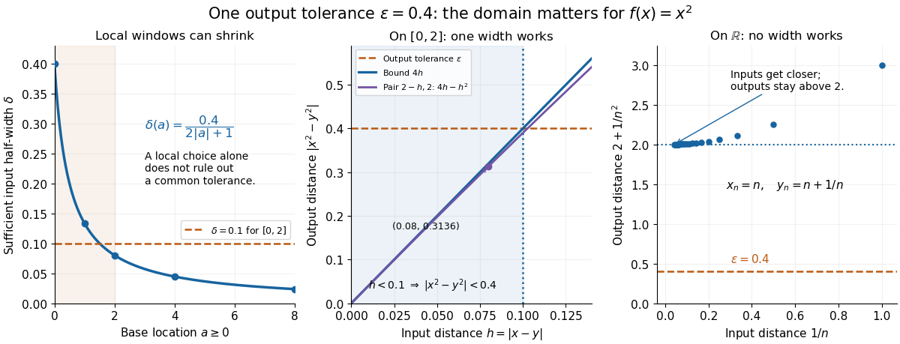

**[Figure 21](#image-the-square-function-local-input-windows-shrink-but-a-bounded-interval-admits-one-shared-tolerance). The square function: local input windows shrink, but a bounded interval admits one shared tolerance**. The left panel computes sufficient windows $\delta(a)=0.4/(2|a|+1)$ from the [continuity bounds for the square function](#continuity-bounds-for-the-square-function); shrinking these particular windows alone does not prove failure of [uniform continuity](topological-analysis.md#uniform-continuity). The middle panel displays the exact bound $4|x-y|$ on the [interval](real-analysis.md#interval-mathematics) $[0,2]$. The right panel gives the decisive [sequence](sequence-and-series.md#sequence) pairs $n,n+1/n$ on the [real line](real-analysis.md#real-line). All plotted values are calculated from the displayed formulas.

A [uniformly continuous function](#uniformly-continuous-function) need not be a [bounded function](function.md#bounded-function). The [identity function](function.md#identity-function) $f(x)=x$ on the [real line](real-analysis.md#real-line) has $|f(x)-f(y)|=|x-y|$, so $\delta=\varepsilon$ always works, although its [image of a function](set-theory.md#image-of-a-function) is the unbounded [real line](real-analysis.md#real-line). [Uniform continuity](topological-analysis.md#uniform-continuity) controls changes between nearby inputs, not the overall size of outputs. Likewise, an unbounded [domain of a function](function.md#domain-of-a-function) does not by itself prevent [uniform continuity](topological-analysis.md#uniform-continuity).

The [square root](algebra.md#square-root) $g(x)=\sqrt x$ supplies a different common tolerance on the [interval](real-analysis.md#interval-mathematics) $[0,\infty)$. Assuming $x\geq y\geq0$, put $u=\sqrt x$ and $v=\sqrt y$. Since $0\leq u-v\leq u+v$,

$$
(u-v)^2\leq(u-v)(u+v)=x-y.
$$

Interchanging the inputs when necessary proves

$$
|\sqrt x-\sqrt y|\leq\sqrt{|x-y|}.
$$

Thus $\delta=\varepsilon^2$ guarantees [uniform continuity](topological-analysis.md#uniform-continuity) on the entire [domain of a function](function.md#domain-of-a-function), including zero. For $\varepsilon=0.4$, any input distance below $0.16$ suffices. The pairs $(0,0.09)$ and $(4,4.09)$ both have input distance $0.09$; their output distances are respectively $0.3$ and $0.09/(\sqrt{4.09}+2)<0.0225$. The common guarantee accommodates quite different local sensitivities.

This [Hölder continuity](sobolev-space.md#holder-condition) bound allows a curved tolerance rule. It is weaker than a [Lipschitz bound](real-analysis.md#lipschitz-bound): at zero the output change divided by the input change is

$$
\frac{|g(h)-g(0)|}{|h-0|}=\frac1{\sqrt h}\longrightarrow\infty
\qquad(h\downarrow0).
$$

No finite [Lipschitz constant](real-analysis.md#lipschitz-constant) works near zero, even though [uniform continuity](topological-analysis.md#uniform-continuity) does. A [Lipschitz function](real-analysis.md#lipschitz-continuity) does have [uniform continuity](topological-analysis.md#uniform-continuity), choosing $\delta=\varepsilon/L$ when its [Lipschitz bound](real-analysis.md#lipschitz-bound) $L$ is positive; when $L=0$ it is a [constant function](function.md#constant-function).[§3.4, Proposition 3.4.8 and Example 3.4.10: Lipschitz continuity implies uniform continuity; the square root on the nonnegative half-line separates the properties](mathematics-bibliography.md#basic-analysis-introduction-to-real-analysis-volume-i-by-jiri-lebl)

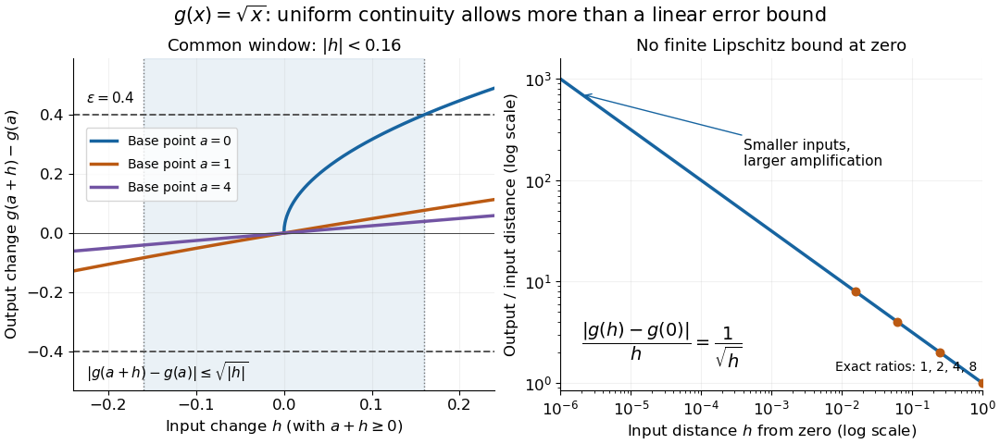

**[Figure 22](#image-square-root-input-changes-share-an-output-tolerance-even-though-amplification-near-zero-is-unbounded). Square-root input changes share an output tolerance even though amplification near zero is unbounded**. At left, the exact output changes $\sqrt{a+h}-\sqrt a$ for base [points](geometry-and-topology.md#point-geometry) $a=0,1,4$ stay inside $\varepsilon=0.4$ whenever $|h|<\delta=0.16$ and $a+h\geq0$. The right panel computes the amplification $1/\sqrt h$ for inputs $0,h$: it grows without bound as $h$ decreases. These are calculated [function graphs](function.md#graph-of-a-function), with no experimental measurements.

For general [metric spaces](topological-analysis.md#metric-space), replace the [absolute values](real-analysis.md#absolute-value) by the respective [distance functions](topological-analysis.md#metric). The [Heine-Cantor theorem](topological-analysis.md#heine-cantor-theorem) gives an existence guarantee: every [continuous function](#continuous-function) on a [compact metric space](topological-analysis.md#compact-metric-space) is [uniformly continuous](topological-analysis.md#uniform-continuity). In particular, [continuity](#continuous-function) on a finite [closed interval](real-analysis.md#closed-real-interval) provides a common tolerance, even when no simple formula for it is known.[§7.5, Definition 7.5.10 and Theorem 7.5.11: uniform continuity between metric spaces and the compact-domain theorem](mathematics-bibliography.md#basic-analysis-introduction-to-real-analysis-volume-i-by-jiri-lebl)

For a short proof outline, fix $\varepsilon>0$. [Continuity](#continuous-function) gives each [point](geometry-and-topology.md#point-geometry) $a$ an [open ball](topology.md#open-ball) of radius $r_a>0$ within which outputs differ from $f(a)$ by less than $\varepsilon/2$. The [open balls](topology.md#open-ball) of half these radii still cover the [domain of a function](function.md#domain-of-a-function). [Compactness](topology.md#compact-space) supplies a [finite subcover](topology.md#finite-subcover). Take $\delta$ to be the smallest half-radius in this [finite set](set.md#finite-set). Two inputs closer than $\delta$ lie together in one of the original [open balls](topology.md#open-ball), so the [triangle inequality](topological-analysis.md#triangle-inequality) bounds their output distance by $\varepsilon$. The beautiful step is that the [compact set](topology.md#compact-space) turns local choices into finitely many choices, whose minimum stays positive.

A shared tolerance also makes [uniformly continuous functions](#uniformly-continuous-function) preserve [Cauchy sequences](sequence-and-series.md#cauchy-sequence): after choosing $\delta$ for $\varepsilon$, all sufficiently late input pairs are closer than $\delta$, so all corresponding output pairs are closer than $\varepsilon$. Unlike a [convergent sequence](sequence-and-series.md#convergent-sequence) argument, this does not require an input [limit](#limit-of-a-function) inside the [domain of a function](function.md#domain-of-a-function). It is why [uniform continuity](topological-analysis.md#uniform-continuity) is useful for extending a [function](function.md) toward missing endpoints and for the decay argument below.

##### Decay of a nonnegative uniformly continuous integrable function

↑ **Parent:** [Uniformly continuous function](#uniformly-continuous-function)

A [nonnegative function](function.md#nonnegative-function) that is a [uniformly continuous function](#uniformly-continuous-function) on the [interval](real-analysis.md#interval-mathematics) $[0,\infty)$ and has a finite [integral](integral.md) tends to zero. Otherwise [uniform continuity](topological-analysis.md#uniform-continuity) gives disjoint [intervals](real-analysis.md#interval-mathematics) of a fixed width on which the [function](function.md) exceeds a fixed positive value, contradicting [integrability](measure-theory.md#integrability). This supplies a useful decay argument for [Lyapunov functions](dynamical-systems.md#lyapunov-function) with merely [continuous](#continuous-function) [vector fields](multivariable-calculus.md#vector-field).

To make the fixed width explicit, suppose some $\eta>0$ occurs as a lower bound $f(t_n)\geq\eta$ along a [sequence](sequence-and-series.md#sequence) with $t_n\to\infty$. Choose $\delta>0$ from [uniform continuity](topological-analysis.md#uniform-continuity) for output tolerance $\eta/2$. On every [interval](real-analysis.md#interval-mathematics) $(t_n-\delta/2,t_n+\delta/2)$ lying in $[0,\infty)$, the [function](function.md) is greater than $\eta/2$. Extract a [subsequence](sequence-and-series.md#subsequence) whose centers are more than $\delta$ apart. Each disjoint [interval](real-analysis.md#interval-mathematics) contributes at least $\eta\delta/2$ to the [integral](integral.md), so the first $N$ contribute at least $N\eta\delta/2$. This contradicts finiteness of the [integral](integral.md). The same input width at every center is the essential step; [continuity](#continuous-function) alone would allow progressively narrower peaks.

### Squeeze theorem

↑ **Parent:** [Limit of a function](#limit-of-a-function)  
ⓦ [Wiki](https://en.wikipedia.org/wiki/Squeeze_theorem)

If two functions with the same limit bound a third nearby, the bounded function has that limit too.

## Derivative

↑ **Parent:** [Calculus](calculus.md)  
ⓦ [Wiki](https://en.wikipedia.org/wiki/Derivative)

The derivative measures the instantaneous rate at which a [function](function.md) changes. For a real [function](function.md) $f$ defined near $a$, it exists when the [difference quotient](#difference-quotient) has a finite two-sided [limit](#limit-of-a-function):

$$
f'(a)=\lim_{h\to0}\frac{f(a+h)-f(a)}h.
$$

The quotient is the [slope](euclidean-geometry.md#slope) of the [straight line](euclidean-geometry.md#straight-line) joining two nearby points of the graph. Its [limit](#limit-of-a-function) is the [slope](euclidean-geometry.md#slope) of the [tangent line](#tangent-line). Thus a [derivative](#derivative) describes a local rate without choosing a particular finite measurement interval.

For $f(x)=x^2$, expanding the numerator gives

$$
\frac{(a+h)^2-a^2}h=2a+h,\qquad f'(a)=2a.
$$

At $a=1$, the increments $h=1$, $1/2$ and $1/10$ give [secant line](euclidean-geometry.md#secant-line) [slopes](euclidean-geometry.md#slope) $3$, $2.5$ and $2.1$. The [limit](#limit-of-a-function) is $2$, and the [tangent line](#tangent-line) is $y=1+2(x-1)$. The picture makes the limiting process visible.

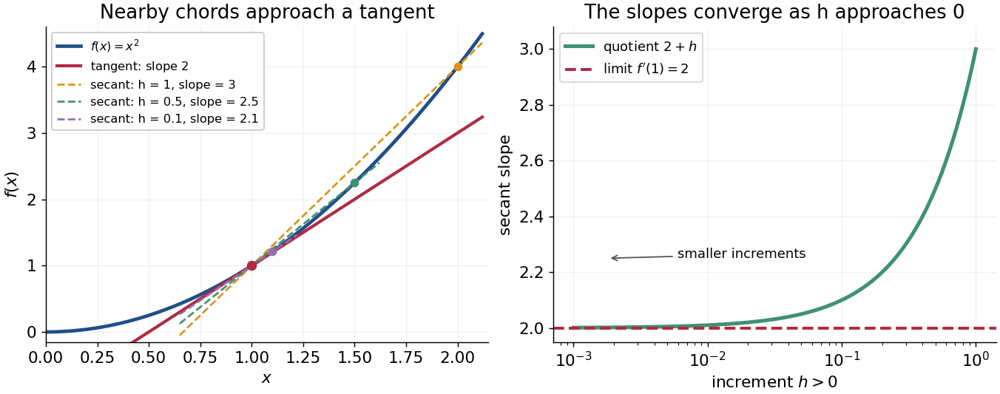

**[Figure 23](#image-secant-lines-to-x-squared-approach-its-tangent-line-at-x-1). Secant lines to x squared approach its tangent line at x = 1**.

The same calculation shows why the [derivative](#derivative) is useful for approximation:

$$
f(a+h)=f(a)+f'(a)h+r(h),\qquad \frac{r(h)}h\longrightarrow0.
$$

This is a [local linear approximation](#local-linear-approximation). Near $a=1$, replacing $(1+h)^2$ by $1+2h$ makes the exact error $h^2$, smaller than the leading change when $h$ is small. A curved graph can therefore be studied locally using a [straight line](euclidean-geometry.md#straight-line).

If the [function](function.md) records [position](classical-mechanics.md#position) against time, its [derivative](#derivative) is [velocity](classical-mechanics.md#velocity). If it records an [objective function](mathematical-optimization.md#objective-function), its [derivative](#derivative) tests local changes that matter in [optimization](mathematical-optimization.md); in several variables, the [gradient](multivariable-calculus.md#gradient) collects these directional rates and guides [gradient descent](gradient-descent.md). The interpretation comes from the [function](function.md) and its units, rather than from a new rule for each application.

Existence matters. For the [absolute value function](real-analysis.md#absolute-value) $f(x)=|x|$, the [one-sided derivatives](#one-sided-derivative) at zero are $-1$ and $1$, so there is no single [tangent line](#tangent-line) described by a finite [derivative](#derivative) there. Nor does a zero [derivative](#derivative) alone identify a maximum or minimum: $f(x)=x^3$ has $f'(0)=0$ but keeps increasing through zero.

### Related rates

↑ **Parent:** [Derivative](#derivative)

Related rates use the [chain rule](#chain-rule) to connect time [derivatives](#derivative) of quantities constrained by an equation. If $F(x(t),y(t))=0$, differentiating gives $F_x\dot x+F_y\dot y=0$. For a [rectangle](euclidean-geometry.md#rectangle) with one fixed side $a$ and variable side $b(t)$, its diagonal $d(t)=\sqrt{a^2+b(t)^2}$ obeys $\dot d=(b/d)\dot b$. The equation must be differentiated before inserting an instantaneous value of $b$, since that value does not make the changing side constant in time.

### Power rule

↑ **Parent:** [Derivative](#derivative)  
ⓦ [Wiki](https://en.wikipedia.org/wiki/Power_rule)

For a real exponent $p$ and $x>0$, write $x^p=\exp(p\ln x)$. The [chain rule](#chain-rule) and the [derivative](#derivative) of the [natural logarithm](#natural-logarithm) give $d(x^p)/dx=px^{p-1}$. For a nonnegative integer exponent this agrees with polynomial differentiation and extends to all real $x$. Reversing differentiation gives $\int x^p\,dx=x^{p+1}/(p+1)+C$ for $p\ne-1$ on a suitable real branch. The exceptional exponent $p=-1$ gives $\ln|x|+C$ on either half-line.

### Logarithmic differentiation

↑ **Parent:** [Derivative](#derivative)

Apply the [chain rule](#chain-rule) to the [logarithm](#logarithm) of a differentiable nonzero real-valued [function](function.md). This converts products into sums and powers into multiplicative coefficients. In particular, for positive $f=C\prod_i x_i^{a_i}$, $df/f=\sum_i a_i\,dx_i/x_i$. It is useful for [monomial uncertainty propagation](wave-equation.md#monomial-uncertainty-propagation) and for finding relative rates of change.

### Regularity of a power times a function with a simple zero

↑ **Parent:** [Derivative](#derivative)

Suppose $\psi$ is differentiable at zero, $\psi(0)=0$ and $\psi'(0)=a\ne0$. Since $\psi(x)/x\to a$, the displayed function satisfies $F(x)\sim a\operatorname{sgn}(x)|x|^{p+1}$ near zero. It is a [continuous function](#continuous-function) at zero exactly when $p>-1$. Its difference quotient is $|h|^p\psi(h)/h$, so it has a finite [derivative](#derivative) there exactly when $p\ge0$: the value is $a$ for $p=0$ and zero for $p>0$. The nonzero-slope assumption is essential; a higher-order zero would change both thresholds.

### Local linear approximation

↑ **Parent:** [Derivative](#derivative)

For a [differentiable function](analysis.md#differentiable-function), a [local linear approximation](#local-linear-approximation) replaces nearby values by its value plus its [derivative](#derivative) times the input change. The error divided by that change tends to zero. It uses the first-order [Taylor polynomial](#taylor-polynomial); the statement concerns a [limit](#limit-of-a-function) near the specified point, not a guaranteed approximation far from it.

### Symmetric second derivative

↑ **Parent:** [Derivative](#derivative)

The symmetric second derivative is the displayed limit when it exists. For a twice continuously differentiable function it equals the ordinary second derivative by Taylor expansion; the definition itself does not require ordinary differentiability. A [continuous function](#continuous-function) with vanishing symmetric second derivative throughout an interval must be affine, by [vanishing symmetric second derivative forces an affine function](#vanishing-symmetric-second-derivative-forces-an-affine-function). For a twice-integrated Fourier series, sinc-squared weights express this quotient, connecting the operation to [Riemann summation of a convergent trigonometric series](fourier-series.md#riemann-summation-of-a-convergent-trigonometric-series).

### Symmetric second differences detect an affine corner

↑ **Parent:** [Derivative](#derivative)

For a continuous function with affine formulas $At+B$ to the left of $c$ and $A't+B'$ to its right, the quotient $[F(c+h)-2F(c)+F(c-h)]/h$ equals $A'-A$ for positive $h$. If it tends to zero, the slopes agree, and continuity at $c$ makes the intercepts agree as well. This detects slope jumps that ordinary pointwise derivatives away from the corner cannot detect.

### Symmetric first-order differences remove an affine corner

↑ **Parent:** [Derivative](#derivative)

For a continuous function with affine formulas $At+B$ to the left of $c$ and $A't+B'$ to its right, the quotient $[F(c+h)-2F(c)+F(c-h)]/h$ equals $A'-A$ for positive $h$. If it tends to zero, the slopes agree, and continuity at $c$ makes the intercepts agree as well. This detects slope jumps that ordinary pointwise derivatives away from the corner cannot detect.

### Vanishing symmetric second derivative forces an affine function

↑ **Parent:** [Derivative](#derivative)

If a continuous real function on an interval has the displayed limit zero at every interior point, it is affine. On any compact subinterval subtract its endpoint chord. If the difference were positive somewhere, adding $\varepsilon(t-a)(t-b)$ for sufficiently small positive $\varepsilon$ would retain a positive interior maximum. At a maximum every symmetric second difference is nonpositive, but its normalized limit would be $2\varepsilon>0$. Thus the function lies below its chord; applying the same argument to its negative gives equality. Real and imaginary parts give the complex-valued version. Existence of ordinary second derivatives is unnecessary.

### One-sided derivative

↑ **Parent:** [Derivative](#derivative)

The right and left [one-sided derivatives](#one-sided-derivative) are the limits of the [difference quotient](#difference-quotient) restricted respectively to positive and negative increments:

$$
f'_+(a)=\lim_{h\downarrow0}\frac{f(a+h)-f(a)}h,
\qquad
f'_-(a)=\lim_{h\uparrow0}\frac{f(a+h)-f(a)}h.
$$

At an interior point, [differentiability](analysis.md#differentiability) is equivalent to existence and equality of these two finite limits. For the [absolute value function](real-analysis.md#absolute-value), $f'_+(0)=1$ and $f'_-(0)=-1$, so it is continuous at zero but not differentiable there.

### Tangent line

↑ **Parent:** [Derivative](#derivative)

The [tangent line](#tangent-line) to a differentiable [function](function.md) at $a$ is its affine first-order approximation $f(a)+f'(a)(x-a)$. For a differentiable [concave function](real-analysis.md#concave-function), it is an upper bound throughout a convex interval: the secant-slope inequality and passage to the [derivative](#derivative) give $f(x)\leq f(a)+f'(a)(x-a)$. This upper bound constructs valid envelopes in [adaptive rejection sampling](monte-carlo-method.md#adaptive-rejection-sampling).

#### Common tangent

↑ **Parent:** [Tangent line](#tangent-line)

A line tangent to two curves or to a curve at two distinct points. For functions $g_1,g_2$, contact at $x_1,x_2$ requires equal derivatives and equal intercepts: $g_1'(x_1)=g_2'(x_2)=m$ and $g_1(x_1)-mx_1=g_2(x_2)-mx_2$. The [common-tangent construction](critical-phenomenon.md#common-tangent-construction) uses the lower supporting line for phase coexistence.

#### Tangent through the origin to an exponential curve

↑ **Parent:** [Tangent line](#tangent-line)

For a nonzero real [constant](mathematics.md#constant-mathematics) $a$, the [tangent line](#tangent-line) to $y=e^{ax}$ at $x_*$ passes through the origin precisely when $e^{ax_*}-x_*ae^{ax_*}=0$. Thus $x_*=1/a$, $y_*=e$, and its [slope](euclidean-geometry.md#slope) is $k=ae$. This gives the unique such [tangent line](#tangent-line). If $a=0$, the graph is the horizontal line $y=1$ and no [tangent line](#tangent-line) through the origin exists. The equality between the [derivative](#derivative) and the slope from the origin, $f'(x_*)=f(x_*)/x_*$, is useful for other [differentiable functions](analysis.md#differentiable-function) too.

#### Normal line to a plane curve

↑ **Parent:** [Tangent line](#tangent-line)

At a regular point of a differentiable [plane curve](algebraic-geometry.md#plane-curve), the normal line passes through that point perpendicular to its [tangent line](#tangent-line). If the tangent slope is a finite nonzero number $m$, the normal slope is $-1/m$, since the direction vectors $(1,m)$ and $(1,-1/m)$ have zero [dot product](inner-product.md#dot-product). A horizontal tangent has a vertical normal, and a vertical tangent has a horizontal normal. For a regular [level set](topology.md#level-set) $F(x,y)=c$, the nonzero [gradient](multivariable-calculus.md#gradient) $\nabla F$ gives a normal direction because differentiating $F$ along the curve gives $\nabla F\cdot\mathbf r'=0$.

### Automatic differentiation

↑ **Parent:** [Derivative](#derivative)  
ⓦ [Wiki](https://en.wikipedia.org/wiki/Automatic_differentiation)

[Automatic differentiation](#automatic-differentiation) evaluates derivatives of a computational graph using the [chain rule](#chain-rule). Reverse mode is [backpropagation](statistical-learning.md#backpropagation) and is useful for [reparameterization gradients](bayesian-statistics.md#reparameterization-gradient) through simulated trajectories.

### Differentiation

↑ **Parent:** [Derivative](#derivative)

Differentiation computes the [derivative](#derivative) of a [function](function.md). A [difference quotient](#difference-quotient) approximates a [derivative](#derivative) using finite increments; its [limit](#limit-of-a-function) is the [derivative](#derivative) when the [function](function.md) is [differentiable](analysis.md#differentiable-function).

### Second derivative

↑ **Parent:** [Derivative](#derivative)  
ⓦ [Wiki](https://en.wikipedia.org/wiki/Second_derivative)

The [derivative](#derivative) of the first [derivative](#derivative). For a twice [differentiable function](analysis.md#differentiable-function), its sign governs local [convexity](real-analysis.md#convex-function) and its magnitude controls the second-order [Taylor remainder](#taylor-remainder).

### Difference quotient

↑ **Parent:** [Derivative](#derivative)

A difference quotient divides a finite change in a function by the corresponding change in its argument. Its limit, when it exists, is the [derivative](#derivative).

#### Discrete integration by parts

↑ **Parent:** [Difference quotient](#difference-quotient)

With $\delta_h f(x)=[f(x+he_\ell)-f(x)]/h$, a change of variables gives

$$
\int g\,\delta_h f=-\int(\delta_{-h}g)f.
$$

The [compact support](function.md#compact-support) of $f$ and its translates must remain inside the integration domain, or one must integrate over the whole space with convergent integrals. In particular $\delta_{-h}g(x)=[g(x)-g(x-he_\ell)]/h$: the denominator's sign matters. This is the [difference quotient](#difference-quotient) analogue of [integration by parts](#integration-by-parts).

### Total derivative

↑ **Parent:** [Derivative](#derivative)  
ⓦ [Wiki](https://en.wikipedia.org/wiki/Total_derivative)

A [total derivative](#total-derivative) accounts for every dependence of a quantity on the variable of [differentiation](#differentiation). For a [differentiable function](analysis.md#differentiable-function) $F(t,x_1,\ldots,x_n)$ evaluated along [differentiable](analysis.md#differentiable-function) coordinate [functions](function.md) $x_i(t)$, the [multivariable chain rule](#multivariable-chain-rule) gives

$$
\frac{d}{dt}F(t,x_1(t),\ldots,x_n(t))
=\frac{\partial F}{\partial t}+\sum_{i=1}^n\frac{\partial F}{\partial x_i}\frac{dx_i}{dt}.
$$

All the [partial derivatives](multivariable-calculus.md#partial-derivative) on the right are evaluated at $(t,x_1(t),\ldots,x_n(t))$. The first term captures explicit dependence on $t$; the remaining terms capture changes transmitted through the coordinates.

For example, take $F(t,x)=tx^2$ and $x(t)=t$. The [partial derivative](multivariable-calculus.md#partial-derivative) with respect to $t$, holding $x$ fixed, is $x^2$, whose value on the path is $t^2$. The [total derivative](#total-derivative) is instead

$$
\frac d{dt}F(t,t)=\frac d{dt}t^3=3t^2
=\underbrace{t^2}_{\partial_t F}+\underbrace{2t^2}_{\partial_x F\,x'}.
$$

At $t=2$, the [partial derivative](multivariable-calculus.md#partial-derivative) is $4$ and the [total derivative](#total-derivative) is $12$. The difference is the contribution from changing $x$.

If the composite [function](function.md) is [continuously differentiable](multivariable-calculus.md#continuously-differentiable-function) on $[a,b]$, the [fundamental theorem of calculus](#fundamental-theorem-of-calculus) gives

$$
\int_a^b\frac{d}{dt}F(t,x(t))\,dt=F(b,x(b))-F(a,x(a)).
$$

This is the sense in which an integrated [total derivative](#total-derivative) contributes endpoint terms. The endpoint statement concerns the whole composite [function](function.md) along the path. [OpenStax, Calculus Volume 3: the chain rule with dependent variables](https://openstax.org/books/calculus-volume-3/pages/4-5-the-chain-rule).

<h3 id="l-hopital-s-rule">L'Hôpital's rule</h3>

↑ **Parent:** [Derivative](#derivative)  
ⓦ [Wiki](https://en.wikipedia.org/wiki/L'Hôpital's_rule)

For an indeterminate quotient whose numerator and denominator both tend to zero or both diverge, suitable differentiability and denominator conditions allow its limit to be computed from the limit of the quotient of their derivatives.

#### Derivative quotient limits on partial domains

↑ **Parent:** [L'Hôpital's rule](#l-hopital-s-rule)

The usual zero-over-zero [L'Hopital rule](#l-hopital-s-rule) requires the denominator's [derivative](#derivative) to be nonzero throughout a sufficiently small deleted neighborhood. A limit taken only where that [derivative](#derivative) is nonzero is insufficient. An explicit counterexample uses $x_n=2^{-n}$, $h_n=4^{-n}$, $S(u)=3u^2-2u^3$ and $q(u)=16u^2(1-u)^2$. On $[3x_n/4,x_n]$ put $g=h_n$ and $f=h_nq((x-3x_n/4)/(x_n/4))$. On $[x_n/2,3x_n/4]$ put $g=h_{n+1}+(h_n-h_{n+1})S((x-x_n/2)/(x_n/4))$ and $f=0$. Extend $g=1,f=0$ beyond one. Values and first [derivatives](#derivative) agree at the joins, both functions tend to zero, and $g$ is positive. Where $g'\ne0$, it lies inside a transition interval and $f'=0$. Thus $f'/g'$ has natural-domain limit zero, but $f/g$ equals zero at $x_n$ and one at $7x_n/8$, so has no limit.

<h3 id="darboux-s-theorem-analysis">Darboux's theorem (analysis)</h3>

↑ **Parent:** [Derivative](#derivative)  
ⓦ [Wiki](https://en.wikipedia.org/wiki/Darboux's_theorem_(analysis))

Every derivative has the intermediate-value property, even when the derivative is discontinuous.

#### Intermediate secant slope from endpoint derivatives

↑ **Parent:** [Darboux's theorem (analysis)](#darboux-s-theorem-analysis)

Let $m=(f(b)-f(a))/(b-a)$ for a function differentiable on a neighborhood of $[a,b]$. If $m=k$, use the whole interval. If $m>k$, the continuous extension of $(f(x)-f(a))/(x-a)$ takes values $f'(a)$ and $m$ at the endpoints, so the [intermediate value theorem](#intermediate-value-theorem) supplies a secant of slope $k$ starting at $a$. If $m<k$, use the continuous extension of $(f(b)-f(x))/(b-x)$ and obtain a secant ending at $b$. The [mean value theorem](#mean-value-theorem) then produces an interior [derivative](#derivative) equal to $k$, without requiring a continuous derivative.

### Product rule

↑ **Parent:** [Derivative](#derivative)  
ⓦ [Wiki](https://en.wikipedia.org/wiki/Product_rule)

If $f$ and $g$ are differentiable at $a$, then

$$
(fg)'(a)=f'(a)g(a)+f(a)g'(a).
$$

#### Differentiability restored by a quadratic zero

↑ **Parent:** [Product rule](#product-rule)

For a [continuous function](#continuous-function) $f:\mathbb R\to\mathbb R$, $g(t)=t^2f(t)$ is [differentiable](analysis.md#differentiable-function) at zero with $g'(0)=0$, because $[g(h)-g(0)]/h=hf(h)\to0$. At any nonzero point $x$, $g$ is [differentiable](analysis.md#differentiable-function) exactly when $f$ is: one direction uses the [product rule](#product-rule), and the converse applies it to $f(t)=t^{-2}g(t)$ near $x$.

#### Leibniz rule

↑ **Parent:** [Product rule](#product-rule)  
ⓦ [Wiki](https://en.wikipedia.org/wiki/Leibniz_rule)

The higher-order product rule is

$$
(fg)^{(n)}=\sum_{k=0}^n\binom nk f^{(k)}g^{(n-k)}.
$$

##### Generalized Leibniz rule

↑ **Parent:** [Leibniz rule](#leibniz-rule)

For $m$ functions with sufficiently many [derivatives](#derivative), the $n$th [derivative](#derivative) of their product distributes the $n$ differentiations among all factors. If factor $j$ is differentiated $k_j$ times, its term has the [multinomial coefficient](binomial-coefficient.md#multinomial-coefficient) $n!/(k_1!\cdots k_m!)$, where the nonnegative integers $k_j$ sum to $n$. Induction on the number of factors proves this from the two-factor [Leibniz rule](#leibniz-rule): splitting off the final factor gives a [binomial coefficient](binomial-coefficient.md), which multiplies the previous multinomial coefficient to give the one displayed above. Equivalently, count the ways to choose which of the $n$ successive applications of the [product rule](#product-rule) differentiate each factor.

#### Nondifferentiable factor with a differentiable nondegenerate product

↑ **Parent:** [Product rule](#product-rule)

At zero, $f(x)=x$ and $g(x)=1+|x|$ give a differentiable product

$$
f(x)g(x)=x+x|x|
$$

with derivative one, although $g$ is not differentiable.

### Quotient rule

↑ **Parent:** [Derivative](#derivative)  
ⓦ [Wiki](https://en.wikipedia.org/wiki/Quotient_rule)

If $f$ and $g$ are [differentiable](analysis.md#differentiable-function) and $g\ne0$, then

$$
\left(\frac fg\right)'
=\frac{f'g-fg'}{g^2}.
$$

### Chain rule

↑ **Parent:** [Derivative](#derivative)  
ⓦ [Wiki](https://en.wikipedia.org/wiki/Chain_rule)

The [chain rule](#chain-rule) calculates the [derivative](#derivative) of a [function composition](function.md#function-composition) by combining local rates. If the inner [function](function.md) $f$ is [differentiable](analysis.md#differentiable-function) at $a$ and the outer [function](function.md) $g$ is [differentiable](analysis.md#differentiable-function) at $f(a)$, then

$$
(g\circ f)'(a)=g'(f(a))f'(a).
$$

The evaluation point matters: the outer [derivative](#derivative) is evaluated at the inner output $f(a)$, not at $a$. A small input change first scales by $f'(a)$; the resulting intermediate change then scales by $g'(f(a))$. In terms of [linear approximations](#linear-approximation), composing those two local descriptions multiplies their scale factors. [OpenStax, Calculus Volume 1: statement and proof of the chain rule](https://openstax.org/books/calculus-volume-1/pages/3-6-the-chain-rule).

For example, $h(x)=\sin(x^2)$ applies a [quadratic function](polynomial.md#quadratic-function) and then the [sine](geometry-and-topology.md#sine). With $f(x)=x^2$ and $g(u)=\sin u$, the [chain rule](#chain-rule) gives

$$
h'(x)=\cos(x^2)\,2x,\qquad h'(1)=2\cos1\approx1.08060461.
$$

Here all [angles](geometry-and-topology.md#angle) are in [radians](geometry-and-topology.md#radian). Near $x=1$, increasing the input by $\Delta x$ changes $x^2$ by about $2\Delta x$, and the [sine](geometry-and-topology.md#sine) changes by about $\cos1$ times that intermediate change. For $\Delta x=0.01$, the [linear approximation](#linear-approximation) predicts an output increase of $0.0108060$; the exact increase is $\sin(1.0201)-\sin1\approx0.0106894$.

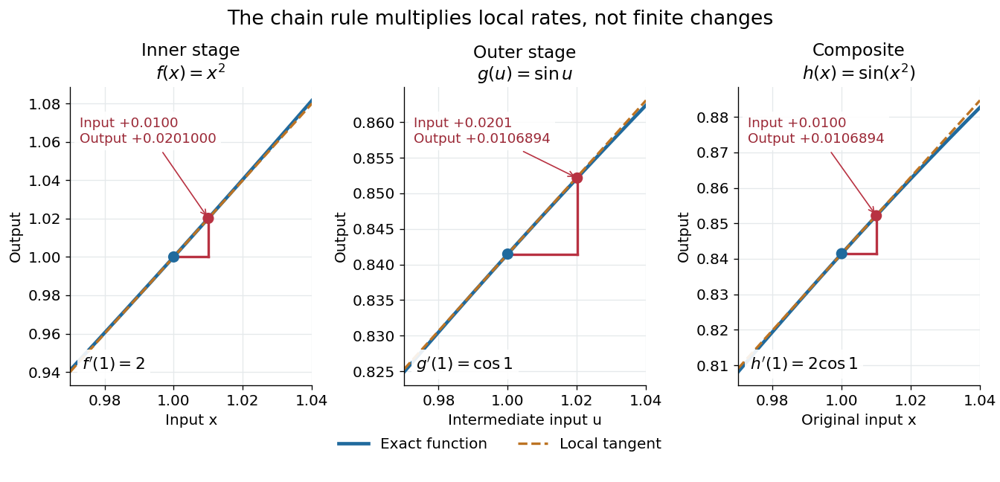

**[Figure 24](#image-the-chain-rule-multiplies-the-local-rates-through-two-successive-functions). The chain rule multiplies the local rates through two successive functions**. The inner [quadratic function](polynomial.md#quadratic-function) has [derivative](#derivative) $2$ at $x=1$, and the outer [sine](geometry-and-topology.md#sine) has [derivative](#derivative) $\cos1$ at its input $u=1$. Their composite has [derivative](#derivative) $2\cos1$. Each panel shows the corresponding [tangent line](#tangent-line) and the exact output of the input change from $1$ to $1.01$. Tangents describe [linear approximations](#linear-approximation), not exact finite changes.

The same rule handles several nested stages. For $h=g\circ f\circ k$, the [derivative](#derivative) is $h'(x)=g'(f(k(x)))f'(k(x))k'(x)$ under the corresponding [differentiability](analysis.md#differentiability) assumptions. Writing each intermediate output prevents evaluating a [derivative](#derivative) at the wrong stage. It also makes the [chain rule](#chain-rule) useful for propagating sensitivities through a mathematical model, where one measured quantity influences another through several transformations.

For a quick proof idea, replace $f$ near $a$ by its [linear approximation](#linear-approximation), then replace $g$ near $f(a)$ by its [linear approximation](#linear-approximation). The composite leading term is their product; [differentiability](analysis.md#differentiability) ensures the remaining error is smaller than the original input change. This argument still applies when $f'(a)=0$, so the informal cancellation $dh/dx=(dh/du)(du/dx)$ should not be interpreted as division by a possibly zero finite change. The hypotheses are sufficient, but are not necessary for every composite to be [differentiable](analysis.md#differentiable-function), as the [nondifferentiable inner function with a differentiable nondegenerate composite](#nondifferentiable-inner-function-with-a-differentiable-nondegenerate-composite) example shows.

#### Linear approximation

↑ **Parent:** [Chain rule](#chain-rule)  
ⓦ [Wiki](https://en.wikipedia.org/wiki/Linear_approximation)

A [linear approximation](#linear-approximation) replaces a [differentiable function](analysis.md#differentiable-function) near a reference input by its value plus the first-order change supplied by its [derivative](#derivative). In one dimension, this is the [tangent line](#tangent-line) $f(a)+f'(a)(x-a)$. The [chain rule](#chain-rule) combines such local approximations through [function composition](function.md#function-composition); it does not assert their equality to the original [functions](function.md) over a finite [interval](real-analysis.md#interval-mathematics).

#### Multivariable chain rule

↑ **Parent:** [Chain rule](#chain-rule)

For [differentiable maps](multivariable-calculus.md#differentiable-map) $f:\mathbb R^n\to\mathbb R^m$ and $g:\mathbb R^m\to\mathbb R^r$, the [multivariable chain rule](#multivariable-chain-rule) multiplies their [Jacobian matrices](multivariable-calculus.md#jacobian-matrix):

$$
J_{g\circ f}(x)=J_g(f(x))J_f(x).
$$

The outer $r\times m$ [matrix](vector-space.md#matrix) multiplies the inner $m\times n$ [matrix](vector-space.md#matrix), producing an $r\times n$ [matrix](vector-space.md#matrix). This order records that the inner [linear map](vector-space.md#linear-map) acts first. Componentwise, the [matrix multiplication](vector-space.md#matrix-multiplication) sums the contributions of all intermediate coordinates. Existence of separate [partial derivatives](multivariable-calculus.md#partial-derivative) alone is not the required [differentiability](analysis.md#differentiability) hypothesis.

##### Second derivatives under a two-variable coordinate change

↑ **Parent:** [Multivariable chain rule](#multivariable-chain-rule)

For twice continuously differentiable coordinate functions $u,v$ and an outer scalar function $f$, apply the [multivariable chain rule](#multivariable-chain-rule) twice along an original coordinate $s$. The first three terms differentiate the outer function, while the last two differentiate the coordinate coefficients. They cannot be omitted for a nonlinear coordinate map. In matrix notation this is the [Hessian matrix](multivariable-calculus.md#hessian-matrix) formula $H_{f\circ g}=J_g^TH_fJ_g+f_uH_u+f_vH_v$ for $g=(u,v)$. The extra terms vanish for an [affine map](geometry-and-topology.md#affine-map).

##### Derivative along a curve

↑ **Parent:** [Multivariable chain rule](#multivariable-chain-rule)

If $F:\mathbb R^n\to\mathbb R$ is [differentiable](analysis.md#differentiable-function) at the point $\gamma(t)$ of a [differentiable](analysis.md#differentiable-function) [parametric curve](topology.md#parametric-curve), the [multivariable chain rule](#multivariable-chain-rule) gives

$$
\frac d{dt}F(\gamma(t))=\nabla F(\gamma(t))\cdot\gamma'(t).
$$

The [gradient](multivariable-calculus.md#gradient) supplies the local spatial rates; the [velocity vector](tangent-vector.md#velocity-vector) $\gamma'(t)$ supplies the direction and rate of movement. Their [dot product](inner-product.md#dot-product) is the change in the sampled [scalar field](classical-field-theory.md#scalar-field) per unit parameter. If the parameter is time, this is a rate per unit time; a [directional derivative](multivariable-calculus.md#directional-derivative) per unit distance instead uses a [unit vector](vector-space.md#unit-vector).

Take $F(x,y)=x^2+2y^2$ and the [unit circle](complex-analysis.md#complex-unit-circle) path $\gamma(t)=(\cos t,\sin t)$. Along the path,

$$
F(\gamma(t))=1+\sin^2t,\qquad
\frac d{dt}F(\gamma(t))=2\sin t\cos t=\sin2t.
$$

At $t=\pi/4$, the [gradient](multivariable-calculus.md#gradient) is $(\sqrt2,2\sqrt2)$, the [velocity vector](tangent-vector.md#velocity-vector) is $(-1/\sqrt2,1/\sqrt2)$, and their [dot product](inner-product.md#dot-product) is $-1+2=1$. The sampled value is $3/2$ and increases at rate one, even though one coordinate is decreasing. This is why a moving observation must combine every coordinate's contribution.

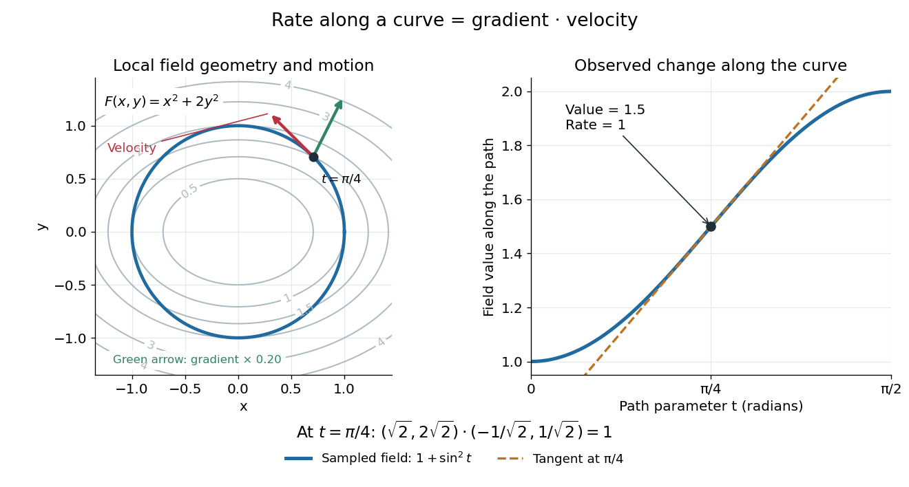

**[Figure 25](#image-the-gradient-and-path-velocity-combine-to-give-the-rate-of-change-along-a-curve). The gradient and path velocity combine to give the rate of change along a curve**. Left: [level curves](topology.md#level-curve) of $F(x,y)=x^2+2y^2$, the [unit circle](complex-analysis.md#complex-unit-circle) path, and arrows at $t=\pi/4$ for its [velocity vector](tangent-vector.md#velocity-vector) and a scaled [gradient](multivariable-calculus.md#gradient). Right: the sampled [function](function.md) $F(\gamma(t))=1+\sin^2t$ and its [tangent line](#tangent-line), of [slope](euclidean-geometry.md#slope) one at that parameter. The displayed gradient arrow is scaled for readability, without changing its direction.

For a [level curve](topology.md#level-curve), $F(\gamma(t))$ is constant, so the [derivative along a curve](#derivative-along-a-curve) is zero and its [velocity vector](tangent-vector.md#velocity-vector) is [orthogonal](inner-product.md#orthogonal-vectors) to the [gradient](multivariable-calculus.md#gradient). Along other paths, the same formula combines a field's geometry with the observer's motion. [OpenStax, multivariable chain rule and parameter-dependent inputs](https://openstax.org/books/calculus-volume-3/pages/4-5-the-chain-rule).

###### Derivative of a vector field dotted with curve velocity

↑ **Parent:** [Derivative along a curve](#derivative-along-a-curve)

For a continuously [differentiable](analysis.md#differentiable-function) [vector field](multivariable-calculus.md#vector-field) $W:\mathbb R^n\to\mathbb R^n$ and a twice continuously [differentiable](analysis.md#differentiable-function) [parametric curve](topology.md#parametric-curve) $r$, the [product rule](#product-rule) and [multivariable chain rule](#multivariable-chain-rule) give

$$
\frac d{dt}\bigl[W(r(t))\cdot r'(t)\bigr]
=r'(t)^TJ_W(r(t))r'(t)+W(r(t))\cdot r''(t),
$$

where $(J_W)_{ij}=\partial_jW_i$ is the [Jacobian matrix](multivariable-calculus.md#jacobian-matrix). Indeed, first differentiate the [dot product](inner-product.md#dot-product) to obtain $(dW(r(t))/dt)\cdot r'+W(r(t))\cdot r''$, and then substitute $dW(r(t))/dt=J_Wr'$.

The first term describes variation in the sampled [vector field](multivariable-calculus.md#vector-field); the second records the changing [velocity vector](tangent-vector.md#velocity-vector) of the [parametric curve](topology.md#parametric-curve). In three dimensions one may take $W=\nabla\times F$ for a sufficiently smooth [vector field](multivariable-calculus.md#vector-field) $F$. The formula then involves first and second spatial [partial derivatives](multivariable-calculus.md#partial-derivative) of $F$ and the [velocity](classical-mechanics.md#velocity) and [acceleration](classical-mechanics.md#acceleration) of the [parametric curve](topology.md#parametric-curve). Omitting the second term would be valid only when its [dot product](inner-product.md#dot-product) vanishes, for example for a straight path with constant [velocity](classical-mechanics.md#velocity).

#### Nondifferentiable inner function with a differentiable nondegenerate composite

↑ **Parent:** [Chain rule](#chain-rule)

At zero, $f(x)=\sqrt[3]x$ is not differentiable and $g(y)=y^3$ is differentiable, while $g\circ f(x)=x$ has derivative one.

#### Second derivative chain rule

↑ **Parent:** [Chain rule](#chain-rule)

For twice differentiable functions,

$$
(g\circ f)''(a)
=g''(f(a))[f'(a)]^2+g'(f(a))f''(a).
$$

## Monotonic function

↑ **Parent:** [Calculus](calculus.md)  
ⓦ [Wiki](https://en.wikipedia.org/wiki/Monotonic_function)

A [real-valued function](function.md#real-valued-function) $f:D\to\mathbb R$, with [domain of a function](function.md#domain-of-a-function) $D\subseteq\mathbb R$ in the usual order of the [real numbers](arithmetic.md#real-number), is a [monotonic function](#monotonic-function) if it is either a [nondecreasing function](#nondecreasing-function) throughout $D$ or a [nonincreasing function](#nonincreasing-function) throughout $D$. The same direction must work for every pair $x<y$ in $D$. Being a [strictly increasing function](#strictly-increasing-function) on one part and a [strictly decreasing function](#strictly-decreasing-function) on another does not make the whole [function](function.md) [monotone](#monotonic-function): for example, $x^2$ on the [real line](real-analysis.md#real-line) changes direction at zero. A [constant function](function.md#constant-function) is both a [nondecreasing function](#nondecreasing-function) and a [nonincreasing function](#nonincreasing-function).

The word "increasing" is ambiguous across textbooks: some allow equal outputs and some require unequal outputs. Use [nondecreasing function](#nondecreasing-function) for the weak inequality and [strictly increasing function](#strictly-increasing-function) for the strict inequality; use [nonincreasing function](#nonincreasing-function) and [strictly decreasing function](#strictly-decreasing-function) in the other direction. Neither [continuity](#continuous-function) nor [differentiability](analysis.md#differentiability) is part of the definition of a [monotonic function](#monotonic-function).

Strict [monotonicity](#monotonic-function) gives [injectivity](algebra.md#injective-function), so an equation $f(x)=b$ has at most one solution and an [inverse function](function.md#inverse-function) exists on the [image of a function](set-theory.md#image-of-a-function). Weak [monotonicity](#monotonic-function) permits repeated outputs and jumps. In [probability theory](probability-theory.md), a [cumulative distribution function](probability-distribution.md#cumulative-distribution-function) is a [nondecreasing function](#nondecreasing-function); its [quantile function](probability-distribution.md#quantile-function) uses a generalized inverse to handle those flat parts and jumps. [Monotonicity](#monotonic-function) alone does not guarantee [continuity](#continuous-function), even for a [strictly increasing function](#strictly-increasing-function).

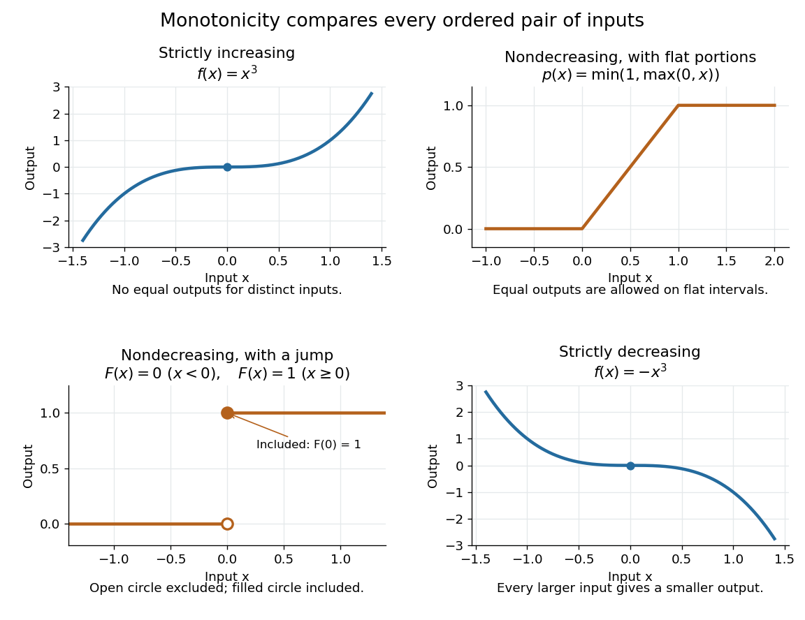

**[Figure 26](#image-strict-and-weak-monotonicity-cubic-functions-flat-portions-and-a-step). Strict and weak monotonicity: cubic functions, flat portions, and a step**. The [strictly increasing function](#strictly-increasing-function) $x^3$ and [strictly decreasing function](#strictly-decreasing-function) $-x^3$ never repeat an output. The [nondecreasing function](#nondecreasing-function) $\min(1,\max(0,x))$ has flat [intervals](real-analysis.md#interval-mathematics), and the [step function](measure-theory.md#step-function) $F(x)=0$ for $x<0$, $F(x)=1$ for $x\geq0$ is a [discontinuous](#discontinuity-of-a-function) [cumulative distribution function](probability-distribution.md#cumulative-distribution-function). The open and closed circles specify its value at the jump; no vertical segment belongs to its graph.

### Derivative criterion for monotonicity

↑ **Parent:** [Monotonic function](#monotonic-function)

Let $I$ be a [real interval](real-analysis.md#interval-mathematics), and let $f:I\to\mathbb R$ be [differentiable](analysis.md#differentiable-function) in its [interior](topology.md#interior-topology) and [continuous](#continuous-function) at any endpoints belonging to $I$. If the [derivative](#derivative) satisfies $f'(x)\geq0$ throughout the [interior](topology.md#interior-topology), then $f$ is a [nondecreasing function](#nondecreasing-function) on $I$. For $x<y$ in $I$, the [mean value theorem](#mean-value-theorem) supplies $c\in(x,y)$ with

$$
f(y)-f(x)=f'(c)(y-x)\geq0.
$$

Changing $\geq0$ to $\leq0$, $>0$, or $<0$ gives a [nonincreasing function](#nonincreasing-function), [strictly increasing function](#strictly-increasing-function), or [strictly decreasing function](#strictly-decreasing-function), respectively. The endpoint [continuity](#continuous-function) assumption lets the [mean value theorem](#mean-value-theorem) apply even when $x$ or $y$ is an endpoint. [OpenStax Calculus Volume 1, mean value theorem and its monotonicity corollary](https://openstax.org/books/calculus-volume-1/pages/4-4-the-mean-value-theorem).

Conversely, if a [nondecreasing function](#nondecreasing-function) on a [real interval](real-analysis.md#interval-mathematics) is [differentiable](analysis.md#differentiable-function) at an interior point $x$, then $f'(x)\geq0$: the [difference quotient](#difference-quotient) $(f(x+h)-f(x))/h$ is nonnegative for either sign of $h$. A [differentiable](analysis.md#differentiable-function) [nonincreasing function](#nonincreasing-function) has [derivative](#derivative) $f'(x)\leq0$. Strict [monotonicity](#monotonic-function) still only forces these weak signs: the [strictly increasing function](#strictly-increasing-function) $x^3$ has [derivative](#derivative) zero at zero. The sign of the [derivative](#derivative) helps locate [intervals](real-analysis.md#interval-mathematics) of [monotonicity](#monotonic-function) when sketching a graph. [OpenStax Calculus Volume 1, derivatives and the shape of a graph](https://openstax.org/books/calculus-volume-1/pages/4-5-derivatives-and-the-shape-of-a-graph).

The [real interval](real-analysis.md#interval-mathematics) hypothesis matters because a [connected subset of the real line](geometry-and-topology.md#connected-subset-of-the-real-line) contains every point between its inputs. On a disconnected [domain of a function](function.md#domain-of-a-function), positive [derivatives](#derivative) need not give a [nondecreasing function](#nondecreasing-function). For example, take

$$
D=(-2,-1)\cup(1,2),\qquad
f(x)=\begin{cases}x,&-2<x<-1,\\x-10,&1<x<2.\end{cases}
$$

Here $f'(x)=1$ everywhere in $D$, but $-3/2<3/2$ while $f(-3/2)=-3/2>-17/2=f(3/2)$. Each component has a [strictly increasing function](#strictly-increasing-function), yet their outputs are ordered the wrong way across the gap. This [function](function.md) is neither a [nondecreasing function](#nondecreasing-function) nor a [nonincreasing function](#nonincreasing-function) on all of $D$; the [mean value theorem](#mean-value-theorem) cannot cross the missing [interval](real-analysis.md#interval-mathematics).

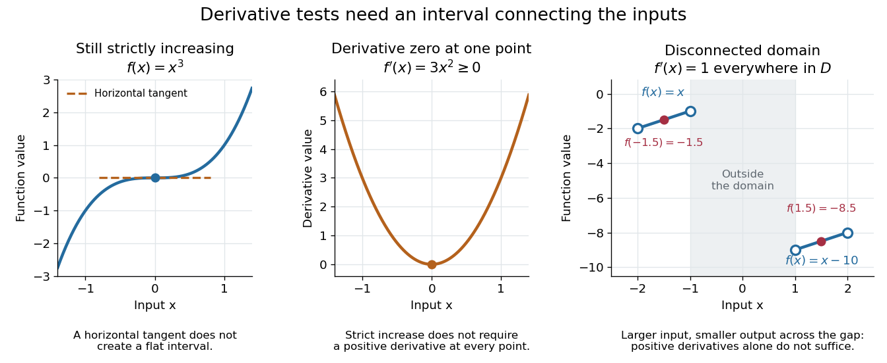

**[Figure 27](#image-a-zero-derivative-can-coexist-with-strict-increase-while-a-domain-gap-defeats-the-derivative-test). A zero derivative can coexist with strict increase, while a domain gap defeats the derivative test**. Left: the [strictly increasing function](#strictly-increasing-function) $f(x)=x^3$ and its [derivative](#derivative) $f'(x)=3x^2$, both zero at the origin. Right: two separate graph segments with [derivative](#derivative) one on $(-2,-1)\cup(1,2)$, but a lower output on the right component. Open circles exclude the four component endpoints.

### Monotone mean-value point of an integral average

↑ **Parent:** [Monotonic function](#monotonic-function)

For a continuous strictly decreasing real function, its average $h(x)=x^{-1}\int_0^xf(t)dt$ lies strictly between $f(x)$ and $f(0)$ for $x>0$. There is a unique $g(x)\in(0,x)$ with $f(g(x))=h(x)$. If $f$ is [differentiable](analysis.md#differentiable-function) and $f'<0$ throughout the positive half-line, the [fundamental theorem of calculus](#fundamental-theorem-of-calculus) and the derivative formula for the monotone inverse give

$$
g'(x)=\frac{f(x)-f(g(x))}{xf'(g(x))}>0.
$$

Continuity of $f'$ is unnecessary: differentiability of a strictly monotone function with nonzero derivative at a point suffices for differentiability of its inverse there.

### Nonincreasing function

↑ **Parent:** [Monotonic function](#monotonic-function)

A [real-valued function](function.md#real-valued-function) $f:D\to\mathbb R$ is a [nonincreasing function](#nonincreasing-function) if every pair $x<y$ in its [domain of a function](function.md#domain-of-a-function) satisfies $f(x)\geq f(y)$. Equal outputs and flat [intervals](real-analysis.md#interval-mathematics) are allowed. For example, $f(x)=-\min(1,\max(0,x))$ is a [nonincreasing function](#nonincreasing-function), with a falling segment between two flat portions. Requiring $f(x)>f(y)$ instead gives a [strictly decreasing function](#strictly-decreasing-function). Negating a [nondecreasing function](#nondecreasing-function) gives a [nonincreasing function](#nonincreasing-function).

A [nonincreasing](#nonincreasing-function) [sequence](sequence-and-series.md#sequence) of [natural numbers](arithmetic.md#natural-number) has finitely many strict drops, so it is eventually constant. This differs from a [strictly decreasing](#strictly-decreasing-function) [sequence](sequence-and-series.md#sequence), which cannot continue indefinitely within the [natural numbers](arithmetic.md#natural-number).

// Target: foundations-of-mathematics.bigb

### Non-strict inverse of a continuous nondecreasing function

↑ **Parent:** [Monotonic function](#monotonic-function)

For a continuous unbounded [nondecreasing function](#nondecreasing-function) $f$ on the nonnegative half-line and $a>f(0)$, the non-strict inverse $h$ is left-continuous in its level argument. It equals the left limit of the [strict generalized inverse of a nondecreasing function](#strict-generalized-inverse-of-a-nondecreasing-function) $G(a)=\inf\{t:f(t)>a\}$. Indeed $G(b)\leq h(a)$ for $b<a$, while for every $t<h(a)$, $f(t)<a$ and choosing $b\in(f(t),a)$ gives $G(b)\geq t$. Similarly $h(a+)=G(a)$. A flat part of $f$ at level $a$ gives a discrepancy between the two inverses: $h(a)$ selects the beginning of the flat part and $G(a)$ its end. For a [Brownian running maximum](brownian-motion.md#brownian-running-maximum), these are the non-strict and strict passage times.

### Left-continuous cumulative function of an atomic measure

↑ **Parent:** [Monotonic function](#monotonic-function)

For positive summable weights $w_j$ at points $q_j$, the strict cumulative function $F(x)=\sum_{q_j<x}w_j$ is nondecreasing and left-continuous. A finite-head/tail argument proves left-continuity, and its right jump at an atom is the mass there. This strict convention differs at atoms from the usual right-continuous [cumulative distribution function](probability-distribution.md#cumulative-distribution-function).

### Nondecreasing function

↑ **Parent:** [Monotonic function](#monotonic-function)

A [real-valued function](function.md#real-valued-function) $f:D\to\mathbb R$ is a [nondecreasing function](#nondecreasing-function) if every pair $x<y$ in its [domain of a function](function.md#domain-of-a-function) satisfies $f(x)\leq f(y)$. Flat [intervals](real-analysis.md#interval-mathematics) are allowed, unlike for a [strictly increasing function](#strictly-increasing-function). For example,

$$
p(x)=\min(1,\max(0,x))=\begin{cases}0,&x\leq0,\\x,&0<x<1,\\1,&x\geq1\end{cases}
$$

is a [continuous](#continuous-function) [nondecreasing function](#nondecreasing-function), but it repeats its output on each flat [interval](real-analysis.md#interval-mathematics).

A [nondecreasing function](#nondecreasing-function) can also be [discontinuous](#discontinuity-of-a-function). The [step function](measure-theory.md#step-function) $F(x)=0$ for $x<0$ and $F(x)=1$ for $x\geq0$ has a [jump discontinuity](#jump-discontinuity) at zero without ever decreasing. It is the [cumulative distribution function](probability-distribution.md#cumulative-distribution-function) of a [random variable](random-variable.md) that equals zero with [probability](probability-theory.md#probability) one; [quantile functions](probability-distribution.md#quantile-function) handle such jumps through a generalized inverse. [Nondecreasing](#nondecreasing-function) allocation [functions](function.md) permit [critical-value payments](game-theory.md#critical-value-payment) in [single-parameter mechanisms](game-theory.md#single-parameter-mechanism).

### Strict generalized inverse of a nondecreasing function

↑ **Parent:** [Monotonic function](#monotonic-function)

For an unbounded nondecreasing function $f:[0,\infty)\to\mathbb R$, its strict generalized inverse is $G(a)=\inf\{t\geq0:f(t)>a\}$. It is nondecreasing and right-continuous in $a$. If $a_n\downarrow a$, then for any $t>G(a)$ monotonicity gives $f(t)>a$, so eventually $f(t)>a_n$ and $G(a_n)\leq t$; also $G(a_n)\geq G(a)$. Local finiteness gives finite left limits. Flat parts of $f$ create jumps of $G$. For the continuous running maximum of [Brownian motion](brownian-motion.md), this gives the [càdlàg](#cadlag) [Brownian first-passage subordinator](stochastic-process.md#brownian-first-passage-subordinator).

### Strictly increasing function

↑ **Parent:** [Monotonic function](#monotonic-function)

A [real-valued function](function.md#real-valued-function) $f:D\to\mathbb R$ is a [strictly increasing function](#strictly-increasing-function) if every pair $x<y$ in its [domain of a function](function.md#domain-of-a-function) satisfies $f(x)<f(y)$. It is therefore [injective](algebra.md#injective-function), and each output has at most one [preimage](set-theory.md#preimage). Its [inverse function](function.md#inverse-function) on its [image of a function](set-theory.md#image-of-a-function) is also [strictly increasing](#strictly-increasing-function). Every [strictly increasing function](#strictly-increasing-function) is a [nondecreasing function](#nondecreasing-function); the converse fails when outputs repeat.

The [polynomial](polynomial.md) $f(x)=x^3$ is a [strictly increasing function](#strictly-increasing-function) on the [real line](real-analysis.md#real-line), although its [derivative](#derivative) $f'(x)=3x^2$ is zero at zero. Indeed, for $x<y$,

$$
y^3-x^3=(y-x)(x^2+xy+y^2)>0,
$$

because $x^2+xy+y^2=(x+y/2)^2+3y^2/4$ can vanish only when $x=y=0$. Thus a positive [derivative](#derivative) everywhere is sufficient on a [real interval](real-analysis.md#interval-mathematics), but is not necessary for a [strictly increasing function](#strictly-increasing-function).

Strict [monotonicity](#monotonic-function) does not ensure [continuity](#continuous-function): $g(x)=x$ for $x<0$ and $g(x)=x+1$ for $x\geq0$ is a [strictly increasing function](#strictly-increasing-function) with a [jump discontinuity](#jump-discontinuity). Its [image of a function](set-theory.md#image-of-a-function) omits $[0,1)$, so the [inverse function](function.md#inverse-function) exists only on the actual [image of a function](set-theory.md#image-of-a-function), rather than on all the [real numbers](arithmetic.md#real-number).

#### Continuity of an increasing interval surjection

↑ **Parent:** [Strictly increasing function](#strictly-increasing-function)

A strictly increasing function from a closed real interval onto the interval between its endpoint values is continuous. Given a desired output tolerance, choose nearby output values on either side and use their preimages to trap nearby inputs. At the endpoints only one side is needed. Equivalently, a discontinuity of a monotone function creates a gap in its range, which is incompatible with surjectivity onto an interval.

### Strictly decreasing function

↑ **Parent:** [Monotonic function](#monotonic-function)

A [real-valued function](function.md#real-valued-function) $f:D\to\mathbb R$ is a [strictly decreasing function](#strictly-decreasing-function) if every pair $x<y$ in its [domain of a function](function.md#domain-of-a-function) satisfies $f(x)>f(y)$. It is a [nonincreasing function](#nonincreasing-function) and is [injective](algebra.md#injective-function), with a [strictly decreasing](#strictly-decreasing-function) [inverse function](function.md#inverse-function) on its [image of a function](set-theory.md#image-of-a-function). Negating a [strictly increasing function](#strictly-increasing-function) gives a [strictly decreasing function](#strictly-decreasing-function): $f(x)=-x^3$ is an example on the [real line](real-analysis.md#real-line), even though its [derivative](#derivative) vanishes at zero. Equal outputs are forbidden, unlike for a general [nonincreasing function](#nonincreasing-function).

### Lebesgue theorem on differentiability of monotone functions

↑ **Parent:** [Monotonic function](#monotonic-function)

Every real-valued [monotone function](#monotonic-function) on a [real interval](real-analysis.md#interval-mathematics) is [differentiable](analysis.md#differentiable-function) with a finite [derivative](#derivative) at [almost every](measure-theory.md#almost-everywhere) point.

This strengthens the regularity known for a [monotonic function](#monotonic-function) beyond the restriction on its jump discontinuities.

## Multivariable calculus

↑ **Parent:** [Calculus](calculus.md)

[This section is present in another page, follow this link to view it.](multivariable-calculus.md)

## Symmetry in integration

↑ **Parent:** [Calculus](calculus.md)  
ⓦ [Wiki](https://en.wikipedia.org/wiki/Symmetry_in_integration)

If an integrand is odd under a measure-preserving symmetry of the domain, its integral is zero.

## Integration by parts

↑ **Parent:** [Calculus](calculus.md)  
ⓦ [Wiki](https://en.wikipedia.org/wiki/Integration_by_parts)

[Integration by parts](#integration-by-parts) transfers a [derivative](#derivative) from one factor of a product to the other, while keeping an endpoint contribution. Its usefulness comes from choosing which factor becomes simpler when differentiated, and which has an accessible [antiderivative](integral.md#antiderivative). The [integral](integral.md) is then replaced by a [boundary term](#boundary-term) minus another [integral](integral.md).

For real [continuously differentiable functions](multivariable-calculus.md#continuously-differentiable-function) $u,v$ on $[a,b]$, the precise [definite integral](integral.md#definite-integral) formula is

$$
\int_a^b u(x)v'(x)\,dx=[u(x)v(x)]_a^b-\int_a^b u'(x)v(x)\,dx,
\qquad [uv]_a^b=u(b)v(b)-u(a)v(a).
$$

In the shorter notation, $du=u'(x)\,dx$ and $dv=v'(x)\,dx$, giving $\int u\,dv=uv-\int v\,du$ for [indefinite integrals](integral.md#antiderivative), with a [constant of integration](integral.md#constant-of-integration) understood. The [product rule](#product-rule) says $(uv)'=u'v+uv'$; the [fundamental theorem of calculus](#fundamental-theorem-of-calculus) turns its [integral](integral.md) into the endpoint difference. Thus the formula packages a differentiation rule into a tool for [integration](integral.md).[OpenStax, Calculus Volume 2, Section 3.1: Integration by parts](https://openstax.org/books/calculus-volume-2/pages/3-1-integration-by-parts)

For example, choose $u=x$ and $dv=e^x\,dx$. Then $du=dx$ and $v=e^x$, since the [exponential function](#exponential-function) is its own [derivative](#derivative):

$$
\int_0^1 xe^x\,dx=[xe^x]_0^1-\int_0^1e^x\,dx=e-(e-1)=1.
$$

The [boundary term](#boundary-term) is $e\approx2.718282$; the remaining [integral](integral.md) is $e-1\approx1.718282$. Their difference is exactly one. The endpoint product alone would overcount, because its [derivative](#derivative) includes $u'v=e^x$ as well as the desired $uv'=xe^x$.

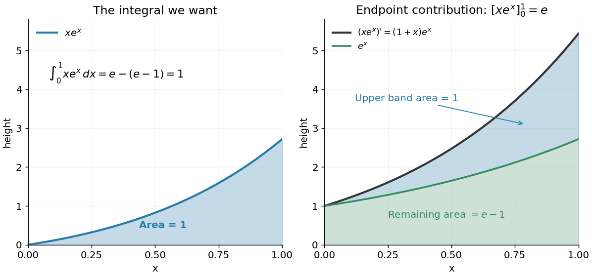

**[Figure 28](#image-integration-by-parts-splits-the-accumulated-product-derivative-into-the-desired-integral-and-the-remaining-integral). Integration by parts splits the accumulated product derivative into the desired integral and the remaining integral**.

In the figure, the [area](differential-geometry.md#surface-area) under $(xe^x)'=(1+x)e^x$ is the endpoint contribution $e$. Its lower band has [area](differential-geometry.md#surface-area) $e-1$, and its upper band has thickness $xe^x$ and [area](differential-geometry.md#surface-area) one. This decomposition makes the subtraction visible. The endpoint contribution is a difference of product values; it need not equal the [area](differential-geometry.md#surface-area) under either factor separately.

The same choice repeatedly lowers the [degree of a polynomial](polynomial.md#degree-of-a-polynomial) when integrating a [polynomial](polynomial.md) times an [exponential function](#exponential-function), while choosing $u=\ln x$ gives $\int\ln x\,dx=x\ln x-x+C$ for $x>0$. More broadly, moving a [derivative](#derivative) onto a convenient test function is the mechanism behind a [weak derivative](distribution-theory.md#weak-derivative). Always evaluate the [boundary term](#boundary-term): it disappears only when the relevant endpoint values justify doing so, often through a [boundary condition](differential-equation.md#boundary-condition).

### Sine-weighted power integral recurrence

↑ **Parent:** [Integration by parts](#integration-by-parts)

Define the [definite integral](integral.md#definite-integral) $F(k)=\int_0^\pi x^k\sin x\,dx$. For real $k>1$, two applications of [integration by parts](#integration-by-parts) give

$$
F(k)=\pi^k+k\int_0^\pi x^{k-1}\cos x\,dx
=\pi^k-k(k-1)F(k-2).
$$

The boundary term $x^{k-1}\sin x$ vanishes at both endpoints. At $k=1$, direct integration gives $F(1)=\pi$, consistent with the displayed relation; $F(-1)$ is finite because $\sin x/x\to1$ at zero. This recurrence and $F(0)=2$ evaluate every nonnegative integer moment, with separate even and odd chains.

### Boundary term

↑ **Parent:** [Integration by parts](#integration-by-parts)

A boundary term is an endpoint or boundary integral left when derivatives are transferred by [integration by parts](#integration-by-parts). It vanishes under some boundary conditions and otherwise supplies natural boundary conditions, conserved charges, or physical surface forces.

## Hyperbolic tangent

↑ **Parent:** [Calculus](calculus.md)  
ⓦ [Wiki](https://en.wikipedia.org/wiki/Hyperbolic_tangent)

The hyperbolic tangent is sinh divided by cosh and approaches plus or minus one at the two infinities.

### Inverse hyperbolic tangent

↑ **Parent:** [Hyperbolic tangent](#hyperbolic-tangent)

For $|x|<1$, the inverse hyperbolic tangent is

$$
\operatorname{artanh}x=\frac12\log\frac{1+x}{1-x}.
$$

### Small-argument expansion of the hyperbolic tangent

↑ **Parent:** [Hyperbolic tangent](#hyperbolic-tangent)

The [Taylor series](#taylor-series) at zero begins

$$
\tanh x=x-\frac{x^3}{3}+O(x^5),
$$

so $\tanh x\sim x$ as $x\to0$.

### Hyperbolic-function identity

↑ **Parent:** [Hyperbolic tangent](#hyperbolic-tangent)

The exponential definitions of the hyperbolic functions imply identities such as

$$
\frac{\sinh x}{1+\cosh x}=\tanh\!\left(\frac x2\right).
$$

### Hyperbolic Pythagorean identity

↑ **Parent:** [Hyperbolic tangent](#hyperbolic-tangent)

The identity $\cosh^2x-\sinh^2x=1$ implies

$$
1-\tanh^2x=\operatorname{sech}^2x,
\qquad
\coth^2x-\operatorname{csch}^2x=1.
$$

The identity follows directly from the exponential definitions of the [hyperbolic functions](#hyperbolic-function).

## Even function

↑ **Parent:** [Calculus](calculus.md)  
ⓦ [Wiki](https://en.wikipedia.org/wiki/Even_function)

An even function satisfies $f(-x)=f(x)$; its [Laurent series](analysis.md#laurent-series) or [Taylor series](#taylor-series) contains only even powers.

## Odd function

↑ **Parent:** [Calculus](calculus.md)  
ⓦ [Wiki](https://en.wikipedia.org/wiki/Odd_function)

An odd function satisfies $f(-x)=-f(x)$; its [Laurent series](analysis.md#laurent-series) or [Taylor series](#taylor-series) contains only odd powers.

### Odd extension

↑ **Parent:** [Odd function](#odd-function)

An odd extension of a function $f$ on the positive half-line is $\widetilde f(r)=f(r)$ for $r>0$ and $\widetilde f(r)=-f(-r)$ for $r<0$. At zero it is set to zero when the boundary value is zero. Smoothness requires compatible even derivatives at zero. In the [radial reduction of the three-dimensional wave equation](wave-equation.md#radial-reduction-of-the-three-dimensional-wave-equation), $r\phi(t,r)$ has a smooth [odd extension](#odd-extension) whenever $\phi$ is smooth and radial.

## ↑ Ancestors (5)

1. [Real analysis](real-analysis.md)
2. [Analysis](analysis.md)
3. [Area of mathematics](mathematics.md#area-of-mathematics)
4. [Mathematics](mathematics.md)
5. [Codex Wiki](README.md)

## ← Incoming links (9)

- [Brownian motion](brownian-motion.md)
- [Completing the square](polynomial.md#completing-the-square)
- [Critical point](analysis.md#critical-point)
- [Differential geometry](differential-geometry.md)
- [Exponential function](#exponential-function)
- [Fluid mechanics](fluid-mechanics.md)
- [Mathematical optimization](mathematical-optimization.md)
- [Mathematics](mathematics.md)
- [Topological manifold](topological-manifold.md)
