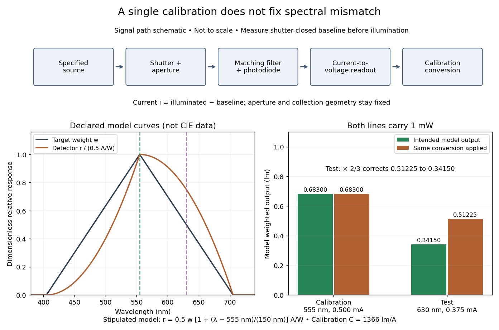

# Calibrated photometer model

↑ **Parent:** [Spectral mismatch correction](spectral-mismatch-correction.md)

Use the triangular $w$ in [equal radiant power under visual weighting](equal-radiant-power-under-visual-weighting.md) and stipulate the detector's [spectral responsivity](spectral-responsivity.md)

$$
r(\lambda)=(0.5\,\mathrm{A\,W^{-1}})w(\lambda)
\left(1+\frac{\lambda-555\,\mathrm{nm}}{150\,\mathrm{nm}}\right).
$$

This model has nonnegative response: $w$ is zero outside $405$–$705\,\mathrm{nm}$. For a $1\,\mathrm{mW}$ ideal calibration line at $555\,\mathrm{nm}$, $i_A=0.5\,\mathrm{mA}$ and $\widetilde\Phi_{v,A}=0.683\,\mathrm{lm}$, so $C_A=1366\,\mathrm{lm\,A^{-1}}$. An equal-[radiant flux](radiant-flux.md) test line at $630\,\mathrm{nm}$ gives $w=1/2$, $r=0.375\,\mathrm{A\,W^{-1}}$ and $i_T=0.375\,\mathrm{mA}$. The unchanged conversion indicates $0.51225\,\mathrm{lm}$, whereas the model's intended weighted result is $0.3415\,\mathrm{lm}$. The required [spectral mismatch correction](spectral-mismatch-correction.md) is $F=2/3$: the uncorrected result is 50% too large. All these numbers are declared model outputs, not instrument measurements or standard [photometry](photometry-optics.md) data.

**[Figure 8](#photometry-calibrated-detector-spectral-mismatch). Calibration at one wavelength leaves a spectral mismatch at another**. Original schematic and analytic model. The apparatus shows the signal path of a filtered [photodiode](photodiode.md) [photometer](photometer.md), with shutter-closed subtraction; it is not a drawing to scale of a specific instrument. The lower panels use the declared triangular weighting and detector response, not CIE tables. The two ideal lines carry the same collected [radiant flux](radiant-flux.md); the source-dependent factor $2/3$ corrects the test indication within this model only.

## ↑ Ancestors (8)

1. [Spectral mismatch correction](spectral-mismatch-correction.md)
2. [Photometric calibration](photometric-calibration.md)
3. [Photometer](photometer.md)
4. [Photometry (optics)](photometry-optics.md)
5. [Optics](optics-split.md)
6. [Branches of physics](branches-of-physics.md)
7. [Physics](physics-split.md)
8. [Codex Wiki](split.md)
