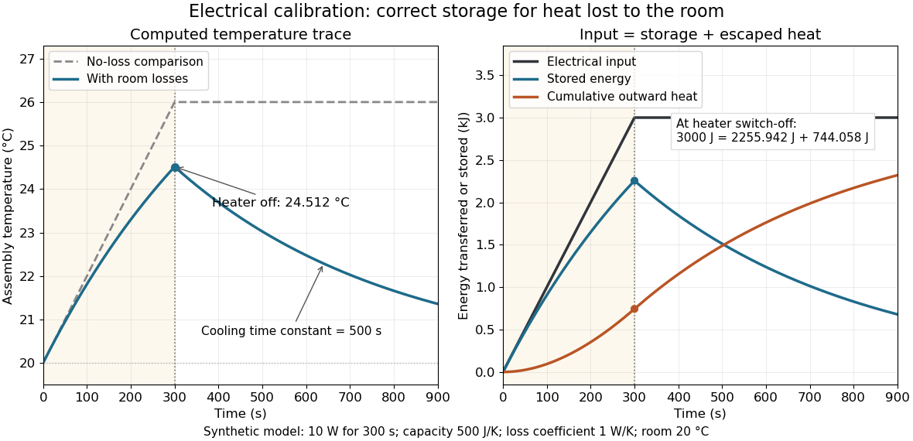

# Calorimeter calibration

↑ **Parent:** [Calorimeter](calorimeter.md)

Calorimeter calibration establishes the response of the actual measurement assembly to a known [energy](energy-split.md) input. It determines a participating [heat capacity](heat-capacity.md), not just the empty vessel's [mass](mass.md). For an electrical calibration with an immersed [resistor](resistor.md), measure [voltage](voltage.md) $V(t)$ across that [resistor](resistor.md) and [electric current](electric-current.md) $I(t)$ through it. If that electrical [work](work.md) is deposited inside the chosen boundary, its input is

$$
E_{\rm el}=\int_{t_0}^{t_1}V(t)I(t)\,dt
=C_{\rm eff}(T_1-T_0)+Q_{\rm loss,out},\qquad
C_{\rm eff}=m_wc_w+C_{\rm cal}.
$$

For a covered receiver at constant [pressure](pressure-split.md), $C_{\rm eff}$ describes [enthalpy](enthalpy-split.md) storage; for a rigid fixed-[volume](volume-thermodynamics.md) assembly, use the matching [heat capacity at constant volume](heat-capacity-at-constant-volume.md). Negligible endpoint mechanical storage and no escaping material are assumed. Thus $E_{\rm el}/(T_1-T_0)$ overestimates $C_{\rm eff}$ if outward loss is ignored. Account for lead losses outside the boundary and maintain the same [water](water.md) charge and immersed hardware in calibration and sample runs.

An alternative calibration mixes known hot and cold [water](water.md) portions. With the vessel initially at the cold portion's [temperature](temperature-split.md) $T_c$, the [mixing calorimetry](mixing-calorimetry.md) balance gives

$$
C_{\rm cal}=\frac{m_hc_w(T_h-T_f)-Q_{\rm loss,out}}{T_f-T_c}-m_cc_w.
$$

The previous synthetic [water](water.md) example returns $100\,\mathrm{J\,K^{-1}}$. The sign matters: attributing room losses to the vessel makes this estimate too large. With both $C_{\rm cal}$ and the loss unknown, one final [temperature](temperature-split.md) supplies only one equation; separate cooling information or controlled independent runs are needed.

A [calorimeter heat-loss correction](calorimeter-heat-loss-correction.md) can make the electrical balance quantitative. For a second synthetic example, stipulate $0.100\,\mathrm{kg}$ of [water](water.md) with $c_w=4180\,\mathrm{J\,kg^{-1}\,K^{-1}}$ and immersed hardware with $C_{\rm cal}=82\,\mathrm{J\,K^{-1}}$, so $C_{\rm eff}=500\,\mathrm{J\,K^{-1}}$. Supply $10\,\mathrm W$ for $300\,\mathrm s$, starting at a room [temperature](temperature-split.md) of $20\,{}^\circ\mathrm C$, with loss coefficient $G=1\,\mathrm{W\,K^{-1}}$. The model below gives $T_1\approx24.512\,{}^\circ\mathrm C$, storage $2255.942\,\mathrm J$ and outward loss $744.058\,\mathrm J$. The uncorrected ratio gives about $665\,\mathrm{J\,K^{-1}}$; subtracting the loss recovers $500\,\mathrm{J\,K^{-1}}$.

**[Figure 2](#calorimeter-electrical-calibration-cooling-balance). Electrical input splits into thermal storage and room losses during calibration**. Original synthetic computed traces for the stated constant-[heat capacity](heat-capacity.md), constant-loss model. The heater switches off at $300\,\mathrm s$; stored [energy](energy-split.md) then declines while cumulative outward [heat](heat-split.md) increases. The no-loss comparison reaches $26\,{}^\circ\mathrm C$. No points represent experimental measurements.

## ↑ Ancestors (7)

1. [Calorimeter](calorimeter.md)
2. [Calorimetry](calorimetry-split.md)
3. [Thermodynamics](thermodynamics-split.md)
4. [Statistical physics](statistical-physics-split.md)
5. [Branches of physics](branches-of-physics.md)
6. [Physics](physics-split.md)
7. [Codex Wiki](split.md)

## ← Incoming links (5)

- [Calorimeter](calorimeter.md)
- [Calorimeter addenda](calorimeter-addenda.md)
- [Calorimetry](calorimetry-split.md)
- [Electrical calorimetry of a resistor](electrical-calorimetry-of-a-resistor.md)
- [Hess's law calorimetry experiment](hess-s-law-calorimetry-experiment.md)
