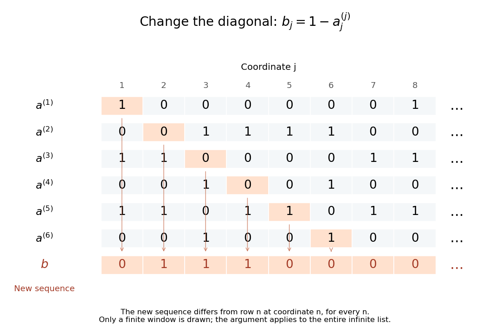

<h1 id="cantor-s-diagonal-argument">Cantor's diagonal argument</h1>

↑ **Parent:** [Countable set](countable-set.md)  
ⓦ [Wiki](https://en.wikipedia.org/wiki/Cantor's_diagonal_argument)

Cantor's diagonal argument shows that the [set](set-split.md) of all infinite [binary sequences](bitstream.md) is an [uncountable set](uncountable-set.md). Suppose a proposed enumeration is $a^{(1)},a^{(2)},\ldots$, where $a^{(n)}_j\in\{0,1\}$ is coordinate $j$ of row $n$. Construct a new [binary sequence](bitstream.md) by

$$
b_n=1-a^{(n)}_n\qquad(n\geq1).
$$

It differs from row $n$ at coordinate $n$, for every $n$. It is consequently absent from the entire proposed list, regardless of how that list was chosen. The failure of an enumeration of all [binary sequences](bitstream.md) follows from this precise point of disagreement, rather than from a claim that the list looks too small.

**[Figure 8](#image-flipping-the-nth-coordinate-of-the-nth-row-constructs-a-binary-sequence-missing-from-every-proposed-row). Flipping the nth coordinate of the nth row constructs a binary sequence missing from every proposed row**.

For the displayed window, the first six diagonal bits are $1,0,0,0,1,1$, so the new sequence starts $0,1,1,1,0,0$. The drawing shows only finitely many rows, but the rule defines every coordinate and excludes every row of an infinite list. This distinguishes the argument from the [Cantor pairing function](cantor-pairing-function.md): that construction lists all pairs of finite indices, whereas this one concerns an entire infinite [sequence](sequence.md) as each object to be listed. Finite [binary strings](binary-string.md) form a [countable set](countable-set.md); all infinite [binary sequences](bitstream.md) do not.

The connection with [power sets](power-set.md) is exact: a [subset](subset.md) $A\subseteq\mathbb N$ corresponds to its [indicator function](indicator-function.md), with a one in position $n$ exactly when $n\in A$. Changing the diagonal membership bit is the same mechanism as the [Cantor's theorem](cantor-s-theorem.md) construction $D=\{x:x\notin f(x)\}$. This reusable method turns a purported complete list into an explicit omitted object.

In his paper [Cantor, Ueber eine elementare Frage der Mannigfaltigkeitslehre, pp. 75–78](https://onepagepapers.com/cantor-diagonal/read/), presented in 1891 and printed in the 1890–91 volume in 1892, Cantor uses infinite sequences of two symbols for the diagonal construction and then gives the broader comparison of cardinalities. The binary notation here is a modern presentation of that construction.

## ↑ Ancestors (7)

1. [Countable set](countable-set.md)
2. [Cardinal number](cardinal-number.md)
3. [Set theory](set-theory-split.md)
4. [Foundations of mathematics](foundations-of-mathematics-split.md)
5. [Area of mathematics](area-of-mathematics.md)
6. [Mathematics](mathematics-split.md)
7. [Codex Wiki](split.md)

## ← Incoming links (9)

- [Bounded nondecreasing rational sequences are uncountable](bounded-nondecreasing-rational-sequences-are-uncountable.md)
- [Cantor's theorem](cantor-s-theorem.md)
- [Foundations of mathematics](foundations-of-mathematics-split.md)
- [Solution](past-exam-of-the-mathematics-course-of-the-university-of-cambridge/2009/ia/paper-4/8e/solution.md)
- [Solution](past-exam-of-the-mathematics-course-of-the-university-of-cambridge/2014/ia/paper-4/7e/i/solution.md)
- [Solution](past-exam-of-the-mathematics-course-of-the-university-of-cambridge/2021/ia/paper-4/8e/b/i/solution.md)
- [Solution](past-exam-of-the-mathematics-course-of-the-university-of-cambridge/2022/ia/paper-4/8f/c/solution.md)
- [Set theory](set-theory-split.md)
- [Uncountability by interleaving prescribed binary coordinates](uncountability-by-interleaving-prescribed-binary-coordinates.md)
