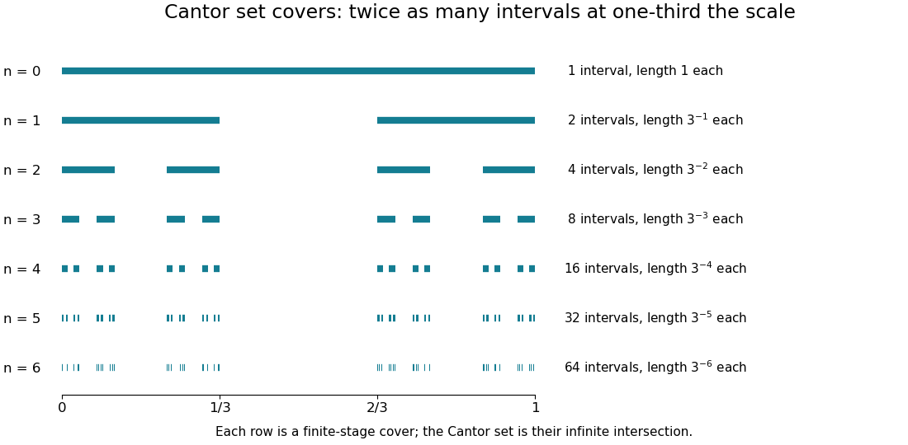

# Cantor set

↑ **Parent:** [Self-similarity](self-similarity.md)  
ⓦ [Wiki](https://en.wikipedia.org/wiki/Cantor_set)

The Cantor set is obtained from $[0,1]$ by repeatedly deleting the open middle third of every remaining interval. Its first stages retain $[0,1/3]\cup[2/3,1]$, then four intervals of length $1/9$, then eight of length $1/27$. After level $n$, there are $2^n$ retained intervals of length $3^{-n}$. The Cantor set is the [intersection](set-intersection.md) of all these stages, rather than the set of endpoints visible in any finite drawing.

**[Figure 18](#image-finite-stages-of-the-cantor-construction-supply-covers-at-successively-smaller-scales). Finite stages of the Cantor construction supply covers at successively smaller scales**.

Equivalently,

$$
C=\left\{\sum_{j=1}^{\infty}\frac{a_j}{3^j}:a_j\in\{0,2\}\right\}.
$$

Thus its points admit a base-three expansion using only zero and two. The word “admit” handles numbers with two expansions: $1/3=0.1_3=0.02222\ldots_3$ is retained as an endpoint. Every infinite binary choice determines a point of $C$, and differing choices give differing points, so $C$ is [uncountable](uncountable-set.md).

Its total retained interval [length](length.md) is $(2/3)^n\to0$, so $C$ has zero [Lebesgue measure](lebesgue-measure.md). It is nevertheless nonempty, [compact](compact-space.md), and [uncountable](uncountable-set.md), and has [Hausdorff dimension](hausdorff-dimension.md) $\log2/\log3$: the covers and mass bounds are worked out in [Hausdorff dimension of the Cantor set](hausdorff-dimension-of-the-cantor-set.md). This separates counting, ordinary [length](length.md), and fine-scale geometric size in one concrete example.

The [self-similarity](self-similarity.md) is exact:

$$
C=\tfrac13C\ \cup\ \left(\tfrac23+\tfrac13C\right).
$$

The [Cantor distribution](cantor-distribution.md) puts half the probability into each copy at every split. It has a continuous [cumulative distribution function](cumulative-distribution-function.md), the [Cantor function](cantor-function.md), while all its mass lies on a [Lebesgue null set](lebesgue-null-set.md). This makes the construction useful in [measure theory](measure-theory-split.md) as well as [fractal geometry](fractal-geometry.md): it provides a concrete model in which several plausible meanings of “small” disagree.

**Table of contents**

- [Cartesian powers of the Cantor set](cartesian-powers-of-the-cantor-set.md)
- [Cantor cylinder](cantor-cylinder.md)

## ↑ Ancestors (6)

1. [Self-similarity](self-similarity.md)
2. [Fractal geometry](fractal-geometry.md)
3. [Geometry and topology](geometry-and-topology-split.md)
4. [Area of mathematics](area-of-mathematics.md)
5. [Mathematics](mathematics-split.md)
6. [Codex Wiki](split.md)

## ← Incoming links (21)

- [Cantor Bernoulli measure](cantor-bernoulli-measure.md)
- [Cantor cylinder](cantor-cylinder.md)
- [Cantor distribution](cantor-distribution.md)
- [Cantor space](cantor-space.md)
- [Cartesian powers of the Cantor set](cartesian-powers-of-the-cantor-set.md)
- [Clopen sign approximation in the real Cantor unit ball](clopen-sign-approximation-in-the-real-cantor-unit-ball.md)
- [Extreme points of a real continuous-function unit ball](extreme-points-of-a-real-continuous-function-unit-ball.md)
- [Geometric measure theory](geometric-measure-theory.md)
- [Hausdorff dimension](hausdorff-dimension.md)
- [Hausdorff dimension of the Cantor set](hausdorff-dimension-of-the-cantor-set.md)
- [Hausdorff measure](hausdorff-measure.md)
- [Lebesgue null set](lebesgue-null-set.md)
- [Solution](past-exam-of-the-mathematics-course-of-the-university-of-cambridge/2006/iii/paper-9/2/solution.md)
- [Solution](past-exam-of-the-mathematics-course-of-the-university-of-cambridge/2007/ii/paper-1/12g/solution.md)
- [Solution](past-exam-of-the-mathematics-course-of-the-university-of-cambridge/2008/iii/paper-59/1/ii/solution.md)
- [Solution](past-exam-of-the-mathematics-course-of-the-university-of-cambridge/2009/ii/paper-4/3f/solution.md)
- [Solution](past-exam-of-the-mathematics-course-of-the-university-of-cambridge/2013/iii/paper-7/2/solution.md)
- [Solution](past-exam-of-the-mathematics-course-of-the-university-of-cambridge/2018/iii/paper-108/4/solution.md)
- [Solution](past-exam-of-the-mathematics-course-of-the-university-of-cambridge/2019/ia/paper-1/12f/ii/solution.md)
- [Scale-restricted Hausdorff content](scale-restricted-hausdorff-content.md)
- [Schottky group](schottky-group.md)
