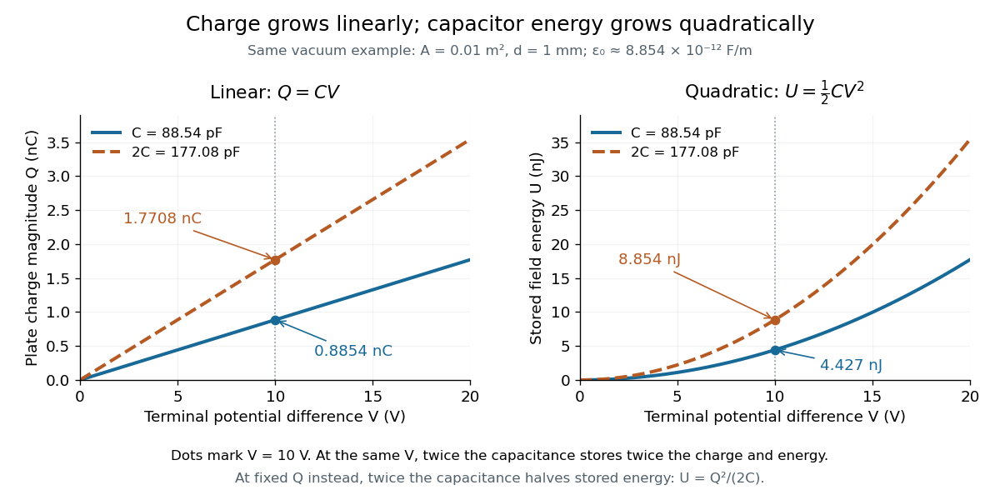

# Capacitor energy

↑ **Parent:** [Capacitor](capacitor.md)

The [capacitor energy](capacitor-energy.md) is the [electrostatic energy](electrostatic-energy.md) stored when [electric charge](electric-charge-split.md) is separated. For a linear [capacitor](capacitor.md) of fixed positive [capacitance](capacitance.md) $C$, plate [electric charge](electric-charge-split.md) magnitude $Q$, and terminal [electric potential difference](electric-potential-difference.md) $V=Q/C$, it is

$$
U=\frac{Q^2}{2C}=\frac12CV^2=\frac12QV.
$$

The zero is the uncharged state. Thus the [capacitor energy](capacitor-energy.md) is positive for nonzero $Q$, even though the total [electric charge](electric-charge-split.md) of the two plates is zero. [OpenStax University Physics 2, §8.3: energy stored in a capacitor](https://openstax.org/books/university-physics-volume-2/pages/8-3-energy-stored-in-a-capacitor).

For the [parallel-plate capacitor](parallel-plate-capacitor.md) example, [capacitance](capacitance.md) $C=8.854\times10^{-11}\,\mathrm F$ and terminal [electric potential difference](electric-potential-difference.md) $V=10\,\mathrm V$ give

$$
U=\frac12(8.854\times10^{-11})(10)^2\,\mathrm J
=4.427\times10^{-9}\,\mathrm J=4.427\,\mathrm{nJ}.
$$

The plate [electric charge](electric-charge-split.md) magnitude is $Q=0.8854\,\mathrm{nC}$. Doubling terminal [electric potential difference](electric-potential-difference.md) with [capacitance](capacitance.md) unchanged doubles the plate [electric charge](electric-charge-split.md) magnitude and quadruples the [capacitor energy](capacitor-energy.md).

**[Figure 4](#image-linear-electric-charge-and-quadratic-capacitor-energy-versus-electric-potential-difference). Linear electric charge and quadratic capacitor energy versus electric potential difference**.

The [electric charge](electric-charge-split.md) is a [linear function](linear-function.md) of terminal [electric potential difference](electric-potential-difference.md), while [capacitor energy](capacitor-energy.md) is a [quadratic function](quadratic-function.md). The second curve in each plot uses twice the [capacitance](capacitance.md): at a given terminal [electric potential difference](electric-potential-difference.md), both plate [electric charge](electric-charge-split.md) magnitude and [capacitor energy](capacitor-energy.md) double. These relations let us calculate how much [energy](energy-split.md) an [electrical circuit](electrical-circuit-split.md) can receive when a [capacitor](capacitor.md) discharges.

A brief charging argument explains the factor $1/2$. If the plate [electric charge](electric-charge-split.md) magnitude has reached $q$, the terminal [electric potential difference](electric-potential-difference.md) is $q/C$. Transferring a further amount $dq$ of [electric charge](electric-charge-split.md) quasistatically requires [work](work.md) $dW=(q/C)\,dq$. With the geometry and [permittivity](permittivity-split.md) fixed, the [integral](integral-split.md) is

$$
U=\int_0^Q\frac qC\,dq=\frac{Q^2}{2C}.
$$

Using $Q=CV$ gives the other two forms. This [integral](integral-split.md) accounts for the gradually rising terminal [electric potential difference](electric-potential-difference.md); it is the [work](work.md) stored in the [capacitor](capacitor.md)'s [electric field](electric-field-split.md), rather than a claim that all [energy](energy-split.md) drawn from a fixed-voltage [battery](electric-battery.md) during charging ends up stored.

The field picture gives the same result. In the vacuum gap of a [parallel-plate capacitor](parallel-plate-capacitor.md), the [electric field](electric-field-split.md) has [energy density](energy-density.md) $u=\epsilon_0 E^2/2$. Multiplying by the gap [volume](volume.md) $Ad$ gives the [electrostatic energy](electrostatic-energy.md)

$$
U\simeq\frac12\epsilon_0E^2Ad
=\frac12\frac{\epsilon_0 A}{d}V^2
=\frac12CV^2.
$$

For the worked example, $u=4.427\times10^{-4}\,\mathrm{J/m^3}$ and $Ad=10^{-5}\,\mathrm{m^3}$ reproduce $U=4.427\,\mathrm{nJ}$. The [electrostatic energy](electrostatic-energy.md) resides in the [electric field](electric-field-split.md) throughout the gap, despite overall [charge neutrality](charge-neutrality.md).

When [capacitance](capacitance.md) changes, specify the constraint. At fixed plate [electric charge](electric-charge-split.md) magnitude $Q$, increasing [capacitance](capacitance.md) decreases [capacitor energy](capacitor-energy.md) $Q^2/(2C)$; doubling [capacitance](capacitance.md) halves it. At fixed terminal [electric potential difference](electric-potential-difference.md) $V$, increasing [capacitance](capacitance.md) increases [capacitor energy](capacitor-energy.md) $CV^2/2$; doubling [capacitance](capacitance.md) doubles it. In the latter case a connected [battery](electric-battery.md) supplies additional [electric charge](electric-charge-split.md) and [energy](energy-split.md), and there may also be mechanical [work](work.md). Use the [fixed-voltage capacitor energy balance](fixed-voltage-capacitor-energy-balance.md) to account for all transfers before inferring a [force](force-split.md) from changing [capacitor energy](capacitor-energy.md).

**Table of contents**

- [Magnetic-to-electric energy ratio in a driven disc capacitor](magnetic-to-electric-energy-ratio-in-a-driven-disc-capacitor.md)
- [Fixed-voltage capacitor energy balance](fixed-voltage-capacitor-energy-balance.md)
  - [Dielectric insertion force at fixed voltage](dielectric-insertion-force-at-fixed-voltage.md)

## ↑ Ancestors (5)

1. [Capacitor](capacitor.md)
2. [Electromagnetism](electromagnetism-split.md)
3. [Branches of physics](branches-of-physics.md)
4. [Physics](physics-split.md)
5. [Codex Wiki](split.md)

## ← Incoming links (21)

- [Breakdown-limited energy of a conducting sphere](breakdown-limited-energy-of-a-conducting-sphere.md)
- [Capacitance](capacitance.md)
- [Capacitor](capacitor.md)
- [Capacitor energy](capacitor-energy.md)
- [Dielectric](dielectric.md)
- [Dielectric capacitor response](dielectric-capacitor-response.md)
- [Dielectric strength](dielectric-strength.md)
- [Electric battery](electric-battery.md)
- [Electrical reactance](electrical-reactance.md)
- [Fixed-voltage capacitor energy balance](fixed-voltage-capacitor-energy-balance.md)
- [Inductance](inductance.md)
- [Parallel-plate capacitor](parallel-plate-capacitor.md)
- [Solution](past-exam-of-the-mathematics-course-of-the-university-of-cambridge/2013/ib/paper-4/7d/solution.md)
- [Solution](past-exam-of-the-mathematics-course-of-the-university-of-cambridge/2018/ib/paper-3/17c/solution.md)
- [Solution](past-exam-of-the-physics-b-course-of-the-university-of-cambridge/2015/paper-1/section-a/a1/solution.md)
- [Solution](past-exam-of-the-physics-b-course-of-the-university-of-cambridge/2019/paper-2/section-b/b6/b/solution.md)
- [Solution](past-exam-of-the-physics-b-course-of-the-university-of-cambridge/2021/paper-1/section-c/c8/d/solution.md)
- [Solution](past-exam-of-the-physics-b-course-of-the-university-of-cambridge/2022/paper-1/section-a/a4/solution.md)
- [Resistor-capacitor equilibrium noise](resistor-capacitor-equilibrium-noise.md)
- [Series RC impedance](series-rc-impedance.md)
- [Series RLC circuit](series-rlc-circuit.md)
