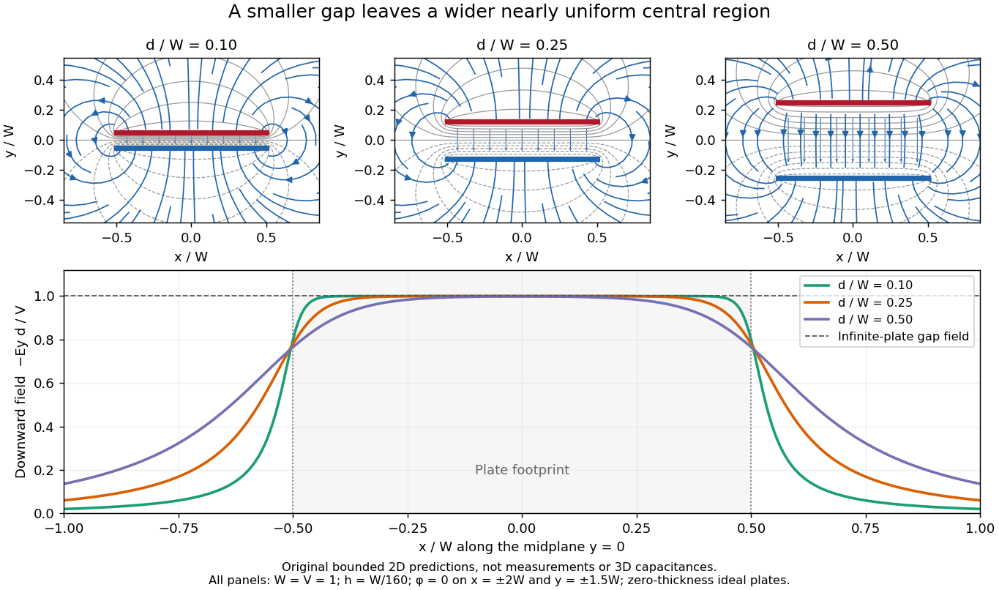

# Capacitor gap aspect ratio

↑ **Parent:** [Fringing field of a capacitor](fringing-field-of-a-capacitor.md)

The [capacitor gap aspect ratio](capacitor-gap-aspect-ratio.md) compares the gap $d$ with a lateral plate width $W$. For rectangular plates of widths $W_x,W_z$, require both $d/W_x\ll1$ and $d/W_z\ll1$ for the leading [parallel-plate capacitor](parallel-plate-capacitor.md) approximation. Large [area](surface-area.md) alone is insufficient: a long narrow strip can have large [area](surface-area.md) and still have $d$ comparable with its smaller width. In addition, the observation point must be many gap widths from an edge. Reducing $d/W$ improves the interior approximation without making the edge itself disappear.

In a two-dimensional straight gap, write the [electric potential](electric-potential.md) as the infinite-plate solution plus a perturbation:

$$
\phi(x,y)=\frac{V}{d}y+\delta\phi(x,y),\qquad -\frac d2<y<\frac d2.
$$

The perturbation satisfies the [Laplace equation](laplace-equation.md) and vanishes on the two ideal plates. [Separation of variables](separation-of-variables.md) in a semi-infinite strip, with $s$ the distance inward from its entrance, gives transverse modes

$$
\delta\phi_n(s,y)=a_n e^{-n\pi s/d}\sin\!\left(\frac{n\pi(y+d/2)}{d}\right),\qquad n=1,2,\ldots.
$$

Thus edge disturbances have a natural penetration scale set by $d$. Modes forbidden by a particular [symmetry](symmetry-physics.md) have zero coefficients; this expression is an explanation of localization in an ideal strip, not a universal numerical correction to finite-plate [capacitance](capacitance.md). The outside [boundary conditions](boundary-condition.md) determine the coefficients.

**[Figure 3](#image-capacitor-gap-aspect-ratio-and-the-width-of-the-nearly-uniform-electric-field-region). Capacitor gap aspect ratio and the width of the nearly uniform electric field region**. Three original solutions of the same [bounded two-dimensional capacitor field model](bounded-two-dimensional-capacitor-field-model.md) at $d/W=0.10,0.25,0.50$. The lower curves show $-E_y d/V$ on the midplane $y=0$; the dashed reference is the infinite-plate value inside the gap. The dashed value is not the infinite-plate prediction outside the plate footprint. All curves are calculated, with the same mesh and outer [Dirichlet boundary conditions](dirichlet-boundary-condition.md); they are neither measurements nor an exact open-domain three-dimensional [capacitance](capacitance.md) calculation.

There is no single aspect-ratio cutoff guaranteeing an assigned accuracy: the requested observable, plate shape and thickness, surroundings, [dielectric](dielectric.md) distribution, and guard geometry all matter. The small-gap approximation is local and is not uniform across an edge. It also does not justify extrapolating $C\simeq\epsilon A/d$ to arbitrarily large $d$, where finite [electrical conductors](electrical-conductor.md) and their external [electric field](electric-field-split.md) dominate. At fixed $V$, formally shrinking an ideal gap makes the interior [electric field](electric-field-split.md) grow like $1/d$; real [electric currents](electric-current.md) across an imperfectly insulating gap, surface roughness and contact eventually invalidate that ideal limit.

## ↑ Ancestors (7)

1. [Fringing field of a capacitor](fringing-field-of-a-capacitor.md)
2. [Parallel-plate capacitor](parallel-plate-capacitor.md)
3. [Capacitor](capacitor.md)
4. [Electromagnetism](electromagnetism-split.md)
5. [Branches of physics](branches-of-physics.md)
6. [Physics](physics-split.md)
7. [Codex Wiki](split.md)

## ← Incoming links (1)

- [Capacitor gap aspect ratio](capacitor-gap-aspect-ratio.md)
