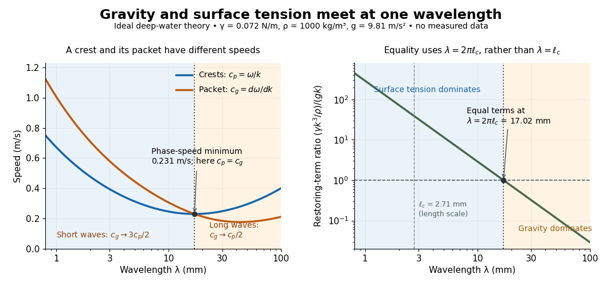

# Capillary length

↑ **Parent:** [Surface tension](surface-tension-split.md)  
ⓦ [Wiki](https://en.wikipedia.org/wiki/Capillary_length)

The [capillary length](capillary-length.md) measures when [gravity](gravity.md) and [surface tension](surface-tension-split.md) are comparably important in shaping a [liquid](liquid.md) interface. For a [liquid](liquid.md) of uniform [mass density](density.md) $\rho$, beneath a [gas](gas.md) whose [mass density](density.md) is negligible, with uniform [gravitational acceleration](gravitational-acceleration.md) $g>0$ and constant [surface tension](surface-tension-split.md) $\gamma>0$,

$$
\ell_c=\sqrt{\frac{\gamma}{\rho g}}.
$$

A deformation of height $a$ and horizontal length scale $L$ has [hydrostatic pressure](hydrostatic-pressure.md) variation of order $\rho ga$ and small-slope [capillary pressure](capillary-pressure.md) of order $\gamma a/L^2$. Equating these gives $L\sim\ell_c$: [surface tension](surface-tension-split.md) smooths small features, whereas [gravity](gravity.md) matters for broad ones. For two resting [fluids](fluid.md), replace $\rho$ by their positive [mass density](density.md) difference $\Delta\rho$ in this static balance. This change alone does not give the two-fluid [wave](wave-split.md) dynamics, because both [fluids](fluid.md) can have inertia. [John W. M. Bush, Interfacial Phenomena, chapters 5–6: curvature and hydrostatic pressure](https://ocw.mit.edu/courses/18-357-interfacial-phenomena-fall-2010/04759cfc15c79928ca9f72a18b3864dd_MIT18_357F10_lec_all.pdf)

With the stipulated illustrative parameters $\gamma=0.072\,\mathrm{N\,m^{-1}}$, $\rho=1000\,\mathrm{kg\,m^{-3}}$, and $g=9.81\,\mathrm{m\,s^{-2}}$, the [capillary length](capillary-length.md) is $\ell_c=2.71\,\mathrm{mm}$. These parameters define the ideal calculations below; they are not a measurement of a particular sample.

**[Figure 3](#image-the-gravity-capillary-wave-crossover-occurs-at-wavelength-2-pi-ell-c-where-phase-speed-is-smallest). The gravity-capillary wave crossover occurs at wavelength $2\pi\ell_c$, where phase speed is smallest**. Calculated [phase velocity](phase-velocity.md) and [group velocity](group-velocity.md) magnitudes, and the ratio of the [surface tension](surface-tension-split.md) and [gravity](gravity.md) terms in the deep-water [dispersion relation](dispersion-relation-split.md), for the stipulated $\gamma$, $\rho$ and $g$. The [capillary length](capillary-length.md) is $2.71\,\mathrm{mm}$, while the equality [wavelength](wavelength.md) is $17.02\,\mathrm{mm}$. Both panels show ideal theory, without experimental data.

For a [sinusoid](sinusoid.md) with [wavenumber](wavenumber.md) $k>0$, the relevant horizontal scale is $L=1/k$, while its [wavelength](wavelength.md) is $\lambda=2\pi/k$. Thus the [Bond number](bond-number.md) for this scale and the reciprocal restoring-term ratio are

$$
\mathrm{Bo}_{1/k}=\frac{\rho g}{\gamma k^2}
=\frac{1}{(k\ell_c)^2}
=\left(\frac{\lambda}{2\pi\ell_c}\right)^2,
\qquad
\frac{\text{capillary term}}{\text{gravity term}}
=(k\ell_c)^2.
$$

Equality is at $k_c=1/\ell_c$, hence $\lambda_c=2\pi\ell_c=17.02\,\mathrm{mm}$ for these parameters. Using $L=\lambda$ instead produces a different numerical [Bond number](bond-number.md); state the length convention. The [capillary length](capillary-length.md) itself is not the equality [wavelength](wavelength.md). This distinction helps choose whether a measured ripple should be modeled as a [surface gravity wave](surface-gravity-wave.md), a nearly pure [capillary wave](capillary-wave.md), or a [gravity-capillary wave](gravity-capillary-wave.md). [David Tong, Fluid Mechanics, §4.1.3, equations (4.23)–(4.24) and the wavelength factor $2\pi$](https://davidtong.org/pdfs/teaching/fluid-mechanics/fluids3.pdf)

## ↑ Ancestors (5)

1. [Surface tension](surface-tension-split.md)
2. [Fluid mechanics](fluid-mechanics-split.md)
3. [Branches of physics](branches-of-physics.md)
4. [Physics](physics-split.md)
5. [Codex Wiki](split.md)

## ← Incoming links (10)

- [Capillary length](capillary-length.md)
- [Finite-aperture stabilization of an inverted liquid surface](finite-aperture-stabilization-of-an-inverted-liquid-surface.md)
- [Gravity-capillary wave](gravity-capillary-wave.md)
- [Gravity smoothing of a Marangoni front](gravity-smoothing-of-a-marangoni-front.md)
- [Laser-diffraction measurement of capillary waves](laser-diffraction-measurement-of-capillary-waves.md)
- [Solution](past-exam-of-the-astrophysical-fluid-dynamics-course-of-the-university-of-cambridge/2019/section-a/3/solution.md)
- [Solution](past-exam-of-the-mathematics-course-of-the-university-of-cambridge/2015/iii/paper-73/3/solution.md)
- [Solution](past-exam-of-the-mathematics-course-of-the-university-of-cambridge/2026/iii/paper-329/3/c/solution.md)
- [Solution](past-exam-of-the-soft-condensed-matter-course-of-the-university-of-cambridge/2012/paper-1/2/b/solution.md)
- [Solution](past-exam-of-the-soft-condensed-matter-course-of-the-university-of-cambridge/2022/section-a/1/solution.md)
