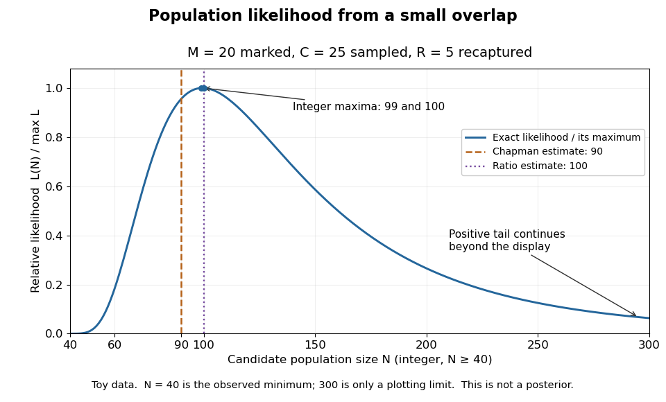

# Capture-recapture model

↑ **Parent:** [Mark and recapture](mark-and-recapture.md)

A [capture-recapture model](capture-recapture-model.md) is a [statistical model](statistical-model-split.md) for repeated observations of identifiable individuals, including those missed on some occasions. A [closed-population capture-recapture model](closed-population-capture-recapture-model.md) estimates a fixed population [cardinality](cardinality.md); models allowing individuals to enter or leave can instead describe survival and recruitment. The sampling assumptions determine which [likelihood function](likelihood-function.md) is appropriate.

For the two-sample [closed-population capture-recapture model](closed-population-capture-recapture-model.md), condition on the [sample sizes](sample-size.md) $M$ and $C$. If the second sample selects $C$ distinct individuals from $N$ by [simple random sampling](simple-random-sampling.md), then the overlap $R$ has the [hypergeometric distribution](hypergeometric-distribution.md):

$$
\mathbb P(R=r\mid N,M,C)
=\frac{\binom Mr\binom{N-M}{C-r}}{\binom NC},
\qquad \max(0,M+C-N)\leq r\leq\min(M,C).
$$

Here $r$ is an [integer](integer-split.md) and the [probability mass function](probability-mass-function.md) is zero outside these bounds. The [binomial coefficients](binomial-coefficient-split.md) count choices of $r$ marked and $C-r$ unmarked individuals, divided by all equally likely size-$C$ [subsets](subset.md). The [hypergeometric distribution](hypergeometric-distribution.md) has [expected value](expected-value-split.md)

$$
\mathbb E[R\mid N,M,C]=\frac{MC}{N}.
$$

Equating the observed overlap with this [expected value](expected-value-split.md) gives the [Lincoln-Petersen estimator](lincoln-petersen-estimator.md). The underlying [sampling without replacement](sampling-without-replacement.md), [probability mass function](probability-mass-function.md), and [expected value](expected-value-split.md) are developed in [Raymond P. Guiteras, MIT 14.30 hypergeometric distribution handout, §§1–4 and 8](https://web.mit.edu/14.380/www/handouts/hypergeometric.pdf).

For the toy counts $M=20$, $C=25$, and $R=5$, hold the observations fixed and vary the unknown [integer](integer-split.md) $N$. The [likelihood function](likelihood-function.md) is

$$
L(N)=\frac{\binom{20}{5}\binom{N-20}{20}}{\binom N{25}},
\qquad N=40,41,42,\ldots.
$$

Values below forty cannot contain the observed [set union](set-union.md). Exact comparison of consecutive [likelihoods](likelihood-function.md) gives two tied [maximum-likelihood estimates](maximum-likelihood-estimator.md), $N=99$ and $N=100$. The [Lincoln-Petersen estimator](lincoln-petersen-estimator.md) returns $100$; the [Chapman estimator](chapman-estimator.md) returns $90$ and is a different rule for [estimation](statistical-estimation.md).

**[Figure 2](#image-relative-likelihood-for-the-toy-overlap-integer-maxima-at-99-and-100-ratio-estimate-100-and-chapman-estimate-90). Relative likelihood for the toy overlap: integer maxima at 99 and 100, ratio estimate 100, and Chapman estimate 90**.

The vertical scale is $L(N)/\max_{n\geq40}L(n)$. This relative [likelihood](likelihood-function.md) compares how well candidate [statistical parameters](statistical-parameter.md) explain the same observations; it is not a [posterior probability](posterior-probability.md). The displayed range $40\leq N\leq300$ is only a plotting window. The [likelihood function](likelihood-function.md) remains positive for every [integer](integer-split.md) $N\geq40$ and tends to zero as $N$ increases, so the curve has a continuing right tail. The data do not justify truncating [statistical inference](statistical-inference-split.md) at three hundred. The conditional [hypergeometric distribution](hypergeometric-distribution.md) formulation also appears in [Louis-Paul Rivest and Mamadou Yauck, Small Sample Estimators for Two-way Capture Recapture Experiments, §3, equation (5)](https://arxiv.org/html/2307.11705v1#S3).

Zero recaptures require care. With $R=0$ and positive $M,C$, the [Lincoln-Petersen estimator](lincoln-petersen-estimator.md) has no finite ratio, but the [capture-recapture model](capture-recapture-model.md) still gives a valid [likelihood function](likelihood-function.md):

$$
L_0(N)=\frac{\binom{N-M}{C}}{\binom NC},
\qquad N\geq M+C.
$$

This [likelihood function](likelihood-function.md) increases toward one as $N$ grows, so there is no finite [maximum-likelihood estimate](maximum-likelihood-estimator.md). For the same [sample sizes](sample-size.md) twenty and twenty-five with zero overlap, forty-five distinct individuals would be observed. Lack of overlap supplies a lower bound but very weak information about large population [cardinalities](cardinality.md).

In more elaborate [capture-recapture models](capture-recapture-model.md), a first-recapture array $m_{ij}$ counts individuals released at occasion $i$ and next observed at $j$. A [probability](probability.md) of survival $\phi_j$ and a [probability](probability.md) of detection $P_{j+1}$ contribute a no-observation continuation factor $\phi_j(1-P_{j+1})$. The resulting [likelihood function](likelihood-function.md) depends on both survival and detection; these [probabilities](probability.md) need not be separately identifiable at the last observation interval. [Missing-count EM for capture-recapture](missing-count-em-for-capture-recapture.md) describes one way to fit such a model, and [identifiability](identifiability.md) remains a separate issue from computing an [estimator](estimator.md) output.

**Table of contents**

- [Closed-population capture-recapture model](closed-population-capture-recapture-model.md)
  - [Lincoln-Petersen estimator](lincoln-petersen-estimator.md)
  - [Chapman estimator](chapman-estimator.md)
- [Missing-count EM for capture-recapture](missing-count-em-for-capture-recapture.md)

## ↑ Ancestors (7)

1. [Mark and recapture](mark-and-recapture.md)
2. [Statistical modelling](statistical-modelling-split.md)
3. [Statistical model](statistical-model-split.md)
4. [Probability and statistics](probability-and-statistics-split.md)
5. [Area of mathematics](area-of-mathematics.md)
6. [Mathematics](mathematics-split.md)
7. [Codex Wiki](split.md)

## ← Incoming links (4)

- [Capture-recapture model](capture-recapture-model.md)
- [Chapman estimator](chapman-estimator.md)
- [Closed-population capture-recapture model](closed-population-capture-recapture-model.md)
- [Mark and recapture](mark-and-recapture.md)
