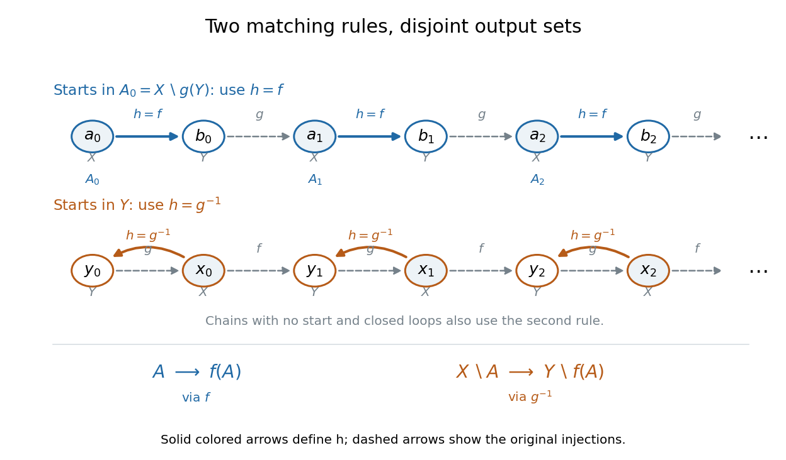

# Cardinal number

↑ **Parent:** [Set theory](set-theory.md)  
ⓦ [Wiki](https://en.wikipedia.org/wiki/Cardinal_number)

In the presence of choice, a cardinal number may be represented by the least ordinal in its bijection class.

**Table of contents**

- [Limit cardinal](#limit-cardinal)
- [Cardinality](#cardinality)
- [Successor cardinal](#successor-cardinal)
- [Cofinality](#cofinality)
  - [Cofinality of a continuous cardinal hierarchy](#cofinality-of-a-continuous-cardinal-hierarchy)
  - [Cofinal map](#cofinal-map)
  - [Cofinality of an increasing ordinal supremum](#cofinality-of-an-increasing-ordinal-supremum)
  - [Singular cardinal](#singular-cardinal)
    - [Bukovský-Hechler theorem](#bukovsky-hechler-theorem)
    - [Singular cardinal enumeration](#singular-cardinal-enumeration)
      - [Cardinal fixed point of the singular cardinal enumeration](#cardinal-fixed-point-of-the-singular-cardinal-enumeration)
    - [Singular cardinals hypothesis](#singular-cardinals-hypothesis)
  - [Cofinal function](#cofinal-function)
  - [Regular cardinal](#regular-cardinal)
- [Large cardinal](#large-cardinal)
  - [Supercompact cardinal](#supercompact-cardinal)
    - [Supercompact Sigma-two downward reflection](#supercompact-sigma-two-downward-reflection)
  - [Mahlo cardinal](#mahlo-cardinal)
    - [Mahloness is downward absolute to the constructible universe](#mahloness-is-downward-absolute-to-the-constructible-universe)
  - [Weakly inaccessible cardinal](#weakly-inaccessible-cardinal)
    - [Weakly Mahlo cardinal](#weakly-mahlo-cardinal)
    - [Model of ZFC without weakly inaccessible cardinals](#model-of-zfc-without-weakly-inaccessible-cardinals)
  - [Strong limit cardinal](#strong-limit-cardinal)
    - [Singular strong limit power-set identity](#singular-strong-limit-power-set-identity)
  - [Strongly inaccessible cardinal](#strongly-inaccessible-cardinal)
    - [Inaccessible limit of inaccessibles](#inaccessible-limit-of-inaccessibles)
      - [Rank cutoff at the first inaccessible limit of inaccessibles](#rank-cutoff-at-the-first-inaccessible-limit-of-inaccessibles)
    - [Keisler extension property](#keisler-extension-property)
  - [Worldly cardinal](#worldly-cardinal)
    - [Worldly cardinals below an inaccessible cardinal](#worldly-cardinals-below-an-inaccessible-cardinal)
    - [Nested transitive models from a worldly cardinal](#nested-transitive-models-from-a-worldly-cardinal)
    - [Arithmetic absoluteness for a rank-initial model](#arithmetic-absoluteness-for-a-rank-initial-model)
  - [Kappa-satisfiable theory](#kappa-satisfiable-theory)
  - [Least-occurrence order on cardinal properties](#least-occurrence-order-on-cardinal-properties)
    - [Nontransitivity of the least-occurrence order on cardinal properties](#nontransitivity-of-the-least-occurrence-order-on-cardinal-properties)
  - [Weakly compact cardinal](#weakly-compact-cardinal)
  - [Measurable cardinal](#measurable-cardinal)
    - [Omega-measurable cardinal](#omega-measurable-cardinal)
      - [Least omega-measurable cardinal is measurable](#least-omega-measurable-cardinal-is-measurable)
    - [Measurable cardinal is a strong limit cardinal](#measurable-cardinal-is-a-strong-limit-cardinal)
    - [Measurable cardinal is one-strong](#measurable-cardinal-is-one-strong)
    - [Two measurable cardinals under an ultrapower embedding](#two-measurable-cardinals-under-an-ultrapower-embedding)
    - [Moved critical point is not an ambient cardinal under GCH](#moved-critical-point-is-not-an-ambient-cardinal-under-gch)
  - [Strongly compact cardinal](#strongly-compact-cardinal)
- [Countable set](#countable-set)
  - [Countability of disjoint positive-length intervals](#countability-of-disjoint-positive-length-intervals)
  - [Countability of finite subsets of a countable set](#countability-of-finite-subsets-of-a-countable-set)
  - [Cardinalities of monotone natural-number functions](#cardinalities-of-monotone-natural-number-functions)
  - [Countability of integer polynomial rings](#countability-of-integer-polynomial-rings)
  - [Countable closure under real polynomial roots](#countable-closure-under-real-polynomial-roots)
  - [Countability of pairwise disjoint open disks](#countability-of-pairwise-disjoint-open-disks)
  - [Increasing chain of countable sets](#increasing-chain-of-countable-sets)
    - [Cardinal bound for an increasing chain of countable sets](#cardinal-bound-for-an-increasing-chain-of-countable-sets)
  - [Finite Cartesian power of a countable set](#finite-cartesian-power-of-a-countable-set)
  - [Countable union of explicitly ordered finite lists without choice](#countable-union-of-explicitly-ordered-finite-lists-without-choice)
  - [Countability from vanishing averages of distinct sequences](#countability-from-vanishing-averages-of-distinct-sequences)
  - [Countably infinite set](#countably-infinite-set)
    - [Increasing enumeration of an infinite subset of natural numbers](#increasing-enumeration-of-an-infinite-subset-of-natural-numbers)
  - [Countable union of countable sets](#countable-union-of-countable-sets)
    - [Parabola obstruction to countable line coverings](#parabola-obstruction-to-countable-line-coverings)
  - [Cantor pairing function](#cantor-pairing-function)
  - [Cantor's diagonal argument](#cantor-s-diagonal-argument)
- [Uncountable set](#uncountable-set)
  - [Uncountability of permutations of a countably infinite set](#uncountability-of-permutations-of-a-countably-infinite-set)
  - [Uncountability of surjections onto a nontrivial finite set](#uncountability-of-surjections-onto-a-nontrivial-finite-set)
- [Initial ordinal](#initial-ordinal)
  - [Aleph number](#aleph-number)
    - [Every infinite cardinal is an aleph](#every-infinite-cardinal-is-an-aleph)
- [Cardinal arithmetic](#cardinal-arithmetic)
  - [Gimel function](#gimel-function)
    - [Gimel recursion for cardinal exponentiation](#gimel-recursion-for-cardinal-exponentiation)
    - [Gimel hypothesis](#gimel-hypothesis)
  - [Beth number](#beth-number)
  - [Product-sum comparison lemma](#product-sum-comparison-lemma)
  - [Infinite cardinal arithmetic](#infinite-cardinal-arithmetic)
    - [Currying law for cardinal exponentiation](#currying-law-for-cardinal-exponentiation)
    - [Square of an infinite cardinal](#square-of-an-infinite-cardinal)
    - [Sum and product of two infinite cardinals](#sum-and-product-of-two-infinite-cardinals)
    - [Cardinality of a finite union of infinite sets](#cardinality-of-a-finite-union-of-infinite-sets)
    - [Countable family of distinct infinite cardinalities with a largest member](#countable-family-of-distinct-infinite-cardinalities-with-a-largest-member)
    - [Cardinal exponentiation between two and the exponent](#cardinal-exponentiation-between-two-and-the-exponent)
  - [Kőnig's theorem (set theory)](#konig-s-theorem-set-theory)
  - [Hausdorff formula for cardinal exponentiation](#hausdorff-formula-for-cardinal-exponentiation)
  - [Continuum hypothesis](#continuum-hypothesis)
    - [Freiling axiom of symmetry](#freiling-axiom-of-symmetry)
      - [Freiling theorem](#freiling-theorem)
    - [Generalized continuum hypothesis](#generalized-continuum-hypothesis)
- [Cantor-Schröder-Bernstein theorem](#cantor-schroder-bernstein-theorem)
  - [Sparse-shift bijection between nonnegative and positive integers](#sparse-shift-bijection-between-nonnegative-and-positive-integers)
  - [Injection-chain proof of the Cantor-Schröder-Bernstein theorem](#injection-chain-proof-of-the-cantor-schroder-bernstein-theorem)

## Limit cardinal

↑ **Parent:** [Cardinal number](cardinal-number.md)

An infinite [cardinal number](cardinal-number.md) is a limit cardinal if it is not a [successor cardinal](#successor-cardinal); equivalently it is an [aleph number](#aleph-number) with zero or a [limit ordinal](ordinal.md#limit-ordinal) as index. Uncountable limit cardinals are either [singular cardinals](#singular-cardinal) or [weakly inaccessible cardinals](#weakly-inaccessible-cardinal). This concerns succession among cardinals, rather than merely being a [limit ordinal](ordinal.md#limit-ordinal).

## Cardinality

↑ **Parent:** [Cardinal number](cardinal-number.md)  
ⓦ [Wiki](https://en.wikipedia.org/wiki/Cardinality)

The cardinality $|X|$ of a [set](set.md) $X$ expresses its size up to [bijection](function.md#bijection). Two [sets](set.md) have the same cardinality exactly when a [bijection](function.md#bijection) pairs their members. For a [finite set](set.md#finite-set), cardinality is the ordinary number of [set elements](set.md#element-of-a-set). In the presence of the [axiom of choice](set-theory.md#axiom-of-choice), every [set](set.md) can be assigned the least [ordinal](ordinal.md) in its [bijection](function.md#bijection) class as its [cardinal number](cardinal-number.md).

An [injective function](algebra.md#injective-function) $A\to B$ shows that $A$ is no larger than $B$: different members of $A$ receive different partners in $B$. If there are [injections](algebra.md#injective-function) in both directions, the [Cantor-Schröder-Bernstein theorem](#cantor-schroder-bernstein-theorem) supplies a [bijection](function.md#bijection). Infinite [cardinality](#cardinality) records this pairing structure rather than a geometric dimension or density. That is why a line of [natural numbers](arithmetic.md#natural-number) and a grid of natural-number pairs can have the same size, while an interval of [real numbers](arithmetic.md#real-number) has larger [cardinality](#cardinality).

## Successor cardinal

↑ **Parent:** [Cardinal number](cardinal-number.md)  
ⓦ [Wiki](https://en.wikipedia.org/wiki/Successor_cardinal)

The successor cardinal $\kappa^+$ is the least [cardinal number](cardinal-number.md) strictly larger than $\kappa$.

## Cofinality

↑ **Parent:** [Cardinal number](cardinal-number.md)  
ⓦ [Wiki](https://en.wikipedia.org/wiki/Cofinality)

The cofinality of an ordinal $\alpha$ is the least [order type](ordinal.md#order-type) of an unbounded subset of $\alpha$, equivalently the least ordinal $\beta$ admitting a cofinal function $\beta\to\alpha$.

### Cofinality of a continuous cardinal hierarchy

↑ **Parent:** [Cofinality](#cofinality)

At a nonzero [limit ordinal](ordinal.md#limit-ordinal) $\delta$, a strictly increasing continuous sequence of [cardinals](cardinal-number.md) $(\kappa_\alpha)_{\alpha\le\delta}$ satisfies $\operatorname{cf}(\kappa_\delta)=\operatorname{cf}(\delta)$. A cofinal sequence of indices gives the upper bound. Conversely, bounds for a cofinal [set](set.md) of values must have cofinal indices, giving the lower bound. In particular the assertion applies to [Beth numbers](#beth-number).

### Cofinal map

↑ **Parent:** [Cofinality](#cofinality)

A map $f:\delta\to\alpha$ whose range is cofinal: every $\xi<\alpha$ lies below or equals some $f(\eta)$. It need not be increasing.

### Cofinality of an increasing ordinal supremum

↑ **Parent:** [Cofinality](#cofinality)

If $\alpha$ is a nonzero [limit ordinal](ordinal.md#limit-ordinal) and $(\gamma_\xi)_{\xi<\alpha}$ is strictly increasing, then $\operatorname{cf}(\sup_{\xi<\alpha}\gamma_\xi)=\operatorname{cf}(\alpha)$. A cofinal subsequence of the index order gives one inequality. Conversely, a cofinal family in the supremum determines a cofinal family of indices by choosing an index past each of its values. This also explains the [cofinality](#cofinality) of limit-indexed [aleph numbers](#aleph-number).

### Singular cardinal

↑ **Parent:** [Cofinality](#cofinality)

An infinite [cardinal number](cardinal-number.md) $\kappa$ is singular when $\operatorname{cf}(\kappa)<\kappa$. Thus a short [cofinal function](#cofinal-function) reaches arbitrarily high ordinals below $\kappa$. For example, $\aleph_\omega$ has [cofinality](#cofinality) $\omega$. The complementary case is a [regular cardinal](#regular-cardinal).

<h4 id="bukovsky-hechler-theorem">Bukovský-Hechler theorem</h4>

↑ **Parent:** [Singular cardinal](#singular-cardinal)

If the power-set [function](function.md) is eventually constant below a [singular cardinal](#singular-cardinal) $\kappa$, its constant value persists at $\kappa$. Writing $\theta=\operatorname{cf}(\kappa)$ gives $2^\kappa=(2^{<\kappa})^\theta$. On the plateau choose a [cardinal](cardinal-number.md) $\mu\ge\theta$, so $(2^\mu)^\theta=2^{\mu\cdot\theta}=2^\mu$.

#### Singular cardinal enumeration

↑ **Parent:** [Singular cardinal](#singular-cardinal)

Write $\sigma_\alpha$ for the $\alpha$th uncountable [singular cardinal](#singular-cardinal) in increasing order. It begins with $\sigma_0=\aleph_\omega$ and $\sigma_1=\aleph_{\omega+\omega}$. At a nonzero [limit ordinal](ordinal.md#limit-ordinal) index it is continuous exactly when the supremum of its earlier values is singular. It can jump when that supremum is a [weakly inaccessible cardinal](#weakly-inaccessible-cardinal). The first member of uncountable [cofinality](#cofinality) occurs at index $\omega_1$, with value $\aleph_{\omega_1}$.

##### Cardinal fixed point of the singular cardinal enumeration

↑ **Parent:** [Singular cardinal enumeration](#singular-cardinal-enumeration)

There is an uncountable [cardinal number](cardinal-number.md) $\kappa$ with $\sigma_\kappa=\kappa$. Iterate $\kappa_{n+1}=\sigma_{\kappa_n}$ starting with $\aleph_0$. If there is no earlier fixed point, the increasing supremum $\kappa$ has countable [cofinality](#cofinality), hence is a [singular cardinal](#singular-cardinal). The [singular cardinal enumeration](#singular-cardinal-enumeration) is cofinal in $\kappa$ below index $\kappa$, and continuity at this singular supremum gives equality.

#### Singular cardinals hypothesis

↑ **Parent:** [Singular cardinal](#singular-cardinal)

The singular cardinals hypothesis asserts that every infinite [singular cardinal](#singular-cardinal) $\kappa$ satisfies

$$
2^{\operatorname{cf}(\kappa)}<\kappa\ \Longrightarrow\ \gimel(\kappa)=\kappa^+.
$$

Equivalently, $\gimel(\kappa)=\max\{\kappa^+,2^{\operatorname{cf}(\kappa)}\}$ for every infinite [singular cardinal](#singular-cardinal). Here $\gimel$ is the [gimel function](#gimel-function). The [Generalized continuum hypothesis](#generalized-continuum-hypothesis) implies this principle, but the principle only constrains the indicated singular-cardinal exponentiation.

### Cofinal function

↑ **Parent:** [Cofinality](#cofinality)

A function $f:\beta\to\alpha$ between ordinals is cofinal when its range is unbounded in $\alpha$: for every $\gamma<\alpha$ some $\xi<\beta$ satisfies $\gamma\leq f(\xi)$.

### Regular cardinal

↑ **Parent:** [Cofinality](#cofinality)  
ⓦ [Wiki](https://en.wikipedia.org/wiki/Regular_cardinal)

An infinite cardinal $\kappa$ is regular when its cofinality is $\kappa$.

## Large cardinal

↑ **Parent:** [Cardinal number](cardinal-number.md)  
ⓦ [Wiki](https://en.wikipedia.org/wiki/Large_cardinal)

A large cardinal property strengthens uncountability by imposing combinatorial, logical, measure-like, or elementary-embedding structure whose existence is not provable in ZFC if ZFC is consistent.

### Supercompact cardinal

↑ **Parent:** [Large cardinal](#large-cardinal)  
ⓦ [Wiki](https://en.wikipedia.org/wiki/Supercompact_cardinal)

A [cardinal](cardinal-number.md) $\kappa$ is supercompact if for every cardinal $\lambda\geq\kappa$ there is an [elementary embedding](set-theory.md#elementary-embedding) $j:V\to M$ into a transitive class with [critical point of an elementary embedding](set-theory.md#critical-point-of-an-elementary-embedding) $\kappa$, $j(\kappa)>\lambda$, and $M^\lambda\subseteq M$. This closure supplies every sufficiently small rank segment needed to transfer existential witnesses into $M$.

#### Supercompact Sigma-two downward reflection

↑ **Parent:** [Supercompact cardinal](#supercompact-cardinal)

If $\kappa$ is a [supercompact cardinal](#supercompact-cardinal), each true $\Sigma_2$ statement, allowing parameters in $V_\kappa$, holds in $V_\kappa$. Write it as an existential witness followed by a $\Pi_1$ assertion. Choose a supercompact [elementary embedding](set-theory.md#elementary-embedding) whose transitive target contains the witness in $V_{j(\kappa)}$. Downward absoluteness of the universal bounded-matrix assertion puts the witness in that rank segment, and elementarity reflects this to $V_\kappa$.

### Mahlo cardinal

↑ **Parent:** [Large cardinal](#large-cardinal)

An inaccessible cardinal $\kappa$ whose inaccessible ordinals below it form a stationary set. Equivalently, every predicate expansion of $V_\kappa$ has an inaccessible elementary rank level below $\kappa$.

#### Mahloness is downward absolute to the constructible universe

↑ **Parent:** [Mahlo cardinal](#mahlo-cardinal)

If $\kappa$ is Mahlo in $V$, then it is Mahlo in $L$. Inaccessibility is downward absolute, and every club in $L$ remains a club in $V$, where it meets a $V$-inaccessible ordinal.

### Weakly inaccessible cardinal

↑ **Parent:** [Large cardinal](#large-cardinal)

A weakly inaccessible cardinal is an uncountable [regular cardinal](#regular-cardinal) that is a [limit cardinal](#limit-cardinal). It need not be a [strong limit cardinal](#strong-limit-cardinal). Under the [Generalized continuum hypothesis](#generalized-continuum-hypothesis), it is a [strongly inaccessible cardinal](#strongly-inaccessible-cardinal), since every smaller infinite $\lambda$ satisfies $2^\lambda=\lambda^+<\kappa$.

#### Weakly Mahlo cardinal

↑ **Parent:** [Weakly inaccessible cardinal](#weakly-inaccessible-cardinal)

A [weakly inaccessible cardinal](#weakly-inaccessible-cardinal) $\kappa$ is weakly Mahlo if $\{\alpha<\kappa:\alpha=\operatorname{cf}(\alpha)\}$ is a [stationary set](ordinal.md#stationary-set). Intersecting this set with the [club set](ordinal.md#club-set) of uncountable [limit cardinals](#limit-cardinal) shows that the weakly inaccessible cardinals below $\kappa$ are stationary, hence unbounded.

#### Model of ZFC without weakly inaccessible cardinals

↑ **Parent:** [Weakly inaccessible cardinal](#weakly-inaccessible-cardinal)

Consistency of [ZFC](set-theory.md#zermelo-fraenkel-set-theory-with-choice) implies consistency of [ZFC](set-theory.md#zermelo-fraenkel-set-theory-with-choice) with the [Generalized continuum hypothesis](#generalized-continuum-hypothesis) and no [weakly inaccessible cardinals](#weakly-inaccessible-cardinal). Pass to the [constructible universe](definable-power-set.md#constructible-universe). If it has an inaccessible, cut at its least one; that rank segment still models [ZFC](set-theory.md#zermelo-fraenkel-set-theory-with-choice) and the [Generalized continuum hypothesis](#generalized-continuum-hypothesis), but has no inaccessibles. In this model the [singular cardinal enumeration](#singular-cardinal-enumeration) is continuous at every nonzero [limit ordinal](ordinal.md#limit-ordinal) index. This is a relative-consistency construction, not a deduction of a [transitive model](set-theory.md#transitive-model) from bare consistency.

### Strong limit cardinal

↑ **Parent:** [Large cardinal](#large-cardinal)  
ⓦ [Wiki](https://en.wikipedia.org/wiki/Strong_limit_cardinal)

A cardinal $\kappa$ is a strong limit when $2^\lambda<\kappa$ for every cardinal $\lambda<\kappa$.

#### Singular strong limit power-set identity

↑ **Parent:** [Strong limit cardinal](#strong-limit-cardinal)

For a singular [strong limit cardinal](#strong-limit-cardinal) $\lambda$, let $\mu=\operatorname{cf}(\lambda)$ and choose cofinal cardinals $\lambda_i<\lambda$. Subset restrictions inject $\mathcal P(\lambda)$ into $\prod_{i<\mu}\mathcal P(\lambda_i)$, whose cardinal is at most $\lambda^\mu$ by the strong-limit property. Conversely $\lambda^\mu\le(2^\lambda)^\mu=2^\lambda$. This equality alone does not imply the [singular cardinals hypothesis](#singular-cardinals-hypothesis).

### Strongly inaccessible cardinal

↑ **Parent:** [Large cardinal](#large-cardinal)

A strongly inaccessible cardinal is an uncountable regular strong limit cardinal.

#### Inaccessible limit of inaccessibles

↑ **Parent:** [Strongly inaccessible cardinal](#strongly-inaccessible-cardinal)

An [inaccessible cardinal](#strongly-inaccessible-cardinal) $\iota$ is an inaccessible limit of inaccessibles if the inaccessible cardinals below it are unbounded in $\iota$. A [rank cutoff at the first inaccessible limit of inaccessibles](#rank-cutoff-at-the-first-inaccessible-limit-of-inaccessibles) shows that existence of unboundedly many inaccessibles does not prove existence of such a limit, provided the former theory is consistent.

##### Rank cutoff at the first inaccessible limit of inaccessibles

↑ **Parent:** [Inaccessible limit of inaccessibles](#inaccessible-limit-of-inaccessibles)

If $\iota$ is the least [inaccessible limit of inaccessibles](#inaccessible-limit-of-inaccessibles), $V_\iota$ models [ZFC](set-theory.md#zermelo-fraenkel-set-theory-with-choice) and internally has unboundedly many [inaccessible cardinals](#strongly-inaccessible-cardinal), while none of its ordinals is an [inaccessible limit of inaccessibles](#inaccessible-limit-of-inaccessibles). Rank agreement makes inaccessibility below $\iota$ absolute. If a model of unboundedly many inaccessibles has no such limit in the first place, no cutoff is needed. This proves the corresponding relative-consistency nonimplication.

#### Keisler extension property

↑ **Parent:** [Strongly inaccessible cardinal](#strongly-inaccessible-cardinal)

An inaccessible cardinal $\kappa$ has the Keisler extension property when there is a proper [transitive set](set-theory.md#transitive-set) $X\supsetneq V_\kappa$ for which

$$
(V_\kappa,\in)\prec(X,\in).
$$

Such a $\kappa$ is not the least inaccessible cardinal: $X$ regards $\kappa$ as inaccessible, [elementarity](mathematical-logic.md#elementary-substructure) reflects the existence of an inaccessible into $V_\kappa$, and [strong-inaccessibility absoluteness from rank agreement](set-theory.md#strong-inaccessibility-absoluteness-from-rank-agreement) makes the resulting witness genuinely inaccessible below $\kappa$.

### Worldly cardinal

↑ **Parent:** [Large cardinal](#large-cardinal)  
ⓦ [Wiki](https://en.wikipedia.org/wiki/Worldly_cardinal)

A cardinal $\kappa$ is worldly when $V_\kappa\models\mathrm{ZFC}$. Every [strongly inaccessible cardinal](#strongly-inaccessible-cardinal) is worldly, but worldly cardinals can be singular.

#### Worldly cardinals below an inaccessible cardinal

↑ **Parent:** [Worldly cardinal](#worldly-cardinal)

Below any uncountable [strongly inaccessible cardinal](#strongly-inaccessible-cardinal) $\kappa$, the [worldly cardinals](#worldly-cardinal) contain a [closed unbounded subset](ordinal.md#club-set) of $\kappa$ and hence have [cardinality](#cardinality) $\kappa$. The structure $V_\kappa$ models [ZFC](set-theory.md#zermelo-fraenkel-set-theory-with-choice). Reflect each finite group from an enumeration of all [first-order formulas](mathematical-logic.md#first-order-formula) to a [closed unbounded subset](ordinal.md#club-set) of $\kappa$, using $|V_\alpha|<\kappa$ and regularity for the witness bounds. The countable intersection remains [closed unbounded](ordinal.md#club-set), so its ranks are [elementary substructures](mathematical-logic.md#elementary-substructure) of $V_\kappa$. Intersect with the [closed unbounded subset](ordinal.md#club-set) of infinite [cardinal numbers](cardinal-number.md) below $\kappa$. Uncountability is essential: the regular strong limit $\omega$ has no [worldly cardinal](#worldly-cardinal) below it.

#### Nested transitive models from a worldly cardinal

↑ **Parent:** [Worldly cardinal](#worldly-cardinal)

A [worldly cardinal](#worldly-cardinal) permits a [countable transitive model](forcing.md#countable-transitive-model) $M$ of [ZFC](set-theory.md#zermelo-fraenkel-set-theory-with-choice) and a [transitive model](set-theory.md#transitive-model) $N$ of [ZFC](set-theory.md#zermelo-fraenkel-set-theory-with-choice) with $M\in N$, $|N|=\aleph_1$, and $(\omega_1)^N=\omega_1$. First collapse a countable [elementary substructure](mathematical-logic.md#elementary-substructure) of $V_\kappa$. Then collapse an $\aleph_1$-sized [Skolem hull](mathematical-logic.md#skolem-hull) containing every countable ordinal and every member of $M$, as well as $M$ itself. The [transitive collapse fixes transitive subsets](ordinal.md#transitive-collapse-fixes-transitive-subsets) lemma preserves $M$ and those ordinals.

#### Arithmetic absoluteness for a rank-initial model

↑ **Parent:** [Worldly cardinal](#worldly-cardinal)

If $V_\kappa\models\mathrm{ZFC}$, it has the standard natural numbers and standard finite proofs. Every arithmetical sentence, including a [formal consistency statement](mathematical-logic.md#formal-consistency-statement), therefore has the same truth value in $V_\kappa$ and the universe.

### Kappa-satisfiable theory

↑ **Parent:** [Large cardinal](#large-cardinal)

A theory is $\kappa$-satisfiable when each of its subtheories of cardinality less than $\kappa$ has a model.

### Least-occurrence order on cardinal properties

↑ **Parent:** [Large cardinal](#large-cardinal)

For cardinal properties $\Phi$ and $\Psi$ that occur, let $\iota_\Phi$ and $\iota_\Psi$ be their least witnesses. Define $\Phi<_1\Psi$ when

$$
\mathrm{ZFC}+\Phi\mathbf C+\Psi\mathbf C\vdash\iota_\Phi<\iota_\Psi.
$$

This relation need not be transitive, because the two implications can be proved under different joint existence assumptions.

#### Nontransitivity of the least-occurrence order on cardinal properties

↑ **Parent:** [Least-occurrence order on cardinal properties](#least-occurrence-order-on-cardinal-properties)

Let $I,W,M$ mean inaccessible, weakly compact, and measurable, and define

$$
\Theta(\kappa)\iff
(W\mathbf C\land M(\kappa))\lor(\neg W\mathbf C\land I(\kappa)).
$$

Then $I<_1W$ and $W<_1\Theta$. Subject to the consistency of an inaccessible without a weakly compact cardinal, there is also a model in which $\Theta=I$, so $I\not<_1\Theta$.

### Weakly compact cardinal

↑ **Parent:** [Large cardinal](#large-cardinal)  
ⓦ [Wiki](https://en.wikipedia.org/wiki/Weakly_compact_cardinal)

An uncountable cardinal $\kappa$ is weakly compact when every $\kappa$-satisfiable theory in an $L_{\kappa,\kappa}$ language having at most $\kappa$ nonlogical symbols is satisfiable.

### Measurable cardinal

↑ **Parent:** [Large cardinal](#large-cardinal)  
ⓦ [Wiki](https://en.wikipedia.org/wiki/Measurable_cardinal)

An uncountable cardinal $\kappa$ is measurable when it carries a nonprincipal $\kappa$-complete ultrafilter.

#### Omega-measurable cardinal

↑ **Parent:** [Measurable cardinal](#measurable-cardinal)

A cardinal is omega-measurable if it carries a [countably complete ultrafilter](set-theory.md#countably-complete-ultrafilter) that is a [nonprincipal ultrafilter](set-theory.md#nonprincipal-ultrafilter). Countable completeness rules out countable underlying sets. Such a measure is weaker than the cardinal's own full completeness requirement, but the [least omega-measurable cardinal is measurable](#least-omega-measurable-cardinal-is-measurable).

##### Least omega-measurable cardinal is measurable

↑ **Parent:** [Omega-measurable cardinal](#omega-measurable-cardinal)

If $\kappa$ is the least [omega-measurable cardinal](#omega-measurable-cardinal) and $U$ witnesses it, failure of $\kappa$-completeness partitions a member of $U$ into fewer than $\kappa$ fibres, none belonging to $U$. The [pushforward ultrafilter](set-theory.md#pushforward-ultrafilter) under the fibre-index map is then a nonprincipal countably complete measure on a smaller cardinal, a contradiction. Thus $U$ is $\kappa$-complete and $\kappa$ is a [measurable cardinal](#measurable-cardinal).

#### Measurable cardinal is a strong limit cardinal

↑ **Parent:** [Measurable cardinal](#measurable-cardinal)

Let $U$ be a nonprincipal $\kappa$-complete ultrafilter on $\kappa$. If $\lambda<\kappa$ and $(A_\alpha)_{\alpha<\kappa}$ were distinct subsets of $\lambda$, then for every $\xi<\lambda$ choose the $U$-large side of the partition according to whether $\xi\in A_\alpha$. Their intersection is $U$-large by $\kappa$-completeness, but all its indices label the same subset of $\lambda$, so it has at most one member, contradicting nonprincipality. Thus $2^\lambda<\kappa$.

#### Measurable cardinal is one-strong

↑ **Parent:** [Measurable cardinal](#measurable-cardinal)

The [ultrapower embedding](set-theory.md#ultrapower-embedding) $j:V_\lambda\to M$ associated with a measure on $\kappa<\lambda$ has critical point $\kappa$. For every $A\in V_{\kappa+1}$,

$$
A=j(A)\cap V_\kappa,
$$

so $V_{\kappa+1}\subseteq M$. Hence every measurable cardinal is [1-strong](set-theory.md#one-strong-cardinal).

#### Two measurable cardinals under an ultrapower embedding

↑ **Parent:** [Measurable cardinal](#measurable-cardinal)

Let $\kappa_0<\kappa_1<\lambda$, where both $\kappa_i$ are measurable and $\lambda$ is inaccessible, and let $j_i:V_\lambda\to M_i$ be ultrapower embeddings by measures on $\kappa_i$. Then

$$
j_0(\kappa_1)=\kappa_1,
\qquad
j_1(\kappa_0)=\kappa_0.
$$

The second equality follows from the critical point. For the first, regularity gives continuity of $j_0$ at $\kappa_1$, while strong-limitness bounds $j_0(\beta)<\kappa_1$ for every $\beta<\kappa_1$.

#### Moved critical point is not an ambient cardinal under GCH

↑ **Parent:** [Measurable cardinal](#measurable-cardinal)

For a measure ultrapower $j:V_\lambda\to M$ with critical point $\kappa$, there are at most $2^\kappa$ equivalence classes of functions $\kappa\to\kappa$, so $|j(\kappa)|\leq2^\kappa$ in $V_\lambda$. The target $M$ regards $j(\kappa)$ as measurable and contains $V_{\kappa+1}$, so it sees $(2^\kappa)^M<j(\kappa)$. Under the [Generalized continuum hypothesis](#generalized-continuum-hypothesis), this places $j(\kappa)$ strictly above the ambient $\kappa^+$ while its ambient cardinality is at most $\kappa^+$; hence it is not an ambient cardinal.

### Strongly compact cardinal

↑ **Parent:** [Large cardinal](#large-cardinal)  
ⓦ [Wiki](https://en.wikipedia.org/wiki/Strongly_compact_cardinal)

An uncountable cardinal $\kappa$ is strongly compact when every $\kappa$-satisfiable theory in any $L_{\kappa,\kappa}$ language is satisfiable, with no bound on the number of nonlogical symbols.

## Countable set

↑ **Parent:** [Cardinal number](cardinal-number.md)  
ⓦ [Wiki](https://en.wikipedia.org/wiki/Countable_set)

A countable set is a [set](set.md) that admits an [injective function](algebra.md#injective-function) into the [natural numbers](arithmetic.md#natural-number). It is therefore either a [finite set](set.md#finite-set) or a [countably infinite set](#countably-infinite-set).

For a [countably infinite set](#countably-infinite-set), countability means that its members can be arranged as a [sequence](sequence-and-series.md#sequence) in which every member occurs exactly once. The order need not resemble the order already present in the [set](set.md). For example, the [integers](integer.md) can be listed as $0,1,-1,2,-2,\ldots$. Simply increasing through positive values would never reach a negative one.

The [Cartesian product](set-theory.md#cartesian-product) $\mathbb N^2$ needs a similar change of strategy. Listing a whole horizontal row first would never finish that row, so later rows would be missed. Instead list pairs by increasing coordinate sum $x+y$, and within each finite diagonal by increasing $y$:

$$
(0,0),\ (1,0),\ (0,1),\ (2,0),\ (1,1),\ (0,2),\ldots.
$$

Every pair has a finite coordinate sum and therefore appears after finitely many earlier pairs. This is the construction made explicit by the [Cantor pairing function](#cantor-pairing-function). It explains why having two infinite coordinates does not, by itself, mean a larger [cardinality](#cardinality).

**[Figure 1](#image-enumerating-natural-number-pairs-along-finite-diagonals-reaches-every-point-of-the-infinite-grid). Enumerating natural-number pairs along finite diagonals reaches every point of the infinite grid**.

### Countability of disjoint positive-length intervals

↑ **Parent:** [Countable set](#countable-set)

A family of pairwise disjoint real intervals of positive length is [countable](#countable-set). Each interval contains a [rational number](number-theory.md#rational-number) in its interior by the [density of the rational numbers](number-theory.md#density-of-the-rational-numbers). Fix an enumeration of the [rational numbers](number-theory.md#rational-number) and select the first member lying inside each interval. Disjointness makes this selection an [injection](algebra.md#injective-function) into a [countable set](#countable-set). The argument also applies to disjoint nonempty open subsets of the real line.

### Countability of finite subsets of a countable set

↑ **Parent:** [Countable set](#countable-set)

A finite [subset](set.md#subset) $A$ of the [natural numbers](arithmetic.md#natural-number), numbered from one, has the binary code $\sum_{j\in A}2^{j-1}$. Distinct finite [subsets](set.md#subset) give distinct codes, because the largest differing exponent exceeds the sum of all smaller powers of two. Thus the finite [subsets](set.md#subset) form a [countable set](#countable-set), although the entire [power set](set.md#power-set) is an [uncountable set](#uncountable-set) by the [Cantor diagonal argument](#cantor-s-diagonal-argument). An enumeration transfers this coding to any [countable set](#countable-set).

### Cardinalities of monotone natural-number functions

↑ **Parent:** [Countable set](#countable-set)

[Nondecreasing functions](calculus.md#nondecreasing-function) $\mathbb N\to\mathbb N$ form an uncountable set: every subset $A$ is encoded by the strictly increasing function $n+\sum_{k=1}^{n}\mathbf1_A(k)$. In contrast, [nonincreasing functions](calculus.md#nonincreasing-function) form a countable set because each is determined by a finite initial segment and its eventual constant value.

// Target: classical-mechanics.bigb

### Countability of integer polynomial rings

↑ **Parent:** [Countable set](#countable-set)

For every fixed positive integer $d$, the [polynomial ring](commutative-algebra.md#polynomial-ring) with integer coefficients in $d$ indeterminates is countably infinite. Polynomials of bounded total degree have only finitely many possible monomials, so they are encoded by a finite Cartesian power of the [integers](integer.md). Taking a [countable union of countable sets](#countable-union-of-countable-sets) over degree bounds proves countability; constant polynomials supply an infinite subset. Nonzero one-variable polynomials have finitely many real roots, so the real [algebraic numbers](algebra.md#algebraic-number) form a countable set as well.

### Countable closure under real polynomial roots

↑ **Parent:** [Countable set](#countable-set)

Every [countable set](#countable-set) $B$ of [real numbers](arithmetic.md#real-number) is contained in a [countable set](#countable-set) closed under taking all real [roots of a polynomial](polynomial.md#root-of-a-polynomial) with coefficients in that set. Let $\phi(A)$ consist of these [roots of a polynomial](polynomial.md#root-of-a-polynomial), excluding the zero [polynomial](polynomial.md). There are countably many finite coefficient lists over a [countable set](#countable-set), and each nonzero [polynomial](polynomial.md) has finitely many [roots of a polynomial](polynomial.md#root-of-a-polynomial); hence $\phi(A)$ is countable. Define $B_0=B$ and $B_{n+1}=B_n\cup\phi(B_n)$. The [countable union of countable sets](#countable-union-of-countable-sets) theorem shows that $X=\bigcup_nB_n$ is countable. Every finite coefficient list in $X$ belongs to one stage $B_N$, so its real [roots of a polynomial](polynomial.md#root-of-a-polynomial) belong to $B_{N+1}\subseteq X$. Retaining $B_n$ at the next stage matters: $\phi(A)$ need not contain $A$.

### Countability of pairwise disjoint open disks

↑ **Parent:** [Countable set](#countable-set)

Every family of pairwise disjoint nonempty open disks in the plane is countable. The [density of the rational numbers](number-theory.md#density-of-the-rational-numbers) gives each disk a point of the [countable set](#countable-set) $\mathbb Q^2$. Fixing an enumeration and taking the first point in each disk yields an [injection](algebra.md#injective-function) from disks to labels. This argument requires no countable choice of representatives and is useful when geometric separation would otherwise produce an uncountable family.

### Increasing chain of countable sets

↑ **Parent:** [Countable set](#countable-set)

A family of countable [sets](set.md) indexed by a [linear order](algebra.md#linear-order) is increasing if $i\leq j$ implies $X_i\subseteq X_j$. Its union has [cardinality](#cardinality) at most $\aleph_1$, by the [cardinal bound for an increasing chain of countable sets](#cardinal-bound-for-an-increasing-chain-of-countable-sets). The index order need not be a [well-order](set.md#well-order).

#### Cardinal bound for an increasing chain of countable sets

↑ **Parent:** [Increasing chain of countable sets](#increasing-chain-of-countable-sets)

An [increasing chain of countable sets](#increasing-chain-of-countable-sets) has union of [cardinality](#cardinality) at most $\aleph_1$. If the union is uncountable, select $\aleph_1$ of its points and one containing member for each. Every countable member misses one selected point, so linear comparison puts it below that point's chosen member. The chosen subfamily is cofinal, and its union has size at most $\aleph_1$ by [infinite cardinal arithmetic](#infinite-cardinal-arithmetic).

### Finite Cartesian power of a countable set

↑ **Parent:** [Countable set](#countable-set)

A finite [Cartesian product](set-theory.md#cartesian-product) of [countable sets](#countable-set) is countable. For a fixed finite exponent $m$, index tuples in $\mathbb N^m$ can be listed by increasing maximum coordinate, with each group finite. If $B$ is countably infinite and $m>0$, its power $B^m$ is also countably infinite.

### Countable union of explicitly ordered finite lists without choice

↑ **Parent:** [Countable set](#countable-set)

Given finite lists $\ell_0,\ell_1,\ldots$ in a [set](set.md) $X$, their union of entries has an explicit enumeration from a subset of $\mathbb N^2$: use the existing positions in each list and a [Cantor pairing function](#cantor-pairing-function). If the union is infinite, successively take the first occurrence of an entry not previously taken, in the order of its natural-number code. The [well-order](set.md#well-order) on [natural numbers](arithmetic.md#natural-number) makes each step uniquely determined and yields an injection $\mathbb N\to X$. No [axiom of choice](set-theory.md#axiom-of-choice) is needed. This does not assert that an arbitrary countable family of unordered [finite sets](set.md#finite-set) has a countable union in [ZF](set-theory.md#zermelo-fraenkel-set-theory) without the [axiom of choice](set-theory.md#axiom-of-choice).

### Countability from vanishing averages of distinct sequences

↑ **Parent:** [Countable set](#countable-set)

If every [sequence](sequence-and-series.md#sequence) of distinct elements of a positive-real [set](set.md) $A$ has arithmetic averages tending to zero, then $A$ is a [countable set](#countable-set). For each positive [integer](integer.md) $n$, the threshold [set](set.md) $\{a\in A:a\ge1/n\}$ must be finite: an infinite sequence inside it would have averages at least $1/n$. The [Archimedean property](arithmetic.md#archimedean-property) makes $A$ their union, so the [countable union of countable sets](#countable-union-of-countable-sets) theorem applies. The hypothesis concerns every distinct-element sequence, not merely one enumeration.

### Countably infinite set

↑ **Parent:** [Countable set](#countable-set)

A countably infinite set admits a [bijection](function.md#bijection) with the [natural numbers](arithmetic.md#natural-number).

#### Increasing enumeration of an infinite subset of natural numbers

↑ **Parent:** [Countably infinite set](#countably-infinite-set)

For an infinite [subset](set.md#subset) $A\subseteq\mathbb N$, repeatedly selecting the least element not yet used gives a [bijection](function.md#bijection) $f:\mathbb N\to A$. The [well-order](set.md#well-order) ensures each minimum exists, infinitude ensures the remaining [set](set.md) is nonempty, and strict increase gives injectivity. If $a\in A$ were omitted forever, all selected values would be at most $a$, impossible inside the [finite set](set.md#finite-set) $\{0,\ldots,a\}$.

### Countable union of countable sets

↑ **Parent:** [Countable set](#countable-set)  
ⓦ [Wiki](https://en.wikipedia.org/wiki/Countable_union_of_countable_sets)

A countable union of countable sets is countable, using a diagonal enumeration.

#### Parabola obstruction to countable line coverings

↑ **Parent:** [Countable union of countable sets](#countable-union-of-countable-sets)

A [parabola](euclidean-geometry.md#parabola) parametrized by $(t,t^2)$ is in [bijection](function.md#bijection) with $\mathbb R$ and is an [uncountable set](#uncountable-set). Every affine line meets it in at most two points. A countable family of affine lines could therefore cover only countably many points of this [parabola](euclidean-geometry.md#parabola), and cannot cover the plane. More generally, an uncountable curve with finite intersection with every permitted member obstructs a countable covering by those members.

### Cantor pairing function

↑ **Parent:** [Countable set](#countable-set)

The Cantor pairing function is an explicit [bijection](function.md#bijection) between $\mathbb N^2$ and $\mathbb N$, with the [natural numbers](arithmetic.md#natural-number) numbered from zero:

$$
\pi(x,y)=\frac{(x+y)(x+y+1)}2+y.
$$

If $d=x+y$, there are $1+2+\cdots+d=d(d+1)/2$ pairs on earlier diagonals, and the pair $(x,y)$ is at offset $y$ along diagonal $d$. The formula therefore gives exactly the enumeration above. For example, $\pi(2,3)=5\cdot6/2+3=18$.

For the inverse at an index $k$, find the unique $d$ satisfying $d(d+1)/2\leq k<(d+1)(d+2)/2$, then put $y=k-d(d+1)/2$ and $x=d-y$. At $k=18$, these are $d=5$, $y=3$, and $x=2$. Thus both the encoding and decoding are explicit. The [bijection](function.md#bijection) is useful for assigning a single [natural number](arithmetic.md#natural-number) to a pair of indices, and iterating it does the same for fixed-length [tuples](set-theory.md#finite-tuple).

<h3 id="cantor-s-diagonal-argument">Cantor's diagonal argument</h3>

↑ **Parent:** [Countable set](#countable-set)  
ⓦ [Wiki](https://en.wikipedia.org/wiki/Cantor's_diagonal_argument)

Cantor's diagonal argument shows that the [set](set.md) of all infinite [binary sequences](sequence-and-series.md#bitstream) is an [uncountable set](#uncountable-set). Suppose a proposed enumeration is $a^{(1)},a^{(2)},\ldots$, where $a^{(n)}_j\in\{0,1\}$ is coordinate $j$ of row $n$. Construct a new [binary sequence](sequence-and-series.md#bitstream) by

$$
b_n=1-a^{(n)}_n\qquad(n\geq1).
$$

It differs from row $n$ at coordinate $n$, for every $n$. It is consequently absent from the entire proposed list, regardless of how that list was chosen. The failure of an enumeration of all [binary sequences](sequence-and-series.md#bitstream) follows from this precise point of disagreement, rather than from a claim that the list looks too small.

**[Figure 2](#image-flipping-the-nth-coordinate-of-the-nth-row-constructs-a-binary-sequence-missing-from-every-proposed-row). Flipping the nth coordinate of the nth row constructs a binary sequence missing from every proposed row**.

For the displayed window, the first six diagonal bits are $1,0,0,0,1,1$, so the new sequence starts $0,1,1,1,0,0$. The drawing shows only finitely many rows, but the rule defines every coordinate and excludes every row of an infinite list. This distinguishes the argument from the [Cantor pairing function](#cantor-pairing-function): that construction lists all pairs of finite indices, whereas this one concerns an entire infinite [sequence](sequence-and-series.md#sequence) as each object to be listed. Finite [binary strings](theoretical-computer-science.md#binary-string) form a [countable set](#countable-set); all infinite [binary sequences](sequence-and-series.md#bitstream) do not.

The connection with [power sets](set.md#power-set) is exact: a [subset](set.md#subset) $A\subseteq\mathbb N$ corresponds to its [indicator function](measure-theory.md#indicator-function), with a one in position $n$ exactly when $n\in A$. Changing the diagonal membership bit is the same mechanism as the [Cantor's theorem](set.md#cantor-s-theorem) construction $D=\{x:x\notin f(x)\}$. This reusable method turns a purported complete list into an explicit omitted object.

In his paper [Cantor, Ueber eine elementare Frage der Mannigfaltigkeitslehre, pp. 75–78](https://onepagepapers.com/cantor-diagonal/read/), presented in 1891 and printed in the 1890–91 volume in 1892, Cantor uses infinite sequences of two symbols for the diagonal construction and then gives the broader comparison of cardinalities. The binary notation here is a modern presentation of that construction.

## Uncountable set

↑ **Parent:** [Cardinal number](cardinal-number.md)  
ⓦ [Wiki](https://en.wikipedia.org/wiki/Uncountable_set)

An uncountable set is a set for which no [bijection](function.md#bijection) with a subset of the natural numbers exists.

### Uncountability of permutations of a countably infinite set

↑ **Parent:** [Uncountable set](#uncountable-set)

The [bijections](function.md#bijection) of a [countably infinite set](#countably-infinite-set) form an uncountable set. Partition an enumeration into disjoint pairs and encode an infinite [binary sequence](sequence-and-series.md#bitstream) by independently fixing or swapping each pair.

### Uncountability of surjections onto a nontrivial finite set

↑ **Parent:** [Uncountable set](#uncountable-set)

If $B$ is a [countably infinite set](#countably-infinite-set) and $A$ is a [finite set](set.md#finite-set) with at least two elements, the set of [surjective functions](algebra.md#surjective-function) $B\to A$ is uncountable. Fix finitely many values to cover $A$, then encode an arbitrary infinite [binary sequence](sequence-and-series.md#bitstream) using two values of $A$ on the remaining inputs.

## Initial ordinal

↑ **Parent:** [Cardinal number](cardinal-number.md)  
ⓦ [Wiki](https://en.wikipedia.org/wiki/Initial_ordinal)

An initial ordinal is an ordinal not equinumerous with any smaller ordinal. It is therefore the canonical ordinal representative of a cardinal.

### Aleph number

↑ **Parent:** [Initial ordinal](#initial-ordinal)  
ⓦ [Wiki](https://en.wikipedia.org/wiki/Aleph_number)

The alephs enumerate the infinite initial ordinals: $\aleph_0=\omega$, successor indices select the next initial ordinal, and limit indices select the least initial ordinal above all earlier values.

#### Every infinite cardinal is an aleph

↑ **Parent:** [Aleph number](#aleph-number)

Assuming the [axiom of choice](set-theory.md#axiom-of-choice), the [well-ordering theorem](set-theory.md#well-ordering-theorem) makes every set equipotent to an [initial ordinal](#initial-ordinal). The infinite initial ordinals are exactly the $\aleph_\alpha$, so every infinite cardinal is $\aleph_\alpha$ for a unique ordinal $\alpha$.

## Cardinal arithmetic

↑ **Parent:** [Cardinal number](cardinal-number.md)  
ⓦ [Wiki](https://en.wikipedia.org/wiki/Cardinal_arithmetic)

Cardinal sums are cardinalities of disjoint unions, products are cardinalities of Cartesian products, and exponentials $\kappa^\lambda$ count functions from a set of size $\lambda$ to one of size $\kappa$.

### Gimel function

↑ **Parent:** [Cardinal arithmetic](#cardinal-arithmetic)

For an infinite [cardinal number](cardinal-number.md), $\gimel(\kappa)=\kappa^{\operatorname{cf}(\kappa)}$. The [singular cardinals hypothesis](#singular-cardinals-hypothesis) predicts its value when $\kappa$ is a [singular cardinal](#singular-cardinal) and $2^{\operatorname{cf}(\kappa)}<\kappa$. For a [regular cardinal](#regular-cardinal), its value is $2^\kappa$.

#### Gimel recursion for cardinal exponentiation

↑ **Parent:** [Gimel function](#gimel-function)

The [Gimel function](#gimel-function) determines all infinite [cardinal](cardinal-number.md) powers. For a regular base, $2^\kappa=\gimel(\kappa)$. For a singular base, put $s=\sup_{\rho<\kappa}2^\rho$ and $\theta=\operatorname{cf}(\kappa)$; then $2^\kappa=s^\theta$, which is $s$ if attained below $\kappa$ and $\gimel(s)$ otherwise. After these powers are known, fix an infinite exponent $\lambda$ and recurse on the base. Below $\lambda$ use $2^\lambda$; at successors use the [Hausdorff formula for cardinal exponentiation](#hausdorff-formula-for-cardinal-exponentiation). At a limit base greater than $\lambda$, put $a=\sup_{\rho<\kappa}\rho^\lambda$. The answer is $a$ if $\operatorname{cf}(\kappa)>\lambda$ or the supremum is attained, and $\gimel(a)$ otherwise. In the nonattained cases, the cofinal-index argument identifies the [cofinality](#cofinality) of the supremum.

#### Gimel hypothesis

↑ **Parent:** [Gimel function](#gimel-function)

For every singular infinite [cardinal number](cardinal-number.md) $\kappa$, the [Gimel function](#gimel-function) has the smallest value permitted by [König theorem for cardinal numbers](#konig-s-theorem-set-theory) and the exponent: $\kappa^{\operatorname{cf}(\kappa)}=\max\{\kappa^+,2^{\operatorname{cf}(\kappa)}\}$. Where $2^{\operatorname{cf}(\kappa)}<\kappa$, this is the [singular cardinals hypothesis](#singular-cardinals-hypothesis). The hypothesis imposes no separate successor-power condition on regular [cardinals](cardinal-number.md).

### Beth number

↑ **Parent:** [Cardinal arithmetic](#cardinal-arithmetic)  
ⓦ [Wiki](https://en.wikipedia.org/wiki/Beth_number)

The [cardinal numbers](cardinal-number.md) defined by $\beth_0=\aleph_0$, $\beth_{\alpha+1}=2^{\beth_\alpha}$, and $\beth_\lambda=\sup_{\alpha<\lambda}\beth_\alpha$ at [limit ordinals](ordinal.md#limit-ordinal) are the beth numbers. In particular $\beth_1=|\mathcal P(\omega)|$, the [cardinality](#cardinality) of the continuum. This notation distinguishes iterated [power sets](set.md#power-set) from the enumeration by [Aleph numbers](#aleph-number) of well-orderable infinite [cardinal numbers](cardinal-number.md).

### Product-sum comparison lemma

↑ **Parent:** [Cardinal arithmetic](#cardinal-arithmetic)

In ZF, let $K,L$ be nonempty. If $K\times L$ injects into $K\sqcup L$, then there is either an injection or a surjection from $K$ to $L$.

Indeed, extend the inverse of the given injection to a surjection $p:K\sqcup L\to K\times L$ by sending points outside its range to one fixed pair $(k_*,l_*)$. If the second coordinate of $p$ restricted to the $K$-summand covers $L$, it is the required surjection. Otherwise choose $l_0$ that it misses. Every $(k,l_0)$ then has its preimage in the $L$-summand. Except possibly for the default pair, that preimage is unique, so these preimages inject $K$ into $L$. In the exceptional case they inject $K\setminus\{k_*\}$ into $L$; either their image is all of $L$, yielding a surjection from $K$, or an omitted point extends the map to an injection from $K$.

### Infinite cardinal arithmetic

↑ **Parent:** [Cardinal arithmetic](#cardinal-arithmetic)

For infinite cardinals, choice gives $\kappa+\kappa=\kappa\cdot\kappa=\kappa$. Exponentiation satisfies $(\kappa^\lambda)^\mu=\kappa^{\lambda\mu}$, while a countable sum of cardinals has size the maximum of $\aleph_0$ and their supremum.

#### Currying law for cardinal exponentiation

↑ **Parent:** [Infinite cardinal arithmetic](#infinite-cardinal-arithmetic)

There is a natural [bijection](function.md#bijection) between functions $M\to K^L$ and functions $M\times L\to K$, obtained by sending $f$ to $(m,l)\mapsto f(m)(l)$. Therefore

$$
(\kappa^\lambda)^\mu=\kappa^{\lambda\mu}.
$$

#### Square of an infinite cardinal

↑ **Parent:** [Infinite cardinal arithmetic](#infinite-cardinal-arithmetic)

Assuming the [axiom of choice](set-theory.md#axiom-of-choice), every infinite cardinal satisfies

$$
\kappa\cdot\kappa=\kappa.
$$

One proof takes a least counterexample $\kappa$, identifies cardinals with [initial ordinals](#initial-ordinal), and well-orders $\kappa\times\kappa$ first by $\max\{\alpha,\beta\}$. Every proper initial segment then has cardinality below $\kappa$ by minimality, so the whole order has cardinality at most $\kappa$, contradicting the choice of $\kappa$.

#### Sum and product of two infinite cardinals

↑ **Parent:** [Infinite cardinal arithmetic](#infinite-cardinal-arithmetic)

For infinite cardinals $\kappa$ and $\lambda$, the [axiom of choice](set-theory.md#axiom-of-choice) and the [square of an infinite cardinal](#square-of-an-infinite-cardinal) give

$$
\kappa+\lambda=\kappa\lambda=\max\{\kappa,\lambda\}.
$$

The maximum is a lower bound for both operations, while both are bounded above by respectively $\mu+\mu$ and $\mu^2$, where $\mu=\max\{\kappa,\lambda\}$.

#### Cardinality of a finite union of infinite sets

↑ **Parent:** [Infinite cardinal arithmetic](#infinite-cardinal-arithmetic)

For finitely many infinite sets $X_1,\ldots,X_n$, choose one whose cardinality $\kappa$ is largest. Then

$$
\kappa\leq\left|\bigcup_{i=1}^nX_i\right|
\leq\sum_{i=1}^n|X_i|
\leq n\kappa=\kappa,
$$

so the union has the same cardinality as that largest member.

#### Countable family of distinct infinite cardinalities with a largest member

↑ **Parent:** [Infinite cardinal arithmetic](#infinite-cardinal-arithmetic)

Pairwise distinct cardinalities do not prevent a countable family from having a largest member. For example, take $X_1=\aleph_\omega$ and $X_{n+2}=\aleph_n$ for $n<\omega$, viewing cardinals as initial ordinals. Every later set is a subset of $X_1$, so

$$
\bigcup_{n\geq1}X_n=X_1
$$

although all the cardinalities are different.

#### Cardinal exponentiation between two and the exponent

↑ **Parent:** [Infinite cardinal arithmetic](#infinite-cardinal-arithmetic)

If $\lambda$ is infinite and $2\le\kappa\le\lambda$, then

$$
\kappa^\lambda=2^\lambda.
$$

Indeed,

$$
2^\lambda\le\kappa^\lambda\le\lambda^\lambda
\le(2^\lambda)^\lambda
=2^{\lambda\lambda}=2^\lambda.
$$

<h3 id="konig-s-theorem-set-theory">Kőnig's theorem (set theory)</h3>

↑ **Parent:** [Cardinal arithmetic](#cardinal-arithmetic)  
ⓦ [Wiki](https://en.wikipedia.org/wiki/Kőnig's_theorem_(set_theory))

If $\kappa_i<\lambda_i$ for every $i\in I$, then

$$
\sum_{i\in I}\kappa_i<\prod_{i\in I}\lambda_i.
$$

The injection uses functions supported at one coordinate. For non-surjectivity, given any map from the disjoint union to the product, choose at coordinate $i$ a value omitted by the $i$th row; the resulting diagonal element is outside its image.

### Hausdorff formula for cardinal exponentiation

↑ **Parent:** [Cardinal arithmetic](#cardinal-arithmetic)

For infinite cardinals $\kappa,\lambda$, Hausdorff's formula is

$$
(\kappa^+)^\lambda=\kappa^\lambda\cdot\kappa^+
=\max\{\kappa^\lambda,\kappa^+\}.
$$

### Continuum hypothesis

↑ **Parent:** [Cardinal arithmetic](#cardinal-arithmetic)  
ⓦ [Wiki](https://en.wikipedia.org/wiki/Continuum_hypothesis)

The continuum hypothesis asserts that every infinite subset of the real numbers is either countable or equinumerous with the real numbers, equivalently $2^{\aleph_0}=\aleph_1$.

#### Freiling axiom of symmetry

↑ **Parent:** [Continuum hypothesis](#continuum-hypothesis)

Every function $f:\mathbb R\to[\mathbb R]^{<\omega_1}$ has reals $x,y$ with $x\notin f(y)$ and $y\notin f(x)$. The values are countable [subsets](set.md#subset). Requiring distinct witnesses is equivalent, by first adjoining $x$ to $f(x)$. The [Freiling theorem](#freiling-theorem) identifies this axiom with the negation of the [Continuum hypothesis](#continuum-hypothesis) in [ZFC](set-theory.md#zermelo-fraenkel-set-theory-with-choice).

##### Freiling theorem

↑ **Parent:** [Freiling axiom of symmetry](#freiling-axiom-of-symmetry)

In [ZFC](set-theory.md#zermelo-fraenkel-set-theory-with-choice), the [Freiling axiom of symmetry](#freiling-axiom-of-symmetry) is equivalent to failure of the [Continuum hypothesis](#continuum-hypothesis). Under the hypothesis, countable initial segments of a well-order of the reals violate symmetry. When the continuum exceeds $\aleph_1$, the union of the countable values on an $\aleph_1$-sized set leaves a real outside; avoiding that real's countable value gives the two witnesses.

#### Generalized continuum hypothesis

↑ **Parent:** [Continuum hypothesis](#continuum-hypothesis)  
ⓦ [Wiki](https://en.wikipedia.org/wiki/Generalized_continuum_hypothesis)

The generalized continuum hypothesis states that $2^\kappa=\kappa^+$ for every infinite [cardinal number](cardinal-number.md) $\kappa$.

<h2 id="cantor-schroder-bernstein-theorem">Cantor-Schröder-Bernstein theorem</h2>

↑ **Parent:** [Cardinal number](cardinal-number.md)  
ⓦ [Wiki](https://en.wikipedia.org/wiki/Cantor-Schröder-Bernstein_theorem)

If there are injections $X\to Y$ and $Y\to X$, then there is a bijection $X\cong Y$.

For arbitrary [sets](set.md) $X$ and $Y$, the precise equivalence is

$$
\bigl(\exists\text{ injection }f:X\to Y\bigr)\ \land\ \bigl(\exists\text{ injection }g:Y\to X\bigr)
\quad\Longleftrightarrow\quad
\exists\text{ bijection }h:X\to Y.
$$

The reverse direction uses the [bijection](function.md#bijection) $h$ and its [inverse function](function.md#inverse-function). Neither [set](set.md) is assumed to be a [subset](set.md#subset) of the other: the hypothesis concerns [functions](function.md), rather than containments. The forward direction holds in [ZF](set-theory.md#zermelo-fraenkel-set-theory) without the [axiom of choice](set-theory.md#axiom-of-choice).[Paul Garrett, Cantor-Schroeder-Bernstein Theorem, p. 1, theorem and paragraph explicitly excluding the axiom of choice](mathematics-bibliography.md#cantor-schroeder-bernstein-theorem-by-paul-garrett)

This makes [cardinality](#cardinality) comparison an [antisymmetric relation](set-theory.md#antisymmetric-relation): if each [set](set.md) is no larger than the other in the sense of an [injection](algebra.md#injective-function), they have equal [cardinality](#cardinality). It also gives a practical strategy: build two convenient [injections](algebra.md#injective-function) and let the theorem supply the [bijection](function.md#bijection). The [Injection-chain proof of the Cantor-Schröder-Bernstein theorem](#injection-chain-proof-of-the-cantor-schroder-bernstein-theorem) explains how to combine them without losing an output or pairing two inputs with the same output.

### Sparse-shift bijection between nonnegative and positive integers

↑ **Parent:** [Cantor-Schröder-Bernstein theorem](#cantor-schroder-bernstein-theorem)

Take $X=\{0,1,2,\ldots\}$, the [nonnegative integers](arithmetic.md#natural-number), and $Y=\{1,2,3,\ldots\}$, the [positive integers](integer.md#positive-integer). Choose the [injections](algebra.md#injective-function)

$$
f:X\to Y,\qquad f(n)=2n+2,
\qquad
g:Y\to X,\qquad g(m)=m.
$$

Here $g$ is an [inclusion map](topology.md#inclusion-map), while $f$ reaches only the positive [even integers](integer.md#even-number). In particular, $f$ is not a [bijection](function.md#bijection): it misses every positive [odd integer](integer.md#odd-integer). Simply using the [inverse function](function.md#inverse-function) of $g$ on its [image](set-theory.md#image-of-a-function) misses input zero.

The remedy is to follow the alternating [injections](algebra.md#injective-function) starting at the missing input zero:

$$
0_X\mathrel{\mathop{\longrightarrow}^{f}}2_Y
\mathrel{\mathop{\longrightarrow}^{g}}2_X
\mathrel{\mathop{\longrightarrow}^{f}}6_Y
\mathrel{\mathop{\longrightarrow}^{g}}6_X
\mathrel{\mathop{\longrightarrow}^{f}}14_Y
\mathrel{\mathop{\longrightarrow}^{g}}14_X\longrightarrow\cdots.
$$

The subscripts distinguish an input in $X$ from an output in $Y$, even when their numerical values agree. The resulting [subset](set.md#subset) of $X$ is $A=\{0,2,6,14,30,\ldots\}$. Its [sequence](sequence-and-series.md#sequence) of members satisfies $a_0=0$ and $a_{k+1}=2a_k+2$, giving $a_k=2^{k+1}-2$ by [mathematical induction](foundations-of-mathematics.md#mathematical-induction). Define the [function](function.md)

$$
h(n)=\begin{cases}
2n+2,&n\in A,\\
n,&n\in X\setminus A.
\end{cases}
$$

**[Figure 3](#image-a-bijection-moves-only-the-sequence-0-2-6-14-ldots). A bijection moves only the sequence $0,2,6,14,\ldots$**. The upper row alternates the original [injections](algebra.md#injective-function) $f$ and $g$. Solid blue arrows are the chosen [bijection](function.md#bijection) $h=f$ on $A$; dashed gray arrows only continue the chain. Below, examples outside $A$ use $h=g^{-1}$ and keep their numerical values. Every displayed number belongs to the explicitly constructed example.

The [image](set-theory.md#image-of-a-function) $h(A)=\{2,6,14,30,\ldots\}=A\setminus\{0\}$ covers all the positive members of $A$ exactly once. The other inputs cover $Y\setminus A$ exactly once by staying fixed. These output [sets](set.md) are disjoint and their [union](set.md#set-union) is $Y$, proving that $h$ is a [bijection](function.md#bijection). In particular, $h(0)=2$, $h(2)=6$, $h(6)=14$, while $h(1)=1$ and $h(4)=4$.

For completeness, its [inverse function](function.md#inverse-function) is

$$
h^{-1}(m)=\begin{cases}
(m-2)/2,&m\in A\setminus\{0\},\\
m,&m\in Y\setminus A.
\end{cases}
$$

The familiar [bijection](function.md#bijection) $n\mapsto n+1$ also works, but this example shows something more specific: the two chosen [injections](algebra.md#injective-function) can repair the missing zero by moving only a sparse [sequence](sequence-and-series.md#sequence) of inputs. The repair never has to shift the entire [set](set.md).

<h3 id="injection-chain-proof-of-the-cantor-schroder-bernstein-theorem">Injection-chain proof of the Cantor-Schröder-Bernstein theorem</h3>

↑ **Parent:** [Cantor-Schröder-Bernstein theorem](#cantor-schroder-bernstein-theorem)

Given [injections](algebra.md#injective-function) $f:X\to Y$ and $g:Y\to X$, start with the [set difference](set.md#set-difference) $A_0=X\setminus g(Y)$: these are exactly the inputs for which $g^{-1}$ is unavailable. Follow both [functions](function.md) repeatedly, using the [natural-number recursion theorem](ordinal.md#natural-number-recursion-theorem) to define

$$
A_{k+1}=g(f(A_k)),\qquad
A=\bigcup_{k=0}^{\infty}A_k.
$$

Thus $A$ contains all the $X$ members reachable from any starting point in $A_0$. The notation $f(A_k)$ and $g(f(A_k))$ denotes [images of a function](set-theory.md#image-of-a-function). If $A_0$ is the [empty set](set.md#empty-set), then every $A_k$ is empty and $g^{-1}$ alone gives the desired [bijection](function.md#bijection).

**[Figure 4](#image-the-injection-chain-proof-of-the-cantor-schroder-bernstein-theorem-partitions-the-inputs-into-two-matching-rules). The Injection-chain proof of the Cantor-Schröder-Bernstein theorem partitions the inputs into two matching rules**. The upper row shows a chain seeded in $A_0$, where the [bijection](function.md#bijection) follows $f$. The lower row shows a chain beginning in $Y$, where the [bijection](function.md#bijection) reverses $g$. The same rule $g^{-1}$ also handles chains with no starting point and closed loops. Separate $X$ and $Y$ copies are used even if the original [sets](set.md) overlap.

Define a [function](function.md) on all of $X$ by

$$
h(x)=\begin{cases}
f(x),&x\in A,\\
g^{-1}(x),&x\in X\setminus A.
\end{cases}
$$

Here $g^{-1}$ is the [inverse function](function.md#inverse-function) from $g(Y)$ to $Y$, obtained by restricting the [codomain](function.md#codomain) of $g$ to its [image](set-theory.md#image-of-a-function). It is well defined because $g$ is [injective](algebra.md#injective-function). Every $x\notin A$ belongs to $g(Y)$, since $A_0\subseteq A$, so the second rule is always available where it is used.

The decisive [set](set.md) identity is

$$
g(f(A))=\bigcup_{k=0}^{\infty}g(f(A_k))
=\bigcup_{k=1}^{\infty}A_k
=A\setminus A_0.
$$

The last equality holds because every $A_k$ with $k\geq1$ lies in $g(Y)$, whereas $A_0$ is disjoint from $g(Y)$. Consequently, for any $y\in Y$,

$$
g(y)\in A\quad\Longleftrightarrow\quad y\in f(A).
$$

Indeed, $g(y)$ cannot belong to $A_0$; if it lies in $A$, the identity gives $g(y)=g(f(a))$ for some $a\in A$, and [injectivity](algebra.md#injective-function) gives $y=f(a)$. The converse follows directly by applying $g$.

Now $f$ restricts to a [bijection](function.md#bijection) from $A$ onto $f(A)$. The displayed equivalence says that $g$ restricts to a [bijection](function.md#bijection) from $Y\setminus f(A)$ onto $X\setminus A$, so its [inverse function](function.md#inverse-function) bijects the remaining inputs with the remaining outputs. The two input [sets](set.md) partition $X$ and the two output [sets](set.md) partition $Y$. Their combined [function](function.md) $h$ is therefore both [injective](algebra.md#injective-function) and [surjective](algebra.md#surjective-function).

No [choice function](set-theory.md#choice-function) is needed: $A$ is fixed by the given [injections](algebra.md#injective-function), and each required $g^{-1}(x)$ is unique. We neither choose a representative from each chain nor enumerate $X$. This is a proof in ordinary classical [ZF](set-theory.md#zermelo-fraenkel-set-theory), even when no [well-ordering](set.md#well-order) of the [sets](set.md) exists there.[Paul Garrett, Cantor-Schroeder-Bernstein Theorem, pp. 1–2, chain construction and pairings; p. 1, no invocation of the axiom of choice](mathematics-bibliography.md#cantor-schroeder-bernstein-theorem-by-paul-garrett)

## ↑ Ancestors (5)

1. [Set theory](set-theory.md)
2. [Foundations of mathematics](foundations-of-mathematics.md)
3. [Area of mathematics](mathematics.md#area-of-mathematics)
4. [Mathematics](mathematics.md)
5. [Codex Wiki](README.md)

## ← Incoming links (65)

- [Absoluteness of cardinalhood in limit ranks](set-theory.md#absoluteness-of-cardinalhood-in-limit-ranks)
- [Beth number](#beth-number)
- [Bounded subfunctor solution set for precomposition](category.md#bounded-subfunctor-solution-set-for-precomposition)
- [Cardinal fixed point of the singular cardinal enumeration](#cardinal-fixed-point-of-the-singular-cardinal-enumeration)
- [Cardinal nonabsoluteness in a small transitive model](set-theory.md#cardinal-nonabsoluteness-in-a-small-transitive-model)
- [Cardinal preservation by chain-condition forcing](forcing.md#cardinal-preservation-by-chain-condition-forcing)
- [Cardinal preservation by closed forcing](forcing.md#cardinal-preservation-by-closed-forcing)
- [Cardinal-preserving forcing](forcing.md#cardinal-preserving-forcing)
- [Cardinalhood is Pi-one definable](set-theory.md#cardinalhood-is-pi-one-definable)
- [Cardinality](#cardinality)
- [Club filter](ordinal.md#club-filter)
- [Club filter completeness](ordinal.md#club-filter-completeness)
- [Delta-system lemma at a regular uncountable cardinal](set-theory.md#delta-system-lemma-at-a-regular-uncountable-cardinal)
- [Downward absoluteness of cardinalhood](set-theory.md#downward-absoluteness-of-cardinalhood)
- [Finite-function collapse to countable size](forcing.md#finite-function-collapse-to-countable-size)
- [Full second-order replacement rank obstruction](set-theory.md#full-second-order-replacement-rank-obstruction)
- [Generalized continuum hypothesis](#generalized-continuum-hypothesis)
- [Generic coordinate reals for finite-function forcing](forcing.md#generic-coordinate-reals-for-finite-function-forcing)
- [Gimel function](#gimel-function)
- [Gimel hypothesis](#gimel-hypothesis)
- [Hereditarily small set](set-theory.md#hereditarily-small-set)
- [Kappa-tree](set.md#kappa-tree)
- [Limit cardinal](#limit-cardinal)
- [Martin's axiom](forcing.md#martin-s-axiom)
- [Nonabsoluteness of singular cardinalhood](set-theory.md#nonabsoluteness-of-singular-cardinalhood)
- [Solution](past-exam-of-the-mathematics-course-of-the-university-of-cambridge/2004/iii/paper-23.md#1/solution)
- [Solution](past-exam-of-the-mathematics-course-of-the-university-of-cambridge/2012/iii/paper-83.md#3/solution)
- [Solution](past-exam-of-the-mathematics-course-of-the-university-of-cambridge/2016/iii/paper-120.md#2/solution)
- [Solution](past-exam-of-the-mathematics-course-of-the-university-of-cambridge/2016/iii/paper-121.md#1/a/solution)
- [Solution](past-exam-of-the-mathematics-course-of-the-university-of-cambridge/2016/iii/paper-121.md#1/b/solution)
- [Solution](past-exam-of-the-mathematics-course-of-the-university-of-cambridge/2016/iii/paper-121.md#1/c/solution)
- [Solution](past-exam-of-the-mathematics-course-of-the-university-of-cambridge/2016/iii/paper-121.md#1/d/solution)
- [Solution](past-exam-of-the-mathematics-course-of-the-university-of-cambridge/2016/iii/paper-121.md#3/a/solution)
- [Solution](past-exam-of-the-mathematics-course-of-the-university-of-cambridge/2016/iii/paper-121.md#3/d/solution)
- [Solution](past-exam-of-the-mathematics-course-of-the-university-of-cambridge/2016/iii/paper-121.md#4/a/solution)
- [Solution](past-exam-of-the-mathematics-course-of-the-university-of-cambridge/2016/iii/paper-121.md#4/c/i/solution)
- [Solution](past-exam-of-the-mathematics-course-of-the-university-of-cambridge/2016/iii/paper-121.md#4/c/ii/solution)
- [Solution](past-exam-of-the-mathematics-course-of-the-university-of-cambridge/2016/iii/paper-121.md#5/d/solution)
- [Solution](past-exam-of-the-mathematics-course-of-the-university-of-cambridge/2016/iii/paper-121.md#5/e/ii/solution)
- [Solution](past-exam-of-the-mathematics-course-of-the-university-of-cambridge/2017/iii/paper-121.md#1/v/solution)
- [Solution](past-exam-of-the-mathematics-course-of-the-university-of-cambridge/2017/iii/paper-121.md#1/vi/solution)
- [Solution](past-exam-of-the-mathematics-course-of-the-university-of-cambridge/2017/iii/paper-121.md#2/v/solution)
- [Solution](past-exam-of-the-mathematics-course-of-the-university-of-cambridge/2018/iii/paper-121.md#1/iii/solution)
- [Solution](past-exam-of-the-mathematics-course-of-the-university-of-cambridge/2018/iii/paper-121.md#1/vi/b/solution)
- [Solution](past-exam-of-the-mathematics-course-of-the-university-of-cambridge/2018/iii/paper-121.md#3/iv/a/solution)
- [Solution](past-exam-of-the-mathematics-course-of-the-university-of-cambridge/2019/iii/paper-121.md#1/i/b/solution)
- [Solution](past-exam-of-the-mathematics-course-of-the-university-of-cambridge/2019/iii/paper-121.md#1/i/f/solution)
- [Solution](past-exam-of-the-mathematics-course-of-the-university-of-cambridge/2019/iii/paper-121.md#3/ii/solution)
- [Solution](past-exam-of-the-mathematics-course-of-the-university-of-cambridge/2019/iii/paper-121.md#3/v/a/solution)
- [Solution](past-exam-of-the-mathematics-course-of-the-university-of-cambridge/2019/iii/paper-121.md#3/v/c/solution)
- [Solution](past-exam-of-the-mathematics-course-of-the-university-of-cambridge/2021/iii/paper-158.md#2/ii/solution)
- [Solution](past-exam-of-the-mathematics-course-of-the-university-of-cambridge/2022/iii/paper-116.md#1/a/solution)
- [Solution](past-exam-of-the-mathematics-course-of-the-university-of-cambridge/2022/iii/paper-116.md#2/f/solution)
- [Solution](past-exam-of-the-mathematics-course-of-the-university-of-cambridge/2023/iii/paper-116.md#3/a/solution)
- [Solution](past-exam-of-the-mathematics-course-of-the-university-of-cambridge/2023/iii/paper-116.md#3/b/solution)
- [Regular cardinalhood is Pi-one definable](set-theory.md#regular-cardinalhood-is-pi-one-definable)
- [Second uncountable ordinal](ordinal.md#second-uncountable-ordinal)
- [Singular cardinal](#singular-cardinal)
- [Stationarity of ordinals of prescribed cofinality](ordinal.md#stationarity-of-ordinals-of-prescribed-cofinality)
- [Stationary nonclosed member of the club filter](ordinal.md#stationary-nonclosed-member-of-the-club-filter)
- [Stationary set](ordinal.md#stationary-set)
- [Strong-inaccessibility absoluteness from rank agreement](set-theory.md#strong-inaccessibility-absoluteness-from-rank-agreement)
- [Successor cardinal](#successor-cardinal)
- [Successor-Suslin decomposition](descriptive-set-theory.md#successor-suslin-decomposition)
- [Worldly cardinals below an inaccessible cardinal](#worldly-cardinals-below-an-inaccessible-cardinal)
