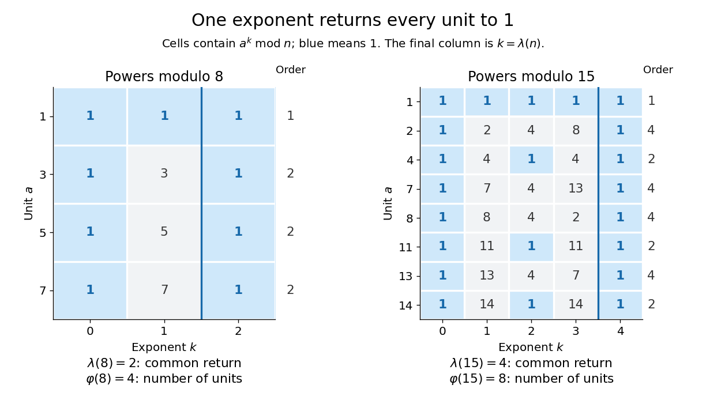

# Carmichael function

↑ **Parent:** [Number theory](number-theory-split.md)  
ⓦ [Wiki](https://en.wikipedia.org/wiki/Carmichael_function)

For an [integer](integer.md) $n>1$, the [Carmichael function](carmichael-function.md) $\lambda(n)$ is the [exponent of a finite group](exponent-of-a-finite-group.md) for the [unit group](unit-group.md) $U(n)=(\mathbb Z/n\mathbb Z)^\times$: the least [positive integer](positive-integer.md) $m$ for which

$$
a^m\equiv1\pmod n\qquad\text{for every }a\text{ with }\gcd(a,n)=1.
$$

Here the [greatest common divisor](greatest-common-divisor.md) condition selects the [units](unit-in-a-ring.md). [Euler's totient function](euler-totient-function.md) $\varphi(n)$ counts them; the [Carmichael function](carmichael-function.md) gives their least common return exponent.[pp. 7–8, definition](notes-on-primitive-lambda-roots-by-peter-j-cameron-and-others.md)

Modulo eight, the [units](unit-in-a-ring.md) are $1,3,5,7$, and their squares are all congruent to one. Their [multiplicative orders](multiplicative-order.md) are $1,2,2,2$, so $\lambda(8)=2$ although $\varphi(8)=4$. Modulo fifteen, the [units](unit-in-a-ring.md) $1,2,4,7,8,11,13,14$ have [multiplicative orders](multiplicative-order.md) $1,4,2,4,4,2,4,2$. For example, the powers of two return through $1,2,4,8,1$. Thus $\lambda(15)=4$ although $\varphi(15)=8$; the [multiplicative order](multiplicative-order.md) of four is only two.

**[Figure 43](#image-individual-unit-orders-divide-the-least-common-return-exponent-modulo-eight-and-fifteen). Individual unit orders divide the least common return exponent modulo eight and fifteen**.

The three quantities are related by

$$
\lambda(n)=\mathop{\operatorname{lcm}}_{\substack{1\leq a<n\\\gcd(a,n)=1}}\operatorname{ord}_n(a),\qquad
\operatorname{ord}_n(a)\mid\lambda(n)\mid\varphi(n).
$$

A common return exponent must be a multiple of every [multiplicative order](multiplicative-order.md), hence of their [least common multiple](least-common-multiple.md). Conversely, that [least common multiple](least-common-multiple.md) makes every [unit](unit-in-a-ring.md) return to one. [Lagrange's theorem](lagrange-s-theorem.md) makes each [multiplicative order](multiplicative-order.md) divide the [group order](order-of-a-finite-group.md) $\varphi(n)$, proving the final [divisibility](divisibility.md). The [Carmichael function](carmichael-function.md) applies to all [units](unit-in-a-ring.md) at once, while the [multiplicative order](multiplicative-order.md) concerns a chosen [unit](unit-in-a-ring.md).

For the [prime factorization](fundamental-theorem-of-arithmetic.md) $n=\prod_{i=1}^r p_i^{e_i}$ with distinct [prime numbers](prime-number.md) $p_i$ and $e_i\geq1$, the formulas are

$$
\lambda(n)=\operatorname{lcm}\bigl(\lambda(p_1^{e_1}),\ldots,\lambda(p_r^{e_r})\bigr),\qquad
\lambda(p^e)=p^{e-1}(p-1)\quad(p\text{ an odd prime}),
$$

$$
\lambda(2^e)=
\begin{cases}
1,&e=1,\\
2,&e=2,\\
2^{e-2},&e\geq3.
\end{cases}
$$

These are [least common multiples](least-common-multiple.md), rather than products: $\lambda(15)=\operatorname{lcm}(2,4)=4$. The convention $\lambda(1)=1$ handles the trivial case separately.[p. 8, Proposition 5.1(a–c)](notes-on-primitive-lambda-roots-by-peter-j-cameron-and-others.md)

The [Chinese remainder theorem for unit groups](chinese-remainder-theorem-for-unit-groups.md) explains the [least common multiple](least-common-multiple.md): a power returns to one in every [prime power](prime-power.md) component exactly when it is a multiple of each component's [exponent of a finite group](exponent-of-a-finite-group.md). For an odd [prime power](prime-power.md), the [unit group](unit-group.md) is a [cyclic group](cyclic-group.md) of [group order](order-of-a-finite-group.md) $p^{e-1}(p-1)$. For $e\geq3$, the [unit group](unit-group.md) modulo $2^e$ is a [direct product of groups](direct-product-of-groups.md) $C_2\times C_{2^{e-2}}$, generated by the classes of $-1$ and five, so its [exponent of a finite group](exponent-of-a-finite-group.md) is $2^{e-2}$.[Section 7.5, pp. 203–205, Theorem 7.28 and its proof](a-computational-introduction-to-number-theory-and-algebra-by-victor-shoup.md)

This gives a uniform reduction for [modular exponentiation](modular-exponentiation.md): for a [unit](unit-in-a-ring.md) $a$ and a nonnegative [integer](integer.md) $k$, reduce $k$ modulo $\lambda(n)$. For example, $2^{1001}\equiv2\pmod{15}$ because $1001\equiv1\pmod4$. The [unit](unit-in-a-ring.md) hypothesis matters: $3^2\equiv1\pmod8$, but $2^2\not\equiv1\pmod8$. Computing the formula assumes the [prime factorization](fundamental-theorem-of-arithmetic.md) is available. The same common-exponent viewpoint explains [Carmichael numbers](carmichael-number.md): a [composite number](composite-number.md) $n$ passes the [Fermat primality test](fermat-primality-test.md) for every [unit](unit-in-a-ring.md) base exactly when $\lambda(n)\mid n-1$. For example, $\lambda(561)=\operatorname{lcm}(2,10,16)=80\mid560$.

## ↑ Ancestors (4)

1. [Number theory](number-theory-split.md)
2. [Area of mathematics](area-of-mathematics.md)
3. [Mathematics](mathematics-split.md)
4. [Codex Wiki](split.md)

## ← Incoming links (2)

- [Carmichael function](carmichael-function.md)
- [Exponent reduction for units](exponent-reduction-for-units.md)
