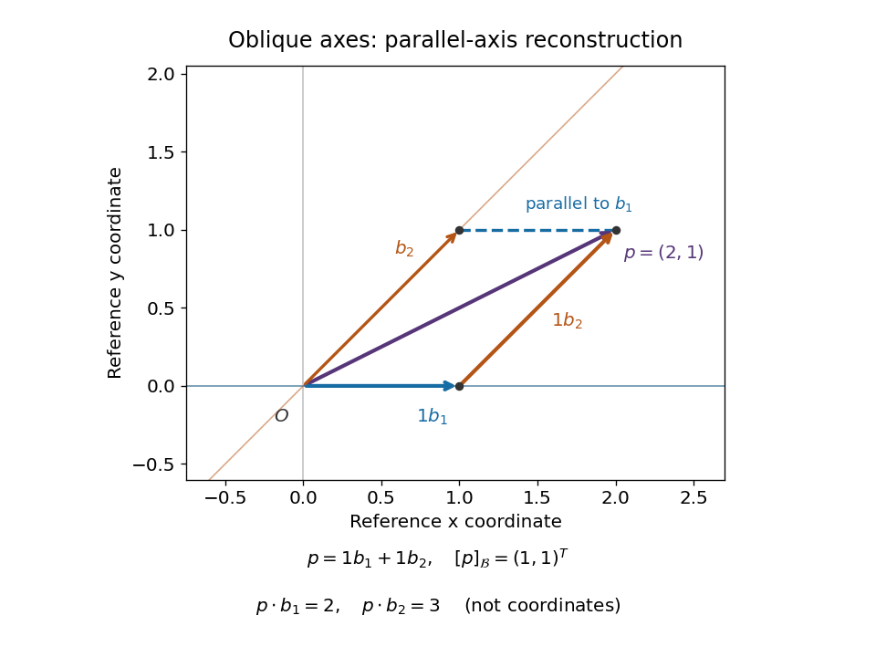

# Cartesian and oblique coordinate reconstruction

↑ **Parent:** [Cartesian basis](cartesian-basis.md)

Keep the same origin and the same [vector](vector.md) $p=(2,1)^T$, but use the nonperpendicular [basis vectors](basis-vector.md) $b_1=(1,0)^T$ and $b_2=(1,1)^T$. They form a [basis](basis.md) because the column [matrix](matrix.md) $B$ has nonzero [determinant](determinant.md):

$$
B=[\,b_1\ b_2\,]=\begin{pmatrix}1&1\\0&1\end{pmatrix},\qquad B^{-1}=\begin{pmatrix}1&-1\\0&1\end{pmatrix},\qquad [p]_{\mathcal B}=B^{-1}p=\begin{pmatrix}1\\1\end{pmatrix}.
$$

The reconstruction is $p=b_1+b_2$. Its [coordinates](coordinate-linear-algebra.md) are read along lines parallel to the other axis, producing a [parallelogram](parallelogram.md). These lines need not be perpendicular to the axis being measured. In contrast, the [dot products](dot-product.md) are $p\cdot b_1=2$ and $p\cdot b_2=3$; treating those as [coordinates](coordinate-linear-algebra.md) would reconstruct $2b_1+3b_2=(5,3)^T$, a different [vector](vector.md).

**[Figure 2](#image-the-same-vector-p-2-1-t-reconstructed-in-an-oblique-basis-coordinates-1-1-t-differ-from-dot-products-2-3-t). The same vector $p=(2,1)^T$ reconstructed in an oblique basis: coordinates $(1,1)^T$ differ from dot products $(2,3)^T$**.

The [dual basis](dual-basis.md) supplies the right measuring rules for any [basis](basis.md).[§3F, Definition 3.112 and Theorem 3.114, printed p. 106: dual basis and coefficient extraction](linear-algebra-done-right-by-sheldon-axler-4th-edition.md) Here these [coordinate functionals](coordinate-functional.md) are $b_1^*(x,y)=x-y$ and $b_2^*(x,y)=y$, the rows of $B^{-1}$. They give $b_1^*(p)=b_2^*(p)=1$. Equivalently, their representing [vectors](vector.md) $d_1=(1,-1)^T$, $d_2=(0,1)^T$ satisfy $d_i\cdot b_j=\delta_{ij}$ and extract the [coordinates](coordinate-linear-algebra.md) as $d_i\cdot p$. These are [Riesz dual basis in an inner product space](riesz-dual-basis-in-an-inner-product-space.md) representatives, rather than the original [basis vectors](basis-vector.md).

The [Gram matrix](gram-matrix.md) records how the nonperpendicular directions interact:

$$
G=B^TB=\begin{pmatrix}1&1\\1&2\end{pmatrix},\qquad B^Tp=G[p]_{\mathcal B}=\begin{pmatrix}2\\3\end{pmatrix},\qquad \|p\|^2=[p]_{\mathcal B}^TG[p]_{\mathcal B}=5.
$$

For any real [basis](basis.md) represented by a square [invertible matrix](invertible-matrix.md) $B$, writing $p=Bc$ gives these identities immediately. One can recover the [coordinates](coordinate-linear-algebra.md) either as $c=B^{-1}p$ or by solving $Gc=B^Tp$. In this example, if $c=(a,b)^T$, the squared [norm](norm.md) is $a^2+2ab+2b^2$, not $a^2+b^2$. Oblique [coordinates](coordinate-linear-algebra.md) remain useful when natural directions are not perpendicular, but the [Gram matrix](gram-matrix.md) must accompany them when computing lengths or [dot products](dot-product.md).

## ↑ Ancestors (6)

1. [Cartesian basis](cartesian-basis.md)
2. [Linear algebra](linear-algebra-split.md)
3. [Algebra](algebra-split.md)
4. [Area of mathematics](area-of-mathematics.md)
5. [Mathematics](mathematics-split.md)
6. [Codex Wiki](split.md)
