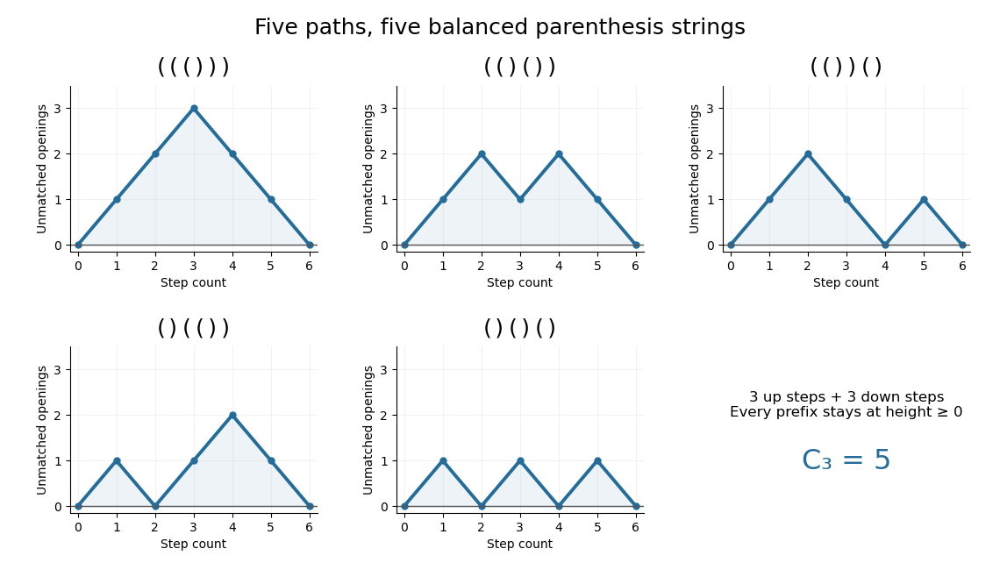

# Catalan number

↑ **Parent:** [Dyck path](dyck-path.md)  
ⓦ [Wiki](https://en.wikipedia.org/wiki/Catalan_number)

The [Catalan number](catalan-number.md) $C_n$ counts [Dyck paths](dyck-path.md) with [semilength of a Dyck path](semilength-of-a-dyck-path.md) $n$. For a [nonnegative integer](natural-number.md) $n$,

$$
\boxed{C_n=\frac1{n+1}\binom{2n}{n},\qquad (C_0,C_1,C_2,C_3,C_4,C_5)=(1,1,2,5,14,42).}
$$

The count $C_0=1$ includes the empty path. Of the $\binom63=20$ paths with three up steps and three down steps, **exactly five stay at nonnegative height**. Their shapes and [balanced parentheses](balanced-parentheses.md) encodings appear below.[§5, printed pp. 38–39, formula (7) and Problems 154–159: Catalan counts, binary parenthesizations, binary trees and Dyck paths](bijective-proof-problems-by-richard-p-stanley.md)

**[Figure 15](#image-all-five-dyck-paths-of-semilength-three-and-their-balanced-parentheses-encodings). All five Dyck paths of semilength three and their balanced parentheses encodings**. Original enumeration of six-step up/down paths with nonnegative prefix heights. An up step encodes an opening parenthesis and a down step a closing one. Each panel shows one distinct string; no path shape or illustration is copied from a source.

The useful connection is a shared decomposition. A [Dyck path](dyck-path.md) splits uniquely at its [first-return decomposition of a Dyck path](first-return-decomposition-of-a-dyck-path.md); a [binary tree](binary-tree.md) splits at its root into left and right subtrees; a [binary parenthesization](binary-parenthesization.md) splits at its last operation. Each removes one outer unit and leaves an [ordered pair](ordered-pair.md) of smaller objects. The resulting [Catalan recurrence](catalan-recurrence.md) lets one count several different structures with the same calculation. A count of five does not mean the structures are physically identical: a [bijection](bijection.md) supplies the precise translation between them.

**Table of contents**

- [Ballot number](ballot-number.md)
  - [Ballot theorem](ballot-theorem.md)
- [Narayana number](narayana-number.md)
- [Catalan recurrence](catalan-recurrence.md)
  - [Generating function of the Catalan numbers](generating-function-of-the-catalan-numbers.md)
- [Binary parenthesization](binary-parenthesization.md)
- [History of Catalan enumeration](history-of-catalan-enumeration.md)

## ↑ Ancestors (6)

1. [Dyck path](dyck-path.md)
2. [Lattice path](lattice-path.md)
3. [Combinatorics](combinatorics-split.md)
4. [Area of mathematics](area-of-mathematics.md)
5. [Mathematics](mathematics-split.md)
6. [Codex Wiki](split.md)

## ← Incoming links (12)

- [Ballot number](ballot-number.md)
- [Binary tree](binary-tree.md)
- [Catalan number](catalan-number.md)
- [Dyck path](dyck-path.md)
- [First return to equal counts in sampling without replacement](first-return-to-equal-counts-in-sampling-without-replacement.md)
- [Matrix-chain multiplication](matrix-chain-multiplication.md)
- [Matrix-chain split reconstruction](matrix-chain-split-reconstruction.md)
- [Narayana number](narayana-number.md)
- [Noncrossing partition](noncrossing-partition.md)
- [Solution](past-exam-of-the-mathematics-course-of-the-year-1-of-the-natural-sciences-course-of-the-university-of-cambridge/2025/paper-2/12/c/ii/solution.md)
- [Rooted plane tree](rooted-plane-tree.md)
- [Triangulation of a convex polygon](triangulation-of-a-convex-polygon.md)
