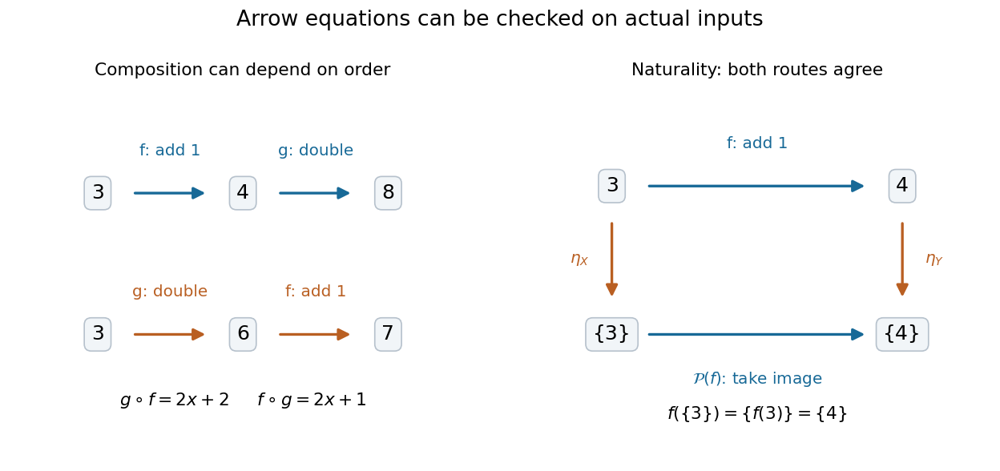
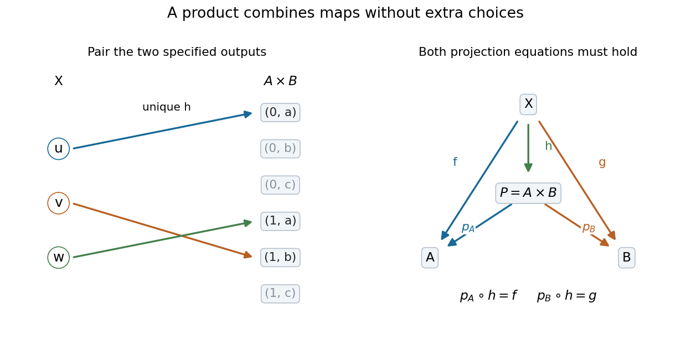

# Category

↑ **Parent:** [Category theory](category-theory.md)  
ⓦ [Wiki](https://en.wikipedia.org/wiki/Category_(mathematics))

A category specifies [objects of a category](#object-of-a-category), [categorical morphisms](#morphism-in-a-category) between them, and [composition in a category](#composition-in-a-category). An arrow $f:A\to B$ can be followed by $g:B\to C$, giving $g\circ f:A\to C$. Every object $A$ has an [identity morphism](algebra.md#identity-morphism) $1_A:A\to A$, and the rules satisfy

$$
h\circ(g\circ f)=(h\circ g)\circ f,\qquad f\circ1_A=f=1_B\circ f.
$$

[Associativity](algebraic-operation.md#associative-property) means that grouping a chain differently does not change its composite. It does not assert [commutativity](algebraic-operation.md#commutativity), and the sources and targets must match before a composite is defined.

In the [Category of sets](#category-of-sets), arrows are [functions](function.md). Take two [functions](function.md) on the [real numbers](arithmetic.md#real-number), $f(x)=x+1$ and $g(x)=2x$. Then $(g\circ f)(x)=2x+2$, whereas $(f\circ g)(x)=2x+1$. At $x=3$, the two orders give **8 and 7**, respectively. Both orders are defined here because these maps share their source and target; for arbitrary arrows the reverse composite need not exist.

**[Figure 1](#image-function-composition-remembers-order-while-a-naturality-square-gives-equal-results-along-both-routes). Function composition remembers order, while a naturality square gives equal results along both routes**.

A [partially ordered set](set.md#partially-ordered-set) supplies a different example: its elements are the [objects of a category](#object-of-a-category), with exactly one arrow $a\to b$ when $a\leq b$, and none otherwise. [Transitivity](set-theory.md#transitive-relation) gives [composition in a category](#composition-in-a-category), and [reflexivity](set-theory.md#reflexive-relation) gives [identity morphisms](algebra.md#identity-morphism). For [subsets](set.md#subset) ordered by inclusion, the two chains $\varnothing\subseteq\{a\}\subseteq\{a,b\}$ and $\varnothing\subseteq\{b\}\subseteq\{a,b\}$ have the same composite arrow. Thus arrows need not be maps of elements: they can record a relation.

**Table of contents**

- [Duality (category theory)](#duality-category-theory)
- [Morphism in a category](#morphism-in-a-category)
- [Small projective object](#small-projective-object)
- [Category of small categories](#category-of-small-categories)
  - [Indiscrete category](#indiscrete-category)
  - [Discrete category](#discrete-category)
  - [Free category on independent arrows](#free-category-on-independent-arrows)
- [Preadditive category](#preadditive-category)
- [Coreflective subcategory](#coreflective-subcategory)
- [Generating set in a category](#generating-set-in-a-category)
- [Composition in a category](#composition-in-a-category)
- [Object of a category](#object-of-a-category)
- [Terminal category](#terminal-category)
- [Nested partial unary operation category](#nested-partial-unary-operation-category)
  - [Free extension of nested partial unary operations](#free-extension-of-nested-partial-unary-operations)
    - [Split-coequalizer lifting for a fixed-point-domain operation](#split-coequalizer-lifting-for-a-fixed-point-domain-operation)
- [Coseparator](#coseparator)
  - [Cogenerating set](#cogenerating-set)
    - [Evaluation embedding into cogenerator products](#evaluation-embedding-into-cogenerator-products)
  - [Equalizer presentation by powers of a coseparator](#equalizer-presentation-by-powers-of-a-coseparator)
- [Category of rings](#category-of-rings)
- [Skeletal category](#skeletal-category)
  - [Skeleton of a category](#skeleton-of-a-category)
- [Subcategory](#subcategory)
  - [Replete subcategory](#replete-subcategory)
  - [Full subcategory](#full-subcategory)
- [Groupoid](#groupoid)
- [Functor](functor.md)
  - [Bifunctor](functor.md#bifunctor)
  - [Discrete opfibration](functor.md#discrete-opfibration)
    - [Connected components of discrete-opfibration pullbacks](functor.md#connected-components-of-discrete-opfibration-pullbacks)
  - [Full functor](functor.md#full-functor)
  - [Flat functor](functor.md#flat-functor)
    - [Flat functor and finite-limit preservation](functor.md#flat-functor-and-finite-limit-preservation)
  - [Kan extension](functor.md#kan-extension)
  - [Finite-limit-preserving functor](functor.md#finite-limit-preserving-functor)
    - [Regular functor](functor.md#regular-functor)
  - [Conservative functor](functor.md#conservative-functor)
  - [Limit-reflecting functor](functor.md#limit-reflecting-functor)
    - [Limits reflected by full and faithful functors](functor.md#limits-reflected-by-full-and-faithful-functors)
    - [Limit-creating functor](functor.md#limit-creating-functor)
      - [Creation of limits up to isomorphism](functor.md#creation-of-limits-up-to-isomorphism)
  - [Colimit-preserving functor](functor.md#colimit-preserving-functor)
  - [Limit-preserving functor](functor.md#limit-preserving-functor)
    - [Equalizer preservation by pullback-preserving functors](functor.md#equalizer-preservation-by-pullback-preserving-functors)
  - [Forgetful functor](functor.md#forgetful-functor)
  - [Endofunctor](functor.md#endofunctor)
    - [Comonad](functor.md#comonad)
      - [Cartesian comonad](functor.md#cartesian-comonad)
      - [Idempotent comonad](functor.md#idempotent-comonad)
      - [Coalgebra for a comonad](functor.md#coalgebra-for-a-comonad)
        - [Category of coalgebras for a comonad](functor.md#category-of-coalgebras-for-a-comonad)
          - [Cartesian closure for a finite-limit-preserving comonad](functor.md#cartesian-closure-for-a-finite-limit-preserving-comonad)
          - [Subobject classifier of a coalgebra topos](functor.md#subobject-classifier-of-a-coalgebra-topos)
          - [Exponentials in a coalgebra topos](functor.md#exponentials-in-a-coalgebra-topos)
          - [Cofree coalgebra](functor.md#cofree-coalgebra)
  - [Finite-limit-preserving set-valued functor](functor.md#finite-limit-preserving-set-valued-functor)
  - [Equivalence of categories](functor.md#equivalence-of-categories)
    - [Essential surjectivity](functor.md#essential-surjectivity)
    - [Isomorphism of categories](functor.md#isomorphism-of-categories)
  - [Functor category](functor.md#functor-category)
    - [Pointwise monomorphism in a set-valued functor category](functor.md#pointwise-monomorphism-in-a-set-valued-functor-category)
    - [Pointwise limits in a functor category](functor.md#pointwise-limits-in-a-functor-category)
    - [Constant diagram functor](functor.md#constant-diagram-functor)
      - [Adjoints to constant presheaves on open sets](functor.md#adjoints-to-constant-presheaves-on-open-sets)
        - [Five adjoints for constant presheaves on open sets](functor.md#five-adjoints-for-constant-presheaves-on-open-sets)
    - [Presheaf (category theory)](functor.md#presheaf-category-theory)
    - [Presheaf category](functor.md#presheaf-category)
      - [Canonical colimit presentation of a presheaf](functor.md#canonical-colimit-presentation-of-a-presheaf)
      - [Free cocompletion](functor.md#free-cocompletion)
      - [Grothendieck topology](functor.md#grothendieck-topology)
        - [Double-negation topology](functor.md#double-negation-topology)
          - [Separating tower site with vanishing product](functor.md#separating-tower-site-with-vanishing-product)
        - [Zariski coverage on finitely presented rings](functor.md#zariski-coverage-on-finitely-presented-rings)
        - [Coverage on a category](functor.md#coverage-on-a-category)
          - [Rigid coverage](functor.md#rigid-coverage)
          - [J-irreducible object of a site](functor.md#j-irreducible-object-of-a-site)
        - [Site (category theory)](functor.md#site-category-theory)
        - [Atomic topology](functor.md#atomic-topology)
          - [Atomic finite-surjection site](functor.md#atomic-finite-surjection-site)
            - [Primitive element of an atomic finite-surjection sheaf](functor.md#primitive-element-of-an-atomic-finite-surjection-sheaf)
              - [Primitive decomposition of an atomic finite-surjection sheaf](functor.md#primitive-decomposition-of-an-atomic-finite-surjection-sheaf)
              - [Primitive-element kernel rigidity lemma](functor.md#primitive-element-kernel-rigidity-lemma)
            - [Descent identities for the atomic finite-surjection site](functor.md#descent-identities-for-the-atomic-finite-surjection-site)
          - [Common-refinement condition for nonempty-sieve coverage](functor.md#common-refinement-condition-for-nonempty-sieve-coverage)
        - [Subcanonical topology](functor.md#subcanonical-topology)
        - [Sheaf on a site](functor.md#sheaf-on-a-site)
      - [Sieve (category theory)](functor.md#sieve-category-theory)
        - [Dense sieve](functor.md#dense-sieve)
        - [J-closed sieve](functor.md#j-closed-sieve)
      - [Presheaf topos](functor.md#presheaf-topos)
        - [Slice-small presheaf construction](functor.md#slice-small-presheaf-construction)
        - [Exponential in a presheaf category](functor.md#exponential-in-a-presheaf-category)
    - [Arrow category](functor.md#arrow-category)
      - [Adjoint chain for evaluation in an arrow category](functor.md#adjoint-chain-for-evaluation-in-an-arrow-category)
      - [Category of injective functions](functor.md#category-of-injective-functions)
    - [Representable functor](functor.md#representable-functor)
      - [Representable retract criterion](functor.md#representable-retract-criterion)
      - [Representability from a solution set](functor.md#representability-from-a-solution-set)
      - [Left adjoint to a covariant representable functor](functor.md#left-adjoint-to-a-covariant-representable-functor)
      - [Covariant representables preserve limits](functor.md#covariant-representables-preserve-limits)
      - [Colimit criterion for representability of a presheaf](functor.md#colimit-criterion-for-representability-of-a-presheaf)
        - [Small-limit preservation is insufficient for the large elements-colimit criterion](functor.md#small-limit-preservation-is-insufficient-for-the-large-elements-colimit-criterion)
      - [Canonical colimit presentation of a covariant set-valued functor](functor.md#canonical-colimit-presentation-of-a-covariant-set-valued-functor)
      - [Representation of a functor](functor.md#representation-of-a-functor)
        - [Uniqueness of functor representations](functor.md#uniqueness-of-functor-representations)
        - [Functoriality of chosen representations](functor.md#functoriality-of-chosen-representations)
        - [Universal element of a set-valued functor](functor.md#universal-element-of-a-set-valued-functor)
      - [Yoneda lemma](functor.md#yoneda-lemma)
        - [Density formula for presheaves](functor.md#density-formula-for-presheaves)
        - [Yoneda embedding](functor.md#yoneda-embedding)
          - [Yoneda embedding detects split epimorphisms](functor.md#yoneda-embedding-detects-split-epimorphisms)
          - [Yoneda embedding preserves exponentials](functor.md#yoneda-embedding-preserves-exponentials)
          - [Covariant Yoneda embedding](functor.md#covariant-yoneda-embedding)
    - [Pointwise epimorphism in a functor category](functor.md#pointwise-epimorphism-in-a-functor-category)
      - [Pushout witness for failure of pointwise surjectivity](functor.md#pushout-witness-for-failure-of-pointwise-surjectivity)
  - [Monofunctor](functor.md#monofunctor)
  - [Natural transformation](functor.md#natural-transformation)
    - [Dinatural transformation](functor.md#dinatural-transformation)
    - [Natural isomorphism](functor.md#natural-isomorphism)
      - [Natural bijection](functor.md#natural-bijection)
    - [Naturality](functor.md#naturality)
  - [Full and faithful functor](functor.md#full-and-faithful-functor)
  - [Faithful functor](functor.md#faithful-functor)
- [Balanced category](#balanced-category)
- [Reflective subcategory](#reflective-subcategory)
  - [Compact Hausdorff reflection](#compact-hausdorff-reflection)
  - [Limits in a reflective subcategory](#limits-in-a-reflective-subcategory)
  - [Left-exact reflective subcategory](#left-exact-reflective-subcategory)
    - [Exponentials in a left-exact reflective subcategory](#exponentials-in-a-left-exact-reflective-subcategory)
  - [Reflector](#reflector)
  - [Closure operation induced by a left-exact reflector](#closure-operation-induced-by-a-left-exact-reflector)
- [Congruence on a category](#congruence-on-a-category)
  - [Category of partial maps localized at subterminal objects](#category-of-partial-maps-localized-at-subterminal-objects)
- [Small category](#small-category)
- [Locally small category](#locally-small-category)
  - [Hom-set](#hom-set)
- [Opposite category](#opposite-category)
- [Connected category](#connected-category)
  - [Connected component of a category](#connected-component-of-a-category)
- [Category of sets](#category-of-sets)
  - [Category of finite sets](#category-of-finite-sets)
  - [Category of pointed sets](#category-of-pointed-sets)
  - [Category of partial functions](#category-of-partial-functions)
  - [Finite-limit-and-colimit preserving endofunctor of sets](#finite-limit-and-colimit-preserving-endofunctor-of-sets)
    - [Ultrapower endofunctor of sets](#ultrapower-endofunctor-of-sets)
- [Category of ordinals in reverse order](#category-of-ordinals-in-reverse-order)
- [Pointed category](#pointed-category)
  - [Pseudo-epimorphism](#pseudo-epimorphism)
    - [Pseudo-epimorphism factorization through the kernel of a cokernel](#pseudo-epimorphism-factorization-through-the-kernel-of-a-cokernel)
  - [Zero object](#zero-object)
    - [Zero morphism](#zero-morphism)
  - [Kernel in a category](#kernel-in-a-category)
  - [Cokernel in a category](#cokernel-in-a-category)
    - [Cokernel invariance under pushout](#cokernel-invariance-under-pushout)
  - [Normal monomorphism](#normal-monomorphism)
    - [Closure of normal monomorphisms forces abelianness](#closure-of-normal-monomorphisms-forces-abelianness)
  - [Conormal epimorphism](#conormal-epimorphism)
- [Monomorphism](#monomorphism)
  - [Extremal monomorphism](#extremal-monomorphism)
  - [Split monomorphism](#split-monomorphism)
    - [Absolute monomorphism](#absolute-monomorphism)
    - [Retract in a category](#retract-in-a-category)
  - [Strong monomorphism](#strong-monomorphism)
    - [Four-object strong nonregular monomorphism](#four-object-strong-nonregular-monomorphism)
    - [Balanced categories with pullbacks have strong monomorphisms](#balanced-categories-with-pullbacks-have-strong-monomorphisms)
    - [Strict monomorphism](#strict-monomorphism)
    - [Regular monomorphism](#regular-monomorphism)
    - [Intersection of strong subobjects](#intersection-of-strong-subobjects)
  - [Anodyne morphism in a category](#anodyne-morphism-in-a-category)
    - [Saturated object with respect to anodyne morphisms](#saturated-object-with-respect-to-anodyne-morphisms)
      - [Saturated reflection from a strong-subobject intersection](#saturated-reflection-from-a-strong-subobject-intersection)
- [Epimorphism](#epimorphism)
  - [Extremal epimorphism](#extremal-epimorphism)
    - [Nonregular extremal epimorphism in the category of categories](#nonregular-extremal-epimorphism-in-the-category-of-categories)
  - [Split epimorphism](#split-epimorphism)
  - [Regular epimorphism](#regular-epimorphism)
    - [Regular epimorphisms are strong epimorphisms](#regular-epimorphisms-are-strong-epimorphisms)
  - [Strong epimorphism](#strong-epimorphism)
    - [Left lifting property against monomorphisms](#left-lifting-property-against-monomorphisms)
      - [Binary-product criterion for lifting-only strong epimorphisms](#binary-product-criterion-for-lifting-only-strong-epimorphisms)
      - [Right-factor cancellation for lifting-only strong morphisms](#right-factor-cancellation-for-lifting-only-strong-morphisms)
      - [Monic lifting-only strong morphisms are invertible](#monic-lifting-only-strong-morphisms-are-invertible)
    - [Regular-epimorphism-monomorphism factorization from kernel pairs](#regular-epimorphism-monomorphism-factorization-from-kernel-pairs)
    - [Strong epimorphism in the category of small categories](#strong-epimorphism-in-the-category-of-small-categories)
    - [Strong quotient](#strong-quotient)
- [Subobject](#subobject)
  - [Well-pointed object in a category](#well-pointed-object-in-a-category)
  - [Intersection of subobjects](#intersection-of-subobjects)
    - [Minimal supported subobject](#minimal-supported-subobject)
  - [Well-copowered category](#well-copowered-category)
  - [Image factorization](#image-factorization)
    - [Image factorization in an abelian category](#image-factorization-in-an-abelian-category)
      - [Pullback stability of abelian image factorization](#pullback-stability-of-abelian-image-factorization)
      - [Functoriality of abelian image factorization](#functoriality-of-abelian-image-factorization)
    - [Frobenius reciprocity for subobjects](#frobenius-reciprocity-for-subobjects)
  - [Well-powered category](#well-powered-category)
- [Projective object](#projective-object)
  - [Projectivity detected by all first left derived functors](#projectivity-detected-by-all-first-left-derived-functors)
  - [Covariant representables are projective](#covariant-representables-are-projective)
  - [Coproducts of projective objects are projective](#coproducts-of-projective-objects-are-projective)
  - [Indecomposable projective object](#indecomposable-projective-object)
  - [Irreducible projective in a set-valued functor category](#irreducible-projective-in-a-set-valued-functor-category)
  - [Projective cover of a set-valued functor by representables](#projective-cover-of-a-set-valued-functor-by-representables)
- [Terminal object](#terminal-object)
  - [Weakly terminal set](#weakly-terminal-set)
  - [Subterminal object](#subterminal-object)
    - [Subterminal sheaf](#subterminal-sheaf)
- [Initial object](#initial-object)
  - [Weakly initial set](#weakly-initial-set)
    - [Initial-object lemma for complete categories with a weakly initial set](#initial-object-lemma-for-complete-categories-with-a-weakly-initial-set)
  - [Strict initial object](#strict-initial-object)
- [Diagram (category theory)](#diagram-category-theory)
  - [Cone over a diagram](#cone-over-a-diagram)
    - [Categorical limit](#categorical-limit)
      - [End of a functor](#end-of-a-functor)
      - [Hom-set detection of categorical limits](#hom-set-detection-of-categorical-limits)
      - [Limit functor](#limit-functor)
      - [Finite limit](#finite-limit)
        - [Finite limits from terminal objects and pullbacks](#finite-limits-from-terminal-objects-and-pullbacks)
        - [Cartesian category](#cartesian-category)
        - [Product (category theory)](#product-category-theory)
          - [Categorical diagonal](#categorical-diagonal)
        - [Equaliser](#equaliser)
          - [Split equalizer](#split-equalizer)
            - [Split equalizers associated with a monad](#split-equalizers-associated-with-a-monad)
        - [Pullback (category theory)](#pullback-category-theory)
          - [Base change of a pullback square](#base-change-of-a-pullback-square)
          - [Pullback pasting lemma](#pullback-pasting-lemma)
          - [Kernel pair](#kernel-pair)
            - [Epimorphisms in an abelian category are coequalizers of their kernel pairs](#epimorphisms-in-an-abelian-category-are-coequalizers-of-their-kernel-pairs)
      - [Construction of small limits from products and equalizers](#construction-of-small-limits-from-products-and-equalizers)
      - [Complete category](#complete-category)
      - [Initial functor](#initial-functor)
        - [Representable test for initial functors](#representable-test-for-initial-functors)
        - [Cone restriction along an initial functor](#cone-restriction-along-an-initial-functor)
  - [Cocone under a diagram](#cocone-under-a-diagram)
- [Colimit](#colimit)
  - [Coend of a functor](#coend-of-a-functor)
  - [Pushout](#pushout)
  - [Construction of finite colimits from coproducts and reflexive coequalizers](#construction-of-finite-colimits-from-coproducts-and-reflexive-coequalizers)
  - [Pushout in a category](#pushout-in-a-category)
    - [Pushout of groups](#pushout-of-groups)
  - [Cocomplete category](#cocomplete-category)
  - [Coproduct](#coproduct)
    - [Countable coproduct](#countable-coproduct)
  - [Coequalizer](#coequalizer)
    - [Split coequalizer](#split-coequalizer)
      - [Functor-split coequalizer pair](#functor-split-coequalizer-pair)
  - [Multicolimit](#multicolimit)
  - [Commutation of limits and colimits](#commutation-of-limits-and-colimits)
    - [Commutation of iterated categorical limits](#commutation-of-iterated-categorical-limits)
    - [Common quotient obstruction to commutation of fixed points and orbits](#common-quotient-obstruction-to-commutation-of-fixed-points-and-orbits)
    - [Commutation of fixed points and orbit quotients for coprime groups](#commutation-of-fixed-points-and-orbit-quotients-for-coprime-groups)
  - [Filtered category](#filtered-category)
    - [Filtered colimit in a category](#filtered-colimit-in-a-category)
      - [Directed colimits created by the abelian-group forgetful functor](#directed-colimits-created-by-the-abelian-group-forgetful-functor)
    - [Weakly filtered category](#weakly-filtered-category)
    - [Filtered colimits commute with finite limits in sets](#filtered-colimits-commute-with-finite-limits-in-sets)
      - [Finite-stage equality in a filtered set colimit](#finite-stage-equality-in-a-filtered-set-colimit)
      - [Cofiltered limits need not commute with finite colimits in sets](#cofiltered-limits-need-not-commute-with-finite-colimits-in-sets)
  - [Sifted category](#sifted-category)
  - [Local state classifier](#local-state-classifier)
- [Idempotent morphism](#idempotent-morphism)
  - [Splitting of an idempotent morphism](#splitting-of-an-idempotent-morphism)
    - [Idempotent splitting through a coequalizer](#idempotent-splitting-through-a-coequalizer)
  - [Cauchy-complete category](#cauchy-complete-category)
    - [Idempotent ideal in a finite category](#idempotent-ideal-in-a-finite-category)
  - [Karoubi envelope](#karoubi-envelope)
- [Regular category](#regular-category)
  - [Regular-logic separation of a proper subobject](#regular-logic-separation-of-a-proper-subobject)
  - [Capital regular category](#capital-regular-category)
    - [Power of sets as a capital regular category](#power-of-sets-as-a-capital-regular-category)
      - [Conservativity of set products on totally supported families](#conservativity-of-set-products-on-totally-supported-families)
    - [Capitalization of a small regular category](#capitalization-of-a-small-regular-category)
    - [Global sections of a capital regular category](#global-sections-of-a-capital-regular-category)
  - [Support of an object in a regular category](#support-of-an-object-in-a-regular-category)
    - [Almost total support for a regular category](#almost-total-support-for-a-regular-category)
      - [Conservative regular representation in sets](#conservative-regular-representation-in-sets)
    - [Well-supported object](#well-supported-object)
  - [Regular coverage](#regular-coverage)
    - [Irreducible representable sheaf for the regular coverage](#irreducible-representable-sheaf-for-the-regular-coverage)
    - [Local membership closure for the regular coverage](#local-membership-closure-for-the-regular-coverage)
  - [Glued ring categories counterexample to regularity](#glued-ring-categories-counterexample-to-regularity)
  - [Left-exact reflective subcategory of a regular category](#left-exact-reflective-subcategory-of-a-regular-category)
  - [Image of a morphism in a regular category](#image-of-a-morphism-in-a-regular-category)
  - [Category of relations](#category-of-relations)
    - [Category of relations (sets)](#category-of-relations-sets)
    - [Total functional relations define morphisms](#total-functional-relations-define-morphisms)
    - [Graph of a morphism as a relation](#graph-of-a-morphism-as-a-relation)
- [Comma category](#comma-category)
  - [Slice category](#slice-category)
    - [Slice of a set-valued functor category](#slice-of-a-set-valued-functor-category)
    - [Finite completeness of slice categories](#finite-completeness-of-slice-categories)
  - [Limits in a comma category of a limit-preserving functor](#limits-in-a-comma-category-of-a-limit-preserving-functor)
  - [Solution-set condition](#solution-set-condition)
  - [Universal arrow from an object to a functor](#universal-arrow-from-an-object-to-a-functor)
    - [Representability through the category of elements](#representability-through-the-category-of-elements)
  - [Category of elements](#category-of-elements)
    - [Covariant density presentation](#covariant-density-presentation)
- [Adjoint functors](#adjoint-functors)
  - [Preservation obstructions to extending an adjoint chain](#preservation-obstructions-to-extending-an-adjoint-chain)
  - [Adjoint chain for the objects of a category](#adjoint-chain-for-the-objects-of-a-category)
  - [Discrete-indiscrete adjunction](#discrete-indiscrete-adjunction)
  - [Boolean ultrafilter-power-set adjunction](#boolean-ultrafilter-power-set-adjunction)
  - [Idempotent adjunction](#idempotent-adjunction)
  - [Adjoint functor theorem](#adjoint-functor-theorem)
  - [Left Kan extension](#left-kan-extension)
    - [Left Kan extension as a comma-category colimit](#left-kan-extension-as-a-comma-category-colimit)
    - [Bounded subfunctor solution set for precomposition](#bounded-subfunctor-solution-set-for-precomposition)
  - [Freyd general adjoint functor theorem](#freyd-general-adjoint-functor-theorem)
  - [Right-adjoint criterion using comma-category colimits](#right-adjoint-criterion-using-comma-category-colimits)
  - [Mate correspondence](#mate-correspondence)
  - [Galois connection](#galois-connection)
    - [Adjoints of inverse image on power sets](#adjoints-of-inverse-image-on-power-sets)
  - [Unit and counit of an adjunction](#unit-and-counit-of-an-adjunction)
    - [Counit of an adjunction](#counit-of-an-adjunction)
    - [Unit of an adjunction](#unit-of-an-adjunction)
    - [Triangle identities for an adjunction](#triangle-identities-for-an-adjunction)
      - [One-triangle adjunction idempotent](#one-triangle-adjunction-idempotent)
        - [Splitting a one-triangle adjunction idempotent](#splitting-a-one-triangle-adjunction-idempotent)
    - [Fully faithful adjoint criterion](#fully-faithful-adjoint-criterion)
      - [Double-adjoint comparison transformation](#double-adjoint-comparison-transformation)
    - [Faithful left adjoint criterion](#faithful-left-adjoint-criterion)
    - [Pointwise-monic unit-and-counit criterion](#pointwise-monic-unit-and-counit-criterion)
      - [Pointwise-monic adjunction over a non-balanced poset](#pointwise-monic-adjunction-over-a-non-balanced-poset)
  - [Adjoint functor theorem for complete lattices](#adjoint-functor-theorem-for-complete-lattices)
  - [Right Kan extension](#right-kan-extension)
  - [Special adjoint functor theorem](#special-adjoint-functor-theorem)
    - [Limit form of the special adjoint functor theorem](#limit-form-of-the-special-adjoint-functor-theorem)
      - [Cogenerator bound for comma-category solution sets](#cogenerator-bound-for-comma-category-solution-sets)
  - [Cartesian closed category](#cartesian-closed-category)
    - [Locally Cartesian closed category](#locally-cartesian-closed-category)
    - [Cartesian closed monoid](#cartesian-closed-monoid)
    - [Extensional reflexive object](#extensional-reflexive-object)
    - [Exponential object](#exponential-object)
      - [Exponential of covariant set-valued functors](#exponential-of-covariant-set-valued-functors)
      - [Currying](#currying)
      - [Evaluation map of an exponential object](#evaluation-map-of-an-exponential-object)
      - [Exponential of monoid sets](#exponential-of-monoid-sets)
        - [Nondecidable exponential of decidable monoid sets](#nondecidable-exponential-of-decidable-monoid-sets)
        - [Monoid condition for decidable exponentials](#monoid-condition-for-decidable-exponentials)
      - [Currying adjunction for small categories](#currying-adjunction-for-small-categories)
    - [Exponential ideal](#exponential-ideal)
      - [Reflector product criterion for an exponential ideal](#reflector-product-criterion-for-an-exponential-ideal)
    - [Exponentiable object](#exponentiable-object)
      - [Exponentiability test using a coseparator](#exponentiability-test-using-a-coseparator)
      - [Product of exponentiable objects is exponentiable](#product-of-exponentiable-objects-is-exponentiable)
      - [Zero object is the only exponentiable object in a pointed category](#zero-object-is-the-only-exponentiable-object-in-a-pointed-category)
      - [Exponentiability criterion in the category of T0 spaces](#exponentiability-criterion-in-the-category-of-t0-spaces)
    - [Cartesian closed category of posets](#cartesian-closed-category-of-posets)
    - [Tiny object](#tiny-object)
      - [Tiny covariant functor on a Cauchy-complete category with an initial object is representable](#tiny-covariant-functor-on-a-cauchy-complete-category-with-an-initial-object-is-representable)
      - [Tiny covariant representable functor on a category with binary coproducts](#tiny-covariant-representable-functor-on-a-category-with-binary-coproducts)
      - [Tiny objects are closed under finite products](#tiny-objects-are-closed-under-finite-products)
      - [Representable presheaves are the tiny objects of an idempotent-complete finite-product category](#representable-presheaves-are-the-tiny-objects-of-an-idempotent-complete-finite-product-category)
- [Category of metric spaces and non-expansive maps](#category-of-metric-spaces-and-non-expansive-maps)
  - [Non-expansive map](#non-expansive-map)
  - [Category of bounded metric spaces and non-expansive maps](#category-of-bounded-metric-spaces-and-non-expansive-maps)
    - [Metric exponential candidate](#metric-exponential-candidate)
      - [Interpolating metric space](#interpolating-metric-space)
  - [Quotient metric](#quotient-metric)
- [Final functor](#final-functor)
  - [Finality of a functor](#finality-of-a-functor)
  - [Cocone extension along a final functor](#cocone-extension-along-a-final-functor)
- [Discrete fibration](#discrete-fibration)
  - [Unique lifting property of a discrete fibration](#unique-lifting-property-of-a-discrete-fibration)
  - [Orthogonality of final functors and discrete fibrations](#orthogonality-of-final-functors-and-discrete-fibrations)
  - [Final-discrete-fibration factorization](#final-discrete-fibration-factorization)
    - [Uniqueness of a final-discrete-fibration factorization](#uniqueness-of-a-final-discrete-fibration-factorization)
    - [Connected-component presheaf of a functor](#connected-component-presheaf-of-a-functor)
- [Category of fields](#category-of-fields)
- [Compact object (mathematics)](#compact-object-mathematics)

## Duality (category theory)

↑ **Parent:** [Category](category.md)  
ⓦ [Wiki](https://en.wikipedia.org/wiki/Duality_(category_theory))

Reversing the arrows in a categorical statement produces its dual statement. A theorem holding for all [categories](category.md) therefore has a dual theorem obtained by applying it to the [opposite category](#opposite-category); for example, [categorical limits](#categorical-limit) are exchanged with [colimits](#colimit).

## Morphism in a category

↑ **Parent:** [Category](category.md)

A [categorical morphism](#morphism-in-a-category) is an arrow with a specified source and target in a [category](category.md). An arrow $f:A\to B$ composes with $g:B\to C$ to give $gf:A\to C$. Composition is associative, and every object has an identity arrow acting as a unit. A [functor](functor.md) preserves the sources, targets, identities and compositions of these arrows. In a [locally small category](#locally-small-category), the arrows between fixed objects form a [hom-set](#hom-set).

## Small projective object

↑ **Parent:** [Category](category.md)

An object with the displayed property is called small projective; the term 0-presentable here uses this all-small-colimits convention. In a [presheaf category](functor.md#presheaf-category), every [representable presheaf](functor.md#representable-functor) has this property by the [Yoneda lemma](functor.md#yoneda-lemma) and pointwise computation of [colimits](#colimit). Conversely the [canonical colimit presentation of a presheaf](functor.md#canonical-colimit-presentation-of-a-presheaf) shows that the identity on such an object factors through one representable, making it a retract. If the indexing category has [equalizers](#equaliser), a representable retract is again representable by the [representable retract criterion](functor.md#representable-retract-criterion).

## Category of small categories

↑ **Parent:** [Category](category.md)

Objects are [small categories](#small-category) and [morphisms](algebra.md#morphism) are [functors](functor.md). Its products pair objects and arrows componentwise. Its [exponential objects](#exponential-object) are [functor categories](functor.md#functor-category), as shown by the [currying adjunction for small categories](#currying-adjunction-for-small-categories).

### Indiscrete category

↑ **Parent:** [Category of small categories](#category-of-small-categories)

The indiscrete category on a [set](set.md) has exactly one morphism between each ordered pair of objects. Every morphism is invertible. A functor into it is determined by its object assignment.

### Discrete category

↑ **Parent:** [Category of small categories](#category-of-small-categories)  
ⓦ [Wiki](https://en.wikipedia.org/wiki/Discrete_category)

The discrete category on a [set](set.md) has that set as its objects and only identity morphisms. Functors from it are exactly assignments of objects in the target category.

### Free category on independent arrows

↑ **Parent:** [Category of small categories](#category-of-small-categories)

Take two distinct objects and one nonidentity arrow for each element of $S$, without arrows between different copies. A [functor](functor.md) from this category to $\mathcal C$ is exactly a choice of one arbitrary arrow of $\mathcal C$ for each element of $S$. Consequently this construction is [left adjoint](#adjoint-functors) to the functor taking the set of all arrows of a small category. Its free object has three arrows per generator, including the two identity arrows.

## Preadditive category

↑ **Parent:** [Category](category.md)  
ⓦ [Wiki](https://en.wikipedia.org/wiki/Preadditive_category)

A [category](category.md) is preadditive if every hom-set is an [abelian group](group.md#abelian-group) and composition is additive in each variable. Zero morphisms and differences of parallel morphisms are therefore defined. A [zero object](#zero-object) or finite [biproducts](category-theory.md#biproduct) need not exist; these are extra requirements in an [additive category](category-theory.md#additive-category).

## Coreflective subcategory

↑ **Parent:** [Category](category.md)

A full subcategory is coreflective when its inclusion $I$ has a right adjoint $q$. The counit $IqX\to X$ is universal for maps to $X$ from objects of the subcategory. The [comonad](functor.md#comonad) $Iq$ is idempotent. For a finite-limit-closed coreflective subcategory of a [topos](category-theory.md#elementary-topos), its coalgebra construction can prove that the subcategory is itself a topos.

## Generating set in a category

↑ **Parent:** [Category](category.md)

A generating set is a set-indexed family $(P_i)$ such that unequal parallel [morphisms](algebra.md#morphism) $f,g:A\to B$ are distinguished by some $h:P_i\to A$, with $fh\ne gh$. It is dual to a [cogenerating set](#cogenerating-set).

## Composition in a category

↑ **Parent:** [Category](category.md)

Given [morphisms](algebra.md#morphism) $f:A\to B$ and $g:B\to C$, their composite is $gf:A\to C$. Composition is associative and has the [identity morphisms](algebra.md#identity-morphism) as units.

## Object of a category

↑ **Parent:** [Category](category.md)

The objects are the entities between which a [category](category.md) specifies [morphisms](algebra.md#morphism). Each object has an [identity morphism](algebra.md#identity-morphism).

## Terminal category

↑ **Parent:** [Category](category.md)

The [category](category.md) with one object and only its identity [morphism](algebra.md#morphism). A [functor](functor.md) from it selects an object of the target [category](category.md).

## Nested partial unary operation category

↑ **Parent:** [Category](category.md)

An object of $\mathcal C_n$ is a set with a finite list of [partial unary operations](function.md#partial-unary-operation). The first is total; the domain of each later operation consists exactly of the defined [fixed points](function.md#fixed-point) of the immediately preceding operation. Morphisms preserve every defined operation. Take $\mathcal C_0$ to be the [Category of sets](#category-of-sets). This tower gives examples of arbitrary finite [monadic length](category-theory.md#monadic-length) even though its long free–forgetful composites induce the same first [monad](category-theory.md#monad).

### Free extension of nested partial unary operations

↑ **Parent:** [Nested partial unary operation category](#nested-partial-unary-operation-category)

For an object of the [nested partial unary operation category](#nested-partial-unary-operation-category) $\mathcal C_n$, adjoining the next operation freely gives one new value at each defined fixed point of the previous operation. Each new value starts an infinite free chain under the first unary operation; the other old operations are undefined on those new points. The new top operation consequently has no fixed points, so subsequent free extensions add no points. This gives a [left adjoint](#adjoint-functors) to forgetting the last operation; extensions of maps along the chains are forced by the first target operation.

#### Split-coequalizer lifting for a fixed-point-domain operation

↑ **Parent:** [Free extension of nested partial unary operations](#free-extension-of-nested-partial-unary-operations)

In the [nested partial unary operation category](#nested-partial-unary-operation-category), suppose the lower-operation diagram $A\rightrightarrows B\xrightarrow{q}Q$ has a [split coequalizer](#split-coequalizer) with $qs=1$, $ft=1$ and $gt=sq$. The section $s$ takes eligible [fixed points](function.md#fixed-point) to eligible fixed points, so the displayed next operation is defined on exactly the required domain. For eligible $x\in B$, the equations give

$$
q\beta_B(x)=qf\beta_A(tx)=qg\beta_A(tx)=q\beta_B(sqx).
$$

Thus $q$ preserves the next operation. Every factored [morphism](algebra.md#morphism) preserves it by evaluating at $sz$, giving creation of the specified [coequalizer](#coequalizer). Together with reflection of [isomorphisms](algebra.md#isomorphism), the [Beck monadicity theorem](category-theory.md#beck-s-monadicity-theorem) proves one-step monadicity.

## Coseparator

↑ **Parent:** [Category](category.md)

A coseparator $S$ in a [category](category.md) distinguishes parallel arrows by postcomposition: if $u\ne v:X\to B$, some $t:B\to S$ satisfies $tu\ne tv$. Equivalently, the contravariant [functor](functor.md) $\mathcal C(-,S)$ is faithful. In a [complete category](#complete-category) that is a [locally small category](#locally-small-category), the evaluation arrow $B\to\prod_{t\in\mathcal C(B,S)}S$ is a [monomorphism](#monomorphism).

### Cogenerating set

↑ **Parent:** [Coseparator](#coseparator)

A cogenerating set is a set-indexed family $(Q_i)_{i\in I}$ such that whenever $f\ne g:A\to B$, there is a [morphism](algebra.md#morphism) $q:B\to Q_i$ with $qf\ne qg$. It generalizes a single [coseparator](#coseparator). In a [locally small category](#locally-small-category) with the needed [products in a category](#product-category-theory), it gives an [evaluation embedding into cogenerator products](#evaluation-embedding-into-cogenerator-products).

#### Evaluation embedding into cogenerator products

↑ **Parent:** [Cogenerating set](#cogenerating-set)

For a [small cogenerating family](#cogenerating-set) $(Q_i)$ in a [locally small category](#locally-small-category), the evaluation arrow $C\to\prod_{i,q\in\mathcal C(C,Q_i)}Q_i$ is a [monomorphism](#monomorphism) whenever that small [product in a category](#product-category-theory) exists. Equality after all its projections is equality after every map to a cogenerator, hence equality of the original parallel [morphisms](algebra.md#morphism).

### Equalizer presentation by powers of a coseparator

↑ **Parent:** [Coseparator](#coseparator)

In a [complete category](#complete-category) that is a [locally small category](#locally-small-category) with a [coseparator](#coseparator) $S$, suppose every [monomorphism](#monomorphism) is a [regular monomorphism](#regular-monomorphism). The evaluation embedding $B\to S^I$, $I=\mathcal C(B,S)$, is an [equalizer](#equaliser) of some pair into $Q$. Composing that pair with the evaluation embedding $Q\to S^J$ leaves the [equalizer](#equaliser) unchanged. Here powers mean [products in a category](#product-category-theory) indexed by sets, without assuming an [exponential object](#exponential-object) exists.

## Category of rings

↑ **Parent:** [Category](category.md)

The category of unital [rings](commutative-algebra.md#ring) has identity-preserving [ring homomorphisms](commutative-algebra.md#ring-homomorphism) as morphisms. The zero ring, allowing $0=1$, is terminal, and $\mathbb Z$ is initial. Nonzero rings admit no maps from the zero ring. Monomorphisms are injective: maps from $\mathbb Z[x]$ probe individual elements. It is a [regular category](#regular-category), with surjective homomorphisms as [regular epimorphisms](#regular-epimorphism); these are distinct from arbitrary categorical [epimorphisms](#epimorphism).

## Skeletal category

↑ **Parent:** [Category](category.md)

A skeletal [category](category.md) has no distinct isomorphic objects. A [full and faithful functor](functor.md#full-and-faithful-functor) with [essential surjectivity](functor.md#essential-surjectivity) between two skeletal categories is an [isomorphism of categories](functor.md#isomorphism-of-categories): surjectivity on isomorphism classes becomes surjectivity on objects, and faithfulness and fullness reflect an equality of image objects to an isomorphism, hence an equality, of source objects.

### Skeleton of a category

↑ **Parent:** [Skeletal category](#skeletal-category)

A skeleton of $\mathcal C$ is a full [subcategory](#subcategory) with exactly one object from each isomorphism class. The [axiom of choice](set-theory.md#axiom-of-choice) supplies skeletons of [small categories](#small-category). Conversely, if every small category has a skeletal equivalent, apply this to the [groupoid](#groupoid) on $\coprod_i A_i$ with exactly one [morphism](algebra.md#morphism) between objects in the same nonempty fibre. A quasi-inverse from the skeletal category selects one object per fibre, giving a choice function. This converse uses an [equivalence of categories](functor.md#equivalence-of-categories) with specified quasi-inverse functors, not just the existence of a full essentially surjective functor in one direction.

## Subcategory

↑ **Parent:** [Category](category.md)

A subcategory $\mathcal S$ of a [category](category.md) $\mathcal C$ specifies some objects and some [morphisms](algebra.md#morphism) between them, containing their identities and closed under composition. It is full if it contains every ambient morphism between its selected objects. A [skeleton of a category](#skeleton-of-a-category) is a full subcategory containing one object from each isomorphism class.

### Replete subcategory

↑ **Parent:** [Subcategory](#subcategory)

A replete subcategory contains every ambient object isomorphic to any of its objects. This closure is at the object level; fullness is a separate property.

### Full subcategory

↑ **Parent:** [Subcategory](#subcategory)

A full subcategory contains all ambient [morphisms](algebra.md#morphism) between its chosen objects. Its inclusion is a [fully faithful](functor.md#full-and-faithful-functor) [functor](functor.md).

## Groupoid

↑ **Parent:** [Category](category.md)

A groupoid is a [category](category.md) in which every [morphism](algebra.md#morphism) is invertible. A group is a groupoid with one object, while an [equivalence relation](set-theory.md#equivalence-relation) defines a groupoid with exactly one arrow between any related pair of objects. Every [functor](functor.md) sends invertible arrows to invertible arrows.

## Functor

↑ **Parent:** [Category](category.md)

[This section is present in another page, follow this link to view it.](functor.md)

## Balanced category

↑ **Parent:** [Category](category.md)  
ⓦ [Wiki](https://en.wikipedia.org/wiki/Balanced_category)

A category is balanced when every morphism that is both a monomorphism and an epimorphism is an isomorphism. A faithful functor whose domain is balanced reflects isomorphisms.

## Reflective subcategory

↑ **Parent:** [Category](category.md)  
ⓦ [Wiki](https://en.wikipedia.org/wiki/Reflective_subcategory)

A full subcategory $\mathcal D\subseteq\mathcal C$ is reflective when its inclusion has a left adjoint $L:\mathcal C\to\mathcal D$, called the reflector. Equivalently, every object $A$ has a universal morphism $A\to LA$ into an object of $\mathcal D$.

### Compact Hausdorff reflection

↑ **Parent:** [Reflective subcategory](#reflective-subcategory)

The inclusion of [compact Hausdorff spaces](topology.md#compact-hausdorff-space) in [topological spaces](topology.md#topological-space) has a [left adjoint](#adjoint-functors). Its unit $X\to RX$ is universal among [continuous functions](calculus.md#continuous-function) from $X$ to compact Hausdorff spaces and has [dense](topology.md#dense-set) image. Completeness follows from [products in a category](#product-category-theory) and closed [equalizers](#equaliser). For any map $X\to K$, its closed image has a dense subset of cardinality at most $|X|$ and hence cardinality at most $2^{2^{|X|}}$. Representatives of all such compact Hausdorff spaces and maps establish the [solution-set condition](#solution-set-condition), so the [general adjoint functor theorem](#freyd-general-adjoint-functor-theorem) gives the reflection. The unit need not be injective or a topological embedding for an arbitrary $X$.

### Limits in a reflective subcategory

↑ **Parent:** [Reflective subcategory](#reflective-subcategory)

If a [full subcategory](#full-subcategory) is reflective in a [complete category](#complete-category), it is complete. For an ambient limit $L$ of a diagram of reflected objects, the reflection unit $L\to JKL$ is invertible by the [hom-set](#hom-set) characterization of reflected objects. Thus $KL$ is an internal [categorical limit](#categorical-limit). If the subcategory is replete, $L$ itself belongs to it. The [reflector](#reflector) need not preserve arbitrary limits.

### Left-exact reflective subcategory

↑ **Parent:** [Reflective subcategory](#reflective-subcategory)

A reflective subcategory is left-exact when its [reflector](#reflector) preserves [finite limits](#finite-limit). The fixed objects of a left-exact reflector are closed under finite limits.

#### Exponentials in a left-exact reflective subcategory

↑ **Parent:** [Left-exact reflective subcategory](#left-exact-reflective-subcategory)

For a [left-exact reflective subcategory](#left-exact-reflective-subcategory) of a [Cartesian closed category](#cartesian-closed-category), an ambient exponential $B^A$ is already fixed by the reflector when $A,B$ are fixed. Indeed maps into $B^A$ transpose to maps from $X\times A$ into $B$, and reflection gives $L(X\times A)\cong LX\times A$. Precomposition with the reflection unit is therefore bijective for maps into $B^A$, characterizing a fixed object.

### Reflector

↑ **Parent:** [Reflective subcategory](#reflective-subcategory)

The reflector of a [reflective subcategory](#reflective-subcategory) is the left adjoint $L$ to its inclusion. Its unit $\eta_A:A\to LA$ is universal among morphisms from $A$ to objects of the subcategory.

### Closure operation induced by a left-exact reflector

↑ **Parent:** [Reflective subcategory](#reflective-subcategory)

For a subobject $m:A'\hookrightarrow A$ and a left-exact reflector $L$ with unit $\eta$, define $c_A(A')$ by the [pullback in a category](#pullback-category-theory)

$$
\begin{array}{ccc}
c_A(A')&\longrightarrow&LA'\\
\downarrow&&\downarrow Lm\\
A&\xrightarrow{\eta_A}&LA.
\end{array}
$$

This operation is monotone, inflationary, idempotent, and stable under pullback. If $A$ is fixed by $L$, then $A'$ is fixed by $L$ exactly when $A'$ is closed.

## Congruence on a category

↑ **Parent:** [Category](category.md)

A congruence on a [category](category.md) $\mathcal C$ is an [equivalence relation](set-theory.md#equivalence-relation) on each hom-set that is compatible with composition on both sides. The quotient category $\mathcal C/{\sim}$ has the same objects and equivalence classes of morphisms, with composition induced from $\mathcal C$.

### Category of partial maps localized at subterminal objects

↑ **Parent:** [Congruence on a category](#congruence-on-a-category)

Given a finite-product category and a product-closed upward filter $\Phi$ of [subobjects](#subobject) of its [terminal object](#terminal-object), a morphism $A\to B$ in $\mathcal C_\Phi$ is represented by a map $A\times U\to B$ for $U\in\Phi$, with two representatives identified when they agree after restriction to some $W\in\Phi$ below both domains. This construction preserves finite products and, when $\mathcal C$ is [Cartesian closed](#cartesian-closed-category), exponentials.

## Small category

↑ **Parent:** [Category](category.md)

A category is small when its objects and morphisms form sets.

## Locally small category

↑ **Parent:** [Category](category.md)

A category is locally small when the morphisms between each fixed pair of objects form a set, even if its collection of all objects is a proper class.

### Hom-set

↑ **Parent:** [Locally small category](#locally-small-category)

In a [locally small category](#locally-small-category), the morphisms from $A$ to $B$ form the [set](set.md) $\mathcal C(A,B)$. Postcomposition and precomposition give the corresponding covariant and contravariant [representable functors](functor.md#representable-functor).

## Opposite category

↑ **Parent:** [Category](category.md)  
ⓦ [Wiki](https://en.wikipedia.org/wiki/Opposite_category)

The opposite category reverses every morphism while retaining the same objects. Limits in $\mathcal C^{\mathrm{op}}$ are colimits in $\mathcal C$, and conversely.

## Connected category

↑ **Parent:** [Category](category.md)  
ⓦ [Wiki](https://en.wikipedia.org/wiki/Connected_category)

A category is connected when it is nonempty and any two objects are joined by a finite zigzag of morphisms after forgetting their directions.

### Connected component of a category

↑ **Parent:** [Connected category](#connected-category)

Two objects of a [category](category.md) lie in the same connected component if a finite zigzag of [morphisms](algebra.md#morphism), with either orientation allowed, joins them. This is an [equivalence relation](set-theory.md#equivalence-relation); its classes give full [subcategories](#subcategory), each a [connected category](#connected-category). For a [small category](#small-category), the collection of components is a [set](set.md) denoted $\pi_0(\mathcal C)$. A [functor](functor.md) induces a function on components. Empty categories have no components.

## Category of sets

↑ **Parent:** [Category](category.md)  
ⓦ [Wiki](https://en.wikipedia.org/wiki/Category_of_sets)

The category of sets has [sets](set.md) as objects and functions as morphisms.

### Category of finite sets

↑ **Parent:** [Category of sets](#category-of-sets)

The [category](category.md) whose objects are [finite sets](set.md#finite-set) and whose [morphisms](algebra.md#morphism) are all [functions](function.md) between them. Finite [categorical limits](#categorical-limit) and [colimits](#colimit) are the ordinary set constructions. It is essentially small: a [skeleton of a category](#skeleton-of-a-category) consists of the sets $\{0,\ldots,n-1\}$ for $n\in\mathbb N$. Its [Yoneda embedding](functor.md#yoneda-embedding) preserves limits but generally does not preserve coproducts: evaluating $y1\amalg y1$ at a two-element set gives two elements, while evaluating $y2$ gives four.

### Category of pointed sets

↑ **Parent:** [Category of sets](#category-of-sets)

The category of [pointed sets](set.md#pointed-set) and basepoint-preserving [functions](function.md) is a [pointed category](#pointed-category). It is equivalent to the [category of partial functions](#category-of-partial-functions) by adjoining or deleting the basepoint. It is not isomorphic to the category of all actual sets and partial functions: there are many distinct singleton [zero objects](#zero-object), whereas the empty set is the sole zero object in that category.

### Category of partial functions

↑ **Parent:** [Category of sets](#category-of-sets)

The category $\mathbf{Part}$ has [sets](set.md) as objects and [partial functions](function.md#partial-function) as morphisms. Composition is defined where both successive functions are defined. The nowhere-defined map is a [zero morphism](#zero-morphism), and the empty set is its sole actual [zero object](#zero-object). Adjoining a tagged basepoint turns a partial function into a total basepoint-preserving function, giving an [equivalence of categories](functor.md#equivalence-of-categories) with the [category of pointed sets](#category-of-pointed-sets).

### Finite-limit-and-colimit preserving endofunctor of sets

↑ **Parent:** [Category of sets](#category-of-sets)

An endofunctor $F:\mathbf{Set}\to\mathbf{Set}$ preserving finite limits and finite colimits has a unique natural monomorphism $\alpha:1_{\mathbf{Set}}\to F$. It also preserves countable coproducts. If some $\alpha_A$ is not surjective, the extra element determines a countably complete nonprincipal ultrafilter on $A$.

#### Ultrapower endofunctor of sets

↑ **Parent:** [Finite-limit-and-colimit preserving endofunctor of sets](#finite-limit-and-colimit-preserving-endofunctor-of-sets)

For an ultrafilter $U$ on $A$, the assignment

$$
F(B)=B^A/U
$$

is an endofunctor of sets. It preserves finite limits. If $U$ is countably complete, every map $A\to\coprod_nB_n$ lands in one summand on a $U$-large set, so $F$ also preserves countable coproducts.

## Category of ordinals in reverse order

↑ **Parent:** [Category](category.md)

Regard the proper class of all [ordinals](ordinal.md) as a poset category with $\alpha\to\beta$ when $\alpha\geq\beta$ in the usual order. It is locally small and complete: the product of any set-indexed family is its ordinary supremum, and equalizers are automatic in a poset. It has no initial object because there is no largest ordinal. Consequently every representable functor from it to sets preserves all small limits but has no left adjoint, since a left adjoint would have to send the empty set to an initial object.

## Pointed category

↑ **Parent:** [Category](category.md)  
ⓦ [Wiki](https://en.wikipedia.org/wiki/Pointed_category)

A pointed category has a [zero object](#zero-object), hence a distinguished zero morphism between every pair of objects.

### Pseudo-epimorphism

↑ **Parent:** [Pointed category](#pointed-category)

A [morphism](algebra.md#morphism) $e:A\to B$ in a [pointed category](#pointed-category) is pseudo-epic when, for every $t:B\to Z$, the equation $te=0$ forces $t=0$. If a [categorical cokernel](#cokernel-in-a-category) exists, this is equivalent to that cokernel having a [zero object](#zero-object) as codomain. Indeed all zero composites then factor uniquely through zero; conversely the cokernel itself must be zero, and being both zero and epic forces its codomain to have identity zero, hence be a [zero object](#zero-object). Every [epimorphism](#epimorphism) is pseudo-epic. In a [preadditive category](#preadditive-category), subtraction shows the converse: $ue=ve$ implies $(u-v)e=0$, hence $u=v$. In a general [pointed category](#pointed-category) no subtraction is available.

#### Pseudo-epimorphism factorization through the kernel of a cokernel

↑ **Parent:** [Pseudo-epimorphism](#pseudo-epimorphism)

In a [pointed category](#pointed-category) with [categorical kernels](#kernel-in-a-category) and [categorical cokernels](#cokernel-in-a-category), where every [monomorphism](#monomorphism) is normal, every $h$ factors through $i=\ker(\operatorname{coker}h)$ as $h=ie$, with $e$ a [pseudo-epimorphism](#pseudo-epimorphism). If $te=0$, write $k=\ker t$. Then $e$ factors through $k$, and the monic $ik$ is a [categorical kernel](#kernel-in-a-category) of some $q$ by normality. Since $qh=0$, the cokernel of $h$ forces $qi=0$. Hence $i$ factors through $ik$, forcing $k$ to be an [isomorphism](algebra.md#isomorphism) and therefore $t=0$. This establishes the factorization without assuming the stronger [abelian category](category-theory.md#abelian-category) axioms.

### Zero object

↑ **Parent:** [Pointed category](#pointed-category)  
ⓦ [Wiki](https://en.wikipedia.org/wiki/Zero_object)

A zero object is both an [initial object](#initial-object) and a [terminal object](#terminal-object). In a pointed category, the composite through the zero object is the zero morphism $0_{A,B}:A\to B$.

#### Zero morphism

↑ **Parent:** [Zero object](#zero-object)

In a [pointed category](#pointed-category), the zero morphism $0_{A,B}:A\to B$ is the composite through its [zero object](#zero-object). Composition on either side by any [morphism](algebra.md#morphism) remains zero. In a [commutative-monoid enrichment](category-theory.md#commutative-monoid-enrichment) on a pointed category, the additive zero must coincide with this zero morphism: morphisms to and from the zero object belong to singleton hom-sets.

### Kernel in a category

↑ **Parent:** [Pointed category](#pointed-category)

The kernel of $f:A\to B$ is the universal morphism $k:K\to A$ satisfying $fk=0$. It is the [equalizer](#equaliser) of $f$ and the zero morphism.

### Cokernel in a category

↑ **Parent:** [Pointed category](#pointed-category)

The cokernel of $f:A\to B$ is the universal morphism $q:B\to Q$ satisfying $qf=0$. It is the [coequalizer](#coequalizer) of $f$ and the zero morphism.

#### Cokernel invariance under pushout

↑ **Parent:** [Cokernel in a category](#cokernel-in-a-category)

In a [pointed category](#pointed-category), a [pushout in a category](#pushout-in-a-category) of $f$ and $f'$ induces an [isomorphism](algebra.md#isomorphism) between their [categorical cokernels](#cokernel-in-a-category), when those cokernels exist. Push out the cokernel map of $f$ together with the zero map, then factor through the cokernel of $f'$. Cokernel and pushout uniqueness prove that this map is inverse to the induced comparison. No abelian hypothesis is needed.

### Normal monomorphism

↑ **Parent:** [Pointed category](#pointed-category)

A normal monomorphism is a [monomorphism](#monomorphism) that is the [kernel in a category](#kernel-in-a-category) of some morphism. In a pointed category with kernels and cokernels, a monomorphism is normal exactly when it is the kernel of its own cokernel.

#### Closure of normal monomorphisms forces abelianness

↑ **Parent:** [Normal monomorphism](#normal-monomorphism)

In an [additive category](category-theory.md#additive-category) with finite [categorical limits](#categorical-limit) and [colimits](#colimit) in which every [epimorphism](#epimorphism) is a [conormal epimorphism](#conormal-epimorphism), closure of [normal monomorphisms](#normal-monomorphism) under composition forces every [monomorphism](#monomorphism) to be normal. To prove this, write a monomorphism $m$ as $kg$, where $k=\ker\operatorname{coker}m$, and put $l=\ker\operatorname{coker}g$. If $kl=\ker t$ were normal, $tm=0$ would force $tk=0$, hence $l$ would be an [isomorphism](algebra.md#isomorphism). This makes $\operatorname{coker}g=0$, so $g$ is epic as well as monic. An epic monomorphism which is a cokernel is invertible, forcing $m$ to be normal. Contrapositively, any failure of normality provides two normal monomorphisms whose composite is not normal.

### Conormal epimorphism

↑ **Parent:** [Pointed category](#pointed-category)

A conormal epimorphism is an [epimorphism](#epimorphism) that is the [cokernel in a category](#cokernel-in-a-category) of some morphism. It is the concept dual to a [normal monomorphism](#normal-monomorphism).

## Monomorphism

↑ **Parent:** [Category](category.md)  
ⓦ [Wiki](https://en.wikipedia.org/wiki/Monomorphism)

A monomorphism $m:A\to B$ is left-cancellative: $mu=mv$ implies $u=v$. It represents a subobject of $B$.

### Extremal monomorphism

↑ **Parent:** [Monomorphism](#monomorphism)

A [monomorphism](#monomorphism) $m$ is extremal if every factorization $m=he$ with $e$ an [epimorphism](#epimorphism) forces $e$ to be an [isomorphism](algebra.md#isomorphism). A [strong monomorphism](#strong-monomorphism) has this property by its lifting property. In a [complete category](#complete-category) that is a [well-powered category](#well-powered-category), intersecting all strong [subobjects](#subobject) containing a given morphism yields an epimorphism–strong-monomorphism factorization; applying it to an extremal monomorphism proves that the extremal monomorphism is strong. The factorization definition and lifting definition should be kept distinct until the needed ambient hypotheses are supplied.

### Split monomorphism

↑ **Parent:** [Monomorphism](#monomorphism)  
ⓦ [Wiki](https://en.wikipedia.org/wiki/Split_monomorphism)

A split monomorphism $f:A\to B$ has a left inverse $r:B\to A$ with $rf=1_A$. Every [functor](functor.md) preserves split monomorphisms.

#### Absolute monomorphism

↑ **Parent:** [Split monomorphism](#split-monomorphism)

An absolute monomorphism is a morphism sent to a [monomorphism](#monomorphism) by every functor out of its category. The absolute monomorphisms are exactly the [split monomorphisms](#split-monomorphism).

#### Retract in a category

↑ **Parent:** [Split monomorphism](#split-monomorphism)

An object $A$ is a retract of $B$ when there are morphisms $s:A\to B$ and $r:B\to A$ with $rs=1_A$. The map $s$ is a [split monomorphism](#split-monomorphism) and $r$ is a [split epimorphism](#split-epimorphism).

### Strong monomorphism

↑ **Parent:** [Monomorphism](#monomorphism)

A strong monomorphism has the right lifting property with respect to every [epimorphism](#epimorphism). In every commutative square with an epimorphism on the left and the strong monomorphism on the right, there is a unique diagonal filler; uniqueness follows from monicity.

#### Four-object strong nonregular monomorphism

↑ **Parent:** [Strong monomorphism](#strong-monomorphism)

Take four distinct objects $a,b,x,d$ and six nonidentity arrows $m:a\to b$, $h:x\to b$, $r,s:b\rightrightarrows d$, $k:a\to d$, $l:x\to d$, with $rm=sm=k$ and $rh=sh=l$. These and identities are all morphisms. The only nonidentity [epimorphisms](#epimorphism) have target $d$, which admits no arrow to $b$, so every lifting square against $m$ either has an identity left side or does not exist. Thus $m$ is a [strong monomorphism](#strong-monomorphism). It is not a [regular monomorphism](#regular-monomorphism): $h$ equalizes $r,s$ but cannot factor through $m$, and an identical pair has $1_b$ as equalizer. Every strong nonregular monomorphism in any category occurs as the image of $m$ under a [faithful functor](functor.md#faithful-functor) from this category. Indeed, such a monomorphism is not epic, so choose distinct $r,s$ agreeing on it; failure of its equalizer property then supplies $h$.

#### Balanced categories with pullbacks have strong monomorphisms

↑ **Parent:** [Strong monomorphism](#strong-monomorphism)

In a [balanced category](#balanced-category) with [pullbacks in a category](#pullback-category-theory), pull a [monomorphism](#monomorphism) back across the bottom map of a lifting square whose left map is an [epimorphism](#epimorphism). The resulting monic projection is epic because its composite with the lifted top map is epic. Balancedness makes that projection invertible, producing the unique lift. Conversely, if all [monomorphisms](#monomorphism) are [strong monomorphisms](#strong-monomorphism), applying the lifting property of a bimorphism to its own square gives its inverse, so the [category](category.md) is balanced. Pullback stability of epimorphisms is not needed.

#### Strict monomorphism

↑ **Parent:** [Strong monomorphism](#strong-monomorphism)

A [morphism](algebra.md#morphism) $m:A\to B$ is strict when every $g:C\to B$ satisfying $hm=km\Rightarrow hg=kg$ for all parallel arrows $h,k$ out of $B$ factors uniquely through $m$. Every [regular monomorphism](#regular-monomorphism) is strict by its [equalizer](#equaliser) property. A strict [monomorphism](#monomorphism) is strong: in a lifting square with an [epimorphism](#epimorphism), cancellation of the [epimorphism](#epimorphism) makes the bottom arrow admissible, and its unique factorization gives the diagonal.

#### Regular monomorphism

↑ **Parent:** [Strong monomorphism](#strong-monomorphism)

A regular monomorphism is a morphism that occurs as the [equalizer](#equaliser) of some parallel pair. Every regular monomorphism is a [strong monomorphism](#strong-monomorphism).

This is the equalizer-defined subclass of [monomorphisms](#monomorphism).

#### Intersection of strong subobjects

↑ **Parent:** [Strong monomorphism](#strong-monomorphism)

Whenever the relevant pullback exists, the intersection of two [strong subobjects](#strong-monomorphism) of an object is strong. More generally, an arbitrary small intersection of strong subobjects is strong when it exists: lift into each subobject and use their common composite into the ambient object to obtain a map into the limit.

### Anodyne morphism in a category

↑ **Parent:** [Monomorphism](#monomorphism)

In the categorical usage where no model structure is specified, an anodyne morphism may mean a morphism that is both a [monomorphism](#monomorphism) and an [epimorphism](#epimorphism). It need not be an isomorphism unless the category is [balanced](#balanced-category).

#### Saturated object with respect to anodyne morphisms

↑ **Parent:** [Anodyne morphism in a category](#anodyne-morphism-in-a-category)

An object $B$ is saturated with respect to anodyne morphisms when it is injective against all of them: every map $A'\to B$ extends across every anodyne morphism $A'\to A$.

##### Saturated reflection from a strong-subobject intersection

↑ **Parent:** [Saturated object with respect to anodyne morphisms](#saturated-object-with-respect-to-anodyne-morphisms)

Suppose a complete well-powered category has enough objects saturated with respect to anodyne morphisms. Inside a saturated object containing $A$, intersect all strong subobjects containing $A$. The resulting object is saturated, the map from $A$ to it is anodyne, and its extension property makes it the reflection of $A$ into the full subcategory of saturated objects.

## Epimorphism

↑ **Parent:** [Category](category.md)  
ⓦ [Wiki](https://en.wikipedia.org/wiki/Epimorphism)

An epimorphism $e:A\to B$ is right-cancellative: $fe=ge$ implies $f=g$. In the [Category of sets](#category-of-sets) and in [abelian groups](group.md#abelian-group), epimorphisms are precisely the surjective homomorphisms.

### Extremal epimorphism

↑ **Parent:** [Epimorphism](#epimorphism)

An [epimorphism](#epimorphism) $e$ is extremal when a factorization $e=mh$ with $m$ a [monomorphism](#monomorphism) forces $m$ to be an [isomorphism](algebra.md#isomorphism). Every [regular epimorphism](#regular-epimorphism) is extremal: its coequalizer property factors $h$ back through $e$, giving an inverse to $m$. In a [regular category](#regular-category), the converse follows by applying extremality to the regular-epi/mono image factorization.

#### Nonregular extremal epimorphism in the category of categories

↑ **Parent:** [Extremal epimorphism](#extremal-epimorphism)

Map two disjoint walking arrows to the two mutually inverse arrows of the walking isomorphism. Their images generate the entire target, so the [functor](functor.md) is an [extremal epimorphism](#extremal-epimorphism). Its [kernel pair](#kernel-pair) only identifies the matching endpoint objects, not the inverse-composition relations. Mapping both arrows to a nonidentity idempotent in a one-object [category](category.md) equalizes that kernel pair but cannot factor through the target groupoid. Thus the functor is not a [regular epimorphism](#regular-epimorphism), although the category of small categories has [finite limits](#finite-limit).

### Split epimorphism

↑ **Parent:** [Epimorphism](#epimorphism)  
ⓦ [Wiki](https://en.wikipedia.org/wiki/Split_epimorphism)

A split epimorphism $r:B\to A$ has a right inverse $s:A\to B$ with $rs=1_A$. Every [functor](functor.md) preserves split epimorphisms.

### Regular epimorphism

↑ **Parent:** [Epimorphism](#epimorphism)

A regular epimorphism is a morphism that is the [coequalizer](#coequalizer) of some parallel pair. Every regular epimorphism is a [strong epimorphism](#strong-epimorphism).

#### Regular epimorphisms are strong epimorphisms

↑ **Parent:** [Regular epimorphism](#regular-epimorphism)

The coequalizer universal property supplies the diagonal filler against any [monomorphism](#monomorphism), so every [regular epimorphism](#regular-epimorphism) is strong. In a [regular category](#regular-category), every strong epimorphism is regular: factor it as a regular epimorphism followed by a monomorphism and use the lifting property to make the monomorphism an isomorphism.

### Strong epimorphism

↑ **Parent:** [Epimorphism](#epimorphism)  
ⓦ [Wiki](https://en.wikipedia.org/wiki/Strong_epimorphism)

A strong epimorphism has the left lifting property with respect to every [monomorphism](#monomorphism). Thus every commutative square with the strong epimorphism on the left and a monomorphism on the right has a diagonal filler.

#### Left lifting property against monomorphisms

↑ **Parent:** [Strong epimorphism](#strong-epimorphism)

A map $e:X\to Y$ has this property if every commutative square with $e$ as its left side and a [monomorphism](#monomorphism) $m:A\to B$ as its right side has a diagonal filler $t:Y\to A$. The filler is unique because $m$ is monic. This definition does not itself stipulate that $e$ is an [epimorphism](#epimorphism); binary products imply that conclusion by testing against the [categorical diagonal](#categorical-diagonal).

##### Binary-product criterion for lifting-only strong epimorphisms

↑ **Parent:** [Left lifting property against monomorphisms](#left-lifting-property-against-monomorphisms)

In a [category](category.md) with binary [products in a category](#product-category-theory), a map with the [left lifting property against monomorphisms](#left-lifting-property-against-monomorphisms) is an [epimorphism](#epimorphism). If $ue=ve$, lift the square with right side $\Delta$ and bottom side $\langle u,v\rangle$. The two projections of its filler give $u=v$. This argument does not require [equalizers](#equaliser).

##### Right-factor cancellation for lifting-only strong morphisms

↑ **Parent:** [Left lifting property against monomorphisms](#left-lifting-property-against-monomorphisms)

If $gf$ has the [left lifting property against monomorphisms](#left-lifting-property-against-monomorphisms), so does $g$. Precompose a lifting square for $g$ with $f$ and lift the composite. To check the remaining triangle, cancel the monic side of the square, rather than cancelling $f$. In particular, a monic right factor of a lifting-only strong morphism is an [isomorphism](algebra.md#isomorphism).

##### Monic lifting-only strong morphisms are invertible

↑ **Parent:** [Left lifting property against monomorphisms](#left-lifting-property-against-monomorphisms)

If $e:X\to Y$ is a [monomorphism](#monomorphism) and has the [left lifting property against monomorphisms](#left-lifting-property-against-monomorphisms), apply its property to the square with both vertical arrows $e$ and both horizontal arrows identities. The filler is a two-sided inverse, so $e$ is an [isomorphism](algebra.md#isomorphism).

#### Regular-epimorphism-monomorphism factorization from kernel pairs

↑ **Parent:** [Strong epimorphism](#strong-epimorphism)

Suppose a category has pullbacks and coequalizers and every pullback of a [regular epimorphism](#regular-epimorphism) is epic. Coequalizing the kernel pair of any morphism produces a factorization as a regular epimorphism followed by a [monomorphism](#monomorphism). Consequently every [strong epimorphism](#strong-epimorphism) is regular.

#### Strong epimorphism in the category of small categories

↑ **Parent:** [Strong epimorphism](#strong-epimorphism)

A functor between small categories is a strong epimorphism precisely when its image generates its codomain as a subcategory. It is a [regular epimorphism](#regular-epimorphism) precisely when it is surjective on objects and full. Hence a functor can be strong without being regular when its image arrows generate additional composites that have no single preimage.

#### Strong quotient

↑ **Parent:** [Strong epimorphism](#strong-epimorphism)

A strong quotient of an object $A$ is the codomain of a [strong epimorphism](#strong-epimorphism) out of $A$. A class of objects is closed under strong quotients when every such codomain remains in the class up to isomorphism.

## Subobject

↑ **Parent:** [Category](category.md)  
ⓦ [Wiki](https://en.wikipedia.org/wiki/Subobject)

A subobject of $A$ is an isomorphism class of monomorphisms into $A$. A quotient object is dually an isomorphism class of epimorphisms out of $A$.

### Well-pointed object in a category

↑ **Parent:** [Subobject](#subobject)

An object $A$ in a category with a [terminal object](#terminal-object) is well-pointed when every [monomorphism](#monomorphism) $m:B\to A$ through which all points $1\to A$ factor is invertible. This definition concerns detection of proper subobjects by points, and does not designate a chosen basepoint. If there are no points, it asserts that every subobject is the whole object. In particular, the empty set is well-pointed.

### Intersection of subobjects

↑ **Parent:** [Subobject](#subobject)

In a [complete category](#complete-category), the intersection of a set-indexed family of [subobjects](#subobject) of $C$ is their wide [pullback in a category](#pullback-category-theory) over $C$. The resulting morphism into $C$ is a [monomorphism](#monomorphism), and it factors through every member. In a [well-powered category](#well-powered-category), even the intersection of all subobjects satisfying a specified property is small.

#### Minimal supported subobject

↑ **Parent:** [Intersection of subobjects](#intersection-of-subobjects)

For a limit-preserving [functor](functor.md) $U$ and an arrow $d:D\to UC$, a supported [subobject](#subobject) is $m:M\hookrightarrow C$ through which $d$ factors after applying $U$. In a complete well-powered domain, their intersection remains supported. At the resulting pair $(C_0,d_0)$, every supported [subobject](#subobject) of $C_0$ is invertible. This minimality makes $q\mapsto U(q)d_0$ injective on morphisms to each cogenerator.

### Well-copowered category

↑ **Parent:** [Subobject](#subobject)

A category is well-copowered if, for each object $C$, the [epimorphisms](#epimorphism) $C\to Q$ have only a [set](set.md) of equivalence classes, where two are equivalent through an [isomorphism](algebra.md#isomorphism) of their codomains compatible with the quotient maps. Equivalently, its [opposite category](#opposite-category) is [well-powered](#well-powered-category).

### Image factorization

↑ **Parent:** [Subobject](#subobject)

An image of $f:A\to B$ is the least [subobject](#subobject) $m:I\hookrightarrow B$ through which $f$ factors. In a [category](category.md) with [pullback in a category](#pullback-category-theory) constructions this gives a [strong epimorphism](#strong-epimorphism)–[monomorphism](#monomorphism) factorization $f=me$: pull back any mono in a lifting square for $e$ to $I$; minimality of the image forces the resulting mono to be invertible, producing a diagonal. Conversely, the lifting property of the strong part proves minimality. No stability under pullback is asserted; that is an additional property in a [regular category](#regular-category).

#### Image factorization in an abelian category

↑ **Parent:** [Image factorization](#image-factorization)

For a [morphism](algebra.md#morphism) in an [abelian category](category-theory.md#abelian-category), its [coimage](category-theory.md#coimage) $\operatorname{coker}(\ker f)$ is canonically isomorphic to its image $\ker(\operatorname{coker}f)$. This yields an [epimorphism](#epimorphism) followed by a [monomorphism](#monomorphism), unique up to unique compatible [isomorphism](algebra.md#isomorphism). Every epi-mono factorization has this same middle object.

##### Pullback stability of abelian image factorization

↑ **Parent:** [Image factorization in an abelian category](#image-factorization-in-an-abelian-category)

Pull back the two arrows of an [image factorization in an abelian category](#image-factorization-in-an-abelian-category). [Monomorphisms](#monomorphism) are preserved by pullback, and [pullback stability of epimorphisms in an abelian category](category-theory.md#pullback-stability-of-epimorphisms-in-an-abelian-category) preserves its epic part. Pasting the squares gives the pulled-back composite. The resulting epi-mono factorization is therefore its image factorization by uniqueness.

##### Functoriality of abelian image factorization

↑ **Parent:** [Image factorization in an abelian category](#image-factorization-in-an-abelian-category)

A commuting square $vf=f'u$ induces a unique map between their images by $I(u,v)p=p'u$ and $i'I(u,v)=vi$. The [cokernel in a category](#cokernel-in-a-category) property supplies existence, and cancellation of the epimorphic $p$ supplies uniqueness. These equations prove identity and composition laws, giving a [functor](functor.md) from the [arrow category](functor.md#arrow-category) to the [abelian category](category-theory.md#abelian-category).

#### Frobenius reciprocity for subobjects

↑ **Parent:** [Image factorization](#image-factorization)

In a [category](category.md) with [pullback in a category](#pullback-category-theory) constructions and [image factorizations](#image-factorization), direct image $\exists_f(A')=\operatorname{im}(A'\hookrightarrow A\xrightarrow{f}B)$ is a [left adjoint](#adjoint-functors) to inverse image on [subobjects](#subobject). Frobenius reciprocity is $\exists_f(A'\cap f^*B')=\exists_f(A')\cap B'$. It holds for all such subobjects exactly when [strong epimorphisms](#strong-epimorphism) are stable under pullback along [monomorphisms](#monomorphism). For sufficiency pull the strong part of the image factorization back along the mono into its intersection with $B'$; for necessity take $A'=A$ and $f$ strong, whose image is the whole codomain.

### Well-powered category

↑ **Parent:** [Subobject](#subobject)  
ⓦ [Wiki](https://en.wikipedia.org/wiki/Well-powered_category)

A category is well-powered when every object has only a set of subobjects. It is well-copowered when every object has only a set of quotient objects.

## Projective object

↑ **Parent:** [Category](category.md)  
ⓦ [Wiki](https://en.wikipedia.org/wiki/Projective_object)

An object $P$ is projective when every morphism $P\to B$ lifts through every [epimorphism](#epimorphism) $A\twoheadrightarrow B$. Equivalently, the functor $\mathcal C(P,-)$ preserves epimorphisms.

### Projectivity detected by all first left derived functors

↑ **Parent:** [Projective object](#projective-object)

In an [abelian category](category-theory.md#abelian-category) with enough projectives, a projective object has a resolution concentrated in degree zero, so every first [left derived functor](homological-algebra.md#left-derived-functor) vanishes on it. Conversely choose $0\to K\to P\to A\to0$ with $P$ projective and use the additive [functor](functor.md) $F=\mathcal A(-,K)$ with target the opposite of the [category](category.md) of [abelian groups](group.md#abelian-group). This [functor](functor.md) is [right exact](category-theory.md#right-exact-additive-functor) in that target. If $L_1F(A)=0$, the derived exact sequence makes $F(K)\to F(P)$ monic, meaning that $\operatorname{Hom}(P,K)\to\operatorname{Hom}(K,K)$ is surjective in [abelian groups](group.md#abelian-group). Extending $1_K$ gives a retraction of $K\to P$, so the sequence splits and $A$ is a [direct summand](vector-space.md#direct-summand) of the projective $P$.

### Covariant representables are projective

↑ **Parent:** [Projective object](#projective-object)

For a [locally small category](#locally-small-category) $\mathcal C$, every [representable functor](functor.md#representable-functor) $\mathcal C(A,-)$ is a [projective object in a category](#projective-object) in $[\mathcal C,\mathbf{Set}]$. The [Yoneda lemma](functor.md#yoneda-lemma) identifies maps from this functor with elements at $A$, and the [pointwise epimorphism in a functor category](functor.md#pointwise-epimorphism-in-a-functor-category) criterion lets such an element be lifted through any epimorphism.

### Coproducts of projective objects are projective

↑ **Parent:** [Projective object](#projective-object)

A set-indexed [coproduct in a category](#coproduct) of [projective objects in a category](#projective-object) is projective. Restrict a map out of the coproduct to each summand, lift each restriction through the given [epimorphism](#epimorphism), and assemble the lifts by the coproduct universal property. Choosing an arbitrary family of lifts uses the usual [axiom of choice](set-theory.md#axiom-of-choice). The empty coproduct, an [initial object](#initial-object), is projective as well.

### Indecomposable projective object

↑ **Parent:** [Projective object](#projective-object)

An object is indecomposable projective if every epic map from a coproduct to it has a component which is split epic. In a [presheaf category](functor.md#presheaf-category), representables have this property by evaluation of the identity. Conversely the canonical representable cover shows such an object is a retract of a representable; if idempotents split in the indexing category, it is itself representable.

### Irreducible projective in a set-valued functor category

↑ **Parent:** [Projective object](#projective-object)

For a [small category](#small-category) $\mathcal C$, an object $P$ of $[\mathcal C,\mathbf{Set}]$ is an irreducible projective when $\operatorname{Nat}(P,-)$ preserves [coproduct in a category](#coproduct) objects and [epimorphisms](#epimorphism). Preservation of coproducts means every map from $P$ into a coproduct factors uniquely through one summand. Such objects are precisely retracts of [representable functors](functor.md#representable-functor); when the indexing category $\mathcal C$ is a [Cauchy-complete category](#cauchy-complete-category), they are representable. To see the retract, split the canonical epimorphism from a coproduct of representables using projectivity, and use coproduct preservation to factor the splitting through one summand.

### Projective cover of a set-valued functor by representables

↑ **Parent:** [Projective object](#projective-object)

For a [small category](#small-category) $\mathcal C$ and $F:\mathcal C\to\mathbf{Set}$, the [Yoneda lemma](functor.md#yoneda-lemma) gives a canonical pointwise-surjective natural transformation

$$
\coprod_{(A,x),\ x\in F(A)}\mathcal C(A,-)\longrightarrow F.
$$

Each representable is projective because evaluation preserves pointwise epimorphisms, and their coproduct is projective. Thus every set-valued functor on a small category is an epimorphic image of a projective object.

## Terminal object

↑ **Parent:** [Category](category.md)  
ⓦ [Wiki](https://en.wikipedia.org/wiki/Terminal_object)

A terminal object receives a unique morphism from every object.

### Weakly terminal set

↑ **Parent:** [Terminal object](#terminal-object)

A weakly terminal set is a [set](set.md) of objects $(W_i)$ of a [category](category.md) such that every object admits at least one [morphism](algebra.md#morphism) into some $W_i$. It is the dual of a [weakly initial set](#weakly-initial-set).

### Subterminal object

↑ **Parent:** [Terminal object](#terminal-object)  
ⓦ [Wiki](https://en.wikipedia.org/wiki/Subterminal_object)

An object $S$ is subterminal when its unique morphism $S\to1$ to the [terminal object](#terminal-object) is a [monomorphism](#monomorphism). Equivalently, every object has at most one morphism to $S$. Subterminal objects form the preorder $\operatorname{Sub}(1)$.

#### Subterminal sheaf

↑ **Parent:** [Subterminal object](#subterminal-object)

In a sheaf topos on a topological space, [subterminal sheaves](#subterminal-sheaf) correspond to open sets $U$. Their sections over $V$ are a singleton if $V\subseteq U$ and empty otherwise. An open cover gives a jointly epimorphic family of these [subobjects](#subobject). The [open cover criterion for a local sheaf topos](category-theory.md#open-cover-criterion-for-a-local-sheaf-topos) follows by applying a colimit-preserving global-sections [functor](functor.md) to that family.

## Initial object

↑ **Parent:** [Category](category.md)  
ⓦ [Wiki](https://en.wikipedia.org/wiki/Initial_object)

An initial object has a unique morphism to every object.

### Weakly initial set

↑ **Parent:** [Initial object](#initial-object)

A weakly initial set is a [set](set.md) of objects $(W_i)$ of a [category](category.md) such that every object receives at least one [morphism](algebra.md#morphism) from some $W_i$. No uniqueness is required. A [solution-set condition](#solution-set-condition) asserts this property in suitable [comma categories](#comma-category).

#### Initial-object lemma for complete categories with a weakly initial set

↑ **Parent:** [Weakly initial set](#weakly-initial-set)

A [locally small category](#locally-small-category) with all small [categorical limits](#categorical-limit) and a small [weakly initial set](#weakly-initial-set) has an [initial object](#initial-object). Take the product $W$ of the weakly initial family, then the simultaneous [equalizer](#equaliser) $e:E\to W$ of all endomorphisms of $W$ and its identity. For any parallel $a,b:E\to X$, their equalizer $j:Y\to E$ receives a map $t:W\to Y$. The equation $(ejt)e=e$ forces $jte=1_E$, so $j$ is invertible and $a=b$. Weak initiality supplies existence of maps from $E$. This is the smallness mechanism in the [Freyd general adjoint functor theorem](#freyd-general-adjoint-functor-theorem).

### Strict initial object

↑ **Parent:** [Initial object](#initial-object)

An [initial object](#initial-object) $0$ is strict when every [morphism](algebra.md#morphism) into $0$ is invertible. Adjoining a new strict initial object to a [category](category.md) means adding one map from it to every object and no map to it from any old object. Its only endomorphism is the identity.

## Diagram (category theory)

↑ **Parent:** [Category](category.md)  
ⓦ [Wiki](https://en.wikipedia.org/wiki/Diagram_(category_theory))

A diagram of shape $\mathcal J$ in $\mathcal C$ is a functor $D:\mathcal J\to\mathcal C$.

### Cone over a diagram

↑ **Parent:** [Diagram (category theory)](#diagram-category-theory)

A cone over $D:\mathcal J\to\mathcal C$ with vertex $A$ is a natural family $\gamma_j:A\to D(j)$ satisfying $D(u)\gamma_i=\gamma_j$ for every $u:i\to j$. Cone morphisms are maps of vertices commuting with every leg.

#### Categorical limit

↑ **Parent:** [Cone over a diagram](#cone-over-a-diagram)

A limit of a diagram $D:\mathcal J\to\mathcal C$ is a terminal cone over $D$: every other cone factors through it uniquely.

##### End of a functor

↑ **Parent:** [Categorical limit](#categorical-limit)

For $T:\mathcal C^{\mathrm{op}}\times\mathcal C\to\mathcal D$, an end is a universal object $E$ with maps $e_C:E\to T(C,C)$ satisfying $T(1_C,f)e_C=T(f,1_D)e_D$ for every $f:C\to D$. Every other such family factors uniquely through $E$. For small $\mathcal C$ in a [complete category](#complete-category), it is the [equalizer](#equaliser) of the two maps $\prod_CT(C,C)\rightrightarrows\prod_{f:C\to D}T(C,D)$.

##### Hom-set detection of categorical limits

↑ **Parent:** [Categorical limit](#categorical-limit)

A [categorical cone](#cone-over-a-diagram) $L\to E_i$ is a [categorical limit](#categorical-limit) precisely when $\mathcal C(C,L)\to\lim_i\mathcal C(C,E_i)$ is a [bijection](function.md#bijection) for every object $C$. This is exactly the [universal property](category-theory.md#universal-property) expressed as a test on [hom-sets](#hom-set). Consequently a [functor](functor.md) preserves existing [categorical limits](#categorical-limit) if every composite with a covariant [representable functor](functor.md#representable-functor) does.

##### Limit functor

↑ **Parent:** [Categorical limit](#categorical-limit)

With chosen $J$-shaped [categorical limits](#categorical-limit), the limit functor sends each [diagram in a category](#diagram-category-theory) to its limit object. A [natural transformation](functor.md#natural-transformation) induces the unique morphism compatible with the limit-cone projections. It is a [right adjoint](#adjoint-functors) to the [constant diagram functor](functor.md#constant-diagram-functor), so it preserves existing [categorical limits](#categorical-limit).

##### Finite limit

↑ **Parent:** [Categorical limit](#categorical-limit)  
ⓦ [Wiki](https://en.wikipedia.org/wiki/Finite_limit)

A finite limit is a [categorical limit](#categorical-limit) whose indexing category has finitely many objects and morphisms.

###### Finite limits from terminal objects and pullbacks

↑ **Parent:** [Finite limit](#finite-limit)

A [terminal object](#terminal-object) and [pullbacks in a category](#pullback-category-theory) give binary products by pulling back the two terminal maps. The diagonal $Y\to Y\times Y$ is the [equalizer](#equaliser) of the product projections; pulling it back along $(f,g)$ gives an equalizer of any parallel pair. A finite diagram then has a [categorical limit](#categorical-limit) as the equalizer of two maps from the product of its object values to the product of its arrow targets. The two maps encode source-image and target projections, so the equalizer enforces every cone equation.

###### Cartesian category

↑ **Parent:** [Finite limit](#finite-limit)

In the finite-limit convention, a [Cartesian category](#cartesian-category) is a [category](category.md) with all [finite limits](#finite-limit), equivalently a [terminal object](#terminal-object) and all [pullbacks in a category](#pullback-category-theory). Some authors use the term for finite products alone, so the convention matters in constructions requiring [equalizers](#equaliser).

###### Product (category theory)

↑ **Parent:** [Finite limit](#finite-limit)  
ⓦ [Wiki](https://en.wikipedia.org/wiki/Product_(category_theory))

A binary categorical product of [objects of a category](#object-of-a-category) $A,B$ is an object $P$ with [categorical morphisms](#morphism-in-a-category) $p_A:P\to A$ and $p_B:P\to B$. Its [universal property](category-theory.md#universal-property) is that, for every object $X$ and pair of arrows $f:X\to A$, $g:X\to B$, there is exactly one arrow $h:X\to P$ satisfying

$$
p_A\circ h=f,\qquad p_B\circ h=g.
$$

The arrows $p_A,p_B$ are called the product projections. Existence lets us combine two maps; uniqueness means there is no extra unspecified information in the combined map.

In the [Category of sets](#category-of-sets), take $A=\{0,1\}$ and $B=\{a,b,c\}$. Their [Cartesian product](set-theory.md#cartesian-product) contains six [ordered pairs](set.md#ordered-pair), and the [projection maps](function.md#projection-map) select the first and second coordinates. Let $X=\{u,v,w\}$, $f(u)=0$, $f(v)=1$, $f(w)=1$, and $g(u)=a$, $g(v)=b$, $g(w)=a$. The unique required map is **$h(u)=(0,a)$, $h(v)=(1,b)$, $h(w)=(1,a)$**. Reading either coordinate recovers the corresponding input map.

**[Figure 2](#image-two-maps-into-the-factors-determine-exactly-one-map-into-their-six-element-cartesian-product). Two maps into the factors determine exactly one map into their six-element Cartesian product**.

In a [partially ordered set](set.md#partially-ordered-set) viewed as a [category](category.md), the projection arrows mean $P\leq A$ and $P\leq B$. The [universal property](category-theory.md#universal-property) says that every common [lower bound](set.md#lower-bound-in-a-partially-ordered-set) $X$ satisfies $X\leq P$, so $P$ is the [greatest lower bound](set.md#greatest-lower-bound-in-a-partially-ordered-set). For [subsets](set.md#subset) ordered by inclusion this is $A\cap B$, the [intersection](set.md#set-intersection); it is a different construction from the [Cartesian product](set-theory.md#cartesian-product) in the [Category of sets](#category-of-sets) because the allowed arrows have changed.

The [universal property](category-theory.md#universal-property) also compares any two proposed products: each supplies a unique map to the other compatible with the projections. The two composites have the same projections as the corresponding [identity morphisms](algebra.md#identity-morphism), so uniqueness makes them identities. Thus a [categorical product](#product-category-theory) is determined up to a unique projection-preserving [isomorphism](algebra.md#isomorphism), which explains why we can use whichever concrete construction is convenient.

###### Categorical diagonal

↑ **Parent:** [Product (category theory)](#product-category-theory)

For a binary [product in a category](#product-category-theory), the diagonal $\Delta_A:A\to A\times A$ is the unique map whose two projection composites are $1_A$. It is a [split monomorphism](#split-monomorphism), since either projection is a left inverse. The diagonal converts equality of two maps into a lifting problem: $\langle u,v\rangle$ factors through $\Delta_A$ exactly when $u=v$.

###### Equaliser

↑ **Parent:** [Finite limit](#finite-limit)  
ⓦ [Wiki](https://en.wikipedia.org/wiki/Equaliser_(mathematics))

The equalizer of parallel arrows $f,g:A\rightrightarrows B$ is a universal arrow $e:E\to A$ satisfying $fe=ge$.

###### Split equalizer

↑ **Parent:** [Equaliser](#equaliser)

A split equalizer consists of $e:E\to X$ and $f,g:X\rightrightarrows Y$ with $fe=ge$, together with maps $r:X\to E$, $s:Y\to X$ satisfying $re=1_E$, $sf=er$, and $sg=1_X$. If $fh=gh$, these identities give $h=erh$, so $rh$ is its unique factorization through $e$. Thus it is an [equalizer](#equaliser), and every [functor](functor.md) preserves it: all the defining identities survive application of the functor. Interchanging $f,g$ gives the other orientation of the same convention.

###### Split equalizers associated with a monad

↑ **Parent:** [Split equalizer](#split-equalizer)

For a [monad](category-theory.md#monad) $(T,\eta,\mu)$, the map $\eta_{TA}:TA\to TTA$ is a [split equalizer](#split-equalizer) of $\eta_{TTA},T\eta_{TA}$ with retraction $\mu_A$ and splitting $T\mu_A$. The map $T\eta_A:TA\to TTA$ is a split equalizer of $TT\eta_A,T\eta_{TA}$ with retraction $\mu_A$ and splitting $\mu_{TA}$. Each assertion follows from the two unit laws and [naturality](functor.md#naturality) of the unit or multiplication. No assumption that $T$ preserves arbitrary equalizers is needed.

###### Pullback (category theory)

↑ **Parent:** [Finite limit](#finite-limit)  
ⓦ [Wiki](https://en.wikipedia.org/wiki/Pullback_(category_theory))

The pullback of $X\to Z\leftarrow Y$ is a universal commutative square with an object mapping to $X$ and $Y$. In the [Category of sets](#category-of-sets), it is the set of pairs with equal images in $Z$.

###### Base change of a pullback square

↑ **Parent:** [Pullback (category theory)](#pullback-category-theory)

Given a [pullback in a category](#pullback-category-theory) $A=B\times_D C$ and a [morphism](algebra.md#morphism) $D'\to D$, assume the indicated [pullbacks in a category](#pullback-category-theory) exist. The four base-changed objects form a [pullback in a category](#pullback-category-theory). A compatible pair of [morphisms](algebra.md#morphism) into $B\times_D D'$ and $C\times_D D'$ gives [morphisms](algebra.md#morphism) into $B,C$ and a common [morphism](algebra.md#morphism) into $D'$. The first two [morphisms](algebra.md#morphism) factor uniquely through $A$, and their common image in $D$ permits unique factorization through $A\times_D D'$. This proves the displayed canonical [isomorphism](algebra.md#isomorphism) without an assumption that the whole [category](category.md) is complete.

###### Pullback pasting lemma

↑ **Parent:** [Pullback (category theory)](#pullback-category-theory)

In a [commutative diagram](homology.md#commutative-diagram) consisting of two horizontally adjacent squares, if both squares are [pullbacks in a category](#pullback-category-theory), their outside rectangle is a [pullback in a category](#pullback-category-theory). If the right square and the outside rectangle are [pullbacks in a category](#pullback-category-theory), the left square is a [pullback in a category](#pullback-category-theory). To prove the first assertion, factor a compatible pair of [morphisms](algebra.md#morphism) first through the right square and then through the left square. For the second assertion, factor through the rectangle and use uniqueness in the right square to recover the prescribed middle [morphism](algebra.md#morphism). Each factorization is unique by the same [universal properties](category-theory.md#universal-property).

###### Kernel pair

↑ **Parent:** [Pullback (category theory)](#pullback-category-theory)  
ⓦ [Wiki](https://en.wikipedia.org/wiki/Kernel_pair)

The kernel pair of a morphism $f:A\to B$ is the [pullback in a category](#pullback-category-theory) $A\times_BA$ with its two projections to $A$. It is the universal parallel pair equalized by $f$.

###### Epimorphisms in an abelian category are coequalizers of their kernel pairs

↑ **Parent:** [Kernel pair](#kernel-pair)

Every [epimorphism](#epimorphism) in an [abelian category](category-theory.md#abelian-category) is the [coequalizer](#coequalizer) of its [kernel pair](#kernel-pair). Its kernel-pair square is a [pullback in a category](#pullback-category-theory) along an epimorphism and therefore also a pushout. A map equalizing the two projections supplies the same map on both pushout legs and so factors uniquely through the original epimorphism. In particular, all such epimorphisms are [regular epimorphisms](#regular-epimorphism).

##### Construction of small limits from products and equalizers

↑ **Parent:** [Categorical limit](#categorical-limit)

If all small products and equalizers exist, the limit of $D:\mathcal J\to\mathcal C$ is the equalizer of the two maps

$$
\prod_{j\in\mathcal J}D(j)\rightrightarrows
\prod_{u:i\to j}D(j),
$$

whose $u$-coordinates are respectively $D(u)$ after projection to $D(i)$ and direct projection to $D(j)$.

##### Complete category

↑ **Parent:** [Categorical limit](#categorical-limit)  
ⓦ [Wiki](https://en.wikipedia.org/wiki/Complete_category)

A category is complete when it has every small limit. Small products and equalizers suffice to construct all small limits.

##### Initial functor

↑ **Parent:** [Categorical limit](#categorical-limit)  
ⓦ [Wiki](https://en.wikipedia.org/wiki/Initial_functor)

A functor $F:\mathcal I\to\mathcal J$ is initial when every comma category $(F\downarrow j)$ is nonempty and connected. Restriction along an initial functor preserves limits:

$$
\lim_{\mathcal J}D\cong\lim_{\mathcal I}DF.
$$

###### Representable test for initial functors

↑ **Parent:** [Initial functor](#initial-functor)

A [functor](functor.md) $F:I\to J$ is initial if restriction preserves [categorical limits](#categorical-limit) for [diagrams in a category](#diagram-category-theory) with codomain $\mathbf{Set}^{\mathrm{op}}$. To test necessity, view $J(-,j)$ as such a diagram. Its limit is a singleton, since the [colimit](#colimit) of the corresponding [representable presheaf](functor.md#representable-functor) is the connected-component set of the slice $J\downarrow j$, which has a terminal object. The restricted colimit is the connected-component set of $(F\downarrow j)$. Thus that [comma category](#comma-category) is nonempty and connected. Sufficiency follows from [cone restriction along an initial functor](#cone-restriction-along-an-initial-functor).

###### Cone restriction along an initial functor

↑ **Parent:** [Initial functor](#initial-functor)

For an [initial functor](#initial-functor) $F:\mathcal I\to\mathcal J$, restriction gives an isomorphism between the category of cones over $D:\mathcal J\to\mathcal C$ and that over $DF$. Given a cone over $DF$, choose $(i,u:Fi\to j)$ and define its $j$-leg as $D(u)\gamma_i$; connectedness of $(F\downarrow j)$ makes the result independent of the choice.

### Cocone under a diagram

↑ **Parent:** [Diagram (category theory)](#diagram-category-theory)

A cocone under $D:\mathcal J\to\mathcal C$ with vertex $A$ is a natural family $\lambda_j:D(j)\to A$ satisfying $\lambda_kD(u)=\lambda_j$ for every $u:j\to k$. Cocones are cones in the [opposite category](#opposite-category).

## Colimit

↑ **Parent:** [Category](category.md)  
ⓦ [Wiki](https://en.wikipedia.org/wiki/Colimit)

A colimit is a universal cocone under a diagram: every other cocone factors through it uniquely.

### Coend of a functor

↑ **Parent:** [Colimit](#colimit)

The dual universal family is a coend $Q$ with maps $i_C:T(C,C)\to Q$ satisfying $i_CT(f,1_C)=i_DT(1_D,f)$ on $T(D,C)$. Every compatible family to another object factors uniquely through $Q$. For small $\mathcal C$ in a cocomplete category, it is the [coequalizer](#coequalizer) $\coprod_{f:C\to D}T(D,C)\rightrightarrows\coprod_CT(C,C)\to Q$.

### Pushout

↑ **Parent:** [Colimit](#colimit)

The [colimit](#colimit) of two arrows $A\to B$ and $A\to C$. A map from the pushout is uniquely a pair of maps from $B$ and $C$ agreeing on $A$. In modules it is $(B\oplus C)/\{(f(a),-g(a)):a\in A\}$.

### Construction of finite colimits from coproducts and reflexive coequalizers

↑ **Parent:** [Colimit](#colimit)

For a finite [diagram in a category](#diagram-category-theory) $D:\mathcal J\to\mathcal C$, set $X=\coprod_jD(j)$ and $Y=\coprod_{a:i\to j}D(i)$. The two maps $s,t:Y\rightrightarrows X$ on the $a$-summand are the injection of $D(i)$ and the injection of $D(j)$ after $D(a)$. Their [coequalizer](#coequalizer) is the [colimit](#colimit) of $D$. The pair $[s,1_X],[t,1_X]:Y\amalg X\rightrightarrows X$ is a [reflexive pair](category-theory.md#reflexive-pair) with the same coequalizer. Thus finite [coproduct in a category](#coproduct) constructions and coequalizers of reflexive pairs suffice, including the empty coproduct for the empty diagram. Finite products cannot replace coproducts here: the poset with elements $0,a,b,u_0,u_1,\ldots$, order $0<a,b<u_{n+1}<u_n$, and incomparable $a,b$ has finite meets and top $u_0$, hence finite categorical products. Every reflexive parallel pair is an equal pair and has its identity as coequalizer, but $a,b$ have no least upper bound and therefore no coproduct.

### Pushout in a category

↑ **Parent:** [Colimit](#colimit)

A pushout of $B\leftarrow A\to C$ is a [colimit](#colimit) with morphisms $B\to P$ and $C\to P$ making the square commute and universal among such commuting pairs. In the [Category of sets](#category-of-sets), form the disjoint union of $B,C$ and identify the two images of each element of $A$.

#### Pushout of groups

↑ **Parent:** [Pushout in a category](#pushout-in-a-category)

For homomorphisms $i_j:H\to G_j$, the [pushout of groups](#pushout-of-groups) is $(G_1*G_2)/\langle\!\langle i_1(h)i_2(h)^{-1}:h\in H\rangle\!\rangle$. It has the [universal property](category-theory.md#universal-property) for homomorphisms out of $G_1,G_2$ agreeing on $H$. When the maps $i_j$ are injective, it is the [amalgamated free product](algebraic-topology.md#amalgamated-free-product), with the factors and common subgroup embedded.

### Cocomplete category

↑ **Parent:** [Colimit](#colimit)  
ⓦ [Wiki](https://en.wikipedia.org/wiki/Cocomplete_category)

A category is cocomplete when it has every small colimit.

### Coproduct

↑ **Parent:** [Colimit](#colimit)  
ⓦ [Wiki](https://en.wikipedia.org/wiki/Coproduct)

A coproduct is a colimit of a discrete diagram: it has injections from each summand and every family of maps out of the summands extends uniquely across it.

#### Countable coproduct

↑ **Parent:** [Coproduct](#coproduct)

A countable coproduct is indexed by the natural numbers. In the [Category of sets](#category-of-sets) it is the disjoint union $\coprod_{n\in\mathbb N}A_n$.

### Coequalizer

↑ **Parent:** [Colimit](#colimit)  
ⓦ [Wiki](https://en.wikipedia.org/wiki/Coequalizer)

The coequalizer of parallel arrows $f,g:A\rightrightarrows B$ is a universal arrow $q:B\to Q$ satisfying $qf=qg$. Every other arrow equalizing $f$ and $g$ factors uniquely through $q$.

#### Split coequalizer

↑ **Parent:** [Coequalizer](#coequalizer)

For parallel arrows $f,g:B\rightrightarrows C$, a split coequalizer consists of $q:C\to Q$ and arrows $s:Q\to C$, $t:C\to B$ with $qf=qg$, $qs=1_Q$, $ft=1_C$, and $gt=sq$. These equations prove the [coequalizer](#coequalizer) property: if $uf=ug$, then $u=uft=ugt=usq$, so $us$ is the unique factor through $q$. Every [functor](functor.md) preserves this split coequalizer because it preserves these equations.

##### Functor-split coequalizer pair

↑ **Parent:** [Split coequalizer](#split-coequalizer)

For $G:\mathcal D\to\mathcal C$, a parallel pair in $\mathcal D$ is G-split if its image admits a [split coequalizer](#split-coequalizer) in $\mathcal C$. Reflection of such coequalizers means that an existing equalizing arrow in $\mathcal D$ is a coequalizer whenever its image is the corresponding split coequalizer. This asserts a property of existing arrows; it does not assert that a lift exists for every base quotient.

### Multicolimit

↑ **Parent:** [Colimit](#colimit)

A multicolimit of a diagram is a family of cocones containing one initial object from every connected component of its cocone category.

### Commutation of limits and colimits

↑ **Parent:** [Colimit](#colimit)

Limits of shape $\mathcal I$ commute with colimits of shape $\mathcal J$ when, for every $D:\mathcal I\times\mathcal J\to\mathcal C$, the canonical comparison

$$
\operatorname*{colim}_{j\in\mathcal J}\operatorname*{lim}_{i\in\mathcal I}D(i,j)
\longrightarrow
\operatorname*{lim}_{i\in\mathcal I}\operatorname*{colim}_{j\in\mathcal J}D(i,j)
$$

is an isomorphism whenever both sides exist.

#### Commutation of iterated categorical limits

↑ **Parent:** [Commutation of limits and colimits](#commutation-of-limits-and-colimits)

For small $J,K$ and a [functor](functor.md) $D:J\times K\to\mathcal C$ into a [complete category](#complete-category), the two iterated [categorical limits](#categorical-limit) are canonically isomorphic. They have the same projections to every $D(j,k)$ and the same [universal property](category-theory.md#universal-property). The result follows also from preservation of [categorical limits](#categorical-limit) by the [limit functor](#limit-functor).

#### Common quotient obstruction to commutation of fixed points and orbits

↑ **Parent:** [Commutation of limits and colimits](#commutation-of-limits-and-colimits)

If [groups](group.md) $G,H$ have a common nontrivial quotient $K$, act on $K$ by left multiplication through $G$ and right inverse multiplication through $H$. The actions commute. There are no [fixed points of a group action](group-action.md#fixed-point-of-a-group-action) for $G$, but the $H$ orbit set is a singleton. The comparison $A^G/H\to(A/H)^G$ is therefore the map from the empty set to a singleton, which is not an [isomorphism](algebra.md#isomorphism).

#### Commutation of fixed points and orbit quotients for coprime groups

↑ **Parent:** [Commutation of limits and colimits](#commutation-of-limits-and-colimits)

For commuting actions of finite [groups](group.md) $G,H$ with [coprime](divisibility.md#coprime-integers) orders, the canonical map $A^G/H\to(A/H)^G$ is a bijection. It is always injective. On any $G$-stable $H$-orbit, all $G$-orbits have the same size, dividing both $|G|$ and the $H$-orbit size, hence dividing $|H|$. Coprimality forces that size to be one, proving surjectivity. Thus [categorical limits](#categorical-limit) indexed by $G$ commute with [colimits](#colimit) indexed by $H$ in the [Category of sets](#category-of-sets).

### Filtered category

↑ **Parent:** [Colimit](#colimit)  
ⓦ [Wiki](https://en.wikipedia.org/wiki/Filtered_category)

A category is filtered when every finite diagram in it admits a cocone. Equivalently, it is nonempty, every pair of objects maps to a common object, and every pair of parallel arrows becomes equal after postcomposition.

#### Filtered colimit in a category

↑ **Parent:** [Filtered category](#filtered-category)

A filtered colimit in a category is a [colimit](#colimit) whose indexing category is a small [filtered category](#filtered-category). In the [Category of sets](#category-of-sets), [filtered colimits commute with finite limits in sets](#filtered-colimits-commute-with-finite-limits-in-sets). A [filtered colimit of modules](module-theory.md#filtered-colimit-of-modules) is an example of this general categorical construction.

##### Directed colimits created by the abelian-group forgetful functor

↑ **Parent:** [Filtered colimit in a category](#filtered-colimit-in-a-category)

For a diagram of [abelian groups](group.md#abelian-group) indexed by a nonempty directed [poset](set.md#partially-ordered-set), take the set colimit as classes $[i,x]$, where $[i,x]=[j,y]$ when their images agree at some common later index. Define $[i,x]+[j,y]=[k,D_{ik}x+D_{jk}y]$ at any common upper bound $k$. Directedness and functoriality prove independence of choices. Negation is $-[i,x]=[i,-x]$ and zero is the class of any zero. This is the unique group structure making the canonical maps homomorphisms, and every compatible group cocone factors by a unique homomorphism. Hence the [forgetful functor](functor.md#forgetful-functor) creates these [colimits](#colimit), even when transition maps are not injective.

#### Weakly filtered category

↑ **Parent:** [Filtered category](#filtered-category)

A category is weakly filtered when every finite connected diagram in it admits a cocone. Equivalently, each of its connected components is a [filtered category](#filtered-category).

#### Filtered colimits commute with finite limits in sets

↑ **Parent:** [Filtered category](#filtered-category)

In the [Category of sets](#category-of-sets), filtered colimits commute with [finite limits](#finite-limit). Elements in a finite limiting diagram involve only finitely many representatives and finitely many equalities, all of which can be realized at one common stage of a filtered diagram.

##### Finite-stage equality in a filtered set colimit

↑ **Parent:** [Filtered colimits commute with finite limits in sets](#filtered-colimits-commute-with-finite-limits-in-sets)

In a [filtered colimit in a category](#filtered-colimit-in-a-category) of [sets](set.md), any finite zigzag of generating identifications can be moved to one common stage. The [filtered category](#filtered-category) conditions supply common objects and equalize the finitely many competing arrows. Consequently finitely many representatives and finitely many equalities can be realized simultaneously at one stage. This is the elementwise reason [filtered colimits commute with finite limits in sets](#filtered-colimits-commute-with-finite-limits-in-sets).

##### Cofiltered limits need not commute with finite colimits in sets

↑ **Parent:** [Filtered colimits commute with finite limits in sets](#filtered-colimits-commute-with-finite-limits-in-sets)

Let $A_n=\{m\in\mathbb N:m\geq n\}$ with the inverse-system inclusions $A_{n+1}\hookrightarrow A_n$, and let $B_n=C_n=1$. Each pushout of $1\leftarrow A_n\to1$ is a singleton because $A_n$ is nonempty. Yet $\varprojlim A_n=\varnothing$, so the pushout after taking limits is $1\sqcup_\varnothing1$, a two-element set. Thus cofiltered limits do not in general preserve pushouts.

### Sifted category

↑ **Parent:** [Colimit](#colimit)  
ⓦ [Wiki](https://en.wikipedia.org/wiki/Sifted_category)

A small category $\mathcal J$ is sifted when it is connected and its diagonal functor $\mathcal J\to\mathcal J\times\mathcal J$ is a [final functor](#final-functor). Equivalently, colimits of shape $\mathcal J$ in the [Category of sets](#category-of-sets) preserve finite products.

### Local state classifier

↑ **Parent:** [Colimit](#colimit)

A local state classifier of $\mathcal C$ is a colimit of the inclusion of the wide subcategory containing all objects and only monomorphisms into $\mathcal C$.

## Idempotent morphism

↑ **Parent:** [Category](category.md)

An endomorphism $e:A\to A$ is idempotent when $e^2=e$. It splits when $e=ir$ for maps $r:A\to B$, $i:B\to A$ satisfying $ri=1_B$.

### Splitting of an idempotent morphism

↑ **Parent:** [Idempotent morphism](#idempotent-morphism)

An [idempotent morphism](#idempotent-morphism) $e:E\to E$ splits if there are $r:E\to H$ and $s:H\to E$ with $sr=e$ and $rs=1_H$. The object $H$ is a retract of $E$. In a [functor category](functor.md#functor-category), the splitting maps must be [natural transformations](functor.md#natural-transformation); objectwise splittings without compatible functorial choices are not enough.

#### Idempotent splitting through a coequalizer

↑ **Parent:** [Splitting of an idempotent morphism](#splitting-of-an-idempotent-morphism)

If $e=ir$ and $ri=1$, then $r$ is the [coequalizer](#coequalizer) of $(e,1)$: an arrow $h$ with $he=h$ factors uniquely as $(hi)r$. Conversely a [coequalizer](#coequalizer) $q$ makes $e$ factor as $iq=e$; epimorphic cancellation gives $qi=1$. Thus the [splitting of an idempotent morphism](#splitting-of-an-idempotent-morphism) is equivalent to this particular [coequalizer](#coequalizer), without assuming arbitrary [coequalizers](#coequalizer) exist.

### Cauchy-complete category

↑ **Parent:** [Idempotent morphism](#idempotent-morphism)

A category is Cauchy-complete when every [idempotent morphism](#idempotent-morphism) splits: for $e:A\to A$ with $e^2=e$, there are $r:A\to B$ and $i:B\to A$ with $ir=e$ and $ri=1_B$. Its [Karoubi envelope](#karoubi-envelope) freely supplies these splittings. For a [small category](#small-category), this condition makes every retract of a [representable functor](functor.md#representable-functor) representable.

#### Idempotent ideal in a finite category

↑ **Parent:** [Cauchy-complete category](#cauchy-complete-category)

A collection of arrows is a two-sided ideal when arbitrary precomposition and postcomposition preserve it. If a finite [category](category.md) has split [idempotent morphisms](#idempotent-morphism), every ideal $I$ satisfying $I^2=I$ is generated by identities belonging to $I$. Factor an arrow $f\in I$ repeatedly as a longer product of arrows of $I$. Two prefixes coincide, since there are only finitely many arrows. The intervening endomorphism $t\in I$ fixes that prefix; an idempotent power $e$ of $t$ still fixes it. Write $e=ir$, $ri=1_B$. Then $1_B=rei\in I$, and $f$ factors through $B$. Applied to the least covering sieves of a finite site, this proves [rigid coverage](functor.md#rigid-coverage).

### Karoubi envelope

↑ **Parent:** [Idempotent morphism](#idempotent-morphism)  
ⓦ [Wiki](https://en.wikipedia.org/wiki/Karoubi_envelope)

The Karoubi envelope freely splits idempotents. Its objects are pairs $(A,e)$ and a morphism $(A,e)\to(B,f)$ is a map $u:A\to B$ satisfying $u=fue$.

## Regular category

↑ **Parent:** [Category](category.md)  
ⓦ [Wiki](https://en.wikipedia.org/wiki/Regular_category)

A regular category has finite limits, image factorizations into regular epimorphisms followed by monomorphisms, and pullback-stable regular epimorphisms.

### Regular-logic separation of a proper subobject

↑ **Parent:** [Regular category](#regular-category)

For a [small category](#small-category) that is a [regular category](#regular-category), use a sort for each object, an operation for each [morphism](algebra.md#morphism), and [regular theory](mathematical-logic.md#regular-theory) axioms describing [finite limits](#finite-limit) and [regular epimorphisms](#regular-epimorphism). Its models are [regular functors](functor.md#regular-functor) into the [Category of sets](#category-of-sets). For a proper [subobject](#subobject) $m:S\hookrightarrow A$, the sequent asserting $\forall x:A\,\exists y:S,\ m(y)=x$ cannot be derivable, since its categorical interpretation would make $m$ a cover and hence invertible. The [chase completeness for regular logic](mathematical-logic.md#chase-completeness-for-regular-logic) supplies a model where it fails. It is essential to allow empty sorts.

### Capital regular category

↑ **Parent:** [Regular category](#regular-category)

A capital regular category, in the convention of [Definitions 1.1–1.3](https://www2.math.ethz.ch/EMIS/journals/TAC/volumes/16/31/16-31.pdf), is a [regular category](#regular-category) whose [well-supported objects](#well-supported-object) are [well-pointed objects in a category](#well-pointed-object-in-a-category). It does not require arbitrary objects to be detected by global points. A [partially ordered set](set.md#partially-ordered-set) with finite meets, regarded as a [category](category.md), is capital: its only well-supported object is the top element. Such a category can have many proper subterminal objects, all with no points. This example distinguishes the definition from the stronger convention that the global-sections functor reflects every isomorphism.

#### Power of sets as a capital regular category

↑ **Parent:** [Capital regular category](#capital-regular-category)

Here $I$ is a [set](set.md) regarded as a discrete [category](category.md). [Finite limits](#finite-limit) and [regular epimorphisms](#regular-epimorphism) are coordinatewise. A [well-supported object](#well-supported-object) is a family of nonempty [sets](set.md). With the [axiom of choice](set-theory.md#axiom-of-choice), every coordinate element extends to a global point of its product. Any [subobject](#subobject) containing all global points must therefore contain every coordinate element, and be the whole family. Thus the category is capital. Families with some empty coordinates explain why global points need not reflect arbitrary [isomorphisms](algebra.md#isomorphism).

##### Conservativity of set products on totally supported families

↑ **Parent:** [Power of sets as a capital regular category](#power-of-sets-as-a-capital-regular-category)

If some $f_i$ is not injective, extend two distinct equal-image elements to tuples using common choices at all other coordinates; the product is not injective. If some $f_i$ is not surjective, extend a missing target element to a tuple; the product is not surjective. The [axiom of choice](set-theory.md#axiom-of-choice) supplies these extensions. Thus the set-product [functor](functor.md) reflects [isomorphisms](algebra.md#isomorphism) between families whose coordinates are all nonempty.

#### Capitalization of a small regular category

↑ **Parent:** [Capital regular category](#capital-regular-category)

Choose one [regular functor](functor.md#regular-functor) witnessing the [regular-logic separation of a proper subobject](#regular-logic-separation-of-a-proper-subobject) for each proper [subobject](#subobject) represented by a [monomorphism](#monomorphism) of the small [regular category](#regular-category). Their product is regular and reflects invertibility of monomorphisms. If an arbitrary [morphism](algebra.md#morphism) becomes invertible, its image inclusion becomes invertible and so does the diagonal of its [kernel pair](#kernel-pair). The original [morphism](algebra.md#morphism) is both a [regular epimorphism](#regular-epimorphism) and a [monomorphism](#monomorphism), hence invertible. The target is a [power of sets as a capital regular category](#power-of-sets-as-a-capital-regular-category). This proves an isomorphism-reflecting regular representation without asserting full faithfulness.

#### Global sections of a capital regular category

↑ **Parent:** [Capital regular category](#capital-regular-category)

In a [locally small](#locally-small-category) [capital regular category](#capital-regular-category), $\Gamma$ is a [regular functor](functor.md#regular-functor) and reflects [terminal objects](#terminal-object). A well-supported object $A$ has a point: otherwise $A\times A$ is well-supported with no points, so its diagonal is invertible by well-pointedness; then $A$ is subterminal and its regular epimorphism to $1$ is invertible, a contradiction. Pulling a regular epimorphism back along a point gives a well-supported object, so the point lifts. This proves preservation of regular epimorphisms, while representability gives limit preservation. If $\Gamma X$ is a singleton, its unique point $1\to X$ is monic and contains all points; $X$ is well-supported, so that point is invertible. Global sections need not reflect arbitrary isomorphisms between objects of proper support.

### Support of an object in a regular category

↑ **Parent:** [Regular category](#regular-category)

The support of an object $A$ in a [regular category](#regular-category) is the [subterminal object](#subterminal-object) appearing as the [image of a morphism in a regular category](#image-of-a-morphism-in-a-regular-category) of $A\to1$. A [regular functor](functor.md#regular-functor) preserves this construction. In the [Category of sets](#category-of-sets), the support is the empty set if $A$ is empty and a singleton otherwise.

#### Almost total support for a regular category

↑ **Parent:** [Support of an object in a regular category](#support-of-an-object-in-a-regular-category)

A [regular category](#regular-category) is almost totally supported if every object is a [well-supported object](#well-supported-object) or a [strict initial object](#strict-initial-object). The case in which every object is well-supported is allowed. There can be at most one strict initial object up to isomorphism. In the [Category of sets](#category-of-sets), these two cases distinguish nonempty sets from the empty set. A meet-semilattice regarded as a category satisfies the condition precisely when it has at most two objects up to isomorphism.

##### Conservative regular representation in sets

↑ **Parent:** [Almost total support for a regular category](#almost-total-support-for-a-regular-category)

For a [regular category](#regular-category) that is a [small category](#small-category), a [regular functor](functor.md#regular-functor) to the [Category of sets](#category-of-sets) that reflects [isomorphisms](algebra.md#isomorphism) exists exactly when the category has [almost total support for a regular category](#almost-total-support-for-a-regular-category). Necessity follows because a nonempty image forces the object's support to be terminal, while an empty image makes all projections $A\times X\to A$ invertible and makes all equalizers of maps out of $A$ invertible. This proves that $A$ is strict initial. For sufficiency, use the capitalization theorem to map conservatively and regularly into a capital regular category, then take [global sections of a capital regular category](#global-sections-of-a-capital-regular-category). Well-supported objects retain points; proper strict initial objects retain empty point sets. A bijection between nonempty point sets makes the image subobject entire and makes the kernel-pair diagonal entire, by well-pointedness. Thus the image arrow is both a regular epimorphism and a monomorphism, and is invertible. The capitalization theorem is a substantive existence input; this argument does not infer arbitrary large-category representability from small-category hypotheses.

#### Well-supported object

↑ **Parent:** [Support of an object in a regular category](#support-of-an-object-in-a-regular-category)

An object of a [regular category](#regular-category) is well-supported when its [support of an object in a regular category](#support-of-an-object-in-a-regular-category) is the [terminal object](#terminal-object), equivalently when $A\to1$ is a [regular epimorphism](#regular-epimorphism). Finite products of well-supported objects are well-supported, by pullback and composition stability of regular epimorphisms. A regular epimorphism has the same support as its codomain, and an object with a point $1\to A$ is well-supported.

### Regular coverage

↑ **Parent:** [Regular category](#regular-category)

The regular coverage on a small [regular category](#regular-category) takes each regular epimorphism as a one-arrow cover. Pullback and composition stability make these a coverage basis. It is subcanonical because maps constant on the kernel pair of a regular epimorphism descend uniquely to its quotient.

#### Irreducible representable sheaf for the regular coverage

↑ **Parent:** [Regular coverage](#regular-coverage)

If a family of subsheaves covers $yA$, local membership of $1_A$ gives a regular epimorphism $\alpha:B\to A$ belonging to one subsheaf. The sheaf condition descends that section to $1_A$ in the same subsheaf. All maps into $A$ are restrictions of $1_A$, so that subsheaf is $yA$. Thus representable sheaves for the regular coverage are irreducible even for arbitrary unions.

#### Local membership closure for the regular coverage

↑ **Parent:** [Regular coverage](#regular-coverage)

For a subfunctor $F\prime\subseteq F$ of a regular-coverage sheaf, its closure consists of sections whose restriction belongs to $F\prime$ along one covering regular epimorphism. Pullbacks prove that local membership is a subfunctor; composition of witnessing covers proves the sheaf condition. It is the smallest subsheaf containing $F\prime$.

### Glued ring categories counterexample to regularity

↑ **Parent:** [Regular category](#regular-category)

Take two copies of the [category of rings](#category-of-rings), identify their terminal zero rings, and adjoin a [strict initial object](#strict-initial-object) $\bot$. Same-copy finite [categorical limits](#categorical-limit) are ordinary ring limits; products of nonzero objects in different copies are $\bot$. Ring surjections and $1_\bot$ are precisely the [strong epimorphisms](#strong-epimorphism). They are stable under pullback along [monomorphisms](#monomorphism), so [image factorizations](#image-factorization) exist and [Frobenius reciprocity for subobjects](#frobenius-reciprocity-for-subobjects) holds. But pulling $\mathbb Z$ in one copy $\to0$ back along $\mathbb Z[x]$ in the other copy $\to0$ gives $\bot\to\mathbb Z[x]$. This is not epic: evaluations $x\mapsto0,1$ agree after precomposing with it. Thus the category is not regular, since strong epimorphisms would then be regular and pullback-stable.

### Left-exact reflective subcategory of a regular category

↑ **Parent:** [Regular category](#regular-category)

Every [left-exact reflective subcategory](#left-exact-reflective-subcategory) of a regular category is regular. The reflector sends a regular-epimorphism--monomorphism factorization to such a factorization among fixed objects. A morphism between fixed objects is a regular epimorphism precisely when the closure of its image under the [closure operation induced by a left-exact reflector](#closure-operation-induced-by-a-left-exact-reflector) is the whole codomain; pullback stability follows from pullback stability of images and of closure.

### Image of a morphism in a regular category

↑ **Parent:** [Regular category](#regular-category)

In a [regular category](#regular-category), the image of $f:A\to B$ is the monomorphism in its essentially unique factorization

$$
A\twoheadrightarrow\operatorname{im}f\hookrightarrow B
$$

as a [regular epimorphism](#regular-epimorphism) followed by a [monomorphism](#monomorphism). Images are stable under pullback.

### Category of relations

↑ **Parent:** [Regular category](#regular-category)

For a [regular category](#regular-category) $\mathcal C$, the category $\mathbf{Rel}(\mathcal C)$ has the objects of $\mathcal C$ and subobjects of $A\times B$ as relations $A\rightsquigarrow B$. Composition takes the image of the pullback expressing existential quantification over the middle object.

For $\mathcal C=\mathbf{Set}$ this is the [category of relations (sets)](#category-of-relations-sets); the general construction also applies to other [regular categories](#regular-category).

#### Category of relations (sets)

↑ **Parent:** [Category of relations](#category-of-relations)  
ⓦ [Wiki](https://en.wikipedia.org/wiki/Category_of_relations)

The category of relations on [sets](set.md) has sets as objects and [binary relations](set-theory.md#binary-relation) as morphisms. Relational composition declares $aRc$ when some intermediate $b$ satisfies both component relations; the identity is the diagonal relation.

#### Total functional relations define morphisms

↑ **Parent:** [Category of relations](#category-of-relations)

In a [regular category](#regular-category), a relation $R\hookrightarrow A\times B$ is total if its projection to $A$ is a [regular epimorphism](#regular-epimorphism), and single-valued if two pairs with the same first component have the same second component. The latter makes that projection a [monomorphism](#monomorphism). A regular epimorphism that is monic is invertible, so $f=\pi_B\pi_A^{-1}$ has graph exactly $R$. No axiom of choice or set-based element selection is used.

#### Graph of a morphism as a relation

↑ **Parent:** [Category of relations](#category-of-relations)

The graph of $f:A\to B$ is the relation represented by $(1_A,f):A\hookrightarrow A\times B$. Its converse is right adjoint to it in the pointwise order on relations.

## Comma category

↑ **Parent:** [Category](category.md)  
ⓦ [Wiki](https://en.wikipedia.org/wiki/Comma_category)

For $F:\mathcal C\to\mathcal D$ and $B\in\mathcal D$, the objects of $(B\downarrow F)$ are arrows $B\to FA$; its morphisms are commuting triangles induced by arrows in $\mathcal C$.

### Slice category

↑ **Parent:** [Comma category](#comma-category)

The slice over $A$ has [morphisms](algebra.md#morphism) $x:X\to A$ as objects and commuting triangles $yu=x$ as arrows $u:(X,x)\to(Y,y)$. Its [terminal object](#terminal-object) is $1_A$, regardless of whether $\mathcal C$ has a [terminal object](#terminal-object). It is the [comma category](#comma-category) $(1_{\mathcal C}\downarrow A)$, viewing $A$ as a [functor](functor.md) from the [terminal category](#terminal-category).

#### Slice of a set-valued functor category

↑ **Parent:** [Slice category](#slice-category)

A [natural transformation](functor.md#natural-transformation) $P\to F$ assigns a set of points over every element $x\in F(c)$. These fibers form a [functor](functor.md) on the [category of elements](#category-of-elements) of $F$. Conversely, a functor on the category of elements gives $P(c)$ as the disjoint union of its values over all $x\in F(c)$. The two constructions are inverse up to natural isomorphism. Smallness of $\mathcal C$ makes the category of elements small and allows this description to transfer Cartesian closure to every slice.

#### Finite completeness of slice categories

↑ **Parent:** [Slice category](#slice-category)

If a [category](category.md) has [pullbacks in a category](#pullback-category-theory), each [slice category](#slice-category) is finitely complete. The identity of the base object is terminal in the slice. Ambient [pullbacks in a category](#pullback-category-theory) inherit a unique common structure map to the base and satisfy the same universal property over that base. A [terminal object](#terminal-object) and [pullbacks in a category](#pullback-category-theory) construct finite [products in a category](#product-category-theory) and [equalizers](#equaliser), hence all [finite limits](#finite-limit).

### Limits in a comma category of a limit-preserving functor

↑ **Parent:** [Comma category](#comma-category)

If $G:\mathcal C\to\mathcal D$ preserves small [categorical limits](#categorical-limit), the projection $(X\downarrow G)\to\mathcal C$ creates the small [categorical limits](#categorical-limit) available in $\mathcal C$. A [categorical cone](#cone-over-a-diagram) of arrows $X\to GA_j$ induces a unique arrow $X\to G(\lim A_j)$ by preservation; this equips the underlying [categorical limit](#categorical-limit) with its [comma category](#comma-category) structure. The [universal property](category-theory.md#universal-property) proves that every [categorical cone](#cone-over-a-diagram) factorization preserves that structure.

### Solution-set condition

↑ **Parent:** [Comma category](#comma-category)

For $U:\mathcal C\to\mathcal D$, the left-adjoint solution-set condition requires a [weakly initial set](#weakly-initial-set) in every $(D\downarrow U)$. Equivalently, there is a [set](set.md) of arrows $d_i:D\to UC_i$ through which every $d:D\to UC$ factors as $U(h)d_i$. The dual right-adjoint condition asks for weakly terminal solution sets in $(U\downarrow D)$.

### Universal arrow from an object to a functor

↑ **Parent:** [Comma category](#comma-category)

A universal arrow from $B$ to $F:\mathcal C\to\mathcal D$ is an [initial object](#initial-object) $(A,\eta_B:B\to F(A))$ of $(B\downarrow F)$. The functor $F$ has a left adjoint exactly when such a universal arrow exists for every $B$; the universal property makes the chosen objects functorial.

#### Representability through the category of elements

↑ **Parent:** [Universal arrow from an object to a functor](#universal-arrow-from-an-object-to-a-functor)

For $F:\mathcal C\to\mathbf{Set}$, the comma category $(1\downarrow F)$ is the category of elements: an object is $(A,a)$ with $a\in F(A)$. Its initial objects are exactly the [representations](functor.md#representation-of-a-functor) of $F$.

### Category of elements

↑ **Parent:** [Comma category](#comma-category)  
ⓦ [Wiki](https://en.wikipedia.org/wiki/Category_of_elements)

The category of elements of a set-valued functor has pairs $(A,x)$ as objects and arrows whose functorial action carries one distinguished element to the other. Its projection to the indexing category is a discrete opfibration or fibration according to variance.

#### Covariant density presentation

↑ **Parent:** [Category of elements](#category-of-elements)

For a set-valued covariant [functor](functor.md) on a [small category](#small-category), the [Yoneda lemma](functor.md#yoneda-lemma) sends the element $x\in F(c)$ to the transformation $\mathcal C(c,-)\to F$. These transformations form a [cocone](#cocone-under-a-diagram) indexed by the opposite [category of elements](#category-of-elements). At $a$, send the representative $(c,x,u:c\to a)$ to $F(u)x$. It is surjective using $(a,z,1_a)$; two representatives of $z$ are identified through that same object of the [category of elements](#category-of-elements). This proves the displayed presentation pointwise.

## Adjoint functors

↑ **Parent:** [Category](category.md)  
ⓦ [Wiki](https://en.wikipedia.org/wiki/Adjoint_functors)

An adjunction is a natural bijection $\mathcal D(LB,A)\cong\mathcal C(B,RA)$.

### Preservation obstructions to extending an adjoint chain

↑ **Parent:** [Adjoint functors](#adjoint-functors)

A [functor](functor.md) admitting a further [left adjoint](#adjoint-functors) must itself be a [right adjoint](#adjoint-functors) and preserve all existing [categorical limits](#categorical-limit). A functor admitting a further [right adjoint](#adjoint-functors) must preserve all existing [colimits](#colimit). Failure to preserve a single [terminal object](#terminal-object), [equalizer](#equaliser), [initial object](#initial-object) or [coproduct](#coproduct) therefore rules out the corresponding extension. In the [adjoint chain for the objects of a category](#adjoint-chain-for-the-objects-of-a-category), connected components fail an equalizer and the [indiscrete category](#indiscrete-category) functor fails a binary coproduct.

### Adjoint chain for the objects of a category

↑ **Parent:** [Adjoint functors](#adjoint-functors)

For small categories, the object functor $O$ has left adjoint the [discrete category](#discrete-category) functor and right adjoint the [indiscrete category](#indiscrete-category) functor. Connected components, defined by zigzags of morphisms, give a left adjoint $\pi_0$ to the discrete functor. There is no further left adjoint: $\pi_0$ fails the equalizer of two functors selecting distinct objects of the indiscrete two-object category. There is no further right adjoint: the indiscrete functor fails the coproduct of two singleton sets.

### Discrete-indiscrete adjunction

↑ **Parent:** [Adjoint functors](#adjoint-functors)

Discretization $D$ and indiscretization $J$ retain underlying sets. Every function $DX\to Y$ is continuous, and every function $X\to JY$ is continuous, giving the [adjunction](#adjoint-functors). Its induced [monad](category-theory.md#monad) and [comonad](functor.md#comonad) are idempotent, since repeated [discrete topology](topology.md#discrete-space) or [indiscrete topology](topology.md#indiscrete-topology) construction changes nothing.

### Boolean ultrafilter-power-set adjunction

↑ **Parent:** [Adjoint functors](#adjoint-functors)

A [Boolean algebra](mathematical-logic.md#boolean-algebra) homomorphism $B\to\mathcal P(A)$ is equivalent to a function assigning to every $a\in A$ an [ultrafilter](set-theory.md#ultrafilter) on $B$: test membership of $a$ in every image subset. This gives a left adjoint valued in the [opposite category](#opposite-category) of sets. Its unit sends an algebra element $b$ to the set of ultrafilters containing $b$. On an infinite power-set algebra this map is not surjective, because the subset consisting of the [principal ultrafilters](set-theory.md#principal-ultrafilter) cannot arise this way in the presence of a [nonprincipal ultrafilter](set-theory.md#nonprincipal-ultrafilter).

### Idempotent adjunction

↑ **Parent:** [Adjoint functors](#adjoint-functors)

An [adjunction](#adjoint-functors) $L\dashv R$ is idempotent when its induced [monad](category-theory.md#monad) has invertible multiplication. This is equivalent to its induced [comonad](functor.md#comonad) having invertible comultiplication. For an idempotent monad, the two maps $\eta_{TA}$ and $T\eta_A$ agree, since both invert the multiplication. If $a:TA\to A$ is an algebra, naturality then gives $\eta_Aa=Ta\,\eta_{TA}=T(a\eta_A)=1$. Thus every algebra unit is invertible. Apply this to $R\varepsilon_B$ to obtain the self-dual adjunction condition.

### Adjoint functor theorem

↑ **Parent:** [Adjoint functors](#adjoint-functors)

A theorem giving sufficient conditions for a [functor](functor.md) to have an [adjoint functor](#adjoint-functors). The [general adjoint functor theorem](#freyd-general-adjoint-functor-theorem) uses a [complete category](#complete-category), [locally small categories](#locally-small-category), preservation of [categorical limits](#categorical-limit) and a [solution-set condition](#solution-set-condition). The [Special adjoint functor theorem](#special-adjoint-functor-theorem) obtains that condition from a [well-powered](#well-powered-category) source and a [small cogenerating family](#cogenerating-set). Precise hypotheses matter in both forms.

### Left Kan extension

↑ **Parent:** [Adjoint functors](#adjoint-functors)

The left Kan extension of $Q:\mathcal C\to\mathcal E$ along $F:\mathcal C\to\mathcal D$ is universal among functors on $\mathcal D$ equipped with a transformation from $Q$ to their restriction along $F$. When it exists, it is left adjoint to precomposition. For small indexing categories and cocomplete $\mathcal E$, it is computed by comma-category colimits.

#### Left Kan extension as a comma-category colimit

↑ **Parent:** [Left Kan extension](#left-kan-extension)

For [small categories](#small-category) and a set-valued [functor](functor.md) $Q$, each displayed [colimit](#colimit) exists in the [Category of sets](#category-of-sets). A representative $(c,u:Fc\to d,x\in Qc)$ maps under a [natural transformation](functor.md#natural-transformation) $\eta:Q\to GF$ to $G(u)\eta_c(x)$. The [colimit](#colimit) identifications make this well-defined, proving the [adjunction](#adjoint-functors) between [left Kan extension](#left-kan-extension) and precomposition.

#### Bounded subfunctor solution set for precomposition

↑ **Parent:** [Left Kan extension](#left-kan-extension)

For [small categories](#small-category) $\mathcal C,\mathcal D$, a [functor](functor.md) $F:\mathcal C\to\mathcal D$ and $Q:\mathcal C\to\mathbf{Set}$, choose an infinite [cardinal number](cardinal-number.md) $\kappa$ bounding the number of [morphisms](algebra.md#morphism) of $\mathcal D$ and the total number of elements of $Q$. Given a [natural transformation](functor.md#natural-transformation) $\eta:Q\to GF$, generate a subfunctor $G'\subseteq G$ from all $\eta_c(x)$ by applying every outgoing $\mathcal D$-[morphism](algebra.md#morphism). Each $G'(d)$ has at most $\kappa$ elements. Label bounded values by subsets of $\kappa$; only a [set](set.md) of such [functors](functor.md) and transformations exists. These factorizations give the [solution-set condition](#solution-set-condition) for precomposition, whose [left adjoint](#adjoint-functors) is the [left Kan extension](#left-kan-extension).

### Freyd general adjoint functor theorem

↑ **Parent:** [Adjoint functors](#adjoint-functors)

For a [functor](functor.md) $U:\mathcal C\to\mathcal D$ between [locally small categories](#locally-small-category), with $\mathcal C$ a [complete category](#complete-category), $U$ has a [left adjoint](#adjoint-functors) if and only if it preserves small [categorical limits](#categorical-limit) and satisfies the [solution-set condition](#solution-set-condition). The dual statement uses cocompleteness, small-colimit preservation and weakly terminal solution sets to characterize existence of a [right adjoint](#adjoint-functors).

### Right-adjoint criterion using comma-category colimits

↑ **Parent:** [Adjoint functors](#adjoint-functors)

A [functor](functor.md) $F:\mathcal X\to\mathcal A$ preserving the possibly large colimits of the projections $U_A:(F\downarrow A)\to\mathcal X$ has a [right adjoint](#adjoint-functors) exactly when all those [colimits](#colimit) exist. The universal cocone makes its vertex a [terminal object](#terminal-object) of $(F\downarrow A)$, hence a representation of $\mathcal A(F-,A)$.

### Mate correspondence

↑ **Parent:** [Adjoint functors](#adjoint-functors)

For adjunctions $F_i\dashv G_i$, taking mates gives a natural bijection

$$
\operatorname{Nat}(F_1,F_2)\cong\operatorname{Nat}(G_2,G_1).
$$

If $\alpha:F_1\to F_2$, its right mate is

$$
G_2\xrightarrow{\eta_1G_2}G_1F_1G_2
\xrightarrow{G_1\alpha G_2}G_1F_2G_2
\xrightarrow{G_1\varepsilon_2}G_1.
$$

Taking mates reverses vertical composition.

### Galois connection

↑ **Parent:** [Adjoint functors](#adjoint-functors)  
ⓦ [Wiki](https://en.wikipedia.org/wiki/Galois_connection)

A Galois connection between posets consists of monotone maps $f:A\to B$ and $g:B\to A$ satisfying $f(a)\leq b$ exactly when $a\leq g(b)$; equivalently, $f$ is left adjoint to $g$ in the poset-enriched sense.

#### Adjoints of inverse image on power sets

↑ **Parent:** [Galois connection](#galois-connection)

For a [function](function.md) $p:A\to B$, order each [power set](set.md#power-set) by inclusion. The [inverse image](set-theory.md#preimage) map $p^*(V)=p^{-1}(V)$ has a [left adjoint](#adjoint-functors) $\exists_p(U)=p(U)$ and a [right adjoint](#adjoint-functors) $\forall_p(U)=\{b\in B:p^{-1}(\{b\})\subseteq U\}$. The two [adjunctions](#adjoint-functors) follow from $p(U)\subseteq V\iff U\subseteq p^{-1}(V)$ and $p^{-1}(V)\subseteq U\iff V\subseteq\forall_p(U)$. Empty [fibers](function.md#fiber-of-a-function) satisfy the second condition vacuously, so points outside the image of $p$ belong to $\forall_p(U)$ for every $U$.

### Unit and counit of an adjunction

↑ **Parent:** [Adjoint functors](#adjoint-functors)

For $F\dashv G$, the unit $\eta:1\to GF$ and counit $\varepsilon:FG\to1$ are the natural transformations corresponding to identity morphisms under the adjunction. They satisfy $\varepsilon_FF\eta=1_F$ and $G\varepsilon\eta_G=1_G$.

#### Counit of an adjunction

↑ **Parent:** [Unit and counit of an adjunction](#unit-and-counit-of-an-adjunction)

For $F\dashv G$, the counit is the [natural transformation](functor.md#natural-transformation) $\varepsilon:FG\Rightarrow1$ corresponding to the identity of $GY$ under the [adjunction](#adjoint-functors) at each $Y$. It participates in the [triangle identities for an adjunction](#triangle-identities-for-an-adjunction).

#### Unit of an adjunction

↑ **Parent:** [Unit and counit of an adjunction](#unit-and-counit-of-an-adjunction)

For $F\dashv G$, the unit is the [natural transformation](functor.md#natural-transformation) $\eta:1\Rightarrow GF$ corresponding to the identity of $FX$ under the [adjunction](#adjoint-functors) at each $X$. It participates in the [triangle identities for an adjunction](#triangle-identities-for-an-adjunction).

#### Triangle identities for an adjunction

↑ **Parent:** [Unit and counit of an adjunction](#unit-and-counit-of-an-adjunction)

For $F\dashv G$ with [adjunction unit](#unit-of-an-adjunction) $\eta$ and [adjunction counit](#counit-of-an-adjunction) $\varepsilon$, the identities are $\varepsilon_{FC}F\eta_C=1_{FC}$ and $G\varepsilon_D\eta_{GD}=1_{GD}$. They make the transpose maps $f\mapsto Gf\eta$ and $g\mapsto\varepsilon Fg$ inverse.

##### One-triangle adjunction idempotent

↑ **Parent:** [Triangle identities for an adjunction](#triangle-identities-for-an-adjunction)

Let $F:\mathcal C\to\mathcal D$, $G:\mathcal D\to\mathcal C$, $\eta:1\Rightarrow GF$ and $\varepsilon:FG\Rightarrow1$ be [natural transformations](functor.md#natural-transformation). If $G\varepsilon\,\eta_G=1_G$, then $e=\varepsilon_FF\eta:F\Rightarrow F$ is an [idempotent morphism](#idempotent-morphism) in the [functor category](functor.md#functor-category). Naturality implies $Ge\,\eta=\eta$ and $\varepsilon e_G=\varepsilon$; these absorption identities prove $e^2=e$. The omitted triangle measures exactly whether $e=1_F$.

###### Splitting a one-triangle adjunction idempotent

↑ **Parent:** [One-triangle adjunction idempotent](#one-triangle-adjunction-idempotent)

The [one-triangle adjunction idempotent](#one-triangle-adjunction-idempotent) splits if and only if $G$ has a [left adjoint](#adjoint-functors). From a splitting $F\xrightarrow rH\xrightarrow sF$, define the new unit $Gr\,\eta$ and counit $\varepsilon s_G$; the absorption identities imply both [triangle identities for an adjunction](#triangle-identities-for-an-adjunction). Conversely, for $H\dashv G$ with unit $\psi:1\Rightarrow GH$ and counit $\varphi:HG\Rightarrow1$, the splitting maps are $r=\varepsilon_HF\psi$ and $s=\varphi_FH\eta$. Their composites are $rs=1_H$ and $sr=e$.

#### Fully faithful adjoint criterion

↑ **Parent:** [Unit and counit of an adjunction](#unit-and-counit-of-an-adjunction)

For $F\dashv G$, the right adjoint $G$ is [full and faithful](functor.md#full-and-faithful-functor) exactly when the counit $FG\to1$ is an isomorphism. Dually, $F$ is full and faithful exactly when the unit $1\to GF$ is an isomorphism.

##### Double-adjoint comparison transformation

↑ **Parent:** [Fully faithful adjoint criterion](#fully-faithful-adjoint-criterion)

For $F\dashv G\dashv H$ with full and faithful $G$, write $\eta,\varepsilon$ for the first unit and counit and $\alpha,\beta$ for the second. The two composites

$$
H\xrightarrow{H\eta}HGF\xrightarrow{(\alpha F)^{-1}}F,
\qquad
H\xrightarrow{(\varepsilon H)^{-1}}FGH\xrightarrow{F\beta}F
$$

coincide. Their common value is the double-adjoint comparison transformation $H\to F$.

#### Faithful left adjoint criterion

↑ **Parent:** [Unit and counit of an adjunction](#unit-and-counit-of-an-adjunction)

For $F\dashv G$, the left adjoint $F$ is [faithful](functor.md#faithful-functor) exactly when every unit component $\eta_A:A\to GFA$ is a [monomorphism](#monomorphism). Under the adjunction, equality after $\eta_A$ corresponds precisely to equality after applying $F$.

#### Pointwise-monic unit-and-counit criterion

↑ **Parent:** [Unit and counit of an adjunction](#unit-and-counit-of-an-adjunction)

Suppose $\mathcal C$ is [balanced](#balanced-category) and every morphism of $\mathcal D$ factors as a [strong epimorphism](#strong-epimorphism) followed by a [monomorphism](#monomorphism). For $F:\mathcal C\rightleftarrows\mathcal D:G$, both unit and counit are pointwise monic exactly when $F$ is [full and faithful](functor.md#full-and-faithful-functor) and its essential image is closed under [strong quotients](#strong-quotient).

##### Pointwise-monic adjunction over a non-balanced poset

↑ **Parent:** [Pointwise-monic unit-and-counit criterion](#pointwise-monic-unit-and-counit-criterion)

Let $\mathcal C=\{0<1\}$ and let $\mathcal D$ be the terminal category. The unique functor $F:\mathcal C\to\mathcal D$ is left adjoint to the functor selecting $1$. Every arrow in a poset is monic, so the unit and counit are pointwise monic, but $F$ is not full because the unique arrow $F1\to F0$ has no preimage $1\to0$. The category $\mathcal C$ is not balanced.

### Adjoint functor theorem for complete lattices

↑ **Parent:** [Adjoint functors](#adjoint-functors)

For complete lattices, a monotone map $f:A\to B$ preserves arbitrary joins exactly when it has a right adjoint. In that case

$$
f^*(b)=\bigvee\{a\in A:f(a)\leq b\},
\qquad f(a)\leq b\Longleftrightarrow a\leq f^*(b).
$$

### Right Kan extension

↑ **Parent:** [Adjoint functors](#adjoint-functors)

The right Kan extension along $K:\mathcal C\to\mathcal D$ is the right adjoint to precomposition by $K$ between suitable [functor categories](functor.md#functor-category).

This is the right-adjoint form of [Kan extension](functor.md#kan-extension); left Kan extension is its left-adjoint counterpart.

### Special adjoint functor theorem

↑ **Parent:** [Adjoint functors](#adjoint-functors)  
ⓦ [Wiki](https://en.wikipedia.org/wiki/Special_adjoint_functor_theorem)

The colimit form of the Special adjoint functor theorem says that a colimit-preserving functor from a locally small, cocomplete, well-copowered category with a small generating family to a locally small category has a right adjoint.

#### Limit form of the special adjoint functor theorem

↑ **Parent:** [Special adjoint functor theorem](#special-adjoint-functor-theorem)

A [functor](functor.md) $G:\mathcal C\to\mathcal D$ from a [locally small category](#locally-small-category) that is complete and [well-powered](#well-powered-category), with a [small cogenerating family](#cogenerating-set), to a [locally small category](#locally-small-category) has a [left adjoint](#adjoint-functors) exactly when it preserves small [categorical limits](#categorical-limit). For sufficiency, the [cogenerator bound for comma-category solution sets](#cogenerator-bound-for-comma-category-solution-sets) produces a [weakly initial set](#weakly-initial-set) in each complete [comma category](#comma-category) $(B\downarrow G)$. The [initial-object lemma for complete categories with a weakly initial set](#initial-object-lemma-for-complete-categories-with-a-weakly-initial-set) supplies its [initial object](#initial-object), a [universal arrow from an object to a functor](#universal-arrow-from-an-object-to-a-functor). Necessity is limit preservation by a [right adjoint](#adjoint-functors).

##### Cogenerator bound for comma-category solution sets

↑ **Parent:** [Limit form of the special adjoint functor theorem](#limit-form-of-the-special-adjoint-functor-theorem)

Under the hypotheses of the [limit form of the special adjoint functor theorem](#limit-form-of-the-special-adjoint-functor-theorem), intersect all [subobjects](#subobject) of $C$ supporting $x:B\to GC$. Limit preservation gives a smallest supporting $(C_0,x_0)$. If $G(u)x_0=G(v)x_0$ for maps $u,v:C_0\to Q_i$, their [equalizer](#equaliser) supports $x_0$, so minimality makes it invertible and $u=v$. Thus the indicated map of [hom-sets](#hom-set) is injective. The [evaluation embedding into cogenerator products](#evaluation-embedding-into-cogenerator-products) embeds $C_0$ in a product of cogenerators indexed by the realized subsets of the fixed sets $\mathcal D(B,GQ_i)$. There are only a set of such products, a set of their [subobjects](#subobject), and a set of maps from $B$ into their images under $G$. These data give a [weakly initial set](#weakly-initial-set) in $(B\downarrow G)$. Using realized subsets avoids assuming maps into every cogenerator exist.

### Cartesian closed category

↑ **Parent:** [Adjoint functors](#adjoint-functors)  
ⓦ [Wiki](https://en.wikipedia.org/wiki/Cartesian_closed_category)

A category with finite products is cartesian closed when every product functor $-\times A$ has a right adjoint $(-)^A$, called exponentiation by $A$.

#### Locally Cartesian closed category

↑ **Parent:** [Cartesian closed category](#cartesian-closed-category)

A category with finite limits is locally Cartesian closed when every [slice category](#slice-category) is a [Cartesian closed category](#cartesian-closed-category). Covariant set-valued functor categories on small categories have this property, using the equivalence between their slices and functor categories on categories of elements.

#### Cartesian closed monoid

↑ **Parent:** [Cartesian closed category](#cartesian-closed-category)

A monoid encoding a one-object product and exponential structure: pairing is inverse to the map $z\mapsto(\pi z,\pi' z)$, and currying is inverse to $y\mapsto\varepsilon\langle y\pi,\pi'\rangle$. These bijections imply pairing naturality $\langle x,y\rangle z=\langle xz,yz\rangle$ and currying naturality $(x\langle z\pi,\pi'\rangle)^*=x^*z$. The element $e=(\pi')^*$ then satisfies $ez=e$ for every $z$, hence is idempotent. Splitting $e$ supplies a terminal object and a two-object [Cartesian closed category](#cartesian-closed-category) whose endomorphisms at the original object are $M$. For the original object to be nonterminal, $M$ must be nontrivial.

#### Extensional reflexive object

↑ **Parent:** [Cartesian closed category](#cartesian-closed-category)

An object isomorphic to its own exponential supplies mutually inverse folding and unfolding maps. Evaluation defines application, and folding after [currying](#currying) defines abstraction. The exponential universal property gives the beta rule, while the full isomorphism gives [eta conversion](computability-theory.md#eta-conversion). A mere retraction of the function object generally suffices for beta but not automatically eta.

#### Exponential object

↑ **Parent:** [Cartesian closed category](#cartesian-closed-category)  
ⓦ [Wiki](https://en.wikipedia.org/wiki/Exponential_object)

An exponential object $B^A$ represents maps out of a product with $A$: there are natural bijections

$$
\mathcal C(X\times A,B)\cong\mathcal C(X,B^A).
$$

The corresponding operations are currying and uncurrying, and the identity of $B^A$ corresponds to the evaluation morphism $B^A\times A\to B$.

##### Exponential of covariant set-valued functors

↑ **Parent:** [Exponential object](#exponential-object)

For a [small category](#small-category), this formula defines the [exponential object](#exponential-object) in its covariant set-valued [functor category](functor.md#functor-category). An arrow $c\to d$ acts by precomposition with $\mathcal C(d,-)\to\mathcal C(c,-)$. Evaluation applies a natural transformation to $(1_c,z)$; currying a map $P\times G\to H$ sends $p\in P(c)$ to the transformation $(f,z)\mapsto\theta(P(f)p,z)$. The formulas prove the universal property directly, without an adjoint existence theorem.

##### Currying

↑ **Parent:** [Exponential object](#exponential-object)

Currying transforms a morphism of two variables into a morphism taking values in an [exponential object](#exponential-object). The [evaluation map of an exponential object](#evaluation-map-of-an-exponential-object) recovers the original morphism. Its categorical universal property requires naturality and uniqueness, not just an underlying set bijection.

##### Evaluation map of an exponential object

↑ **Parent:** [Exponential object](#exponential-object)

The evaluation map is the counit representing application in an [exponential object](#exponential-object). For every $Z$, composition with evaluation gives the natural bijection $\operatorname{Hom}(Z,Y^X)\cong\operatorname{Hom}(Z\times X,Y)$. Its inverse is [currying](#currying). Evaluation must be a morphism in the ambient category, such as an [equivariant map](group-action.md#equivariant-map) in a category of [group](group.md) actions.

##### Exponential of monoid sets

↑ **Parent:** [Exponential object](#exponential-object)

For left [M-sets](algebraic-operation.md#m-set), $B^A$ consists of [equivariant maps of monoid sets](algebraic-operation.md#equivariant-map-of-monoid-sets) $M\times A\to B$ for the diagonal action on the domain. Its action is $(m\cdot f)(w,a)=f(wm,a)$ and evaluation is $f(1,a)$. The curry of an equivariant $h:C\times A\to B$ is $\widehat h(c)(w,a)=h(w\cdot c,a)$. This construction can have noninjective action maps even when both $A$ and $B$ are decidable.

###### Nondecidable exponential of decidable monoid sets

↑ **Parent:** [Exponential of monoid sets](#exponential-of-monoid-sets)

For the free monoid on $x,y$, act on $\mathbb N$ by adding word length and on $\{0,1\}$ trivially. Both actions are injective. The equivariant function $f(w,n)$ indicating words of length strictly greater than $n$ ending in $x$ is nonzero, but $y\cdot f=0$. Thus the [exponential of monoid sets](#exponential-of-monoid-sets) is not decidable. Strict inequality ensures invariance when the original word is empty.

###### Monoid condition for decidable exponentials

↑ **Parent:** [Exponential of monoid sets](#exponential-of-monoid-sets)

If each $m$ admits $p,q$ with $pmq=p$, then $B^A$ is decidable whenever the left [M-set](algebraic-operation.md#m-set) $B$ is. For equivariant $f,g$, equality of all values at $(1,a)$ implies equality at $(m,a)$: apply $p$ and use $f(pm,p a)=pm\cdot f(1,q a)$, then cancel the injective action of $p$ on $B$. Equality after the exponential action of $m$ then gives equal traces by cancelling its action on $B$.

##### Currying adjunction for small categories

↑ **Parent:** [Exponential object](#exponential-object)

A [functor](functor.md) $\mathcal D\times\mathcal C\to\mathcal E$ is uniquely a [functor](functor.md) $\mathcal D\to[\mathcal C,\mathcal E]$: fix its first coordinate and use its first-coordinate arrows as [natural transformations](functor.md#natural-transformation). Uncurrying evaluates those transformations and second-coordinate arrows. The [adjunction unit](#unit-of-an-adjunction) inserts a fixed first coordinate, and the [adjunction counit](#counit-of-an-adjunction) is evaluation. This makes the [category of small categories](#category-of-small-categories) cartesian closed.

#### Exponential ideal

↑ **Parent:** [Cartesian closed category](#cartesian-closed-category)

A full subcategory $\mathcal D$ of a [Cartesian closed category](#cartesian-closed-category) $\mathcal C$ is an exponential ideal when $B^A$ belongs to $\mathcal D$ for every $B\in\mathcal D$ and every $A\in\mathcal C$.

##### Reflector product criterion for an exponential ideal

↑ **Parent:** [Exponential ideal](#exponential-ideal)

For a [reflective subcategory](#reflective-subcategory) $\mathcal D$ of a [Cartesian closed category](#cartesian-closed-category) $\mathcal C$, with reflector $L$, the subcategory $\mathcal D$ is an [exponential ideal](#exponential-ideal) if and only if the canonical comparison

$$
L(A\times B)\longrightarrow LA\times LB
$$

is an isomorphism for every $A,B$. The proof repeatedly curries a map into an object of $\mathcal D$ and factors it through the unit of the reflection.

#### Exponentiable object

↑ **Parent:** [Cartesian closed category](#cartesian-closed-category)  
ⓦ [Wiki](https://en.wikipedia.org/wiki/Exponentiable_object)

An object $X$ in a category with finite products is exponentiable when $-\times X$ has a right adjoint $[X,-]$. The terminal object is exponentiable, and exponentiable objects are closed under binary products because right adjoints compose:

$$
[X\times Y,-]\cong[X,[Y,-]].
$$

##### Exponentiability test using a coseparator

↑ **Parent:** [Exponentiable object](#exponentiable-object)

In a [complete category](#complete-category) that is a [locally small category](#locally-small-category) with a [coseparator](#coseparator) $S$ and all [monomorphisms](#monomorphism) regular, an object $A$ is an [exponentiable object](#exponentiable-object) exactly when $\mathcal C(-\times A,S)$ is a [representable functor](functor.md#representable-functor). A representing object $E$ gives representations $E^I$ for maps into powers $S^I$. An [equalizer presentation by powers of a coseparator](#equalizer-presentation-by-powers-of-a-coseparator) then constructs a representation for maps into every target. The [Yoneda lemma](functor.md#yoneda-lemma) makes these representations functorial and supplies the [right adjoint](#adjoint-functors).

##### Product of exponentiable objects is exponentiable

↑ **Parent:** [Exponentiable object](#exponentiable-object)

If $A$ and $B$ are [exponentiable objects](#exponentiable-object), then

$$
-\times(A\times B)\cong(-\times A)\times B
$$

has the composite of their exponential functors as a right adjoint. The [terminal object](#terminal-object) supplies the empty product, so exponentiable objects are closed under finite products.

##### Zero object is the only exponentiable object in a pointed category

↑ **Parent:** [Exponentiable object](#exponentiable-object)

If the [terminal object](#terminal-object) is also initial and $E$ is exponentiable, the left adjoint $-\times E$ preserves the initial object. But $0\times E\cong E$ because $0$ is terminal, while preservation of initiality gives $0\times E\cong0$. Hence $E\cong0$.

##### Exponentiability criterion in the category of T0 spaces

↑ **Parent:** [Exponentiable object](#exponentiable-object)

A $T_0$ space $E$ is exponentiable in $\mathbf{Top}_0$ if and only if the functor $\mathbf{Top}_0(-\times E,S)$ to sets is [representable](functor.md#representable-functor), where $S$ is the [Sierpiński space](topology.md#sierpinski-space). Every $T_0$ space is an equalizer of maps between powers of $S$, so a representing object for maps into $S$ constructs exponentials for every target by products and equalizers.

#### Cartesian closed category of posets

↑ **Parent:** [Cartesian closed category](#cartesian-closed-category)

The exponential $B^A$ in the category of posets is the poset of monotone maps $A\to B$ ordered pointwise. Evaluation is monotone, and currying gives the cartesian-closed adjunction.

#### Tiny object

↑ **Parent:** [Cartesian closed category](#cartesian-closed-category)

An object $A$ of a [Cartesian closed category](#cartesian-closed-category) is tiny when exponentiation $(-)^A$ itself has a right adjoint.

The extra adjunction defining a tiny object should not be confused with the filtered-colimit condition for a [compact object (mathematics)](#compact-object-mathematics).

##### Tiny covariant functor on a Cauchy-complete category with an initial object is representable

↑ **Parent:** [Tiny object](#tiny-object)

Let $\mathcal C$ be a small [Cauchy-complete category](#cauchy-complete-category) with [initial object](#initial-object) $0$. The terminal object of $[\mathcal C,\mathbf{Set}]$ is $h_0$, so $\operatorname{Nat}(P,F)\cong(F^P)(0)$. If $P$ is tiny, exponentiation by $P$ is itself a [left adjoint](#adjoint-functors) and preserves all colimits. Evaluation at zero also preserves colimits. Consequently $\operatorname{Nat}(P,-)$ preserves coproducts and epimorphisms, since every epimorphism in a set-valued functor category is the coequalizer of its [kernel pair](#kernel-pair). Thus $P$ is an [irreducible projective in a set-valued functor category](#irreducible-projective-in-a-set-valued-functor-category), hence [representable](functor.md#representable-functor).

##### Tiny covariant representable functor on a category with binary coproducts

↑ **Parent:** [Tiny object](#tiny-object)

For a [small category](#small-category) $\mathcal C$ with binary coproducts, exponentiation by $h_A=\mathcal C(A,-)$ in $[\mathcal C,\mathbf{Set}]$ is naturally $F\mapsto F(-\amalg A)$: the exponential at $B$ is $\operatorname{Nat}(h_B\times h_A,F)\cong\operatorname{Nat}(h_{B\amalg A},F)\cong F(B\amalg A)$ by the [Yoneda lemma](functor.md#yoneda-lemma). This precomposition functor has a [right adjoint](#adjoint-functors) given by [Right Kan extension](#right-kan-extension), so $h_A$ is a [tiny object](#tiny-object).

##### Tiny objects are closed under finite products

↑ **Parent:** [Tiny object](#tiny-object)

In a [Cartesian closed category](#cartesian-closed-category), exponentiation satisfies $(-)^{A\times B}\cong((-)^B)^A$. If the two exponential functors have [right adjoints](#adjoint-functors), their composite has the composite of those right adjoints in reverse order. Therefore a product of [tiny objects](#tiny-object) is tiny. The [terminal object](#terminal-object) is tiny since exponentiation by it is the identity, covering the empty product.

##### Representable presheaves are the tiny objects of an idempotent-complete finite-product category

↑ **Parent:** [Tiny object](#tiny-object)

If a small finite-product category $\mathcal C$ splits idempotents, the tiny objects of its [presheaf topos](functor.md#presheaf-topos) are exactly the [representable presheaves](functor.md#representable-functor). Exponentiation by $yA$ is precomposition with $-\times A$ and therefore has a right adjoint given by [Right Kan extension](#right-kan-extension). Conversely, if $P$ is tiny, then $\operatorname{Nat}(P,-)$ preserves all colimits; idempotent completeness makes every such presheaf representable.

## Category of metric spaces and non-expansive maps

↑ **Parent:** [Category](category.md)

The category $\mathbf{Met}$ has [metric spaces](topological-analysis.md#metric-space) as objects and maps $f$ satisfying $d(fx,fy)\leq d(x,y)$ as morphisms. Its binary product uses the maximum metric.

### Non-expansive map

↑ **Parent:** [Category of metric spaces and non-expansive maps](#category-of-metric-spaces-and-non-expansive-maps)

A non-expansive map between [metric spaces](topological-analysis.md#metric-space) is a function $f$ such that $d(fx,fy)\leq d(x,y)$.

### Category of bounded metric spaces and non-expansive maps

↑ **Parent:** [Category of metric spaces and non-expansive maps](#category-of-metric-spaces-and-non-expansive-maps)

The category $\mathbf{Met}_b$ is the full subcategory on bounded [metric spaces](topological-analysis.md#metric-space). It has finite products: the terminal space is a singleton and

$$
d_{X\times Y}((x,y),(x',y'))=\max\{d_X(x,x'),d_Y(y,y')\}.
$$

#### Metric exponential candidate

↑ **Parent:** [Category of bounded metric spaces and non-expansive maps](#category-of-bounded-metric-spaces-and-non-expansive-maps)

For bounded metric spaces $X,Y$, let $[X,Y]$ be the set of [non-expansive maps](#non-expansive-map) and define

$$
\bar d(f,g)=\sup\{d_Y(fx,gy):d_X(x,y)<d_Y(fx,gy)\}.
$$

Whenever $\bar d$ satisfies the triangle inequality, it is a metric and makes $[X,-]$ right adjoint to $-\times X$ in $\mathbf{Met}_b$.

##### Interpolating metric space

↑ **Parent:** [Metric exponential candidate](#metric-exponential-candidate)

A metric space $X$ is interpolating when $d(x,y)=r+s$ implies that some $z$ satisfies $d(x,z)=r$ and $d(z,y)=s$. Interpolation makes the [metric exponential candidate](#metric-exponential-candidate) satisfy the triangle inequality, so every bounded interpolating metric space is an [exponentiable object](#exponentiable-object) of $\mathbf{Met}_b$.

### Quotient metric

↑ **Parent:** [Category of metric spaces and non-expansive maps](#category-of-metric-spaces-and-non-expansive-maps)  
ⓦ [Wiki](https://en.wikipedia.org/wiki/Quotient_metric)

The quotient metric is the largest metric on a quotient set for which the quotient map is [non-expansive](#non-expansive-map). It is obtained by taking infima of lengths of chains that may jump freely within equivalence classes.

## Final functor

↑ **Parent:** [Category](category.md)  
ⓦ [Wiki](https://en.wikipedia.org/wiki/Final_functor)

A functor $F:\mathcal C\to\mathcal D$ is final when every comma category $(B\downarrow F)$ is nonempty and connected. Colimits are unchanged after restriction along a final functor.

### Finality of a functor

↑ **Parent:** [Final functor](#final-functor)

The finality property of a [functor](functor.md) means every required [comma category](#comma-category) is nonempty and connected. It is the condition defining a [final functor](#final-functor); the displayed criterion uses [categorical connected components](#connected-component-of-a-category).

### Cocone extension along a final functor

↑ **Parent:** [Final functor](#final-functor)

Let $F:\mathcal I\to\mathcal J$ be final and $D:\mathcal J\to\mathcal C$. A cocone $\lambda_i:D(Fi)\to X$ extends uniquely to $D$: for $j\in\mathcal J$, choose $(i,u:j\to Fi)$ in $(j\downarrow F)$ and set $\bar\lambda_j=\lambda_iD(u)$. Connectedness makes this independent of the choice. Consequently

$$
\operatorname*{colim}_{i\in\mathcal I}D(Fi)\cong
\operatorname*{colim}_{j\in\mathcal J}D(j)
$$

whenever either side is constructed by this universal property.

## Discrete fibration

↑ **Parent:** [Category](category.md)  
ⓦ [Wiki](https://en.wikipedia.org/wiki/Discrete_fibration)

A functor $F:\mathcal C\to\mathcal D$ is a discrete fibration when every arrow $B\to FA$ has a unique lift with codomain $A$.

### Unique lifting property of a discrete fibration

↑ **Parent:** [Discrete fibration](#discrete-fibration)

An incoming [morphism](algebra.md#morphism) into the image of a specified object has exactly one lift with that specified codomain. Both its source object and its lifted [morphism](algebra.md#morphism) are determined. Applying uniqueness to identity and composite [morphisms](algebra.md#morphism) gives the functoriality of lifting.

### Orthogonality of final functors and discrete fibrations

↑ **Parent:** [Discrete fibration](#discrete-fibration)

Given a commutative square whose left functor is [final](#final-functor) and whose right functor is a [discrete fibration](#discrete-fibration), there is a unique diagonal functor filling the square. To construct its value on an object, choose an object of the relevant connected [comma category](#comma-category) and lift the resulting arrow; uniqueness of lifts makes the answer constant over that connected category.

### Final-discrete-fibration factorization

↑ **Parent:** [Discrete fibration](#discrete-fibration)

Every functor factors as a [final functor](#final-functor) followed by a [discrete fibration](#discrete-fibration). For $F:\mathcal C\to\mathcal D$, the intermediate category has objects $(B,c)$, where $B\in\mathcal D$ and $c$ is a connected component of $(B\downarrow F)$. An arrow $(B,c)\to(B',c')$ is an arrow $g:B\to B'$ whose precomposition functor sends $c'$ to $c$.

#### Uniqueness of a final-discrete-fibration factorization

↑ **Parent:** [Final-discrete-fibration factorization](#final-discrete-fibration-factorization)

Two factorizations of one [functor](functor.md) have a unique connecting [functor](functor.md) in each direction, by the [orthogonality of final functors and discrete fibrations](#orthogonality-of-final-functors-and-discrete-fibrations). Their composites and the identity fill the same lifting square, so uniqueness makes both composites identities. The intermediate [categories](category.md) are therefore canonically [isomorphic](algebra.md#isomorphism).

#### Connected-component presheaf of a functor

↑ **Parent:** [Final-discrete-fibration factorization](#final-discrete-fibration-factorization)

For a [functor](functor.md) $F:\mathcal C\to\mathcal D$, precomposition by $u:B\to B'$ induces $(B'\downarrow F)\to(B\downarrow F)$, hence a map of [categorical connected components](#connected-component-of-a-category) in the opposite direction to $u$. This defines a [presheaf](algebraic-geometry.md#presheaf-of-sets-on-a-topological-space) on $\mathcal D$. Its [category of elements](#category-of-elements) is the intermediate [category](category.md) in the [final-discrete-fibration factorization](#final-discrete-fibration-factorization).

## Category of fields

↑ **Parent:** [Category](category.md)

The category of fields has fields as objects and unital field homomorphisms as morphisms. Every morphism is injective.

It is the full subcategory of the [category of rings](#category-of-rings) on field objects.

## Compact object (mathematics)

↑ **Parent:** [Category](category.md)  
ⓦ [Wiki](https://en.wikipedia.org/wiki/Compact_object_(mathematics))

A [compact object (mathematics)](#compact-object-mathematics) is an object whose represented [Hom functor](homological-algebra.md#hom-functor) preserves filtered [colimits](#colimit). This preservation condition differs from the extra right-adjoint property defining a [tiny object](#tiny-object).

## ↑ Ancestors (5)

1. [Category theory](category-theory.md)
2. [Foundations of mathematics](foundations-of-mathematics.md)
3. [Area of mathematics](mathematics.md#area-of-mathematics)
4. [Mathematics](mathematics.md)
5. [Codex Wiki](README.md)

## ← Incoming links (106)

- [Automorphism](algebra.md#automorphism)
- [Balanced categories with pullbacks have strong monomorphisms](#balanced-categories-with-pullbacks-have-strong-monomorphisms)
- [Base change of a pullback square](#base-change-of-a-pullback-square)
- [Bifunctor](functor.md#bifunctor)
- [Binary-product criterion for lifting-only strong epimorphisms](#binary-product-criterion-for-lifting-only-strong-epimorphisms)
- [Capital regular category](#capital-regular-category)
- [Cartesian category](#cartesian-category)
- [Category of adjunctions inducing a fixed monad](category-theory.md#category-of-adjunctions-inducing-a-fixed-monad)
- [Category of commutative monoids](algebraic-operation.md#category-of-commutative-monoids)
- [Category of finite sets](#category-of-finite-sets)
- [Category of topological manifolds](topological-manifold.md#category-of-topological-manifolds)
- [Category theory](category-theory.md)
- [Colimit criterion for representability of a presheaf](functor.md#colimit-criterion-for-representability-of-a-presheaf)
- [Congruence on a category](#congruence-on-a-category)
- [Connected component of a category](#connected-component-of-a-category)
- [Connected-component presheaf of a functor](#connected-component-presheaf-of-a-functor)
- [Conservative functor](functor.md#conservative-functor)
- [Coseparator](#coseparator)
- [Definition (mathematics)](mathematical-logic.md#definition-mathematics)
- [Duality (category theory)](#duality-category-theory)
- [Endofunctor](functor.md#endofunctor)
- [Endomorphism](algebra.md#endomorphism)
- [Equalizer submonad of a monad](category-theory.md#equalizer-submonad-of-a-monad)
- [Finite completeness of slice categories](#finite-completeness-of-slice-categories)
- [Fixed point of a group action](group-action.md#fixed-point-of-a-group-action)
- [Frobenius reciprocity for subobjects](#frobenius-reciprocity-for-subobjects)
- [Groupoid](#groupoid)
- [Hereditary abelian category with enough projectives](category-theory.md#hereditary-abelian-category-with-enough-projectives)
- [Idempotent ideal in a finite category](#idempotent-ideal-in-a-finite-category)
- [Image factorization](#image-factorization)
- [Isomorphism of categories](functor.md#isomorphism-of-categories)
- [Left derived functors on an abelian category](homological-algebra.md#left-derived-functors-on-an-abelian-category)
- [Locale](category-theory.md#locale)
- [Mathematical definition](foundations-of-mathematics.md#mathematical-definition)
- [Model category](category-theory.md#model-category)
- [Monad morphism](category-theory.md#monad-morphism)
- [Monoidal category](category-theory.md#monoidal-category)
- [Morphism in a category](#morphism-in-a-category)
- [Natural transformation](functor.md#natural-transformation)
- [Nonregular extremal epimorphism in the category of categories](#nonregular-extremal-epimorphism-in-the-category-of-categories)
- [Object of a category](#object-of-a-category)
- [Solution](past-exam-of-the-mathematics-course-of-the-university-of-cambridge/2001/iii/paper-17.md#2/iii/solution)
- [Solution](past-exam-of-the-mathematics-course-of-the-university-of-cambridge/2002/iii/paper-20.md#12/i/solution)
- [Solution](past-exam-of-the-mathematics-course-of-the-university-of-cambridge/2002/iii/paper-20.md#2/iii/solution)
- [Solution](past-exam-of-the-mathematics-course-of-the-university-of-cambridge/2002/iii/paper-20.md#3/i/solution)
- [Solution](past-exam-of-the-mathematics-course-of-the-university-of-cambridge/2002/iii/paper-20.md#4/iv/solution)
- [Solution](past-exam-of-the-mathematics-course-of-the-university-of-cambridge/2002/iii/paper-20.md#7/solution)
- [Solution](past-exam-of-the-mathematics-course-of-the-university-of-cambridge/2004/iii/paper-23.md#1/solution)
- [Solution](past-exam-of-the-mathematics-course-of-the-university-of-cambridge/2004/iii/paper-23.md#2/solution)
- [Solution](past-exam-of-the-mathematics-course-of-the-university-of-cambridge/2004/iii/paper-23.md#3/ii/solution)
- [Solution](past-exam-of-the-mathematics-course-of-the-university-of-cambridge/2005/iii/paper-26.md#1/solution)
- [Solution](past-exam-of-the-mathematics-course-of-the-university-of-cambridge/2005/iii/paper-26.md#3/solution)
- [Solution](past-exam-of-the-mathematics-course-of-the-university-of-cambridge/2006/iii/paper-24.md#1/iii/solution)
- [Solution](past-exam-of-the-mathematics-course-of-the-university-of-cambridge/2006/iii/paper-24.md#6/solution)
- [Solution](past-exam-of-the-mathematics-course-of-the-university-of-cambridge/2007/iii/paper-25.md#2/solution)
- [Solution](past-exam-of-the-mathematics-course-of-the-university-of-cambridge/2007/iii/paper-25.md#3/ii/solution)
- [Solution](past-exam-of-the-mathematics-course-of-the-university-of-cambridge/2007/iii/paper-25.md#3/iii/solution)
- [Solution](past-exam-of-the-mathematics-course-of-the-university-of-cambridge/2007/iii/paper-25.md#5/solution)
- [Solution](past-exam-of-the-mathematics-course-of-the-university-of-cambridge/2007/iii/paper-25.md#6/solution)
- [Solution](past-exam-of-the-mathematics-course-of-the-university-of-cambridge/2008/iii/paper-26.md#2/solution)
- [Solution](past-exam-of-the-mathematics-course-of-the-university-of-cambridge/2008/iii/paper-26.md#4/solution)
- [Solution](past-exam-of-the-mathematics-course-of-the-university-of-cambridge/2009/iii/paper-23.md#5/a/solution)
- [Solution](past-exam-of-the-mathematics-course-of-the-university-of-cambridge/2009/iii/paper-23.md#5/solution)
- [Solution](past-exam-of-the-mathematics-course-of-the-university-of-cambridge/2009/iii/paper-23.md#6/solution)
- [Solution](past-exam-of-the-mathematics-course-of-the-university-of-cambridge/2010/iii/paper-21.md#1/solution)
- [Solution](past-exam-of-the-mathematics-course-of-the-university-of-cambridge/2010/iii/paper-21.md#2/solution)
- [Solution](past-exam-of-the-mathematics-course-of-the-university-of-cambridge/2010/iii/paper-21.md#3/solution)
- [Solution](past-exam-of-the-mathematics-course-of-the-university-of-cambridge/2010/iii/paper-75.md#1/solution)
- [Solution](past-exam-of-the-mathematics-course-of-the-university-of-cambridge/2012/iii/paper-25.md#2/a/solution)
- [Solution](past-exam-of-the-mathematics-course-of-the-university-of-cambridge/2012/iii/paper-25.md#2/c/solution)
- [Solution](past-exam-of-the-mathematics-course-of-the-university-of-cambridge/2012/iii/paper-25.md#3/b/solution)
- [Solution](past-exam-of-the-mathematics-course-of-the-university-of-cambridge/2012/iii/paper-25.md#4/solution)
- [Solution](past-exam-of-the-mathematics-course-of-the-university-of-cambridge/2013/iii/paper-18.md#5/b/solution)
- [Solution](past-exam-of-the-mathematics-course-of-the-university-of-cambridge/2013/iii/paper-18.md#5/d/solution)
- [Solution](past-exam-of-the-mathematics-course-of-the-university-of-cambridge/2013/iii/paper-18.md#6/a/solution)
- [Solution](past-exam-of-the-mathematics-course-of-the-university-of-cambridge/2014/iii/paper-18.md#7/a/solution)
- [Solution](past-exam-of-the-mathematics-course-of-the-university-of-cambridge/2015/iii/paper-22.md#2/a/solution)
- [Solution](past-exam-of-the-mathematics-course-of-the-university-of-cambridge/2015/iii/paper-22.md#3/b/ii/solution)
- [Solution](past-exam-of-the-mathematics-course-of-the-university-of-cambridge/2015/iii/paper-22.md#4/a/solution)
- [Solution](past-exam-of-the-mathematics-course-of-the-university-of-cambridge/2016/iii/paper-119.md#5/a/solution)
- [Solution](past-exam-of-the-mathematics-course-of-the-university-of-cambridge/2017/iii/paper-119.md#1/solution)
- [Solution](past-exam-of-the-mathematics-course-of-the-university-of-cambridge/2017/iii/paper-119.md#2/ii/solution)
- [Solution](past-exam-of-the-mathematics-course-of-the-university-of-cambridge/2017/iii/paper-119.md#3/solution)
- [Solution](past-exam-of-the-mathematics-course-of-the-university-of-cambridge/2017/iii/paper-119.md#5/solution)
- [Solution](past-exam-of-the-mathematics-course-of-the-university-of-cambridge/2017/iii/paper-119.md#6/solution)
- [Solution](past-exam-of-the-mathematics-course-of-the-university-of-cambridge/2018/iii/paper-119.md#3/i/solution)
- [Solution](past-exam-of-the-mathematics-course-of-the-university-of-cambridge/2018/iii/paper-119.md#4/i/solution)
- [Solution](past-exam-of-the-mathematics-course-of-the-university-of-cambridge/2018/iii/paper-119.md#4/iii/solution)
- [Path-algebra module equivalence](algebra.md#path-algebra-module-equivalence)
- [Power of sets as a capital regular category](#power-of-sets-as-a-capital-regular-category)
- [Preadditive category](#preadditive-category)
- [Presheaf (category theory)](functor.md#presheaf-category-theory)
- [Product (category theory)](#product-category-theory)
- [Projectivity detected by all first left derived functors](#projectivity-detected-by-all-first-left-derived-functors)
- [Representability from a solution set](functor.md#representability-from-a-solution-set)
- [Semi-additive category](category-theory.md#semi-additive-category)
- [Semiring](algebra.md#semiring)
- [Shift monad on order-preserving maps of natural numbers](category-theory.md#shift-monad-on-order-preserving-maps-of-natural-numbers)
- [Skeletal category](#skeletal-category)
- [Small-limit preservation is insufficient for the large elements-colimit criterion](functor.md#small-limit-preservation-is-insufficient-for-the-large-elements-colimit-criterion)
- [Strict initial object](#strict-initial-object)
- [Subcategory](#subcategory)
- [Terminal category](#terminal-category)
- [Uniqueness of a final-discrete-fibration factorization](#uniqueness-of-a-final-discrete-fibration-factorization)
- [Weakly initial set](#weakly-initial-set)
- [Weakly terminal set](#weakly-terminal-set)
