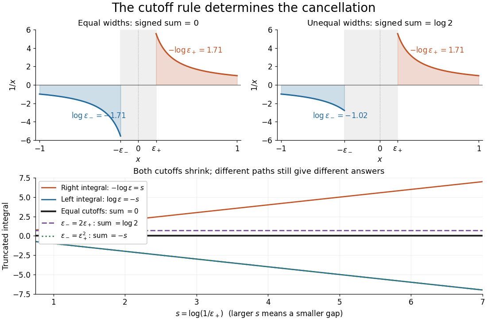
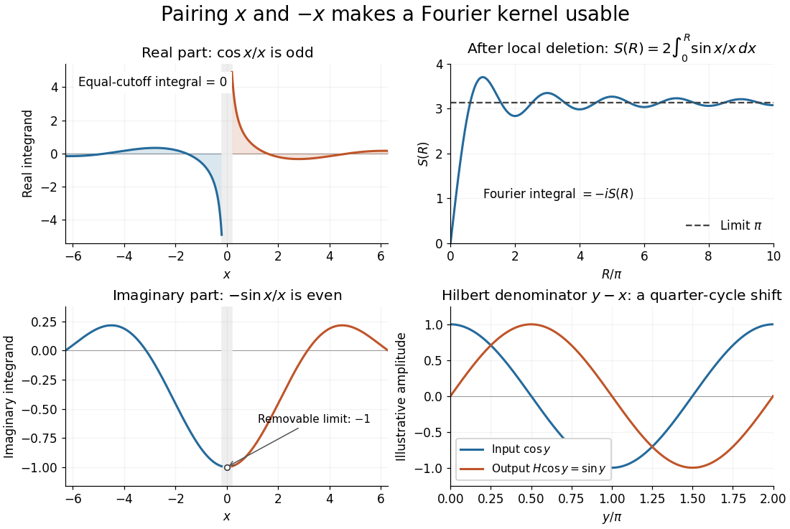

# Cauchy principal value

↑ **Parent:** [Complex analysis](complex-analysis-split.md)  
ⓦ [Wiki](https://en.wikipedia.org/wiki/Cauchy_principal_value)

The [Cauchy principal value](cauchy-principal-value.md) assigns an [integral](integral-split.md) a value by a specified symmetric [limit](limit-of-a-function.md). Its simplest example is $1/x$ on $[-1,1]$: delete $(-\varepsilon,\varepsilon)$, integrate what remains, and obtain zero for every $\varepsilon>0$. The positive [signed area under a graph](signed-area-under-a-graph.md) cancels the negative one, although each grows without bound as the gap closes. This is a useful cancellation rule, but it does not make the ordinary [improper integral](improper-integral.md) exist.

**[Figure 5](#image-equal-local-cutoffs-cancel-the-signed-areas-of-1-x-unequal-cutoffs-leave-a-logarithmic-remainder-even-when-both-shrink-to-zero). Equal local cutoffs cancel the signed areas of 1/x; unequal cutoffs leave a logarithmic remainder, even when both shrink to zero**.

Precisely, let $a<c<b$ be finite and suppose that the two truncated [integrals](integral-split.md) below exist for every sufficiently small $\varepsilon>0$. The local [Cauchy principal value](cauchy-principal-value.md) at $c$ is

$$
\operatorname{PV}\int_a^b f(x)\,dx
=\lim_{\varepsilon\downarrow0}\left(\int_a^{c-\varepsilon}f(x)\,dx+\int_{c+\varepsilon}^b f(x)\,dx\right),
$$

provided the combined [limit](limit-of-a-function.md) is finite. The same $\varepsilon$ removes equal distances on the two sides of $c$; the outer endpoints $a,b$ need not be equally distant from $c$. By contrast, the ordinary [improper integral](improper-integral.md) requires both one-sided [limits](limit-of-a-function.md) to be finite separately before adding them. Whenever those separate [limits](limit-of-a-function.md) exist, the [Cauchy principal value](cauchy-principal-value.md) agrees with their sum.[NIST DLMF, equation 1.4.24: local principal value](https://dlmf.nist.gov/1.4#E24)

For $1/x$, the [natural logarithm](natural-logarithm.md) gives

$$
\int_{-1}^{-\varepsilon}\frac{dx}{x}=\log\varepsilon\longrightarrow-\infty,
\qquad
\int_{\varepsilon}^{1}\frac{dx}{x}=-\log\varepsilon\longrightarrow+\infty.
$$

Their sum is zero at every positive cutoff, so $\operatorname{PV}\int_{-1}^1dx/x=0$. This calculation adds two finite truncated [integrals](integral-split.md) and then takes a [limit](limit-of-a-function.md); it never assigns a meaning to $-\infty+\infty$. If the left and right deletion widths are instead $\varepsilon_-$ and $\varepsilon_+$, then

$$
\int_{-1}^{-\varepsilon_-}\frac{dx}{x}+\int_{\varepsilon_+}^{1}\frac{dx}{x}
=\log\frac{\varepsilon_-}{\varepsilon_+}.
$$

Thus a ratio tending to $r>0$ produces $\log r$: choosing $\varepsilon_-=2\varepsilon_+$ gives $\log2$, and choosing $\varepsilon_-=\varepsilon_+^2$ makes the sum tend to $-\infty$. Both widths can tend to zero without selecting a unique answer. The local [Cauchy principal value](cauchy-principal-value.md) selects the ratio $1$.

Unequal outer endpoints leave a finite contribution even with symmetric local deletion. For $A,B>0$,

$$
\operatorname{PV}\int_{-A}^{B}\frac{dx}{x}=\log\frac BA;
\qquad
\operatorname{PV}\int_{-1}^{2}\frac{dx}{x}=\log2.
$$

More generally, for a function $h$ with continuous [derivative](derivative.md) on $[a,b]$, subtract its value at the possible [simple pole](simple-pole.md):

$$
\operatorname{PV}\int_a^b\frac{h(x)}{x-c}\,dx
=h(c)\log\frac{b-c}{c-a}
+\int_a^b\frac{h(x)-h(c)}{x-c}\,dx.
$$

The quotient in the last [integral](integral-split.md) extends continuously to $h'(c)$ at $c$. This formula explains both the cancellation and a practical way to compute it: integrate a continuous remainder instead of subtracting two large, nearly equal divergent contributions.

A finite [Cauchy principal value](cauchy-principal-value.md) is weaker than [absolute convergence](absolute-convergence.md). Indeed,

$$
\int_{-1}^{-\varepsilon}\frac{dx}{|x|}+\int_{\varepsilon}^{1}\frac{dx}{|x|}
=2\log(1/\varepsilon)\longrightarrow+\infty.
$$

Taking the [absolute value](absolute-value.md) destroys the cancellation. Even the [Cauchy principal value](cauchy-principal-value.md) need not exist: $1/x^2$ gives $2(1/\varepsilon-1)\to+\infty$ on the same truncated interval. Absolute integrability makes the cutoff prescription unnecessary; an ordinary [improper integral](improper-integral.md) can also converge without [absolute convergence](absolute-convergence.md), as the [Dirichlet integral](dirichlet-integral.md) illustrates. The three notions should therefore be checked separately.

There is an independent [Cauchy principal value](cauchy-principal-value.md) at infinity. For a [function](function-split.md) integrable on every finite interval, define

$$
\operatorname{PV}\int_{-\infty}^{\infty}f(x)\,dx
=\lim_{R\to\infty}\int_{-R}^R f(x)\,dx,
$$

when the [limit](limit-of-a-function.md) is finite. The ordinary [improper integral](improper-integral.md) instead requires convergence of the two tails separately.[NIST DLMF, equation 1.4.25: principal value at infinity](https://dlmf.nist.gov/1.4#E25) For example, the [odd function](odd-function.md) $f(x)=x/(1+x^2)$ has no finite singularity and its symmetric [integral](integral-split.md) is always zero, whereas its two tails diverge. Unequal truncations give

$$
\int_{-A}^B\frac{x}{1+x^2}\,dx
=\frac12\log\frac{1+B^2}{1+A^2}.
$$

Letting $B/A\to r>0$ as $A,B\to\infty$ yields $\log r$. Symmetry at infinity is therefore a separate choice from symmetry near a finite [pole](pole.md). When both are needed, state both prescriptions, for example first take the local [Cauchy principal value](cauchy-principal-value.md) at fixed $R$ and then let $R\to\infty$; coupling the two cutoffs requires its own justification.

The local cancellation also defines the [principal-value reciprocal distribution](principal-value-reciprocal-distribution.md). Since $1/x$ is not a [locally integrable function](locally-integrable-function.md) across zero, its action on a [test function](test-function.md) $\varphi$ is prescribed by

$$
\left\langle\operatorname{PV}\frac1x,\varphi\right\rangle
=\lim_{\varepsilon\downarrow0}\int_{|x|>\varepsilon}\frac{\varphi(x)}x\,dx
=\int_0^\infty\frac{\varphi(x)-\varphi(-x)}x\,dx.
$$

The [test function](test-function.md) is smooth with [compact support](compact-support.md), so the last numerator removes the singular constant contribution: its quotient tends to $2\varphi'(0)$ at zero and vanishes sufficiently far away. This defines a [distribution](distribution-mathematical-analysis.md), not a finite pointwise value of $1/x$ at zero. It extends to [Schwartz functions](schwartz-function.md) as a [tempered distribution](tempered-distribution.md), and is also the [distributional derivative of the logarithmic modulus](distributional-derivative-of-the-logarithmic-modulus.md).[Hunter and Nachtergaele, Applied Analysis, Chapter 11, Example 11.7, p. 293: principal-value reciprocal distribution](https://www.math.ucdavis.edu/~hunter/book/ch11.pdf) Using an asymmetric local cutoff ratio $r>0$ would add $(\log r)\varphi(0)$ to this action, equivalently adding $(\log r)$ times the [Dirac delta function](dirac-delta-function.md). Thus the cutoff choice matters even after passing to [distributions](distribution-mathematical-analysis.md).

Why keep this prescription? A [Fourier transform](fourier-transform-split.md) naturally encounters such a kernel. With $\widehat f(k)=\int_{\mathbb R}f(x)e^{-ikx}\,dx$, pairing $x$ and $-x$ gives, for $k\ne0$ and $0<\varepsilon<R$,

$$
\int_{\varepsilon<|x|<R}\frac{e^{-ikx}}x\,dx
=-2i\int_{\varepsilon}^{R}\frac{\sin(kx)}x\,dx
\longrightarrow-i\pi\operatorname{sgn}(k).
$$

The [cosine](cosine.md) contribution is an [odd function](odd-function.md) and cancels locally; the [sine](sine.md) contribution has a removable singularity and its tail converges by the [Dirichlet integral](dirichlet-integral.md). This is the [Fourier transform of a principal-value reciprocal](principal-value-fourier-transform-of-a-real-pole.md), with $\operatorname{sgn}$ the [sign function](sign-function.md). The displayed computation is a prescribed [limit](limit-of-a-function.md) for each nonzero $k$; the corresponding [Fourier transform](fourier-transform-split.md) identity is understood as an identity of [tempered distributions](tempered-distribution.md), rather than the transform of an absolutely integrable reciprocal function.

**[Figure 6](#image-fourier-cancellation-for-1-x-the-odd-cosine-contribution-disappears-the-sine-contribution-approaches-minus-i-times-pi-and-the-hilbert-transform-turns-a-cosine-into-a-sine). Fourier cancellation for 1/x: the odd cosine contribution disappears, the sine contribution approaches minus i times pi, and the Hilbert transform turns a cosine into a sine**.

The [Hilbert transform](hilbert-transform.md) uses exactly this [principal-value reciprocal distribution](principal-value-reciprocal-distribution.md) as a [convolution kernel](convolution-kernel.md). In the convention already used here,

$$
Hf(y)=\frac1\pi\operatorname{PV}\int_{\mathbb R}\frac{f(x)}{y-x}\,dx,
\qquad
\widehat{Hf}(k)=-i\operatorname{sgn}(k)\widehat f(k)
$$

for [Schwartz functions](schwartz-function.md) $f$, with the second identity interpreted through [tempered distributions](tempered-distribution.md). Hence the singular [integral](integral-split.md) has a simple description as a [Fourier multiplier](fourier-multiplier.md).[Stroock, MIT Topics in Fourier Analysis, Lecture 21, p. 1: principal-value convolution kernel and its Fourier multiplier; signs adapted to the displayed convention](https://ocw.mit.edu/courses/res-18-015-topics-in-fourier-analysis-spring-2024/mitres_18_015_s24_lec21.pdf) For the bounded pure tone $\cos(\omega x)$ with $\omega>0$, the same calculation with symmetric deletion about $x=y$ and symmetric truncation of $x-y$ at infinity gives $H\cos(\omega y)=\sin(\omega y)$ and $H\sin(\omega y)=-\cos(\omega y)$. These tones lie outside the [Schwartz space](schwartz-space.md); their prescribed [Cauchy principal values](cauchy-principal-value.md) explain the quarter-cycle shift in the figure. Both figures are calculated mathematical illustrations. Reversing the Hilbert denominator reverses these signs; NIST uses that opposite convention.[NIST DLMF, equations 1.14.41 and 1.14.46: Hilbert transform and Fourier sign conventions](https://dlmf.nist.gov/1.14#v)

**Table of contents**

- [Differentiating a principal-value integral across a fixed simple pole](differentiating-a-principal-value-integral-across-a-fixed-simple-pole.md)
- [Principal-value beta integral](principal-value-beta-integral.md)

## ↑ Ancestors (5)

1. [Complex analysis](complex-analysis-split.md)
2. [Analysis](analysis-split.md)
3. [Area of mathematics](area-of-mathematics.md)
4. [Mathematics](mathematics-split.md)
5. [Codex Wiki](split.md)

## ← Incoming links (51)

- [Borel integral with a simple pole](borel-integral-with-a-simple-pole.md)
- [Cauchy principal value](cauchy-principal-value.md)
- [Causal Fourier resolvent of a point-driven fixed string](causal-fourier-resolvent-of-a-point-driven-fixed-string.md)
- [Convolution of a Cauchy distribution and a uniform distribution](convolution-of-a-cauchy-distribution-and-a-uniform-distribution.md)
- [Differentiating a principal-value integral across a fixed simple pole](differentiating-a-principal-value-integral-across-a-fixed-simple-pole.md)
- [Fourier transform of the Heaviside step function](fourier-transform-of-the-heaviside-step-function.md)
- [Friedel density tail from a derivative singularity](friedel-density-tail-from-a-derivative-singularity.md)
- [Gaussian saddle coalescing with a simple pole](gaussian-saddle-coalescing-with-a-simple-pole.md)
- [Heat-kernel convergence from a conditionally convergent Gaussian integral](heat-kernel-convergence-from-a-conditionally-convergent-gaussian-integral.md)
- [Improper line integral](improper-line-integral.md)
- [Kramers-Kronig relations](kramers-kronig-relations.md)
- [Legendre expansion of thin-disk gravity](legendre-expansion-of-thin-disk-gravity.md)
- [Logarithmic integral function](logarithmic-integral-function.md)
- [Neutral Rayleigh-mode dispersion correction](neutral-rayleigh-mode-dispersion-correction.md)
- [Solution](past-exam-of-the-advanced-quantum-condensed-matter-physics-course-of-the-university-of-cambridge/2013/paper-1/1/solution.md)
- [Solution](past-exam-of-the-mathematics-course-of-the-university-of-cambridge/2002/iii/paper-50/3/solution.md)
- [Solution](past-exam-of-the-mathematics-course-of-the-university-of-cambridge/2004/iii/paper-72/4/a/solution.md)
- [Solution](past-exam-of-the-mathematics-course-of-the-university-of-cambridge/2004/iii/paper-72/4/b/solution.md)
- [Solution](past-exam-of-the-mathematics-course-of-the-university-of-cambridge/2004/iii/paper-76/1/b/i/solution.md)
- [Solution](past-exam-of-the-mathematics-course-of-the-university-of-cambridge/2004/iii/paper-76/1/b/iii/solution.md)
- [Solution](past-exam-of-the-mathematics-course-of-the-university-of-cambridge/2004/iii/paper-76/2/i/solution.md)
- [Solution](past-exam-of-the-mathematics-course-of-the-university-of-cambridge/2005/iii/paper-67/2/a/solution.md)
- [Solution](past-exam-of-the-mathematics-course-of-the-university-of-cambridge/2006/ii/paper-3/8e/solution.md)
- [Solution](past-exam-of-the-mathematics-course-of-the-university-of-cambridge/2008/iii/paper-81/2/solution.md)
- [Solution](past-exam-of-the-mathematics-course-of-the-university-of-cambridge/2009/iii/paper-76/3/solution.md)
- [Solution](past-exam-of-the-mathematics-course-of-the-university-of-cambridge/2010/ii/paper-2/8e/solution.md)
- [Solution](past-exam-of-the-mathematics-course-of-the-university-of-cambridge/2013/iii/paper-67/4/b/ii/solution.md)
- [Solution](past-exam-of-the-mathematics-course-of-the-university-of-cambridge/2015/ii/paper-3/6b/solution.md)
- [Solution](past-exam-of-the-mathematics-course-of-the-university-of-cambridge/2015/iii/paper-62/4/solution.md)
- [Solution](past-exam-of-the-mathematics-course-of-the-university-of-cambridge/2015/iii/paper-71/2/b/solution.md)
- [Solution](past-exam-of-the-mathematics-course-of-the-university-of-cambridge/2015/iii/paper-72/3/solution.md)
- [Solution](past-exam-of-the-mathematics-course-of-the-university-of-cambridge/2017/ii/paper-1/7e/solution.md)
- [Solution](past-exam-of-the-mathematics-course-of-the-university-of-cambridge/2017/iii/paper-336/2/b/solution.md)
- [Solution](past-exam-of-the-mathematics-course-of-the-university-of-cambridge/2018/iii/paper-327/2/i/solution.md)
- [Solution](past-exam-of-the-mathematics-course-of-the-university-of-cambridge/2018/iii/paper-336/1/b/a/solution.md)
- [Solution](past-exam-of-the-mathematics-course-of-the-university-of-cambridge/2018/iii/paper-336/1/c/solution.md)
- [Solution](past-exam-of-the-mathematics-course-of-the-university-of-cambridge/2019/ii/paper-2/7a/solution.md)
- [Solution](past-exam-of-the-mathematics-course-of-the-university-of-cambridge/2020/ii/paper-4/7e/solution.md)
- [Solution](past-exam-of-the-mathematics-course-of-the-university-of-cambridge/2022/ii/paper-1/7e/solution.md)
- [Solution](past-exam-of-the-mathematics-course-of-the-university-of-cambridge/2025/ii/paper-1/7e/solution.md)
- [Solution](past-exam-of-the-mathematics-course-of-the-year-1-of-the-natural-sciences-course-of-the-university-of-cambridge/2018/paper-1/16/e/solution.md)
- [Solution](past-exam-of-the-mathematics-course-of-the-year-1-of-the-natural-sciences-course-of-the-university-of-cambridge/2019/paper-2/14/d/iii/solution.md)
- [Solution](past-exam-of-the-mathematics-course-of-the-year-1-of-the-natural-sciences-course-of-the-university-of-cambridge/2022/paper-1/20/a/solution.md)
- [Solution](past-exam-of-the-mathematics-course-of-the-year-2-of-the-natural-sciences-course-of-the-university-of-cambridge/2012/paper-2/3/solution.md)
- [Solution](past-exam-of-the-mathematics-course-of-the-year-2-of-the-natural-sciences-course-of-the-university-of-cambridge/2021/paper-2/5/b/iii/solution.md)
- [Principal-value Fourier transform of a real pole](principal-value-fourier-transform-of-a-real-pole.md)
- [Principal-value reciprocal distribution](principal-value-reciprocal-distribution.md)
- [Radial Fourier representation of the Helmholtz Green function](radial-fourier-representation-of-the-helmholtz-green-function.md)
- [Residue theorem](residue-theorem.md)
- [Simple saddle coinciding with a simple pole](simple-saddle-coinciding-with-a-simple-pole.md)
- [Upper-half-plane indentation rule](upper-half-plane-indentation-rule.md)
