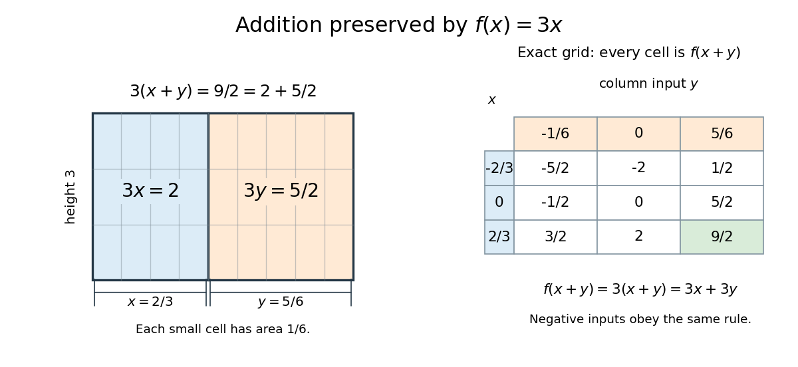

<h1 id="cauchy-s-functional-equation">Cauchy's functional equation</h1>

↑ **Parent:** [Functional equation](functional-equation.md)  
ⓦ [Wiki](https://en.wikipedia.org/wiki/Cauchy's_functional_equation)

[Cauchy's functional equation](cauchy-s-functional-equation.md) asks for [functions](function-split.md) $f:\mathbb R\to\mathbb R$ satisfying

$$
f(x+y)=f(x)+f(y)\qquad(x,y\in\mathbb R).
$$

The identity must hold for every pair of [real numbers](real-number.md), and a solution is an [additive function](additive-function.md). It says that combining two inputs before applying $f$ gives the same result as combining their outputs.[Daniel Reem, Remarks on the Cauchy functional equation and variations of it, version 7, §1.1, Eq. (1) and the real domain](remarks-on-the-cauchy-functional-equation-and-variations-of-it-by-daniel-reem.md)

For example, $f(x)=3x$ satisfies the identity because $3(x+y)=3x+3y$. At $x=2/3$ and $y=5/6$ the two sides give

$$
f\left(\frac23+\frac56\right)=f\left(\frac32\right)=\frac92,
\qquad
f\left(\frac23\right)+f\left(\frac56\right)=2+\frac52=\frac92.
$$

For positive widths, a [rectangle](rectangle.md) of height three makes this visible: cutting its width into $x$ and $y$ partitions its [area](surface-area.md) into $3x$ and $3y$. The same identity also holds for negative inputs, where $3x$ is a signed output rather than an ordinary [area](surface-area.md).

**[Figure 2](#image-the-function-f-x-3x-preserves-addition-partitioning-a-rectangle-and-checking-exact-rational-grid-sums). The function f(x)=3x preserves addition: partitioning a rectangle and checking exact rational grid sums**.

Every [function](function-split.md) $f(x)=cx$ with a fixed [real number](real-number.md) $c$ solves [Cauchy's functional equation](cauchy-s-functional-equation.md). The surprising question is whether these are all the solutions. [Rational homogeneity of an additive function](rational-homogeneity-of-an-additive-function.md) forces $f(q)=qf(1)$ for every [rational number](rational-number.md) $q$, but reaching an [irrational number](irrational-number.md) requires an additional argument. [Continuity](continuous-function.md) at just one point or being a [bounded function](bounded-function.md) on an [interval](interval-mathematics.md) of positive length supplies that argument; without such a condition, [discontinuous additive functions](discontinuous-additive-function.md) exist.[Reem, version 7, §1.1, printed p. 2: classical continuity and bounded-interval conditions and nonlinear solutions](remarks-on-the-cauchy-functional-equation-and-variations-of-it-by-daniel-reem.md)

This makes [Cauchy's functional equation](cauchy-s-functional-equation.md) a useful test of the boundary between [algebra](algebra-split.md) and [analysis](analysis-split.md): a rule about [addition](addition.md) fixes all rational multiples, while a tiny amount of [continuity](continuous-function.md) fixes the entire [real line](real-line.md). For example, the [continuous exponential functional equation](continuous-exponential-functional-equation.md) reduces to an [additive function](additive-function.md) after taking a [logarithm](logarithm.md), so this result explains why its nonzero solutions are [exponential functions](exponential-function.md).

**Table of contents**

- [Additive function](additive-function.md)
  - [Rational homogeneity of an additive function](rational-homogeneity-of-an-additive-function.md)
  - [Additive function continuous at one point is linear](additive-function-continuous-at-one-point-is-linear.md)
  - [Additive function bounded on an interval is linear](additive-function-bounded-on-an-interval-is-linear.md)
  - [Measurable additive function is continuous](measurable-additive-function-is-continuous.md)
  - [Continuous additive function on the nonnegative real numbers](continuous-additive-function-on-the-nonnegative-real-numbers.md)
  - [Discontinuous additive function](discontinuous-additive-function.md)

## ↑ Ancestors (5)

1. [Functional equation](functional-equation.md)
2. [Analysis](analysis-split.md)
3. [Area of mathematics](area-of-mathematics.md)
4. [Mathematics](mathematics-split.md)
5. [Codex Wiki](split.md)

## ← Incoming links (3)

- [Additive function bounded on an interval is linear](additive-function-bounded-on-an-interval-is-linear.md)
- [Cauchy's functional equation](cauchy-s-functional-equation.md)
- [Discontinuous additive function](discontinuous-additive-function.md)
