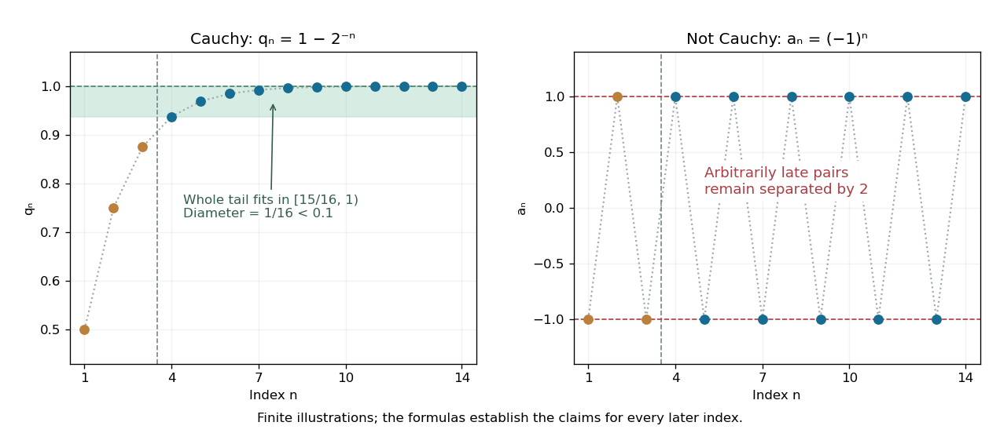
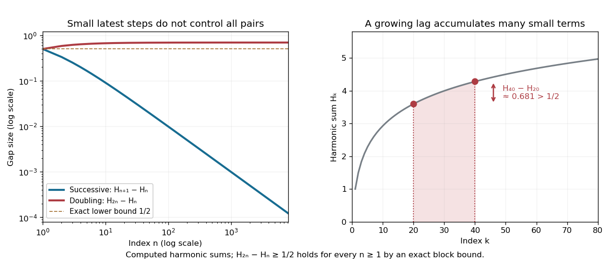

# Cauchy sequence

↑ **Parent:** [Sequence and series](sequence-and-series-split.md)  
ⓦ [Wiki](https://en.wikipedia.org/wiki/Cauchy_sequence)

A [Cauchy sequence](cauchy-sequence.md) is a [sequence](sequence.md) whose sufficiently late terms are all close to one another. In a [metric space](metric-space.md) $(X,d)$, the precise condition is

$$
\forall\varepsilon>0\;\exists N\in\mathbb N_{>0}\;\forall m,n\geq N:\ d(x_m,x_n)<\varepsilon.
$$

For [real numbers](real-number.md) with their usual [metric](metric.md), $d(x_m,x_n)=|x_m-x_n|$. The useful feature is that the definition compares computed terms to other computed terms: it does not require an already known [limit of a sequence](limit-of-a-sequence.md). The one index $N$ must control every pair of later indices, not merely successive terms. [Lebl, Basic Analysis I, §2.4: Cauchy sequences and the role of all late pairs](https://www.jirka.org/ra/html/sec_cauchy.html).

For an explicit example, take $q_n=1-2^{-n}$ for $n\geq1$. Its [tail of a sequence](tail-of-a-sequence.md) beginning at $N$ lies in $[1-2^{-N},1)$, and for every $m,n\geq N$,

$$
|q_m-q_n|=|2^{-n}-2^{-m}|<2^{-N}.
$$

Choose $N$ with $2^{-N}<\varepsilon$ to certify the entire future [sequence](sequence.md). For $\varepsilon=0.1$, $N=4$ works because $2^{-4}=0.0625$. The [limit of a sequence](limit-of-a-sequence.md) is one, but the pairwise bound establishes the [Cauchy sequence](cauchy-sequence.md) property without first needing that answer. By contrast, $a_n=(-1)^n$ is not a [Cauchy sequence](cauchy-sequence.md): arbitrarily late [even integers](even-number.md) and [odd integers](odd-integer.md) give values separated by two. [MIT 18.100A, Lecture 10, Definition 1, Negation 3 and Example 4](https://www.ocw.mit.edu/courses/18-100a-real-analysis-fall-2020/mit18_100af20_lec102.pdf).

**[Figure 19](#image-a-cauchy-sequence-confines-every-sufficiently-late-pair-to-a-small-band-persistent-alternation-cannot-do-so). A Cauchy sequence confines every sufficiently late pair to a small band; persistent alternation cannot do so**. The original geometric example $q_n=1-2^{-n}$ has all terms with $n\geq4$ in $[15/16,1)$, a band narrower than $0.1$. Only finitely many terms are drawn; the formula certifies the entire tail. The alternating example $(-1)^n$ continues to attain both $-1$ and $1$ arbitrarily late.

Tiny successive changes do not provide this guarantee. For the [harmonic numbers](harmonic-number.md) $H_n=\sum_{j=1}^n1/j$, the successive difference $H_{n+1}-H_n=1/(n+1)$ tends to zero, but

$$
H_{2n}-H_n=\sum_{j=n+1}^{2n}\frac1j\geq n\frac1{2n}=\frac12.
$$

Thus, beyond every proposed $N$, choosing $n\geq N$ and $m=2n$ defeats the fixed tolerance $\varepsilon=1/2$. Even every fixed positive lag $h$ passes the weaker test: $0<H_{n+h}-H_n\leq h/(n+1)\to0$. The failing lag grows with $n$, as explained more generally by [convergence from arbitrary variable-lag increments](convergence-from-arbitrary-variable-lag-increments.md). [Lebl, Basic Analysis I, §2.4: shrinking fixed-lag increments do not imply the Cauchy condition](https://www.jirka.org/ra/html/sec_cauchy.html).

**[Figure 20](#image-harmonic-numbers-take-vanishing-successive-steps-while-retaining-a-nonvanishing-gap-between-indices-n-and-2n). Harmonic numbers take vanishing successive steps while retaining a nonvanishing gap between indices $n$ and $2n$**. The blue curve is $H_{n+1}-H_n=1/(n+1)$; the red curve is $H_{2n}-H_n$. The exact lower bound $1/2$ holds for every positive [integer](integer-split.md) $n$, not just the plotted sample. The shaded region between $n$ and $2n$ in the right panel illustrates how many individually small terms produce a substantial gap.

Every [convergent sequence](convergent-sequence.md) in a [metric space](metric-space.md) is a [Cauchy sequence](cauchy-sequence.md): apply the [triangle inequality](triangle-inequality.md) to two late terms and their common [limit of a sequence](limit-of-a-sequence.md). The reverse implication requires [completeness](completeness.md). It holds in the [real numbers](real-number.md) by [completeness of the real numbers](completeness-of-the-real-numbers.md), but can fail in the [rational numbers](rational-number.md): the rational endpoints from the [bisection method](bisection-method.md) approaching $\sqrt2$ are a [Cauchy sequence](cauchy-sequence.md) with no rational [limit of a sequence](limit-of-a-sequence.md). The existing construction in [completeness of the real numbers](completeness-of-the-real-numbers.md) shows how this happens. A [Cauchy sequence](cauchy-sequence.md) is always a [bounded sequence](bounded-sequence.md); in $\mathbb R$, boundedness gives a [convergent subsequence](convergent-subsequence.md) by the [Bolzano-Weierstrass theorem](bolzano-weierstrass-theorem.md), and the pairwise condition forces the whole [sequence](sequence.md) to share its limit. [MIT 18.100A, Lecture 10, Theorems 5–7: boundedness, subsequences and real completeness](https://www.ocw.mit.edu/courses/18-100a-real-analysis-fall-2020/mit18_100af20_lec102.pdf).

**Table of contents**

- [Tail diameter of a sequence](tail-diameter-of-a-sequence.md)
- [Summable increments imply a Cauchy sequence](summable-increments-imply-a-cauchy-sequence.md)
- [Convergence from arbitrary variable-lag increments](convergence-from-arbitrary-variable-lag-increments.md)
- [Cauchy subsequence](cauchy-subsequence.md)
- [Completeness of the real numbers](completeness-of-the-real-numbers.md)
  - [Dedekind cut](dedekind-cut.md)
  - [Least-upper-bound property](least-upper-bound-property.md)

## ↑ Ancestors (6)

1. [Sequence and series](sequence-and-series-split.md)
2. [Real analysis](real-analysis-split.md)
3. [Analysis](analysis-split.md)
4. [Area of mathematics](area-of-mathematics.md)
5. [Mathematics](mathematics-split.md)
6. [Codex Wiki](split.md)

## ← Incoming links (155)

- [Absolutely summable sequence space](absolutely-summable-sequence-space.md)
- [Algebraic closure of the p-adic numbers is not complete](algebraic-closure-of-the-p-adic-numbers-is-not-complete.md)
- [Banach space](banach-space-split.md)
- [Bounded-variation multipliers of a convergent series](bounded-variation-multipliers-of-a-convergent-series.md)
- [Cauchy sequence](cauchy-sequence.md)
- [Cauchy-sequence construction of a metric completion](cauchy-sequence-construction-of-a-metric-completion.md)
- [Cauchy subsequence](cauchy-subsequence.md)
- [Closed-range bound on the kernel complement](closed-range-bound-on-the-kernel-complement.md)
- [Closest point theorem for a closed convex subset of Lp](closest-point-theorem-for-a-closed-convex-subset-of-lp.md)
- [Completeness](completeness.md)
- [Completeness forced by uniformly bounded lifting](completeness-forced-by-uniformly-bounded-lifting.md)
- [Completeness of homogeneous Riemannian manifolds](completeness-of-homogeneous-riemannian-manifolds.md)
- [Completeness of the bounded-variation space](completeness-of-the-bounded-variation-space.md)
- [Completeness of the real numbers](completeness-of-the-real-numbers.md)
- [Completion of a normed space](completion-of-a-normed-space.md)
- [Contraction mapping theorem](contraction-mapping-theorem.md)
- [Contraction property of closed subsets characterizes completeness](contraction-property-of-closed-subsets-characterizes-completeness.md)
- [Convergence from arbitrary variable-lag increments](convergence-from-arbitrary-variable-lag-increments.md)
- [Derivative seminorms on a compact interval](derivative-seminorms-on-a-compact-interval.md)
- [Discrete metric](discrete-metric.md)
- [Discretely valued field](discretely-valued-field.md)
- [Dyadic-block alternation of reciprocal terms](dyadic-block-alternation-of-reciprocal-terms.md)
- [Exponentially weighted L2 space](exponentially-weighted-l2-space.md)
- [Fréchet space](frechet-space.md)
- [Heine-Borel theorem](heine-borel-theorem.md)
- [Hilbert projection theorem](hilbert-projection-theorem.md)
- [Hilbert space](hilbert-space-split.md)
- [Hilbert space completion](hilbert-space-completion.md)
- [Incompleteness of finitely supported sequences](incompleteness-of-finitely-supported-sequences.md)
- [Infinite-dimensional bounded sequences can lack convergent subsequences](infinite-dimensional-bounded-sequences-can-lack-convergent-subsequences.md)
- [Lax-Milgram theorem](lax-milgram-theorem.md)
- [Limit inferior and limit superior](limit-inferior-and-limit-superior.md)
- [Metric space](metric-space.md)
- [Minkowski inequality for error aggregation](minkowski-inequality-for-error-aggregation.md)
- [Newton iteration over a valued field](newton-iteration-over-a-valued-field.md)
- [P-adic number](p-adic-number.md)
- [Solution](past-exam-of-the-mathematics-course-of-the-university-of-cambridge/2001/ia/paper-1/9d/iii/solution.md)
- [Solution](past-exam-of-the-mathematics-course-of-the-university-of-cambridge/2001/ib/paper-1/10a/solution.md)
- [Solution](past-exam-of-the-mathematics-course-of-the-university-of-cambridge/2001/ib/paper-2/10a/solution.md)
- [Solution](past-exam-of-the-mathematics-course-of-the-university-of-cambridge/2001/ib/paper-2/1a/solution.md)
- [Solution](past-exam-of-the-mathematics-course-of-the-university-of-cambridge/2001/iii/paper-12/5/solution.md)
- [Solution](past-exam-of-the-mathematics-course-of-the-university-of-cambridge/2002/ia/paper-1/9c/iv/solution.md)
- [Solution](past-exam-of-the-mathematics-course-of-the-university-of-cambridge/2002/ib/paper-2/1e/solution.md)
- [Solution](past-exam-of-the-mathematics-course-of-the-university-of-cambridge/2002/iii/paper-6/1/solution.md)
- [Solution](past-exam-of-the-mathematics-course-of-the-university-of-cambridge/2003/ib/paper-1/10f/solution.md)
- [Solution](past-exam-of-the-mathematics-course-of-the-university-of-cambridge/2003/ib/paper-3/11f/solution.md)
- [Solution](past-exam-of-the-mathematics-course-of-the-university-of-cambridge/2003/ib/paper-3/1f/solution.md)
- [Solution](past-exam-of-the-mathematics-course-of-the-university-of-cambridge/2003/iii/paper-6/1/solution.md)
- [Solution](past-exam-of-the-mathematics-course-of-the-university-of-cambridge/2004/ib/paper-2/14g/solution.md)
- [Solution](past-exam-of-the-mathematics-course-of-the-university-of-cambridge/2004/ib/paper-3/16f/solution.md)
- [Solution](past-exam-of-the-mathematics-course-of-the-university-of-cambridge/2004/iii/paper-19/2/a/solution.md)
- [Solution](past-exam-of-the-mathematics-course-of-the-university-of-cambridge/2004/iii/paper-25/2/solution.md)
- [Solution](past-exam-of-the-mathematics-course-of-the-university-of-cambridge/2004/iii/paper-6/1/solution.md)
- [Solution](past-exam-of-the-mathematics-course-of-the-university-of-cambridge/2005/iii/paper-30/2/solution.md)
- [Solution](past-exam-of-the-mathematics-course-of-the-university-of-cambridge/2005/iii/paper-6/1/i/solution.md)
- [Solution](past-exam-of-the-mathematics-course-of-the-university-of-cambridge/2005/iii/paper-6/1/iv/solution.md)
- [Solution](past-exam-of-the-mathematics-course-of-the-university-of-cambridge/2006/ib/paper-4/3f/solution.md)
- [Solution](past-exam-of-the-mathematics-course-of-the-university-of-cambridge/2006/iii/paper-15/3/solution.md)
- [Solution](past-exam-of-the-mathematics-course-of-the-university-of-cambridge/2006/iii/paper-27/4/iii/solution.md)
- [Solution](past-exam-of-the-mathematics-course-of-the-university-of-cambridge/2006/iii/paper-6/1/solution.md)
- [Solution](past-exam-of-the-mathematics-course-of-the-university-of-cambridge/2007/ib/paper-2/4a/iii/solution.md)
- [Solution](past-exam-of-the-mathematics-course-of-the-university-of-cambridge/2007/ib/paper-3/13h/solution.md)
- [Solution](past-exam-of-the-mathematics-course-of-the-university-of-cambridge/2007/ib/paper-4/13h/solution.md)
- [Solution](past-exam-of-the-mathematics-course-of-the-university-of-cambridge/2007/ii/paper-1/22g/solution.md)
- [Solution](past-exam-of-the-mathematics-course-of-the-university-of-cambridge/2007/iii/paper-28/2/a/solution.md)
- [Solution](past-exam-of-the-mathematics-course-of-the-university-of-cambridge/2008/ib/paper-1/11f/solution.md)
- [Solution](past-exam-of-the-mathematics-course-of-the-university-of-cambridge/2008/ib/paper-4/13f/solution.md)
- [Solution](past-exam-of-the-mathematics-course-of-the-university-of-cambridge/2008/ii/paper-3/2f/b/solution.md)
- [Solution](past-exam-of-the-mathematics-course-of-the-university-of-cambridge/2008/iii/paper-29/1/a/solution.md)
- [Solution](past-exam-of-the-mathematics-course-of-the-university-of-cambridge/2008/iii/paper-34/3/a/solution.md)
- [Solution](past-exam-of-the-mathematics-course-of-the-university-of-cambridge/2008/iii/paper-34/3/c/solution.md)
- [Solution](past-exam-of-the-mathematics-course-of-the-university-of-cambridge/2009/ib/paper-2/3e/solution.md)
- [Solution](past-exam-of-the-mathematics-course-of-the-university-of-cambridge/2009/ib/paper-4/13e/solution.md)
- [Solution](past-exam-of-the-mathematics-course-of-the-university-of-cambridge/2009/ii/paper-1/22h/a/solution.md)
- [Solution](past-exam-of-the-mathematics-course-of-the-university-of-cambridge/2009/iii/paper-10/5/e/solution.md)
- [Solution](past-exam-of-the-mathematics-course-of-the-university-of-cambridge/2009/iii/paper-28/1/i/solution.md)
- [Solution](past-exam-of-the-mathematics-course-of-the-university-of-cambridge/2009/iii/paper-8/1/b/solution.md)
- [Solution](past-exam-of-the-mathematics-course-of-the-university-of-cambridge/2009/iii/paper-9/1/a/solution.md)
- [Solution](past-exam-of-the-mathematics-course-of-the-university-of-cambridge/2009/iii/paper-9/2/a/solution.md)
- [Solution](past-exam-of-the-mathematics-course-of-the-university-of-cambridge/2010/ii/paper-2/22h/a/solution.md)
- [Solution](past-exam-of-the-mathematics-course-of-the-university-of-cambridge/2010/iii/paper-24/3/c/solution.md)
- [Solution](past-exam-of-the-mathematics-course-of-the-university-of-cambridge/2010/iii/paper-64/4/solution.md)
- [Solution](past-exam-of-the-mathematics-course-of-the-university-of-cambridge/2012/ia/paper-1/10d/iv/solution.md)
- [Solution](past-exam-of-the-mathematics-course-of-the-university-of-cambridge/2012/iii/paper-14/3/solution.md)
- [Solution](past-exam-of-the-mathematics-course-of-the-university-of-cambridge/2012/iii/paper-28/1/b/i/solution.md)
- [Solution](past-exam-of-the-mathematics-course-of-the-university-of-cambridge/2012/iii/paper-28/1/b/iii/solution.md)
- [Solution](past-exam-of-the-mathematics-course-of-the-university-of-cambridge/2013/ib/paper-4/12f/solution.md)
- [Solution](past-exam-of-the-mathematics-course-of-the-university-of-cambridge/2013/iii/paper-36/4/a/solution.md)
- [Solution](past-exam-of-the-mathematics-course-of-the-university-of-cambridge/2014/ib/paper-4/13e/solution.md)
- [Solution](past-exam-of-the-mathematics-course-of-the-university-of-cambridge/2014/iii/paper-5/1/e/solution.md)
- [Solution](past-exam-of-the-mathematics-course-of-the-university-of-cambridge/2014/iii/paper-5/1/g/solution.md)
- [Solution](past-exam-of-the-mathematics-course-of-the-university-of-cambridge/2014/iii/paper-64/1/ii/solution.md)
- [Solution](past-exam-of-the-mathematics-course-of-the-university-of-cambridge/2014/iii/paper-8/1/solution.md)
- [Solution](past-exam-of-the-mathematics-course-of-the-university-of-cambridge/2014/iii/paper-8/2/solution.md)
- [Solution](past-exam-of-the-mathematics-course-of-the-university-of-cambridge/2015/ia/paper-1/9f/solution.md)
- [Solution](past-exam-of-the-mathematics-course-of-the-university-of-cambridge/2015/ii/paper-3/18g/solution.md)
- [Solution](past-exam-of-the-mathematics-course-of-the-university-of-cambridge/2015/iii/paper-5/2/1/solution.md)
- [Solution](past-exam-of-the-mathematics-course-of-the-university-of-cambridge/2015/iii/paper-5/2/5/solution.md)
- [Solution](past-exam-of-the-mathematics-course-of-the-university-of-cambridge/2015/iii/paper-5/2/9/solution.md)
- [Solution](past-exam-of-the-mathematics-course-of-the-university-of-cambridge/2015/iii/paper-6/1/solution.md)
- [Solution](past-exam-of-the-mathematics-course-of-the-university-of-cambridge/2016/ib/paper-1/11g/a/solution.md)
- [Solution](past-exam-of-the-mathematics-course-of-the-university-of-cambridge/2016/ib/paper-1/11g/b/i/solution.md)
- [Solution](past-exam-of-the-mathematics-course-of-the-university-of-cambridge/2016/ib/paper-1/11g/b/ii/solution.md)
- [Solution](past-exam-of-the-mathematics-course-of-the-university-of-cambridge/2016/ib/paper-1/11g/c/solution.md)
- [Solution](past-exam-of-the-mathematics-course-of-the-university-of-cambridge/2016/ib/paper-2/4e/b/solution.md)
- [Solution](past-exam-of-the-mathematics-course-of-the-university-of-cambridge/2016/ib/paper-3/12g/a/solution.md)
- [Solution](past-exam-of-the-mathematics-course-of-the-university-of-cambridge/2016/ib/paper-3/12g/c/solution.md)
- [Solution](past-exam-of-the-mathematics-course-of-the-university-of-cambridge/2016/ib/paper-4/3g/b/solution.md)
- [Solution](past-exam-of-the-mathematics-course-of-the-university-of-cambridge/2016/ib/paper-4/3g/c/solution.md)
- [Solution](past-exam-of-the-mathematics-course-of-the-university-of-cambridge/2017/ib/paper-3/12g/solution.md)
- [Solution](past-exam-of-the-mathematics-course-of-the-university-of-cambridge/2017/ib/paper-3/2g/i/solution.md)
- [Solution](past-exam-of-the-mathematics-course-of-the-university-of-cambridge/2017/ib/paper-3/2g/ii/solution.md)
- [Solution](past-exam-of-the-mathematics-course-of-the-university-of-cambridge/2017/ib/paper-3/2g/iii/solution.md)
- [Solution](past-exam-of-the-mathematics-course-of-the-university-of-cambridge/2017/ii/paper-2/10f/solution.md)
- [Solution](past-exam-of-the-mathematics-course-of-the-university-of-cambridge/2017/iii/paper-326/1/2/a/solution.md)
- [Solution](past-exam-of-the-mathematics-course-of-the-university-of-cambridge/2018/ib/paper-4/12f/a/solution.md)
- [Solution](past-exam-of-the-mathematics-course-of-the-university-of-cambridge/2018/iii/paper-105/1/b/solution.md)
- [Solution](past-exam-of-the-mathematics-course-of-the-university-of-cambridge/2018/iii/paper-105/2/a/solution.md)
- [Solution](past-exam-of-the-mathematics-course-of-the-university-of-cambridge/2018/iii/paper-201/1/c/solution.md)
- [Solution](past-exam-of-the-mathematics-course-of-the-university-of-cambridge/2018/iii/paper-202/1/iii/solution.md)
- [Solution](past-exam-of-the-mathematics-course-of-the-university-of-cambridge/2018/iii/paper-326/1/1/c/solution.md)
- [Solution](past-exam-of-the-mathematics-course-of-the-university-of-cambridge/2019/ib/paper-1/12g/b/solution.md)
- [Solution](past-exam-of-the-mathematics-course-of-the-university-of-cambridge/2019/ib/paper-2/12e/a/iii/solution.md)
- [Solution](past-exam-of-the-mathematics-course-of-the-university-of-cambridge/2019/ib/paper-3/3g/b/solution.md)
- [Solution](past-exam-of-the-mathematics-course-of-the-university-of-cambridge/2019/ib/paper-4/12e/a/i/solution.md)
- [Solution](past-exam-of-the-mathematics-course-of-the-university-of-cambridge/2019/ii/paper-1/22h/b/solution.md)
- [Solution](past-exam-of-the-mathematics-course-of-the-university-of-cambridge/2020/ii/paper-2/22i/a/solution.md)
- [Solution](past-exam-of-the-mathematics-course-of-the-university-of-cambridge/2020/ii/paper-4/26k/b/i/solution.md)
- [Solution](past-exam-of-the-mathematics-course-of-the-university-of-cambridge/2021/iii/paper-136/1/a/solution.md)
- [Solution](past-exam-of-the-mathematics-course-of-the-university-of-cambridge/2021/iii/paper-154/3/5/solution.md)
- [Solution](past-exam-of-the-mathematics-course-of-the-university-of-cambridge/2022/ia/paper-1/9d/c/solution.md)
- [Solution](past-exam-of-the-mathematics-course-of-the-university-of-cambridge/2022/ib/paper-1/10g/d/solution.md)
- [Solution](past-exam-of-the-mathematics-course-of-the-university-of-cambridge/2022/ii/paper-2/22g/a/solution.md)
- [Solution](past-exam-of-the-mathematics-course-of-the-university-of-cambridge/2022/iii/paper-154/1/1/solution.md)
- [Solution](past-exam-of-the-mathematics-course-of-the-university-of-cambridge/2022/iii/paper-319/1/c/solution.md)
- [Solution](past-exam-of-the-mathematics-course-of-the-university-of-cambridge/2023/ib/paper-1/10g/solution.md)
- [Solution](past-exam-of-the-mathematics-course-of-the-university-of-cambridge/2023/ii/paper-1/22f/b/solution.md)
- [Solution](past-exam-of-the-mathematics-course-of-the-university-of-cambridge/2023/iii/paper-136/2/a/solution.md)
- [Solution](past-exam-of-the-mathematics-course-of-the-university-of-cambridge/2024/iii/paper-136/1/a/solution.md)
- [Solution](past-exam-of-the-mathematics-course-of-the-university-of-cambridge/2025/iii/paper-105/2/f/solution.md)
- [Solution](past-exam-of-the-mathematics-course-of-the-university-of-cambridge/2025/iii/paper-136/3/a/solution.md)
- [Solution](past-exam-of-the-mathematics-course-of-the-university-of-cambridge/2026/iii/paper-131/1/d/solution.md)
- [Solution](past-exam-of-the-mathematics-course-of-the-university-of-cambridge/2026/iii/paper-202/2/a/solution.md)
- [Solution](past-exam-of-the-mathematics-course-of-the-year-2-of-the-natural-sciences-course-of-the-university-of-cambridge/2021/paper-1/4/a/solution.md)
- [Radial continuation proof of Hopf-Rinow](radial-continuation-proof-of-hopf-rinow.md)
- [Separating family of seminorms](separating-family-of-seminorms.md)
- [Sequence](sequence.md)
- [Sequential properness for a self-adjoint operator](sequential-properness-for-a-self-adjoint-operator.md)
- [Sine sequence is not Cauchy in the integral norm](sine-sequence-is-not-cauchy-in-the-integral-norm.md)
- [Space of continuous functions on a compact space](space-of-continuous-functions-on-a-compact-space.md)
- [Summable increments imply a Cauchy sequence](summable-increments-imply-a-cauchy-sequence.md)
- [Tail diameter of a sequence](tail-diameter-of-a-sequence.md)
- [Tail of a sequence](tail-of-a-sequence.md)
- [Uniformly continuous function](uniformly-continuous-function.md)
- [Weakly Cauchy sequence](weakly-cauchy-sequence.md)
