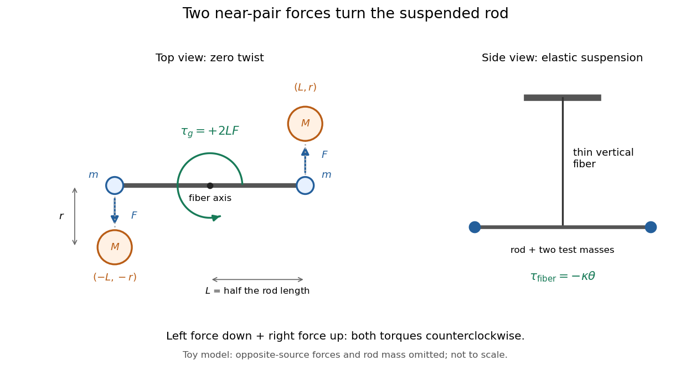

# Cavendish experiment

↑ **Parent:** [Newtonian gravitational field](newtonian-gravitational-field.md)  
ⓦ [Wiki](https://en.wikipedia.org/wiki/Cavendish_experiment)

The [Cavendish experiment](cavendish-experiment.md) makes the attraction predicted by [Newton's law of universal gravitation](newton-s-law-of-universal-gravitation-split.md) measurable between laboratory [masses](mass.md). Two small test [masses](mass.md) hang at the ends of a horizontal rod in a [Cavendish torsion balance](cavendish-torsion-balance.md); nearby larger source [masses](mass.md) exert a tiny [torque](torque.md). A thin suspension fiber supplies an opposing [torque](torque.md) as it twists. Measuring its twist and calibrating its [torsion constant](torsion-constant.md) lets an experimenter infer the gravitational [force](force-split.md) and, in a modern analysis, the [gravitational constant](gravitational-constant.md). [University of Connecticut, Physics 258/259, The Cavendish Experiment: apparatus and equations of motion, pp. 1–3](https://www.phys.uconn.edu/~hamilton/phys258/N/cav.pdf)

The beautiful feature is that the two horizontal [forces](force-split.md) can cancel as vectors while their [torques](torque.md) add. The instrument converts weak attraction into a rotation, with sensitivity set by the fiber's [torsion constant](torsion-constant.md). Earth's much larger downward [gravitational weight](weight-physics.md) is supported by the suspension rather than supplying the intended [torque](torque.md) about its vertical axis. A laboratory measurement can therefore probe the same [Newtonian gravitational field](newtonian-gravitational-field.md) that governs the [two-body problem](two-body-problem.md).

Henry Cavendish's original paper was _Experiments to determine the Density of the Earth_, published in _Philosophical Transactions_, volume 88 (1798), pp. 469–526, and read on 21 June 1798. On p. 469 he credits John Michell with the apparatus idea and explains that Michell died before using it; the instrument reached Cavendish through Francis John Hyde Wollaston. Cavendish's stated aim was Earth's mean [mass density](density.md). Calling the experiment a determination of the [gravitational constant](gravitational-constant.md) is a modern interpretation, not Cavendish's own formulation of his result. [Cavendish (1798), original paper, opening p. 469; DOI 10.1098/rstl.1798.0022](https://www.famaf.unc.edu.ar/~wolf/FisicaI/Phil.%20Trans.%20R.%20Soc.%20Lond.-1798-Cavendish-rstl.1798.0022.pdf)

The connection between Earth's mean [mass density](density.md) and the [gravitational constant](gravitational-constant.md) follows in a spherical, nonrotating model of [Earth](earth.md). With Earth [mass](mass.md) $M_E$, radius $R_E$, and surface [gravitational acceleration](gravitational-acceleration.md) $g$, the [spherical shell theorem](spherical-shell-theorem.md) and [Newton's law of universal gravitation](newton-s-law-of-universal-gravitation-split.md) give

$$
g=\frac{GM_E}{R_E^2},\qquad \overline\rho_E=\frac{3M_E}{4\pi R_E^3},\qquad G=\frac{3g}{4\pi R_E\overline\rho_E}.
$$

Thus a local comparison of gravitational attractions, together with knowledge of Earth's size and surface [gravitational acceleration](gravitational-acceleration.md), reaches a property of the entire planet. These are modern equations explaining the connection, not equations quoted from Cavendish's paper.

For a worked example, use an explicitly simplified two-near-pair model. Each test [point mass](point-mass.md) is $m$, each source [point mass](point-mass.md) is $M$, and each [lever arm](lever-arm.md) is $L$, so the rod's full [length](length.md) is $2L$. Neglect the rod's [mass](mass.md). At zero twist put the test [masses](mass.md) at $(-L,0)$ and $(L,0)$, and the sources at $(-L,-r)$ and $(L,r)$. Here $r$ is the near-pair center separation. Ignore each source's attraction on the test [mass](mass.md) at the opposite end. Evaluate the two near-pair [forces](force-split.md) at zero twist and treat their [torque](torque.md) as constant for a small twist, requiring $L|\theta|\ll r$. This is a teaching model, not a precision model of Cavendish's actual apparatus.

By [Newton's law of universal gravitation](newton-s-law-of-universal-gravitation-split.md), each retained [force](force-split.md) has magnitude $F=GmM/r^2$. The left [force](force-split.md) points down and the right [force](force-split.md) points up. Using [torque](torque.md) about the suspension axis, both contributions are counterclockwise when viewed from above:

$$
\tau_{z,\mathrm{left}}=(-L)(-F)=LF,\qquad \tau_{z,\mathrm{right}}=LF,\qquad |\tau_g|=2L\frac{GmM}{r^2}.
$$

The net retained horizontal [force](force-split.md) is zero, yet the net [torque](torque.md) is positive. Moving the sources to $(-L,r)$ and $(L,-r)$ reverses both [forces](force-split.md) and hence the [torque](torque.md). In a real apparatus, the opposite source also attracts each test [mass](mass.md); that correction is explicitly included in the university derivation. [University of Connecticut, The Cavendish Experiment, p. 2, equation (1): opposite-source correction](https://www.phys.uconn.edu/~hamilton/phys258/N/cav.pdf)

**[Figure 8](#image-two-near-pair-forces-give-the-same-counterclockwise-torque-about-a-vertical-suspension-fiber). Two near-pair forces give the same counterclockwise torque about a vertical suspension fiber**.

For illustrative parameters, take $m=0.010\,\mathrm{kg}$, $M=1.0\,\mathrm{kg}$, $r=0.050\,\mathrm m$, $L=0.10\,\mathrm m$, and [torsion constant](torsion-constant.md) $\kappa=1.0\times10^{-8}\,\mathrm{N\,m/rad}$. Use $G=6.67430\times10^{-11}\,\mathrm{m^3\,kg^{-1}\,s^{-2}}$, the central value in NIST's 2022 CODATA table; that table gives standard uncertainty $0.00015\times10^{-11}\,\mathrm{m^3\,kg^{-1}\,s^{-2}}$. This is an input for the example, not a measurement made with these assumed parameters. [Fundamental Physical Constants — Complete Listing by National Institute of Standards and Technology and others](fundamental-physical-constants-complete-listing-by-national-institute-of-standards-and-technology-and-others.md)

$$
F=\frac{(6.67430\times10^{-11})(0.010)(1.0)}{(0.050)^2}=2.66972\times10^{-10}\,\mathrm N,\qquad |\tau_g|=2(0.10)F=5.33944\times10^{-11}\,\mathrm{N\,m}.
$$

This sub-nanonewton [force](force-split.md) produces a measurable twist in the [Cavendish torsion balance](cavendish-torsion-balance.md). The displayed digits make the toy calculation reproducible; they do not describe experimental precision.

**Table of contents**

- [Cavendish torsion balance](cavendish-torsion-balance.md)

## ↑ Ancestors (6)

1. [Newtonian gravitational field](newtonian-gravitational-field.md)
2. [Newton's law of universal gravitation](newton-s-law-of-universal-gravitation-split.md)
3. [Classical mechanics](classical-mechanics-split.md)
4. [Branches of physics](branches-of-physics.md)
5. [Physics](physics-split.md)
6. [Codex Wiki](split.md)

## ← Incoming links (3)

- [Cavendish experiment](cavendish-experiment.md)
- [Cavendish torsion balance](cavendish-torsion-balance.md)
- [Gravitational constant measurement sensitivity](gravitational-constant-measurement-sensitivity.md)
