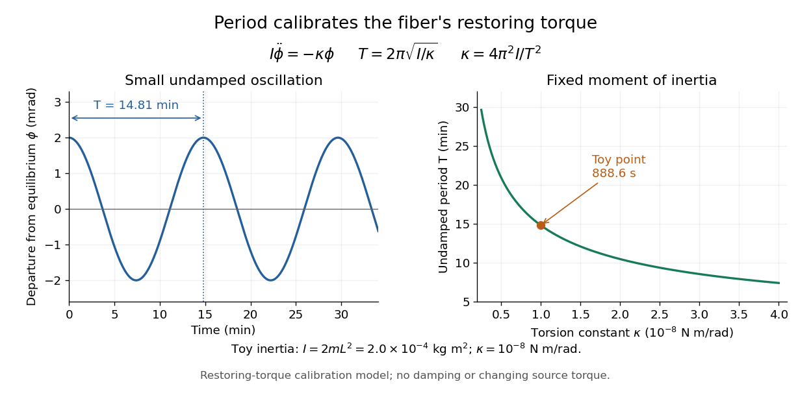

# Cavendish torsion balance

↑ **Parent:** [Cavendish experiment](cavendish-experiment.md)

A [Cavendish torsion balance](cavendish-torsion-balance.md) is a [torsion balance](torsion-balance.md) arranged to measure gravitational [torque](torque.md) from nearby source [masses](mass.md). Its suspended horizontal rod rotates about a vertical fiber. In the linear elastic regime, a twist [angle](angle.md) $\theta$, measured from the fiber's untwisted orientation, gives a restoring [torque](torque.md) $\tau_{\mathrm{fiber}}=-\kappa\theta$, where $\kappa>0$ is the [torsion constant](torsion-constant.md). The minus sign is essential: the fiber resists the twist. Under an approximately constant gravitational [torque](torque.md), the rotational equation using [moment of inertia](moment-of-inertia.md) $I$ and [angular acceleration](angular-acceleration.md) $\ddot\theta$ is

$$
I\ddot\theta=\tau_g-\kappa\theta,\qquad \theta_{\mathrm{eq}}=\frac{\tau_g}{\kappa}.
$$

At [equilibrium](equilibrium-point-of-a-dynamical-system.md), the two [torques](torque.md) balance. The [angle](angle.md) is a displacement from the fiber's reference orientation, not the largest excursion during an [oscillation](oscillation.md). [University of Connecticut, The Cavendish Experiment, pp. 2–3: restoring torque and equilibrium deflection](https://www.phys.uconn.edu/~hamilton/phys258/N/cav.pdf)

For the toy parameters in the [Cavendish experiment](cavendish-experiment.md), the predicted [equilibrium](equilibrium-point-of-a-dynamical-system.md) twist is

$$
\theta_{\mathrm{eq}}=\frac{5.33944\times10^{-11}}{1.0\times10^{-8}}=0.00533944\,\mathrm{rad}\simeq0.3059^\circ.
$$

Here $L|\theta_{\mathrm{eq}}|/r\simeq0.0107$, consistent with using a small geometric displacement in the toy model, but not an estimate of its total [measurement error](measurement-error.md). Reversing the source positions ideally takes the [equilibrium](equilibrium-point-of-a-dynamical-system.md) [angle](angle.md) from $+\theta_{\mathrm{eq}}$ to $-\theta_{\mathrm{eq}}$: the magnitude of the change is $2|\theta_{\mathrm{eq}}|\simeq0.6119^\circ$. A stable zero offset then cancels in the difference. A real reading may track a reflected light spot; the [law of reflection](law-of-reflection.md) doubles a mirror's rotation in the outgoing beam, so the spot's angular change must not be confused with the rod's [angle](angle.md). [Harvard Natural Sciences Lecture Demonstrations, Cavendish Experiment: mirror readout and source reversal](https://sciencedemonstrations.fas.harvard.edu/presentations/cavendish-experiment)

How can the fiber's [torsion constant](torsion-constant.md) be found without already knowing the gravitational [force](force-split.md)? Measure the [oscillation period](period-of-an-oscillation.md) and calculate the [moment of inertia](moment-of-inertia.md). For the same toy rod, neglecting its [mass](mass.md) and treating both test [masses](mass.md) as [point masses](point-mass.md), $I=mL^2+mL^2=2mL^2$. With the source [torque](torque.md) absent or treated as constant, let $\phi=\theta-\theta_{\mathrm{eq}}$ be a small departure from [equilibrium](equilibrium-point-of-a-dynamical-system.md). Neglect [damping](damping.md) and any change of gravitational [torque](torque.md) with [angle](angle.md). The rotational equation becomes [simple harmonic motion](simple-harmonic-motion.md):

$$
I\ddot\phi+\kappa\phi=0,\qquad \phi(t)=A\cos(\omega t+\delta),\qquad \omega=\sqrt{\frac{\kappa}{I}},\qquad T=2\pi\sqrt{\frac I\kappa},\qquad \kappa=\frac{4\pi^2I}{T^2}.
$$

Here $A$ is the angular amplitude, $\delta$ specifies the initial phase, and $\omega$ is the [angular frequency](angular-frequency.md). A softer fiber gives a larger [equilibrium](equilibrium-point-of-a-dynamical-system.md) twist but also a longer [oscillation period](period-of-an-oscillation.md): greater sensitivity costs observation time. An undamped [oscillation](oscillation.md) does not settle at [equilibrium](equilibrium-point-of-a-dynamical-system.md); [damping](damping.md) is needed for settling. [University of Connecticut, The Cavendish Experiment, p. 3, equation (7): period calibration neglecting damping](https://www.phys.uconn.edu/~hamilton/phys258/N/cav.pdf)

The toy [moment of inertia](moment-of-inertia.md) and undamped [oscillation period](period-of-an-oscillation.md) are

$$
I=2(0.010)(0.10)^2=2.0\times10^{-4}\,\mathrm{kg\,m^2},\qquad T=2\pi\sqrt{\frac{2.0\times10^{-4}}{1.0\times10^{-8}}}\simeq888.5766\,\mathrm s\simeq14.81\,\mathrm{min}.
$$

Timing this [oscillation period](period-of-an-oscillation.md) would recover the assumed [torsion constant](torsion-constant.md). The units check explains the result: [torque](torque.md) divided by [torsion constant](torsion-constant.md) is an [angle](angle.md) in [radians](radian.md), and $I/\kappa$ has units of [time](time-in-physics.md) squared when [radians](radian.md) are treated as dimensionless in [SI](international-system-of-units.md).

**[Figure 9](#image-undamped-small-torsional-oscillations-calibrate-the-restoring-torque-a-softer-fiber-has-a-longer-period). Undamped small torsional oscillations calibrate the restoring torque: a softer fiber has a longer period**.

Combining the [equilibrium](equilibrium-point-of-a-dynamical-system.md) twist with the period calibration, the two-near-pair model would infer the [gravitational constant](gravitational-constant.md) as

$$
G=\frac{\kappa|\theta_{\mathrm{eq}}|r^2}{2LmM}=\frac{4\pi^2Lr^2|\theta_{\mathrm{eq}}|}{MT^2}.
$$

The test [mass](mass.md) cancels in the second expression because it enters both the gravitational [torque](torque.md) and the toy [moment of inertia](moment-of-inertia.md). If the measured quantity is the magnitude $|\Delta\theta|$ of the change between opposite source positions, use $|\theta_{\mathrm{eq}}|=|\Delta\theta|/2$. Substituting the toy twist and [oscillation period](period-of-an-oscillation.md) returns the input $G$; it is a consistency check, not independent experimental evidence.

The sensitivity of a [Cavendish torsion balance](cavendish-torsion-balance.md) also explains its practical difficulty. Air motion can exert unwanted [torque](torque.md); unequal [temperatures](temperature-split.md) can drive that motion. Cavendish discusses this effect on p. 471 and describes observing from outside a closed room to avoid disturbing the instrument. [Cavendish (1798), original paper, p. 471: temperature-driven air currents and remote observation](https://www.infinitoteatrodelcosmo.it/wp-content/uploads/2021/07/cavendish-1997-xxi-experiments-to-determine-the-density-of-the-earth.pdf) Mechanical vibrations can excite the same slow [oscillations](oscillation.md) used to calibrate the [torsion constant](torsion-constant.md), while changes in the fiber or source separations alter the inferred [force](force-split.md). Precision therefore depends on resolving the [equilibrium](equilibrium-point-of-a-dynamical-system.md) [angle](angle.md), calibrating the full suspended [moment of inertia](moment-of-inertia.md) and [torsion constant](torsion-constant.md), and modeling the actual source geometry. The two-near-pair model omits opposite-source attraction, rod contributions, finite-size effects, [damping](damping.md), and the variation of gravitational [torque](torque.md) as the rod turns. [Harvard Cavendish demonstration: sensitivity, settling, and separation-dependent measurement](https://sciencedemonstrations.fas.harvard.edu/presentations/cavendish-experiment)

## ↑ Ancestors (7)

1. [Cavendish experiment](cavendish-experiment.md)
2. [Newtonian gravitational field](newtonian-gravitational-field.md)
3. [Newton's law of universal gravitation](newton-s-law-of-universal-gravitation-split.md)
4. [Classical mechanics](classical-mechanics-split.md)
5. [Branches of physics](branches-of-physics.md)
6. [Physics](physics-split.md)
7. [Codex Wiki](split.md)

## ← Incoming links (4)

- [Cavendish experiment](cavendish-experiment.md)
- [Cavendish torsion balance](cavendish-torsion-balance.md)
- [Solution](past-exam-of-the-mathematics-course-of-the-university-of-cambridge/2024/iii/paper-325/3/a/solution.md)
- [Torsion balance](torsion-balance.md)
