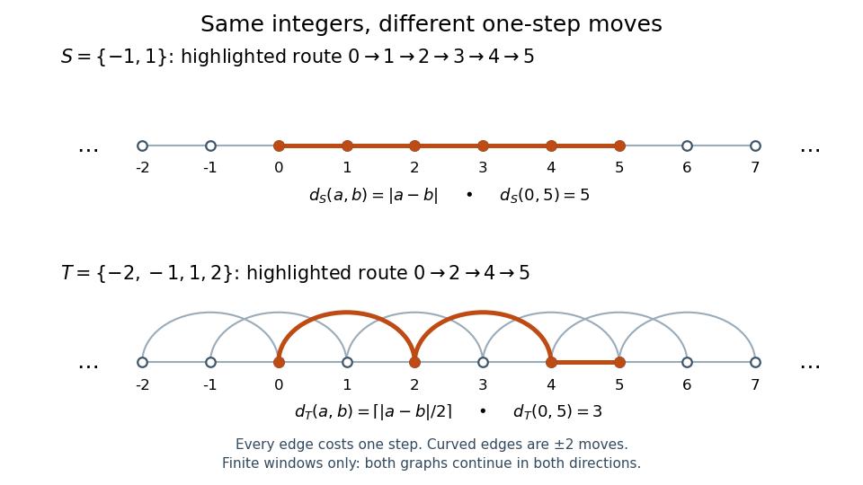

# Cayley graphs of the integers

↑ **Parent:** [Cayley graph](cayley-graph.md)

For the additive [infinite cyclic group](infinite-cyclic-group.md) $\mathbb Z$, the [generating set of a group](generating-set-of-a-group.md) $S=\{-1,1\}$ produces the infinite line: each [integer](integer-split.md) $n$ is adjacent to $n-1$ and $n+1$. Adding the moves $\pm2$ gives $T=\{-2,-1,1,2\}$ and additional [edges](edge-of-a-graph.md) skipping one [vertex](vertex-graph-theory.md). Each skip still costs one step in the [word metric](word-metric.md).

For [integers](integer-split.md) $a,b$, these [word metrics](word-metric.md) are

$$
d_S(a,b)=|a-b|,\qquad d_T(a,b)=\left\lceil\frac{|a-b|}{2}\right\rceil.
$$

The [absolute value](absolute-value.md) counts unit moves, and the [ceiling function](ceiling-function.md) counts pairs plus a possible leftover unit. Every $T$-move changes the [integer](integer-split.md) by at most two, while moves of size two followed by at most one move of size one attain this bound. For example, the [graph path](path-in-a-graph.md) $0,1,2,3,4,5$ has five steps for $S$, while $0,2,4,5$ has three for $T$. This calculation gives the concrete comparison

$$
d_T(a,b)\leq d_S(a,b)\leq2d_T(a,b).
$$

**[Figure 1](#image-two-cayley-graphs-of-the-integers-unit-moves-need-five-steps-from-zero-to-five-adding-moves-of-size-two-needs-three). Two Cayley graphs of the integers: unit moves need five steps from zero to five; adding moves of size two needs three**.

The picture shows only a finite window of each infinite [Cayley graph](cayley-graph.md). By contrast, $U=\{-2,2\}$ alone fails to be a [generating set of a group](generating-set-of-a-group.md) for $\mathbb Z$: it generates the [subgroup](subgroup.md) $2\mathbb Z$. Its move [graph](graph-split.md) has two [connected components of a graph](component-graph-theory.md), the [even integers](even-number.md) and the [odd integers](odd-integer.md). Within either component the [graph distance](distance-graph-theory.md) is $|a-b|/2$; between different components no finite [graph path](path-in-a-graph.md) exists. Adding a shortcut is different from deleting the moves needed for [connectivity](connectivity-graph-theory.md).

## ↑ Ancestors (6)

1. [Cayley graph](cayley-graph.md)
2. [Geometric group theory](geometric-group-theory-split.md)
3. [Geometry and topology](geometry-and-topology-split.md)
4. [Area of mathematics](area-of-mathematics.md)
5. [Mathematics](mathematics-split.md)
6. [Codex Wiki](split.md)

## ← Incoming links (5)

- [Cayley graph](cayley-graph.md)
- [Cayley graphs of the integers](cayley-graphs-of-the-integers.md)
- [Equivalence of finite word metrics](equivalence-of-finite-word-metrics.md)
- [Word length](word-length.md)
- [Word metric](word-metric.md)
