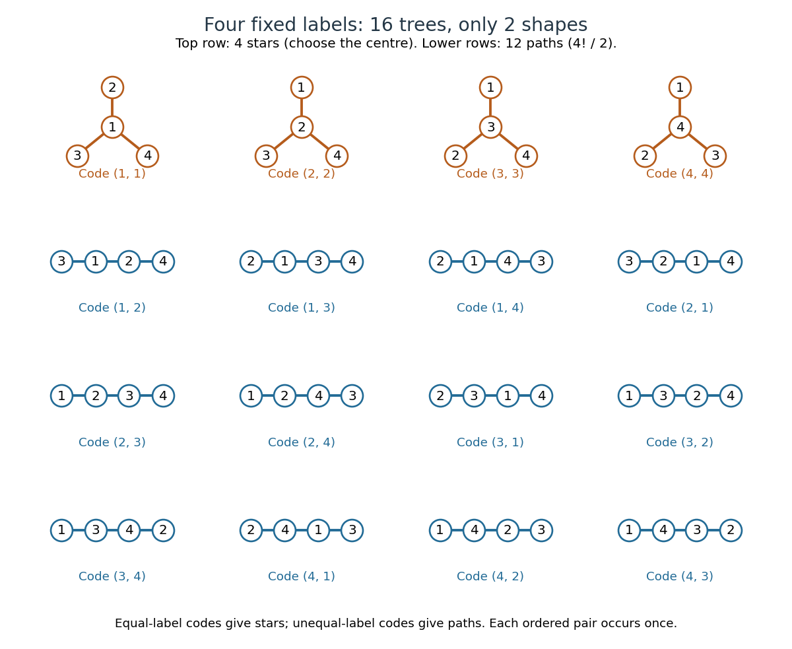

<h1 id="cayley-s-formula">Cayley's formula</h1>

↑ **Parent:** [Tree (graph theory)](tree-graph-theory.md)  
ⓦ [Wiki](https://en.wikipedia.org/wiki/Cayley's_formula)

For an integer $n\geq2$, let $\mathcal T_n$ be the set of [labelled trees](labelled-tree.md) with fixed [vertex set](vertex-set.md) $\{1,\ldots,n\}$. Each [tree](tree-graph-theory.md) is a finite [simple graph](simple-graph.md), with no distinguished [root of a tree](root-of-a-tree.md), and two [trees](tree-graph-theory.md) are different exactly when their sets of [edges](edge-of-a-graph.md) differ. Then

$$
|\mathcal T_n|=n^{n-2}.
$$

Equivalently, this is the number of [spanning trees](spanning-tree.md) of the [complete graph](complete-graph.md) $K_n$. The [labelled combinatorial structure](labelled-combinatorial-structure.md) includes the fixed labels: drawings, positions, and the order in which [edges](edge-of-a-graph.md) are listed do not create extra [trees](tree-graph-theory.md). For $n=1$, the single [vertex](vertex-graph-theory.md) with no [edges](edge-of-a-graph.md) is the unique [tree](tree-graph-theory.md); count it separately, since the [Prüfer sequence](prufer-sequence.md) construction requires $n\geq2$. For $n=2$, the unique [tree](tree-graph-theory.md) has [edge](edge-of-a-graph.md) $\{1,2\}$ and corresponds to the empty [Prüfer sequence](prufer-sequence.md). [Peter Magyar, Michigan State University, Math 481: Cayley's theorem and inverse Prüfer transformations](https://users.math.msu.edu/users/magyarp/math481/)

For four fixed labels, there are $4^2=16$ [labelled trees](labelled-tree.md), but only two [unlabelled trees](unlabelled-tree.md): the [star graph](star-graph-theory.md) and the [path graph](path-graph.md). There are four [star graphs](star-graph-theory.md), one for each choice of centre. There are $4!/2=12$ [path graphs](path-graph.md): arrange the labels along a [graph path](path-in-a-graph.md), then identify each ordering with its reversal, which describes the same set of [edges](edge-of-a-graph.md). Thus $4+12=16$. For instance, [star graphs](star-graph-theory.md) centred at $1$ and at $2$ have different sets of [edges](edge-of-a-graph.md) even though they have the same shape.

**[Figure 11](#image-all-sixteen-labelled-trees-on-four-fixed-vertices-four-star-graphs-and-twelve-path-graphs-each-with-its-prufer-sequence). All sixteen labelled trees on four fixed vertices: four star graphs and twelve path graphs, each with its Prüfer sequence**.

The striking point is that connectedness and the absence of a [graph cycle](cycle-in-a-graph.md) are global restrictions on [edges](edge-of-a-graph.md), yet the answer is a power with no correction factor. The [Prüfer sequence](prufer-sequence.md) supplies a [bijection](bijection.md) that turns those restrictions into $n-2$ freely chosen labels. The [rule of product](rule-of-product.md) then gives $n^{n-2}$ immediately. The same representation makes [vertex degrees](degree-graph-theory.md) easy to count and supports [uniform labelled tree generation](uniform-labelled-tree-generation.md) for simulations and algorithm experiments.

Arthur Cayley's 1889 paper "A theorem on trees", published in the Quarterly Journal of Pure and Applied Mathematics, volume 23, pages 376–378, treats the counting problem and its refinement by [vertex degrees](degree-graph-theory.md). It was reprinted as paper 895 in volume XIII of his Collected Mathematical Papers, pages 26–28. This publication is the historical context for the name [Cayley's formula](cayley-s-formula.md); the name alone is not a claim of priority. [Cayley, A theorem on trees (1889), original journal volume, pages 376–378](https://gdz.sub.uni-goettingen.de/id/PPN600494829_0023) [Cayley, A theorem on trees, collected-paper reprint and publisher's first-page preview](https://doi.org/10.1017/CBO9780511703799.010)

**Table of contents**

- [Labelled forest count with prescribed roots](labelled-forest-count-with-prescribed-roots.md)
- [Prüfer sequence](prufer-sequence.md)
  - [Prüfer degree formula](prufer-degree-formula.md)
    - [Labelled tree count with prescribed degrees](labelled-tree-count-with-prescribed-degrees.md)
  - [Uniform labelled tree generation](uniform-labelled-tree-generation.md)

## ↑ Ancestors (5)

1. [Tree (graph theory)](tree-graph-theory.md)
2. [Combinatorics](combinatorics-split.md)
3. [Area of mathematics](area-of-mathematics.md)
4. [Mathematics](mathematics-split.md)
5. [Codex Wiki](split.md)

## ← Incoming links (4)

- [Cayley's formula](cayley-s-formula.md)
- [Labelled tree](labelled-tree.md)
- [Prüfer sequence](prufer-sequence.md)
- [Unlabelled tree](unlabelled-tree.md)
